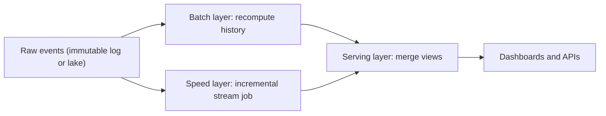
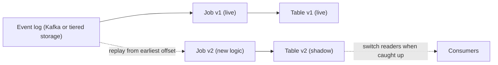

## 🎯 TL;DR

> **Lambda** keeps two paths for the same data: a **batch** path that recomputes the truth from history, and a **speed** (stream) path that gives fresh but provisional results. **Kappa** keeps one stream path and fixes mistakes by **replaying** the log.

- Lambda is correct but duplicates logic, and the two codebases drift apart. Kappa has one code path, but it needs a log you can replay and a job that can rebuild its state.
- Lakehouse tables and engines that run the same code in batch and streaming blur the line. The real question is: can one code path meet our latency, cost and history requirements?
- Decide with three questions: how far back must we reprocess, how fast must the answer be, and does the batch logic really differ from the stream logic?

## 🌱 Start simple (Junior)

> **💡 Analogy:** A newspaper with a live ticker and a print edition. The ticker reports the score as it happens (fast, may be corrected later). The print edition checks every play against the official record the next morning (slow, correct). Lambda is two desks with two teams. Kappa is one reporter who updates the live story and, when a mistake is found, replays the match from the recording.

Take one business question: **how many clicks did each ad get per minute?**

- **Batch:** every night, read yesterday's raw clicks and count. The answer is exact, but it arrives the next morning.
- **Stream:** count clicks as they arrive and update the number every few seconds. The answer is fast, but a late event or a restart can make it slightly wrong.

Here is what the two paths can disagree on for one ad, one minute:

```text
Real clicks for ad A, minute 10:00                  : 100
Stream count shown at 10:01 (one click arrived late): 99
Batch count next morning                            : 100
```

Lambda keeps both paths and shows the batch number once it exists. Kappa says: keep only the stream path, and when the logic changes, replay the old events through the new version.

## 🔧 How it really works (Mid)

**Lambda** has three layers. The raw events are the **master dataset**: append-only, never edited. Everything else is derived from it.



- The **batch view** is complete and exact up to a cut-off (for example, all days before today).
- The **real-time view** covers only what the batch has not reached yet (today). It is thrown away when the batch catches up.
- The serving layer answers with "batch view for days before today, real-time view for today".

A sketch of that merge rule (illustrative PostgreSQL-style SQL):

```sql
CREATE VIEW clicks_per_minute AS
SELECT window_start, ad_id, clicks
FROM batch_clicks_minute
WHERE window_start <  DATE_TRUNC('day', now())
UNION ALL
SELECT window_start, ad_id, clicks
FROM speed_clicks_minute
WHERE window_start >= DATE_TRUNC('day', now());
```

**Kappa** has one path. Reprocessing is a replay, not a second pipeline:



A safe Kappa reprocessing sequence:

1. Deploy job v2 that reads from the **earliest retained offset** and writes to a **new** output table. Never write into the live table.
2. Let v2 catch up to the head of the log. Watch consumer lag until it reaches zero.
3. Compare v1 and v2: a daily control total and a sample of keys.
4. Point readers to v2 (switch a view or a config value). Keep v1 for a grace period so you can roll back, then drop it.

The same business logic can be shared between a batch job and a streaming job, so that the two paths cannot drift:

```python
from pyspark.sql import DataFrame, functions as F

click_schema = "event_id STRING, ad_id STRING, event_time TIMESTAMP"

def minute_counts(events: DataFrame) -> DataFrame:
    # One definition of the business rule, used for batch and streaming input.
    return (events
        .groupBy(F.window("event_time", "1 minute").alias("w"), "ad_id")
        .agg(F.count("*").alias("clicks"))
        .select(F.col("w.start").alias("window_start"), "ad_id", "clicks"))

# Batch: exact, used for reprocessing and for the batch view
batch_out = minute_counts(spark.read.parquet("s3://lake/clicks/"))

# Streaming: fresh; the watermark lets Spark drop state for old windows
stream_in = (spark.readStream.format("kafka")
    .option("kafka.bootstrap.servers", "broker:9092")
    .option("subscribe", "clicks.raw")
    .load()
    .select(F.from_json(F.col("value").cast("string"), click_schema).alias("e"))
    .select("e.*")
    .withWatermark("event_time", "5 minutes"))

query = (minute_counts(stream_in).writeStream
    .outputMode("append")      # a window is emitted once, after the watermark passes it
    .format("console")         # demo sink; use a lakehouse or OLAP sink in production
    .start())
```

Notice what is shared (the rule) and what is not (the source, the watermark, the output mode). That split is the practical core of "lambda done right". See [[watermark]] and [[late-arriving-data]] for why the watermark exists.

## 🧠 Senior depth & trade-offs

**Lambda failure modes**

- **Drift.** Two implementations of "a click" (bot filter, timezone, deduplication) slowly diverge. The dashboard then changes its numbers when the batch overwrites the stream result, and users lose trust. Mitigation: a shared module (as above) plus a reconciliation job ([[pattern-reconciliation]]).
- **Double cost.** Two clusters, two on-call rotations, two sets of tests.
- **Silent overwrite.** A batch correction that changes numbers already sent to customers needs a communication plan, not only a fix.

**Kappa failure modes**

- **Replay storms.** Replaying 90 days into a sink or an API can exceed its capacity. Throttle the replay, and run it on separate consumer groups.
- **Non-idempotent sinks.** A replay into an append-only table counts every event twice. Sinks must be upserts keyed by a business key, or you need exactly-once writes ([[pattern-exactly-once]], [[idempotency]]).
- **Non-deterministic logic.** Using `now()` or processing time inside the logic gives different results on each replay. Use event time carried in the record.
- **Schema evolution.** Old events must still parse with the new code. Schema registry and compatible changes are required, see [[schema-evolution]].
- **Retention.** The log must hold the history you need. Here is the arithmetic: 90 days at 125 GB/day is 11.25 TB. A single consumer that reads 200 MB/s needs `11,250,000 MB / 200 MB/s = 56,250 s`, about 15.6 hours, before any sink cost. A 7-day Kafka retention cannot replay that at all.

**The streaming lakehouse.** When the log is too short, store raw events in an open table format such as [[iceberg]] or [[delta-lake]]. Replay becomes a batch read of snapshots, and incremental streaming reads pick up new snapshots. This keeps the Kappa shape while removing the retention limit. The cost is small files and compaction work.

**When Lambda is still the right answer**

- Billing or regulated numbers must come from a batch path that is easy to audit, while dashboards use a stream. Many teams run "stream everything, batch overwrites the partition each night". That is a hybrid, and it is fine if you name it honestly.
- The exact batch computation is far cheaper than a stateful stream: a full scan of columnar files can beat keeping huge state in a stream job.
- The stream engine cannot express part of the logic (for example, complex joins against a large history).

**What to monitor:** consumer lag, watermark lag, replay progress, the v1 versus v2 control totals, state size per job, and the number of corrected rows after each batch run.

> **🎤 Say this in the interview:** "I start from three questions: the reprocessing horizon, the latency target, and whether the batch logic really differs from the stream logic. If one code path meets all three, I choose Kappa and keep the raw history in a replayable table. If billing needs an auditable batch path, I keep a batch layer but share the business code so the two cannot drift."

## 🧪 Try it

1. A stream job counts clicks per minute. The bot rule changes from "IP in blocklist" to "user agent matches a pattern". Describe the reprocessing plan. Hint: think about the old table and the replay target.
2. You must reprocess 30 days at 80 GB/day, and one consumer reads 150 MB/s. How long does the read take? Show the arithmetic.
3. Explain why the batch number for minute 10:00 can differ from the stream number, even when no event is lost.

<details><summary>Show solutions</summary>

**1.** Deploy job v2 with the new rule that reads from the earliest retained offset (or the lake snapshot) and writes to a new table. Do not touch the live table. When v2 has caught up, compare control totals per day, then switch readers, and keep v1 for a rollback window.

**2.** 30 × 80 GB = 2,400 GB = 2,400,000 MB. At 150 MB/s: 2,400,000 / 150 = 16,000 s, about 4.4 hours, before parallelism. Add more consumers or partitions to shorten it.

**3.** The stream result is provisional: it is emitted when the watermark passes, and it ignores events that arrive after the allowed lateness. The batch sees all events for the day, so late events are included. Both can be correct under their own rules, which is why the serving layer must say which one it shows.

</details>

## 💬 Interview corner

**Question: "Lambda or Kappa for our clickstream?"**

- **Mid answer:** "Kappa, because there is one code path, and I can fix bugs by replaying the Kafka topic."
- **Senior answer:** "It depends on three things. If we reprocess only the last week, Kafka retention is enough and Kappa is simple. If we need 90 days of history, the log must be longer-lived, so I'd land raw events in an open table format and replay from there. If billing needs an auditable exact number, I'd keep a batch path for billing and share the business logic so the dashboards and the bill cannot drift."

**Follow-up:** "How do you do a backfill in Kappa?" Answer with the shadow-table procedure from the Mid layer.

## ⚠️ Common mistakes

> **⚠️ Watch out:** A stream job plus a separate batch job written in another language is not Kappa. It is Lambda with one fewer layer. Name it correctly in the design.

> **⚠️ Watch out:** Replaying into the live table on an append-only sink doubles every count. Replay into a shadow table, or make the sink idempotent.

- Assuming Kafka retention equals your history. It usually does not.
- Using processing time in the logic, so replays give different answers.
- Calling a number "exact" in the stream layer when late events are dropped by design.
- Forgetting that a batch correction changes numbers that users already saw.
- Choosing Lambda by default out of habit, without checking whether the batch and stream logic really differ.

## ✅ Check yourself (quiz)

1. In Lambda, what is the role of the speed layer?
   - A) It is the only source of truth
   - B) It gives fresh, incremental, provisional results for recent data
   - C) It stores the raw events forever
   - D) It replaces the serving layer

<details><summary>Answer</summary>

**B** — the speed layer covers the window the batch has not reached yet. Its results are replaced when the batch catches up.

</details>

2. Why does a Kappa reprocessing job write to a **new** table instead of the live one?

   - A) Kafka does not allow two writers to one table
   - B) The live output stays untouched until v2 is validated, and v1 remains available for rollback
   - C) New tables are faster to write
   - D) Replays cannot write to existing tables

<details><summary>Answer</summary>

**B** — a shadow table lets you compare outputs and switch readers at a time you choose. Writing over the live table gives you no rollback and risks double counts.

</details>

3. **(Senior)** Your Kafka topic keeps 7 days, but the business asks for a 90-day reprocessing after a logic bug. What is the right design?

   - A) Increase the Kafka retention to 90 days on every topic, with no other change
   - B) Give up on the reprocessing and accept the bug in the history
   - C) Store raw events in a replayable lake table (for example Iceberg or Delta) and replay from it, with Kafka keeping the short live window
   - D) Run the replay against the live table, one day at a time

<details><summary>Answer</summary>

**C** — a lake table is cheap for long history and can be read in batch or incrementally. Option A is possible but expensive and still not a backfill design; D writes into the live table.

</details>

4. **(Senior)** A replay into an append-only table doubles the revenue in the sink. What is the most likely cause, and what is the fix?

   - A) The stream engine has a bug in windowing
   - B) The sink is not idempotent, so events processed again are added again; use upserts keyed by a business key or an exactly-once sink
   - C) The replay used too many partitions
   - D) Watermarks were set too low

<details><summary>Answer</summary>

**B** — at-least-once replay re-delivers events. An append-only sink stores each delivery, so the totals double. The fix is an idempotent write keyed by a stable business key.

</details>

5. **(Senior)** Why must replay logic use event time and not processing time?

   - A) Processing time is not available in Spark
   - B) Event time is fixed in the record, so the same input gives the same windows on every run; processing time changes with the replay speed
   - C) Event time is always faster
   - D) Processing time cannot be used with watermarks

<details><summary>Answer</summary>

**B** — determinism is what makes a replay comparable to the original run. Processing time depends on when the code runs.

</details>

## 🗂️ Flashcards

| Front | Back |
|---|---|
| Lambda architecture | Batch layer (exact, recomputed) + speed layer (fresh, incremental) + serving layer that merges them |
| Kappa architecture | One stream path; reprocessing is a replay of the log into a new version |
| Master dataset | The immutable raw events that every view is derived from |
| Why a shadow table in Kappa | Validate the new output and keep a rollback before switching readers |
| Main Lambda risk | Drift between two implementations of the same business rule |
| Main Kappa risk | Replays into non-idempotent sinks double-count |
| Why a replay needs event time | Event time is in the record; processing time changes with each run |
| Streaming lakehouse | Raw events in Iceberg or Delta, so replay is not limited by Kafka retention |

## 🔗 Go further

- [[lambda-kappa]] covers the architecture overview; this lesson is about choosing and operating it.
- [[pattern-reconciliation]] is how the two numbers are compared in production.
- [[pattern-backfill]] and [[backfills]] explain the mechanics of rerunning history.
- [[pattern-late-data]] and [[pattern-realtime-aggregation]] cover the watermark and window decisions used by the speed layer.
- [[lakehouse-table-formats]] explains why the lake can act as a replayable log.
