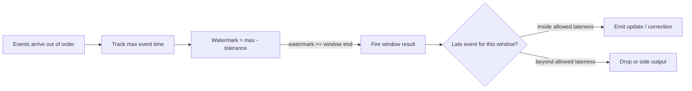

## 🎯 TL;DR

> In a stream, events do not arrive in the order they happened. A phone sends its tap after it regains signal, a retry sends an old event again, a partition lags behind the others. A **watermark** says "I no longer expect events older than this time", so a window can close and publish. **Allowed lateness** keeps a closed window open for a while, so late events can **correct** the published result. Anything later than that is dropped or sent to a side channel, and a **nightly batch** is the final word.

- **Event time** (when it happened) is what windows must use. **Processing time** (when the job saw it) is only for operations.
- A **watermark** is a moving estimate: the newest event time seen, minus the disorder you tolerate.
- **Allowed lateness** trades memory and extra output updates for correctness.
- The sink must accept **updates** (upserts keyed by window and key), or the corrections are lost or doubled.
- Real-time output is **provisional**. Reconcile it with the batch result and say so in the data.

## 🌱 Start simple (Junior)

> **💡 Analogy:** A school collects homework and marks the class average for "Week 3" once the teacher believes everyone has handed in. Some students are slow. The teacher waits a little, then announces the average. If a student hands in late next day, the teacher can **update** the average, but only for a few days. After that the grade book is closed. The **watermark** is the teacher's rule for "I think everyone from Week 3 has handed in by now". **Allowed lateness** is the extra days the teacher keeps the book open.

Here are four click events. Each has an **event time** (when the user clicked) and an arrival order (when the server received them):

```text
arrival 1: event_time 00:00:05
arrival 2: event_time 00:00:30
arrival 3: event_time 00:01:10   <- the next minute has started
arrival 4: event_time 00:00:20   <- this one is late: it belongs to minute 0
```

If you count minute 0 as soon as minute 1 starts, the count for minute 0 is wrong. Event 4 arrived after the minute-0 result was already published. The question for the design is: **how long do we wait, and what do we do with event 4?**

Two rules solve it:

1. Use the event time, not the arrival time, to decide which minute an event belongs to.
2. Decide a waiting rule (the watermark) and a correction rule (allowed lateness), and write both down.

## 🔧 How it really works (Mid)

### Event time, processing time and the watermark

A stream engine tracks **event time** for each partition or source. The watermark is derived from it:

```text
watermark = max(event_time seen so far) - allowed_out_of_orderness
```

With an allowed disorder of 10 seconds, after seeing an event at `10:01:10`, the watermark is `10:01:00`. The engine reads it as: "I do not expect events older than `10:01:00` anymore." A window `[10:00, 10:01)` closes when the watermark reaches its end.



The trade-off is in one number, the tolerance:

- **Too small:** windows close too early, and good events are treated as late. Counts are wrong, and corrections come often.
- **Too large:** results are delayed by the tolerance, and state stays open longer. Freshness suffers.

Measure the real delay before you pick it. Compare `event_time` with `ingest_time` (when the event entered Kafka) for the 99th and 99.9th percentile per source. A mobile source may need minutes or hours of tolerance, a server log may need seconds.

### A runnable simulation

The rules are easier to see in code than in prose. This plain Python program runs the watermark logic with a 60-second window, a 10-second tolerance and a 120-second allowed lateness. It needs no framework:

```python
WINDOW = 60             # tumbling window size (seconds)
OUT_OF_ORDER = 10       # watermark = max event time seen - 10
ALLOWED_LATENESS = 120  # keep a window open this long after the watermark passes its end

arrivals = [5, 30, 70, 20, 100, 50, 200, 65, 5]  # event times, in arrival order

counts = {}             # window start -> count
fired = set()           # windows already emitted once
max_seen = float("-inf")

for t in arrivals:
    w = t - t % WINDOW
    watermark = max_seen - OUT_OF_ORDER
    if watermark >= w + WINDOW + ALLOWED_LATENESS:
        print(f"t={t:>3}  DROP   window {w} is closed (wm={watermark})")
        continue
    counts[w] = counts.get(w, 0) + 1
    if w in fired:
        print(f"t={t:>3}  UPDATE window {w} -> {counts[w]}")
    max_seen = max(max_seen, t)
    watermark = max_seen - OUT_OF_ORDER
    for win in sorted(counts):
        if win not in fired and watermark >= win + WINDOW:
            fired.add(win)
            print(f"t={t:>3}  EMIT   window {win} -> {counts[win]} (wm={watermark})")
```

Its output:

```text
t= 70  EMIT   window 0 -> 2 (wm=60)
t= 20  UPDATE window 0 -> 3
t= 50  UPDATE window 0 -> 4
t=200  EMIT   window 60 -> 2 (wm=190)
t= 65  UPDATE window 60 -> 3
t=  5  DROP   window 0 is closed (wm=190)
```

Read it line by line:

- Event `70` moves the watermark to `60`, which closes window `0` (`[0, 60)`). The first result is emitted with count 2.
- Events `20` and `50` arrive late, but still inside the allowed lateness. Each one **updates** the published count (3, then 4).
- Event `200` moves the watermark to `190`. Window `60` closes and is emitted with 2. Window `0` is now past its lateness limit (`0 + 60 + 120 = 180`).
- Event `65` is late for window `60`, which is still open, so it is an update.
- The final event `5` arrives when the watermark is `190`, beyond the limit for window `0`. It is dropped. A real system would send it to a side output for a repair job.

### How real engines do it

- **Flink** tracks watermarks per source and per operator. Flink SQL window functions (`TUMBLE`, `HOP`) drop events that arrive after the watermark has passed their window. The DataStream API lets you set an allowed lateness on a window and send late events to a **side output**. Check the option names for your Flink version.
- **Spark Structured Streaming** uses `withWatermark` on the event-time column. Events older than the watermark are dropped from aggregations, and state for old windows is cleaned up.
- **Kafka** does not know about event time. The consumer (or the engine above it) must decide the watermark. Partition skew makes this harder: the slowest partition holds back the global watermark.

### Updating earlier results

A window can be emitted more than once. The sink must accept that. Three common designs:

| Sink design | Behaviour on a correction | Risk |
|---|---|---|
| **Upsert by key** `(window_start, url)` | Overwrites the row with the newest total | Needs a unique key; the newest result must be the one kept |
| **Append with version** `(window_start, url, emitted_at)` | Adds a new version; readers take the latest | Readers must dedupe; storage grows |
| **Append only** (no key) | Adds a second row for the same window | Double counting, the most common bug |

Upserts keyed by the window are the usual answer, because a replay after a restart then writes the same row again.

## 🧠 Senior depth & trade-offs

- **Correctness contract first.** Write down three numbers before the design: the tolerance (how late an event may be and still count in the real-time number), the lateness (how long a published number may still change), and the **reconciliation window** (how long until the batch result is final). Everything else follows.
- **Lateness distribution, not a single number.** A tolerance that covers 99 percent of events may still drop 1 percent of traffic every hour. For money, fraud or billing, decide whether a 0.1 percent drop is acceptable, and measure it on the batch side.
- **State and memory.** Allowed lateness keeps every open window in state. The memory cost is about (number of keys) × (open windows) × (bytes per accumulator). A long lateness with a high-cardinality key can exhaust the state backend. See [[streaming-state]].
- **Idle sources stall the watermark.** A partition with no traffic does not advance its watermark, so the global watermark stops and no window closes. Use an idle-source timeout, or treat idle partitions as finished. This is a common production incident.
- **Exactly-once is not the same as correct under lateness.** Checkpoints make the job's state consistent after a failure. They do not decide whether an event is late. Keep the two concerns apart when you explain the design. See [[delivery-semantics]].
- **Reconciliation with the nightly batch.** Treat the stream as provisional. Each nightly batch recomputes the last few days from raw data (see [[pattern-batch-etl]]) and overwrites the same keys in the serving table, with a marker such as `source = 'batch'`. Then compare: for each window, the difference between stream and batch should be within an agreed tolerance. Alert when it is not, because a growing difference is a sign of a broken watermark or a broken sink. See [[pattern-reconciliation]].
- **Dropped events are data.** Count them. A side output of late events, stored with the event time and the lateness, lets you run a targeted backfill and measure the loss.
- **Monitoring.** Watermark lag (wall clock minus watermark), the number of late and dropped events per source, update rate per window, state size, and the reconciliation difference per day.
- **When not to use real-time correction.** If the business only needs a daily number, do not build a watermark system. Use the batch pipeline and accept that the number arrives tomorrow. Real-time with corrections is worth its cost only when someone acts on the number within minutes.
- **Lambda and Kappa.** The stream gives the fast, provisional answer; batch gives the final one. Kappa keeps one code path by replaying the stream; Lambda keeps two. See [[pattern-lambda-kappa]].

## 🧪 Try it

Use the simulation in this lesson, and the arrival list `[5, 30, 70, 20, 100, 50, 200, 65, 5]`.

1. **Change the tolerance.** Set `OUT_OF_ORDER = 0` and run the program again. Which events are now dropped or emitted at a different time, and why?
2. **Find the drop.** Without running the code, decide whether the event `65` would be dropped if `ALLOWED_LATENESS` were `60`. Show the arithmetic.
3. **Design the sink.** A dashboard shows views per minute from the stream and the batch recomputes last night's numbers. Write the upsert key, one extra column that tells the two sources apart, and the SQL that keeps the batch result when both exist for the same minute.

<details><summary>Show solutions</summary>

**1.** With `OUT_OF_ORDER = 0` the output is:
```text
t= 70  EMIT   window 0 -> 2 (wm=70)
t= 20  UPDATE window 0 -> 3
t= 50  UPDATE window 0 -> 4
t=200  EMIT   window 60 -> 2 (wm=200)
t= 65  UPDATE window 60 -> 3
t=  5  DROP   window 0 is closed (wm=200)
```
The same events are updates or drops, but the watermark values are higher, so windows close earlier relative to the newest data. The lesson: a smaller tolerance does not change which late events are accepted here, because the allowed lateness does the work. It does mean less waiting before the first emit, and on real data a smaller tolerance also means more events fall past the watermark entirely.

**2.** The window for `65` is `[60, 120)`. Its close test is `watermark >= 60 + 60 + ALLOWED_LATENESS`. When event `65` arrives, the watermark is `190`. With `ALLOWED_LATENESS = 60`, the limit is `60 + 60 + 60 = 180`, and `190 >= 180`, so the event is dropped. With `120`, the limit is `240`, and `190 < 240`, so it is accepted as an update.

**3.**
```sql
-- Target table: one row per minute and URL, plus the source of the number
CREATE TABLE views_minute (
  minute  TIMESTAMP,
  url     STRING,
  views   BIGINT,
  source  STRING,          -- 'stream' or 'batch'
  PRIMARY KEY (minute, url) NOT ENFORCED
);

-- Batch writes its result with source = 'batch'; the upsert replaces the stream row.
-- Stream writes source = 'stream' only where no batch row exists yet:
INSERT INTO views_minute
SELECT s.minute, s.url, s.views, 'stream'
FROM stream_views s
WHERE NOT EXISTS (
  SELECT 1 FROM batch_views b WHERE b.minute = s.minute AND b.url = s.url
);
```
The rule "batch wins" is written in the data, so readers can see which numbers are final. In a real system the stream write would be a different upsert path; the point is the key and the source column.

</details>

## 💬 Interview corner

**Question: "An event arrives two hours late. What happens to your hourly aggregate?"**

Mid answer: "If the watermark has passed that hour, the event is dropped or sent to a side output. Otherwise it updates the aggregate."

Senior answer: "It depends on the contract. With a tolerance of, say, 2 minutes and an allowed lateness of 10 minutes, a two-hour-late event is dropped from the real-time number and goes to a side output. A daily batch recomputes that hour from raw data, so the final number is right. I'd measure how many events arrive that late, and if it is above the agreed loss, I'd either raise the tolerance for that source or accept a longer reconciliation window. I'd make sure the sink is keyed by window so corrections overwrite and do not double-count."

**Question: "How do you choose the watermark delay?"** Start from the measured lateness distribution per source, not a guess. Pick the value that covers the traffic you can afford to be late, then pair it with an allowed lateness and a batch reconciliation. A higher delay costs freshness and state; a lower one costs accuracy.

> **🎤 Say this in the interview:** "Windows use event time. The watermark is my bounded guess of how late events can be, and it decides when a number is published. Allowed lateness decides how long that number can still be corrected. Anything beyond that goes to a side output, and the nightly batch is the final answer, so the sink must support updates."

## ⚠️ Common mistakes

> **⚠️ Watch out:** Using processing time for windows. Events from a mobile app that was offline for an hour land in the wrong bucket, and the bug looks like random noise.

> **⚠️ Watch out:** An append-only sink with allowed lateness. Each correction adds a row, and the dashboard double counts. Corrections need an upsert key or a version column.

- Choosing the watermark tolerance by intuition. Measure the lateness distribution first.
- Forgetting idle partitions. One silent partition freezes the global watermark, and no window ever closes.
- Assuming exactly-once means no late data. Exactly-once is about processing once; lateness is about event time.
- Dropping late events silently. Count them and keep them in a side output.
- Treating the real-time number as final in reports. Label it as provisional until the batch run has reconciled it.
- Setting a huge allowed lateness "to be safe" without checking the state size.

## ✅ Check yourself (quiz)

1. A window `[10:00, 10:01)` has a watermark of `10:01:05`. What happens to the window?
   - A) It is still open, because the watermark must equal the window end exactly
   - B) It has closed; events for it are now late and handled by allowed lateness or dropped
   - C) It is deleted from state immediately, including late events
   - D) It restarts at `10:01`

<details><summary>Answer</summary>

**B** — the watermark has passed the window end, so the window fired. New events for it are late. Whether they still update the result depends on the allowed lateness; after that they are dropped or sent to a side output.

</details>

2. Why must windows use event time rather than processing time?

   - A) Processing time is not stored in the database
   - B) Network and queue delays move events into the wrong windows when they use arrival time; event time reflects when the thing happened
   - C) Event time is always faster
   - D) Flink does not support processing time

<details><summary>Answer</summary>

**B** — results should describe what happened in each interval. Using arrival time mixes delay into the numbers, so the same event may land in different windows across replays.

</details>

3. A sink receives a corrected total for a window that was already published. Which design is correct?

   - A) Append the new row; readers can sum everything
   - B) Upsert by the window key, so the newest total replaces the old row
   - C) Delete the table and rebuild it every minute
   - D) Ignore corrections; they are rare

<details><summary>Answer</summary>

**B** — an upsert keyed by `(window, key)` makes corrections and replays idempotent. Appending creates double counts, and summing versions is easy to get wrong.

</details>

4. **(Senior)** One of 20 Kafka partitions has no traffic for an hour. Your windows never close. What is the cause and the fix?

   - A) The window is too large; make it smaller
   - B) The global watermark is the minimum over the partitions, and the idle one does not advance; mark idle partitions as idle after a timeout so the watermark can move
   - C) Kafka does not allow empty partitions
   - D) Increase the allowed lateness to one day

<details><summary>Answer</summary>

**B** — the global watermark follows the slowest active input, so one idle partition holds it back. An idle timeout excludes the silent input. Longer lateness does not help, because the watermark never moves.

</details>

5. **(Senior)** Your stream and nightly batch disagree by 0.5 percent for yesterday's totals, and the gap grew this week. Name two causes to check and what you would do about each.

   - A) The colours of the dashboard; change the palette
   - B) A too-small tolerance dropping more late events (raise it or measure the distribution), or a sink that double counts after restarts (fix the key to be an upsert)
   - C) Batch is always wrong; ignore it
   - D) The number of users; add more users

<details><summary>Answer</summary>

**B** — a growing gap usually means a change in lateness (more events drop) or a sink problem (duplicates after restarts or retries). Measure the late and dropped counts, check the sink key, and reconcile per window to find the source.

</details>

## 🗂️ Flashcards

| Front | Back |
|---|---|
| Event time vs processing time | When it happened vs when the system saw it; windows should use event time |
| What is a watermark? | A moving estimate: max event time seen minus the tolerated disorder; "no older events expected" |
| When does a window fire? | When the watermark reaches or passes the window end |
| What is allowed lateness? | How long a fired window stays open so late events can update its result |
| What happens to events beyond allowed lateness? | Dropped, or sent to a side output for repair |
| Why do idle partitions matter? | The global watermark follows the slowest active input; an idle one freezes it |
| Which sink design handles corrections? | An upsert keyed by window and key (append-only causes double counts) |
| How should real-time numbers be labelled? | Provisional, until the batch reconciliation has run |

## 🔗 Go further

- [[pattern-realtime-aggregation]] shows the windows and rollups that these rules apply to.
- [[pattern-reconciliation]] explains how to compare the stream and the batch and what to do with the gap.
- [[pattern-lambda-kappa]] covers the architecture choices of running both layers or replaying one.
- [[pattern-backfill]] describes how to repair a window after a large late-data loss.
- [[streaming-state]] and [[time-and-ordering]] cover state size and ordering guarantees in more depth.
- [[flink]] and [[delivery-semantics]] show the engine behaviour and the exactly-once contract that sit underneath.
- Check the watermark and allowed-lateness options in the documentation for your Flink or Spark version before quoting them.
