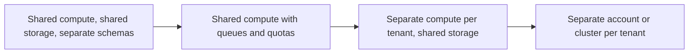

## 🎯 TL;DR

> **Multi-tenant platform pattern:** many teams (tenants) share one set of infrastructure. The platform must give each tenant **isolation** (their jobs do not starve or expose others), **quotas** (a fair share with a guaranteed minimum), **access control** (who can read which data), and **self-service** (teams provision what they need without a ticket).

- Choose the isolation level by **risk and cost**, not by habit. Shared compute with queues is cheap; separate clusters per tenant is expensive and safe.
- The main failure is the **noisy neighbour**: one runaway job or one huge export slows everybody.
- The platform team's product is the **paved road** (templates, guardrails, cost visibility), not the tickets it closes.

## 🌱 Start simple (Junior)

> **💡 Analogy:** An office building with shared meeting rooms. Everyone books through one system. The rules say how long a booking lasts, how many rooms one team can hold at once, and which rooms are private (the finance room needs a key). If one team books every room all day, the rules step in. The building is shared, but nobody can read the finance team's papers.

Imagine three teams share one data warehouse: marketing, finance and product. Without a platform, the setup looks like this:

- Marketing runs a huge backfill on Friday evening and blocks finance's month-end report.
- Product can read finance's raw payment table, because everyone has the same login.
- Nobody knows which team spent the money on the cluster last month.

A multi-tenant platform fixes each problem with a specific mechanism: queues and quotas, access policies, and cost tags.

## 🔧 How it really works (Mid)

### Isolation levels

There is a spectrum. Move right when you need stronger isolation, and expect higher cost and more operations work:



| Level | Typical mechanism | Cost | Blast radius | Use when |
|---|---|---|---|---|
| Shared compute, namespaces | separate schemas or databases, one engine | lowest | high | small teams, low-risk data |
| Shared compute with queues | resource groups or pools, per-tenant quotas | low | medium | most internal platforms |
| Separate compute, shared storage | one warehouse or cluster per team | medium | low for compute | heavy workloads that disturb others |
| Separate account or cluster | full infrastructure per tenant | highest | lowest | regulated data, external customers |

Storage isolation is a separate question. Shared storage with per-tenant prefixes and access policies is common, but a bad policy exposes everything in the bucket, so test the policy as a security control.

### Quotas and fair share

A quota is a rule about how much a tenant may use. The useful policy has three numbers: a **guarantee** (what the tenant always gets), a **cap** (the most it may use even when others are idle), and a **fair share** (what it gets when everybody is busy). Worked example for a cluster with 1,000 vCPU and four teams:

- Guarantee: 100 vCPU each, so 400 is reserved.
- Remaining 600 vCPU is shared equally: 150 each.
- Each team's cap is 400 vCPU, so a team can burst when others are idle.
- Check: if one team runs 400 vCPU of work while the other three each run 200, the total is 1,000 and nobody is above their guarantee. If the three others drop to 100 each, the bursting team can use up to 400 and the rest of the cluster is idle.

The numbers are illustrative. Real engines express the same ideas in their own terms, such as resource pools, queues or warehouse sizes. Also limit **per query** resources: a maximum bytes scanned, a maximum runtime and a maximum number of concurrent queries per user.

```yaml
# illustrative policy, not any tool's real schema
tenant: finance
guarantee_vcpu: 100
max_vcpu: 400
max_concurrent_queries: 20
query_timeout_min: 30
max_bytes_scanned_per_query_tb: 5
owners: ["finance-data@company"]
cost_center: "FIN-204"
```

### Access control

Access is layered:

- **Tenant boundary:** a team can read its own namespace by default. Cross-tenant reads need a grant that names the data and an owner who approves it.
- **Column and row policies:** mask sensitive columns ([[data-masking]]) and filter rows by tenant or region, so one shared table can serve several teams safely.
- **Service accounts:** pipelines run as service accounts owned by a team, not as a person. When a person leaves, pipelines keep working and the audit trail stays meaningful.
- **Audit:** every read of sensitive data is logged, and the logs are queryable by the data owner.

### Self-service

Self-service means a team can create a namespace, a queue, a pipeline template and a dashboard without opening a ticket. The platform provides a template, default quotas, default retention, a lint check and a cost tag. Teams change parameters through reviewed configuration (often infrastructure as code), not by clicking in a console that nobody records.

## 🧠 Senior depth & trade-offs

- **Noisy neighbour defence has three layers.** Admission control at the front door (queues and concurrency caps), resource limits during execution (memory and CPU per job), and timeouts or kill policies for runaway queries. Monitor queue wait per tenant. A tenant that waits for resources is a fairness signal; a tenant that holds all resources is a quota problem.
- **Shared metadata is a shared fate.** One catalog or metastore serves every tenant. An outage or a slow metadata call hits everyone, and a single tenant that creates 500,000 small partitions can slow every query planner. Put limits on partition counts and file counts per table, and track the metadata service's own latency.
- **Shared Kafka topics and ACL mistakes.** Multi-tenancy on a message bus means topic naming conventions, ACLs per consumer group, and quotas on producer and consumer bandwidth. A wrong ACL is a data leak; treat ACL changes like code review.
- **Chargeback versus showback.** Showback shows each team its cost and creates awareness. Chargeback moves the money. Start with showback: it needs cost tags on every job and table, and it reveals waste without political fights. Use [[capacity-planning]] numbers to set quotas, not guesses.
- **Deletion and retention per tenant.** Each tenant may have different legal retention. A shared table with mixed retention needs per-tenant deletion jobs, which is harder than dropping a whole schema. See [[pattern-data-deletion]] and [[data-retention]].
- **Platform as a product.** The platform team needs an SLO for its services (queue latency, provisioning time), an intake for requests, and a deprecation policy for old templates. Otherwise it becomes an unpaid ticket queue.
- **When not to use this pattern.** Two teams with one warehouse and no regulatory constraints do not need a multi-tenant platform. Start with namespaces, a naming convention and a monthly cost review. Add queues when contention appears, and separate clusters when a specific tenant needs it. Premature isolation adds cost and slows every team down.

## 🧪 Try it

A cluster has 600 vCPU. Three tenants have these settings:

| tenant | guarantee | cap |
|---|---|---|
| A | 100 | 300 |
| B | 100 | 300 |
| C | 100 | 200 |

1. How much capacity is reserved as guarantees, and how much is shared?
2. Tenant A is idle. B and C both want 400 vCPU each. What does each get, and why?
3. A asks for a cap of 600. Name one reason to refuse and one reason to agree.

<details>
<summary>Your guess?</summary>

1. 300 vCPU are reserved (100 × 3). The remaining 300 are shared.
2. B gets 300 and C gets 200. Their demand (400 each) is above their caps, so the caps bind, even though 600 vCPU are available and 100 vCPU stay idle. A cap is a hard ceiling, not a fair-share target; it stops a tenant from taking the whole idle cluster.
3. Refuse: a 600 cap is the whole cluster, so when A bursts it can take the guarantees of B and C. Agree: if A has a real, time-bound peak and the others are rarely busy at the same time, a higher cap can be acceptable with a monitored review date.

</details>

## 💬 Interview corner

**Typical question:** "Design a data platform that 50 teams share. How do you keep one team's job from breaking the others, and how do you control access?"

- **Junior answer:** "I would give each team its own database and set permissions."
- **Mid answer:** "I would use namespaces per team, resource queues with quotas, and role-based access. Teams provision with templates."
- **Senior answer:** "I choose isolation per tenant by risk and cost: shared compute with queues for most, dedicated compute for heavy or regulated workloads. Quotas have a guarantee, a cap and a fair share, plus per-query limits. Access is by namespace with grants for cross-tenant reads, column masking for sensitive fields, and service accounts for pipelines. The shared metadata layer and the message bus are the shared-fate risks, so I put limits on partitions and ACL changes under review, and I measure queue wait per tenant to detect noisy neighbours."

> **🎤 Say this in the interview:** "I isolate tenants in proportion to their risk. Most share compute with guaranteed minimums and caps, the sensitive or heavy ones get dedicated compute, and access is by namespace with masking and service accounts. The real risks are noisy neighbours and shared metadata, so I limit per-query resources and watch queue wait per tenant."

## ⚠️ Common mistakes

- **Shared login for everyone.** It makes access control and audit meaningless. Use per-team roles and service accounts.
- **Quotas with no guarantee.** A tenant can burst, but a sudden burst by another team starves it. Use a guaranteed minimum plus a cap.
- **Isolating everything from day one.** Separate clusters for five-person teams cost a lot and slow delivery.
- **Ignoring metadata limits.** One team's million small files can make the catalog slow for everyone.
- **No cost tags.** Without them nobody can tell which team drives the bill, so waste is never fixed.
- **Treating self-service as "anyone can create anything".** Self-service needs templates, defaults and guardrails.

## ✅ Check yourself (quiz)

1. Which isolation level is the best default for most internal teams with moderate risk?
   - A) A separate cluster per team
   - B) A shared engine with namespaces, resource queues and quotas
   - C) One shared admin account for all teams
   - D) A copy of the warehouse per team

   <details>
   <summary>Answer</summary>

   **B** — shared compute with queues and quotas gives fair share and reasonable blast radius at a low cost. Separate clusters are for workloads or data that need stronger isolation.

   </details>

2. What does a **guarantee** protect, that a cap alone does not?
   - A) The tenant's data from deletion
   - B) The tenant's minimum capacity when other tenants are busy
   - C) The tenant's cost from rising
   - D) The tenant's schema from changing

   <details>
   <summary>Answer</summary>

   **B** — a cap only limits the maximum. Without a guarantee, a busy neighbour can take almost everything and leave the tenant with nothing when it needs its share.

   </details>

3. *(Trade-off)* A team with a regulated dataset asks for full isolation. Which is the best answer?
   - A) Refuse; all teams must share compute
   - B) Give it a dedicated compute pool or account, with its own access policies, and accept the higher cost for that tenant
   - C) Give it a higher cap on the shared cluster
   - D) Copy its data to every other tenant to avoid access checks

   <details>
   <summary>Answer</summary>

   **B** — regulated data justifies stronger isolation, and the cost is visible through cost tags. A higher cap on shared compute does not isolate anything, and copying data widens the exposure.

   </details>

4. *(Senior)* Why is the shared metadata catalog a risk in a multi-tenant platform even when compute is isolated?
   - A) It stores passwords in plain text
   - B) Every tenant depends on it, so an outage or a tenant creating huge numbers of partitions slows everyone's planning
   - C) It cannot store more than one schema
   - D) It deletes old snapshots automatically

   <details>
   <summary>Answer</summary>

   **B** — isolated compute still shares the control plane. Limits on partitions and files per table, and monitoring of the metadata service, keep one tenant from becoming everyone's problem.

   </details>

## 🗂️ Flashcards

| Front | Back |
|---|---|
| Multi-tenant platform | Many teams share infrastructure with isolation, quotas, access control and self-service |
| Noisy neighbour | One tenant's workload slows others by consuming shared resources |
| Guarantee | Minimum capacity a tenant always gets when others are busy |
| Cap | Maximum a tenant may use, even when the cluster is idle |
| Blast radius | How many tenants an incident or a mistake can affect |
| Showback | Show each team its cost without moving money; a good first step |
| Chargeback | Charge teams for their cost; requires accurate tags and agreement |
| Shared fate | A dependency (metadata, ACL service, bus) that every tenant relies on |

## 🔗 Go further

- [[governance-contracts-mesh]] for ownership and contracts between teams on a shared platform.
- [[data-security]] for access control, encryption and audit controls.
- [[data-retention]] for per-tenant retention and legal holds.
- [[kubernetes-for-data]] for running workloads for many tenants on shared infrastructure.
- [[pattern-data-deletion]] for deleting one tenant's data from a shared table.
