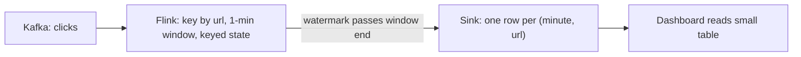

## 🎯 TL;DR

> **Real-time aggregation** keeps counts and sums (per minute, per page, per user) up to date while events arrive. There are two main shapes: **compute the aggregate in the stream** (for example Flink windows), or **store raw events and aggregate at insert time** (for example a ClickHouse materialized view). The choice is about **where the state lives**, **how late data is corrected**, and **how flexible the queries must be**.

- A **window** turns an endless stream into finite buckets (for example one bucket per minute).
- **Pre-aggregation** writes one row per bucket and key, so the serving table stays small.
- **Raw ingestion + materialized view** keeps every event and lets the engine roll it up as it arrives.
- Neither is "more real-time". Both are seconds to minutes behind. Choose by correctness needs and by how many questions you will ask later.

## 🌱 Start simple (Junior)

> **💡 Analogy:** A shop counts visitors. One clerk keeps a notebook and adds a tick every time someone walks in; at 10:01 he writes "10:00 — 42 visitors" and starts a new page. That is **pre-aggregation**. Another shop keeps a guest log, one line per visit, and a clerk who totals the log by minute whenever the manager asks. That is **raw events + aggregate later**. A third option is a log with a helper who totals each line into a summary sheet as soon as it is written. That is a **materialized view**.

Suppose a website sends one event per click:

```text
{"user_id": "u42", "url": "/pricing", "event_time": "2026-10-12T10:00:07Z"}
{"user_id": "u17", "url": "/pricing", "event_time": "2026-10-12T10:00:31Z"}
{"user_id": "u42", "url": "/blog",    "event_time": "2026-10-12T10:01:02Z"}
```

The product wants: "how many views per URL in each minute, updated live." The output for minute `10:00` would be:

| minute | url | views |
|---|---|---|
| 10:00 | /pricing | 2 |

Two ideas are needed before any tool:

1. **Window:** the minute `10:00` is a bucket. An event belongs to the bucket of its `event_time`, not the time it arrived.
2. **Result shape:** one row per `(window, url)`. The answer is a small table that dashboards can read quickly.

## 🔧 How it really works (Mid)

### Option A: pre-aggregate in the stream (Flink)

A stream job reads events, groups them by key and window, keeps a running count in **state** (see [[state-store]]), and writes one result per window when the window closes. In Flink SQL, a tumbling window of one minute looks like this:

```sql
-- Source: events from Kafka. The WATERMARK defines how late an event may be.
CREATE TABLE clicks (
  user_id    STRING,
  url        STRING,
  event_time TIMESTAMP(3),
  WATERMARK FOR event_time AS event_time - INTERVAL '10' SECOND
) WITH (
  'connector' = 'kafka',
  'topic' = 'clicks',
  'properties.bootstrap.servers' = 'kafka:9092',
  'format' = 'json'
);

-- Sink: a table with the result columns (JDBC, Kafka or another store).
-- Its connector options are omitted here.
CREATE TABLE url_minute_counts (
  window_start TIMESTAMP(3),
  window_end   TIMESTAMP(3),
  url          STRING,
  views        BIGINT
) WITH ( /* sink connector options */ );

INSERT INTO url_minute_counts
SELECT window_start, window_end, url, COUNT(*) AS views
FROM TABLE(
  TUMBLE(TABLE clicks, DESCRIPTOR(event_time), INTERVAL '1' MINUTE))
GROUP BY window_start, window_end, url;
```



How it behaves:

- A window's result is emitted when the **watermark** passes the window's end (see [[watermark]]). With a 10-second delay, the `10:00` window is final at about `10:01:10`. This is the latency you should quote.
- State holds one counter per open `(window, key)`. The number of keys times the number of open windows bounds memory.
- The sink receives **final** results per window. Late events handling is the subject of [[pattern-late-data]].

### Option B: raw ingestion + materialized view (ClickHouse)

Store every event, and let an insert-time **materialized view** write the rollup into a second table. ClickHouse does this with a `SummingMergeTree` target table:

```sql
-- Raw events: every click is kept
CREATE TABLE clicks_raw (
  event_time DateTime,
  user_id    String,
  url        String
) ENGINE = MergeTree
ORDER BY (url, event_time);

-- Rollup: one row per (minute, url) per insert block; merged later
CREATE TABLE url_minute (
  minute DateTime,
  url    String,
  views  UInt64
) ENGINE = SummingMergeTree
ORDER BY (minute, url);

-- Runs on each insert into clicks_raw and writes into url_minute
CREATE MATERIALIZED VIEW url_minute_mv TO url_minute AS
SELECT toStartOfMinute(event_time) AS minute, url, count() AS views
FROM clicks_raw
GROUP BY minute, url;

-- Query: always aggregate again, because merges are eventual
SELECT minute, url, sum(views) AS views
FROM url_minute
WHERE minute >= now() - INTERVAL 1 HOUR
GROUP BY minute, url
ORDER BY minute DESC, views DESC
LIMIT 20;
```

The key facts:

- The materialized view is **insert-triggered**: it aggregates each inserted block, not the whole table. Several partial rows per `(minute, url)` can exist until background merges combine them. That is why the query uses `sum(views)`.
- Late events are simply inserted with their old `event_time`. The rollup row for that old minute is updated by the next merge. There is no watermark and no "window closed" concept. This is the big correctness difference.
- For **distinct counts** (unique users per minute), `SummingMergeTree` is not enough. Use an `AggregatingMergeTree` target with `uniqState(user_id)` in the view and `uniqMerge` at query time. The state can be merged across blocks, so the rollup stays correct.

### Choosing between them

| Question | Flink pre-aggregation | Raw + materialized view |
|---|---|---|
| Where is the work done? | Stream job, state in Flink | Insert path of the database |
| Latency for a new value | Window size + watermark delay | Visible after the insert and the next query |
| Late events | Within the allowed lateness, or dropped / side output | Accepted at any time; rollup corrected on merge |
| Ad-hoc questions later | Limited to what you aggregated | Any question over raw events |
| Storage | Only the rollups (small) | Raw events (large) plus rollups |
| Operations | Checkpoints, state size, job upgrades | Table design, merges, insert batch size |
| Typical use | Alerts, fraud signals, metrics the job owns | Dashboards, product analytics, exploration |

## 🧠 Senior depth & trade-offs

- **Pick by what must be correct.** If an alert must fire once per window with an exact count, a stream job with a defined watermark gives a clear contract. If the business accepts "the number can still move for a few hours", raw ingestion plus a rollup is simpler and forgiving.
- **Keyed state and skew.** In Flink, all events of one key go to one task. A viral URL or a bot user is a [[hot-key]]. Pre-aggregate in two stages (local partial count, then global sum) or salt the key. The same skew hits ClickHouse when one `(minute, url)` gets most inserts.
- **State size.** Count the open windows: with 1-minute tumbling windows, a 1-hour allowed delay keeps about 60 windows per key open. Multiply by the number of keys (say 10 million URLs) and by the bytes per accumulator. Do this arithmetic before choosing the design. If the state does not fit, use a shorter window, fewer keys, or the raw path.
- **Exactly-once.** Flink checkpoints give exactly-once state updates inside the job. The end-to-end guarantee also depends on the sink. An upsert sink keyed by `(window_start, url)` makes replays idempotent. An append sink without dedupe can double-count after a restart. See [[pattern-exactly-once]].
- **Insert batching in ClickHouse.** Many tiny inserts create many small parts and slow merges. Batch inserts (thousands of rows per insert) or use the asynchronous insert settings, and check the docs for your version before relying on a specific behaviour.
- **Monitoring.** For the stream: consumer lag, checkpoint duration, backpressure, watermark lag (current time minus watermark). For ClickHouse: insert rate, number of parts per partition, merge backlog. For both: the **age of the newest row** on the dashboard, which is the number people actually feel.
- **Serving.** A dashboard that polls every second against raw events will not scale. The rollup table or a [[realtime-olap]] engine serves the queries; the raw table serves investigations.
- **When not to use it.** If the question is answered once a day, a batch rollup is cheaper and easier to reason about (see [[pattern-batch-etl]]). If you need a per-user state machine with business logic, that is a stream application, not an aggregation.
- **Lambda option.** Teams often run both: the stream gives a provisional number, and the nightly batch gives the final one. See [[pattern-lambda-kappa]] and [[pattern-reconciliation]].

## 🧪 Try it

Use the click events from the lesson.

1. **Window arithmetic.** With a 1-minute tumbling window and a 10-second watermark delay, at what wall-clock time is the `10:03` window emitted if no late events arrive? Explain the answer in one sentence.
2. **Distinct users in ClickHouse.** Write the materialized view and target table that count distinct `user_id` per `(minute, url)`. Hint: use `AggregatingMergeTree`, `uniqState` in the view and `uniqMerge` in the query.
3. **Choose.** A team needs top-10 URLs per hour on a dashboard, and an alert when any URL exceeds 10,000 views in one minute. The raw events are kept for 90 days for investigations. Pick a design for each requirement and justify it in two sentences.

<details><summary>Show solutions</summary>

**1.** The `10:03` window covers `10:03:00` to `10:04:00`. The watermark must pass `10:04:00`, and with a 10-second delay that means an event with time at least `10:04:10` must have been seen. Without late events, the window is emitted about when the stream reaches `10:04:10` of event time, which is roughly 10 seconds after the window's end in event time.

**2.**
```sql
CREATE TABLE url_minute_uniq (
  minute   DateTime,
  url      String,
  users    AggregateFunction(uniq, String)
) ENGINE = AggregatingMergeTree
ORDER BY (minute, url);

CREATE MATERIALIZED VIEW url_minute_uniq_mv TO url_minute_uniq AS
SELECT toStartOfMinute(event_time) AS minute,
       url,
       uniqState(user_id) AS users
FROM clicks_raw
GROUP BY minute, url;

SELECT minute, url, uniqMerge(users) AS unique_users
FROM url_minute_uniq
GROUP BY minute, url;
```
A plain `count(DISTINCT ...)` on the rollup would be wrong, because you cannot add distinct counts from two blocks. The state object can be merged.

**3.** The hourly top-10 is a query over a rollup: use the `url_minute` table from ClickHouse (sum the minutes per hour), or an hourly rollup. The 10,000-views-per-minute alert is a threshold on the stream output (Flink with a 1-minute window, with the alert written to a topic), because it must fire quickly and is a fixed rule. The 90-day raw table covers the investigations that the rollups cannot answer.

</details>

## 💬 Interview corner

**Question: "Design a live dashboard that shows page views per minute."**

Mid answer: "I'd put the events in Kafka, count per minute with a Flink tumbling window, and write the counts to a database the dashboard reads."

Senior answer: "It depends on the correctness need. A Flink window gives one final row per minute after the watermark passes, so the latency is the window size plus the watermark delay, and the state is bounded by the number of open windows times the number of keys. If analysts also ask new questions, I'd keep the raw events in ClickHouse and maintain the per-minute rollup with a materialized view, accepting that the rollup is eventually merged. I'd watch the age of the newest row as the main SLO."

**Question: "Why not just use a materialized view for everything?"** Because the view has no notion of a window closing. You get no defined moment when a number is final, and late events keep changing old rows. That is fine for analytics and wrong for an alert that must fire once.

> **🎤 Say this in the interview:** "I separate the latency of a number from its correctness. A stream window gives a number that is final at a known time. A raw store with a rollup gives a number that is fresh now and corrected later. I choose based on whether the consumer needs finality or flexibility."

## ⚠️ Common mistakes

> **⚠️ Watch out:** Using processing time (the time the event arrived) for the window. A network delay then moves events to the wrong minute. Use event time with a watermark.

> **⚠️ Watch out:** Reading a ClickHouse `SummingMergeTree` table without `sum()` and `GROUP BY`. You can see several partial rows for the same key until the merge runs.

- Calling a rollup "real time" without stating its lag. Quote the freshness, and measure it.
- Using `count(DISTINCT)` over a pre-aggregated table. Distinct counts need mergeable state, or raw data.
- Forgetting state growth in Flink: a window with a long allowed delay and a high-cardinality key uses a lot of memory.
- Many tiny inserts into ClickHouse, which create a large number of parts.
- Writing an append-only sink with no dedupe and then restarting the job. Replays double the counts.
- Building a per-second dashboard directly on the raw event table.

## ✅ Check yourself (quiz)

1. In a Flink tumbling window of 1 minute with a 10-second watermark delay, when is the `10:00` result final (assuming no late data)?
   - A) At `10:00:00`, when the window starts
   - B) At `10:01:00`, exactly when the window ends
   - C) About `10:01:10`, when the watermark passes the window end
   - D) At `10:10:00`

<details><summary>Answer</summary>

**C** — the window emits when the watermark passes its end. With a 10-second out-of-orderness allowance, the watermark reaches `10:01:00` only after events with time `10:01:10` have been seen.

</details>

2. Why does the ClickHouse query over a `SummingMergeTree` rollup need `sum(views)` even though the view is "already aggregated"?

   - A) `SummingMergeTree` does not store numbers
   - B) Inserts create partial rows per key, and merges are eventual; the query must combine them
   - C) `sum` is faster than reading a column
   - D) The materialized view deletes the raw table

<details><summary>Answer</summary>

**B** — each insert block produces its own partial rows, and background merges combine them later. Until then, the same `(minute, url)` appears several times, so the query must aggregate again.

</details>

3. A team wants an exact count of unique users per minute, rolled up with a materialized view. Which design is correct?

   - A) `SummingMergeTree` with `count(DISTINCT user_id)` in the view
   - B) `AggregatingMergeTree` storing `uniqState(user_id)`, merged with `uniqMerge` at query time
   - C) A plain `MergeTree` with `count(DISTINCT)` in every dashboard query, over the raw table only
   - D) An average of the per-block distinct counts

<details><summary>Answer</summary>

**B** — distinct counts cannot be added across blocks, so the state must be stored and merged. Option C is correct in result but reads all raw rows on each dashboard refresh, which is what the rollup is meant to avoid.

</details>

4. **(Senior)** A viral URL receives 80 percent of all clicks. Your Flink job groups by URL. What symptom do you expect, and what do you change?

   - A) The window size must be smaller
   - B) One task holds the hot key and falls behind, creating lag and backpressure; split the key with a two-stage aggregation (partial counts per random salt, then a final sum)
   - C) Flink does not support `COUNT`
   - D) Increase the watermark delay to 1 hour

<details><summary>Answer</summary>

**B** — all events of one key go to one parallel task, so that task becomes the bottleneck. Two-stage aggregation spreads the partial work and sums the small results.

</details>

5. **(Senior)** Your dashboard shows yesterday's numbers after a deployment, although the stream is healthy. What do you check first?

   - A) The chart colours
   - B) The checkpoint and the sink: whether the job restored from an old checkpoint or the sink stopped accepting writes, and the age of the newest row
   - C) The Kafka topic name
   - D) The number of dashboard users

<details><summary>Answer</summary>

**B** — a healthy-looking stream with stale output usually means a failed or stuck sink, or a restore from an old state. Measure the age of the newest row and check the job's checkpoint history and sink errors.

</details>

## 🗂️ Flashcards

| Front | Back |
|---|---|
| What is a tumbling window? | Fixed, non-overlapping buckets of time (for example one minute) |
| When is a window result final in a stream job? | When the watermark passes the window end |
| Pre-aggregation vs raw + materialized view | Stream computes rollups in state; the database rolls up at insert time and keeps raw events |
| Why `sum(views)` on a SummingMergeTree rollup? | Partial rows per key exist until background merges combine them |
| How to count distinct values in a rollup? | Store mergeable state (`uniqState`) and merge it (`uniqMerge`) |
| Main cause of a slow Flink task on a viral key | A hot key sends all its events to one parallel task |
| Best metric for "is the dashboard fresh?" | Age of the newest row, not job uptime |
| Who handles late data in a materialized view? | Nobody explicitly; late rows are inserted and the rollup is corrected on merge |

## 🔗 Go further

- [[pattern-late-data]] covers watermarks, allowed lateness and corrections, which are the hard part of Option A.
- [[pattern-hot-keys]] shows the general technique for skewed keys, including two-stage aggregation.
- [[realtime-olap]] and [[clickhouse]] explain how a columnar OLAP store serves dashboards at scale.
- [[flink]] and [[spark-structured-streaming]] describe the two stream engines used for Option A.
- [[pattern-lambda-kappa]] explains when to run a stream and a batch layer side by side.
- Check the window and watermark syntax in the Flink SQL documentation for your version, and the ClickHouse engine docs for `SummingMergeTree` and `AggregatingMergeTree`.
