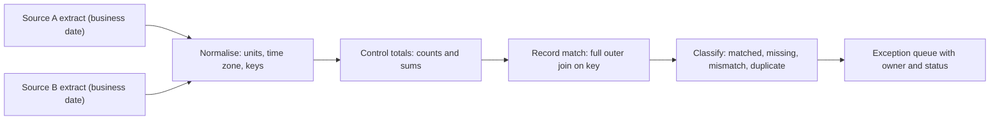

## 🎯 TL;DR

> **Reconciliation** compares two systems that should agree about the same business facts (for example, the payment switch and the ledger, or network CDRs and the billing system), finds what matches, what is missing on one side, and what differs, and turns each difference into a tracked exception.

- Reconcile at the right **grain** (a transaction, a call record, an hour per switch) and compare **counts and totals first**, then individual records.
- Define the **matching key**, the **normalisation** rules (currency units, time zones, rounding) and a **tolerance** before you write any SQL.
- A reconciliation report is not the end. The output is an **exception workflow**: someone owns each open difference, and the cut-off rules say when a missing item is a real problem and when it is just late.

## 🌱 Start simple (Junior)

> **💡 Analogy:** Two shopkeepers each keep a notebook of the day's sales. At closing time they compare the notebooks. Sales that appear in only one notebook are investigated. Sales that appear in both with different totals are investigated. Sales that match are ticked off. Nobody changes the other notebook; they only record the differences and fix the cause.

In data terms:

- **System A** is the source of one view of the truth (the payment switch logs every transaction).
- **System B** is the other view (the core ledger records what was posted to accounts).
- **Reconciliation** answers: for the same day, which transactions match, which exist only in A, which exist only in B, and where do the amounts disagree?

A tiny example for one day:

```text
txn_id   switch   ledger   note
T-001    500      500      matched
T-002    200      -        missing in ledger (posting failed?)
T-003    -        700      missing in switch (orphan posting?)
T-004    900      450      amount mismatch (partial posting?)
```

Four outcomes, four different investigations. Reconciliation is the discipline of naming them and making sure someone looks at each one.

## 🔧 How it really works (Mid)

A reconciliation job has five steps:



1. **Extract** both sides for the same business date, with the same cut-off rule. "Same date" must mean the same thing in both systems: a transaction time in one, a posting date in the other, may need a mapping.
2. **Normalise.** Convert currency to one unit (here, rials, as integers, never floats), convert timestamps to one time zone, trim IDs, and make the status values comparable.
3. **Control totals first.** Compare row counts and sums per group (per switch, per hour, per product). If they match, you are done for that group, and you save a full join.
4. **Record-level match** only for groups whose totals differ. A full outer join on the matching key classifies every record.
5. **Classify and route.** Each outcome becomes an exception row with a type, an amount, an age and an owner.

Control totals and the record-level query:

```sql
-- Step 3: control totals per side, same business date
SELECT 'switch' AS source, COUNT(*) AS n, SUM(amount_rial) AS total_rial
FROM switch_txn
WHERE business_date = DATE '2026-10-12' AND status = 'SUCCESS'
UNION ALL
SELECT 'ledger', COUNT(*), SUM(amount_rial)
FROM ledger_entry
WHERE business_date = DATE '2026-10-12';

-- Step 4 and 5: record-level exceptions only
WITH sw AS (
  SELECT txn_id, amount_rial
  FROM switch_txn
  WHERE business_date = DATE '2026-10-12' AND status = 'SUCCESS'
),
lg AS (
  SELECT txn_id, SUM(amount_rial) AS amount_rial, COUNT(*) AS n
  FROM ledger_entry
  WHERE business_date = DATE '2026-10-12'
  GROUP BY txn_id
)
SELECT COALESCE(sw.txn_id, lg.txn_id) AS txn_id,
       CASE
         WHEN lg.txn_id IS NULL THEN 'missing_in_ledger'
         WHEN sw.txn_id IS NULL THEN 'missing_in_switch'
         WHEN lg.n > 1         THEN 'duplicate_in_ledger'
         WHEN sw.amount_rial <> lg.amount_rial THEN 'amount_mismatch'
       END AS recon_status
FROM sw
FULL OUTER JOIN lg ON sw.txn_id = lg.txn_id
WHERE lg.txn_id IS NULL OR sw.txn_id IS NULL
   OR lg.n > 1 OR sw.amount_rial <> lg.amount_rial;
```

Notice three decisions baked into the query. The switch side is filtered to `SUCCESS` because failed attempts are not expected in the ledger. The ledger side is grouped first, so a duplicate posting is detected instead of silently summed into a "match". The `WHERE` keeps only exceptions, so the output is small enough for people to work through.

**Telecom version.** Replace transactions with CDRs. Reconcile the number of call records and total billable seconds per switch and per hour, between the mediation output and the billing input. A count mismatch usually means a missing file (a file-level gap, see [[file-ingestion]]). A total mismatch with equal counts usually means a rating or rounding difference. The two need different owners.

**Tolerance.** Some differences are expected: a cut-off at midnight, a timing offset, or a rounding rule. Define the tolerance per control, in writing. Zero for money, a small percentage for estimates, and never a silent "close enough" for a billing number.

## 🧠 Senior depth & trade-offs

**Independence.** A reconciliation is only useful if the two sides are produced by different paths. If the "ledger" is built by the same job that builds the "switch" table, both can be wrong in the same way and the check passes. Keep the second source independent, and if that is impossible, say so in the report.

**Cut-off and late data.** Money moves late. A card settlement may arrive a day after the authorization. Decide the rule up front: reconcile by **business date** with a cut-off time, and keep an open window (for example T+2) in which a missing item is "pending", not "exception". This is the same watermark-style problem as in [[pattern-late-data]], but the penalty is financial, so the policy must be explicit and reviewed by the business.

**Exactly-once effects matter here.** A duplicate in either side is the most common cause of false exceptions. Deduplicate on the business key first (see [[pattern-dedup]]), and make the exception generation itself idempotent: rerunning the job for the same date must produce the same exception set, not double it. Use an upsert keyed by `(business_date, txn_id, recon_status)`.

**Money as integers.** Store rials or minor units as integers or fixed-point decimals. A `DOUBLE` sum over millions of rows gives tiny differences that look like mismatches and bury the real ones. Use `DECIMAL` with explicit scale, or integer minor units.

**Grain and performance.** Full outer joins on tens of millions of rows are expensive. Control totals per partition let you skip most of the data. Partition both sides by business date (and by a hash of the key if the join is large), so the join is a partition-wise join, see [[shuffle]].

**Exception workflow.** An exception is a small case file: type, amount, first seen, age, owner, status (open, investigating, resolved, written off), and the evidence (the two records). Measure the open count and the age distribution. A growing backlog of old exceptions is a control failure even if the matched percentage looks high.

**Auditability.** Keep the reconciliation outputs and the control totals for the regulatory retention period. The question an auditor asks is "show me what you checked on this day, and what was the result", not "show me your SQL".

**When not to reconcile record by record.** At very high volume with a stable process, control totals and sampling (plus a full check on any group whose totals differ) catch almost everything at a fraction of the cost.

**What to monitor:** match rate per control, count and value of open exceptions, the age of the oldest open exception, the number of days where totals did not match, and the job's freshness relative to the cut-off.

> **🎤 Say this in the interview:** "I'd reconcile in layers: control totals per business date and group first, then a record-level full outer join only for the groups that differ. I'd define the key, the normalisation and the tolerance up front, store money as integers, and treat every difference as an exception with an owner and an age. The job must be idempotent and the second source must be independent, otherwise the check proves nothing."

## 🧪 Try it

1. Given the switch and the ledger for one day, write the classification query for "present in both but the ledger has a second posting for the same transaction".
2. A CDR reconciliation shows equal counts but a 0.3% difference in billable seconds. List three likely causes and how you would test each.
3. Why is `SUM` over a `DOUBLE` column a risk for money, and what do you use instead?

<details><summary>Show solutions</summary>

**1.** Group the ledger by `txn_id` and count the rows, then keep the groups with `COUNT(*) > 1` and join to the switch on `txn_id`. The `lg.n > 1` branch in the query above does exactly this, and you can see the duplicates by filtering on it alone.

**2.** Possible causes: rounding at the rating step (per-call rounding up versus per-session), a time-zone or cut-off difference that moves a few calls across the midnight boundary, and a duplicated or missing record that is offset by an equal count elsewhere. Test each by comparing per-call duration totals, by checking the hour buckets at the cut-off, and by checking duplicates on the call ID.

**3.** Floating-point addition is not associative, and the order of rows in a distributed sum changes the result slightly. Those tiny differences look like mismatches. Use `DECIMAL(p, s)` with an explicit scale, or store integer minor units.

</details>

## 💬 Interview corner

**Question: "How would you reconcile the payment switch with the ledger?"**

- **Mid answer:** "I'd join the two tables on transaction ID and list the rows that don't match."
- **Senior answer:** "I'd first compare control totals by business date and switch, then run a full outer join only on the groups that differ. I'd normalise units and time zones first, and store money as integers. The output is an exception table with type, age and owner, and the job is idempotent. I'd also define a T+2 window, because settlements arrive late, and I'd make sure the ledger is built independently from the switch feed."

**Follow-up:** "What do you do with a missing item that is 3 days old?" Answer: it is an escalated exception, not a pending one, and the workflow says who investigates, what evidence is needed and when it is written off, with approval.

## ⚠️ Common mistakes

> **⚠️ Watch out:** A reconciliation that uses the same pipeline on both sides proves nothing. Two copies of the same bug always match.

> **⚠️ Watch out:** Comparing money with `DOUBLE` or with a join on rounded values hides real differences and creates fake ones.

- Joining on a non-unique key, so one-to-many joins multiply the rows and make totals look wrong.
- Summing before deduplicating, so a duplicate posting is counted twice and "fixed" by hand.
- Ignoring the cut-off: a transaction at 23:59:59 in one system and 00:00:01 in the other is not a mismatch, it is a timing rule.
- Writing exceptions without an owner or an age, so the backlog grows silently.
- Treating a small percentage mismatch as acceptable without a written tolerance.
- Rerunning the job and getting a different exception set, because the output is not idempotent.

## ✅ Check yourself (quiz)

1. A transaction appears in the switch log but not in the ledger. Which classification is correct?
   - A) `missing_in_switch`
   - B) `missing_in_ledger`
   - C) `amount_mismatch`
   - D) `duplicate_in_ledger`

<details><summary>Answer</summary>

**B** — the record exists on the switch side only, so it is missing in the ledger. Do not assume it is an error until the cut-off window has passed.

</details>

2. Why are control totals (counts and sums per group) checked before the record-level join?

   - A) Joins are not allowed on money columns
   - B) They are cheap, and matching groups can be skipped, so the expensive join runs only where totals differ
   - C) Control totals replace the exception table
   - D) The regulator requires a record-level join for every row

<details><summary>Answer</summary>

**B** — totals are a cheap first filter. The full join is needed only for groups that disagree.

</details>

3. **(Senior)** A reconciliation shows a 0.001% mismatch on the same day, every day, always in the same direction. What do you suspect first?

   - A) Random network loss
   - B) A systematic cause such as rounding, a cut-off rule or a fee that one side applies and the other does not
   - C) That the job is wrong and should be deleted
   - D) That the tolerance should be increased until the mismatch disappears

<details><summary>Answer</summary>

**B** — a consistent direction points to a rule difference, not randomness. Find the rule, fix it or document it, and only then set a tolerance.

</details>

4. **(Senior)** Why must the exception generation be idempotent?

   - A) So the job runs faster
   - B) So a rerun for the same date produces the same exceptions, instead of duplicates or lost cases that operators have already worked on
   - C) So the switch can be reconciled twice
   - D) Because Spark cannot write twice

<details><summary>Answer</summary>

**B** — operators act on exception IDs. A non-idempotent job creates duplicate cases or overwrites their status, which breaks the workflow and the audit trail.

</details>

5. **(Senior)** Why is a T+2 window used for card settlements?

   - A) Settlements always take exactly two days
   - B) Late settlements are normal, so a missing item inside the window is pending, not an exception; the window is a business rule, agreed explicitly
   - C) The database cannot store more than two days of data
   - D) T+2 removes the need for a cut-off

<details><summary>Answer</summary>

**B** — the window separates normal lateness from a real problem. The length is a business and regulatory decision, documented and reviewed.

</details>

## 🗂️ Flashcards

| Front | Back |
|---|---|
| Reconciliation | Comparing two systems that should agree on the same business facts, and tracking every difference |
| Control totals | Counts and sums per group; a cheap first check that skips matching groups |
| Four outcomes | Matched, missing on one side, duplicate, amount mismatch |
| Why a full outer join | It shows records that exist on only one side |
| Why money is not DOUBLE | Floating-point sums drift; use DECIMAL or integer minor units |
| Independent sources | The two sides must come from different paths, or a shared bug passes the check |
| T+N window | Late items inside the window are pending; after it they become exceptions |
| Exception record | Type, amount, first seen, age, owner, status and evidence |

## 🔗 Go further

- [[design-payment-reconciliation]] applies this pattern end to end, with a payment switch and a ledger.
- [[design-telco-cdr]] applies it to call records and billing.
- [[pattern-lambda-kappa]] explains why a streaming number is often reconciled with a nightly batch number.
- [[pattern-late-data]] covers the cut-off and watermark logic behind the pending window.
- [[data-quality]] and [[data-observability]] describe the checks and alerts that run around the reconciliation job.
