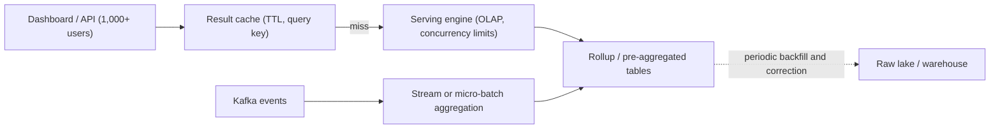

## 🎯 TL;DR

> **Serving pattern:** do the heavy work **before** the user arrives. Pre-aggregate facts into small tables, answer dashboards from those tables through an engine built for concurrency, and cache what many users ask for again.

- A dashboard used by 1,000 people does not need 1,000 full scans of raw events. It needs a few thousand rows, prepared in advance.
- Three levers: **pre-aggregation** (rollups), **caching** (results), and **a serving engine** built for many small concurrent queries.
- You also need **admission control**: a limit on how many queries run at once, so one heavy report cannot slow everybody else.

## 🌱 Start simple (Junior)

> **💡 Analogy:** A restaurant kitchen. If every customer ordered a raw ingredient and cooked it at the table, the service would stop. The kitchen prepares sauces and portions in advance (pre-aggregation), keeps popular dishes warm (cache), and has a limit on how many orders it takes at once (concurrency limit).

Imagine a sales dashboard: "revenue per country for the last 30 days". Each time a manager opens it, the database must read every sale of the last 30 days and add them up. That is fine for one person. For 1,000 managers refreshing every minute, it is a traffic jam.

The fix is to add up once, in advance:

```sql
-- once per hour, instead of every dashboard view
CREATE TABLE sales_daily AS
SELECT CAST(event_ts AS DATE) AS day,
       country,
       COUNT(*)              AS orders,
       SUM(amount)           AS revenue
FROM events
GROUP BY 1, 2;
```

The dashboard now reads `sales_daily`, which has one row per day per country. Thirty days × 200 countries is 6,000 rows instead of hundreds of millions of events.

## 🔧 How it really works (Mid)

A serving path usually has four layers, from the user down to storage:



### 1. Pre-aggregation (rollups)

A rollup stores facts grouped by the dimensions the dashboards filter and group by. The grain is the important decision: `day × country × product` answers more questions than `day × country`, but it has more rows. A simple estimate: 200 countries × 5,000 products × 365 days = 365 million rows per year at most. In practice the count is lower because most product-country pairs have no sales, but you must measure it.

**Additive measures are easy.** `COUNT`, `SUM`, `MIN` and `MAX` can be rolled up from smaller pieces: total revenue for a month is the sum of daily revenues.

**Distinct counts are not.** `COUNT(DISTINCT user_id)` cannot be added up from daily distinct counts (a user active on two days is counted twice). Use a sketch such as HyperLogLog ([[hyperloglog]]), which is mergeable, and accept a small error, or store an exact set only for small dimensions.

### 2. Caching

Dashboards repeat the same queries. A result cache keyed by the normalized query and its parameters (for example `country=IR, range=30d`), with a time-to-live of 30 to 60 seconds, can serve most of the traffic. Two problems to plan for:

- **Stampede.** When a popular entry expires, 500 requests may miss at once and all hit the engine. Use request coalescing (one request computes, the others wait for it) or refresh hot entries before they expire.
- **Staleness.** A cache is a second copy of the answer. Show the data timestamp on the dashboard, so users know how old the number is.

### 3. Serving engine and concurrency

Warehouses are designed for a few large, expensive queries at a time. Serving needs many small, fast queries. Engines built for this, such as ClickHouse and StarRocks, use columnar storage, vectorized execution and pre-sorted or pre-aggregated tables, so a query that touches 6,000 rows returns in milliseconds. Real-time OLAP systems can also ingest from Kafka, so the freshness is seconds instead of hours.

Concurrency control is part of the design:

- **Admission control:** a maximum number of running queries per engine and per tenant, with a bounded queue.
- **Timeouts and row limits:** a dashboard query that scans more than N rows is rejected or sent to a slower path.
- **Priority:** interactive dashboards before scheduled exports.

```sql
-- the dashboard query: small, indexed by day and country
SELECT day, SUM(revenue) AS revenue
FROM sales_daily
WHERE country = 'IR'
  AND day >= CURRENT_DATE - INTERVAL '30' DAY
GROUP BY day
ORDER BY day;
```

Use the same query shape for the rollup and for the raw table only in tests, so you can compare the two results.

## 🧠 Senior depth & trade-offs

- **Freshness versus cost.** Every increase in freshness (micro-batch → streaming aggregation) costs more compute and more operational work. Write the freshness SLA in numbers, for example "data is at most 5 minutes old, p95", and build to that number, not to "real time".
- **Rollup explosion.** Each extra dimension multiplies the rows. Pick dimensions from the dashboards, not from the schema. Keep the raw table for ad-hoc analysis and use rollups only for the known shapes.
- **Late and corrected data.** A rollup built from events must be corrected when late events arrive. Decide the policy: recompute the last N days each run, or accept a fixed lateness window and document it. See [[pattern-late-data]].
- **Hot queries.** One dashboard can account for most of the load. Measure per-query cost and cache the top few shapes first. The same hot-key thinking as in [[pattern-hot-keys]] applies to query popularity.
- **Multi-tenant noise.** One customer's large export can increase tail latency (p99) for everyone. Separate resource pools per tenant or per workload class, and cap the rows per query.
- **Failure modes to monitor.** p95 and p99 latency, queue wait time (not only query time), cache hit ratio, rollup freshness (`max(event_ts)` compared with now), and error rate per dashboard. A dashboard that is fast and stale is still wrong.
- **When not to use it.** Ad-hoc analysis by a few analysts, or a monthly report, does not need a serving layer. A warehouse with normal concurrency is simpler. Do not use a serving engine as a system of record; it is a copy optimized for reads.

## 🧪 Try it

A `sales_daily` rollup has these rows for country `IR`:

| day | revenue |
|---|---|
| 2026-10-01 | 100 |
| 2026-10-02 | 150 |
| 2026-10-03 | 80 |

1. Write a query that returns the total revenue for 2026-10-01 to 2026-10-03.
2. Your colleague wants to add `COUNT(DISTINCT user_id)` per day to the rollup and then sum those values to get the 3-day total. What is wrong with that?
3. Estimate the rows of a rollup with `day × country × device`, for 365 days, 200 countries and 3 devices, assuming every combination has sales.

<details>
<summary>Your guess?</summary>

1. `SELECT SUM(revenue) FROM sales_daily WHERE country = 'IR' AND day BETWEEN '2026-10-01' AND '2026-10-03';` returns 330.
2. Distinct counts are not additive. A user who buys on two days is counted once per day, so the sum counts them twice. Use a mergeable sketch (for example HyperLogLog) or recompute from the source for the range.
3. 365 × 200 × 3 = 219,000 rows. This is an upper bound; the real number is lower when many combinations have no sales.

</details>

## 💬 Interview corner

**Typical question:** "Design the analytics backend for a dashboard with 10,000 concurrent users and a 2-second p95 target."

- **Junior answer:** "I would put the data in a database and add an index."
- **Mid answer:** "I would pre-aggregate the events into daily tables by the dashboard's dimensions, cache the results for a short TTL, and serve them from an OLAP engine."
- **Senior answer:** "I start from the SLA and the query shapes. Rollups are sized by grain and checked against the number of dimension combinations. Distinct metrics use sketches, because they cannot be summed. A short-TTL cache with request coalescing absorbs repeated queries, and admission control with per-tenant queues protects p99. I monitor queue wait, freshness lag and cache hit ratio, and I keep the raw warehouse for ad-hoc work."

> **🎤 Say this in the interview:** "I answer dashboards from pre-aggregated tables, not from raw events. The grain is chosen from the dashboard dimensions, distinct counts use mergeable sketches, a short-TTL cache with coalescing handles repeats, and admission control keeps one heavy query from hurting everyone's p99."

## ⚠️ Common mistakes

- **Pre-aggregating everything.** The rollup explodes in size and rebuilds take hours. Build only the shapes that dashboards use.
- **Summing distinct counts** across days or partitions.
- **Caching without a timestamp.** Users cannot tell whether a number is 30 seconds or 3 hours old.
- **No admission control.** A single export job can push every dashboard into timeouts.
- **Measuring average latency only.** Users feel p95 and p99, not the average.
- **Serving from the raw table** because "the rollup is not ready". This hides the rollup bug until the day the raw table grows past the budget.

## ✅ Check yourself (quiz)

1. Why is a rollup at `day × country` much faster for a 30-day dashboard than the raw event table?
   - A) It is stored on faster disks
   - B) It reads hundreds of rows per day instead of millions of events, because the aggregation is done in advance
   - C) It removes the need for an index
   - D) It stores the events compressed in JSON

   <details>
   <summary>Answer</summary>

   **B** — the work of grouping and adding is done once during the rollup build. The dashboard reads a small, already aggregated table, so it scans far fewer rows.

   </details>

2. A metric is "unique buyers per month". Which approach is correct for a rollup that serves monthly and yearly views?
   - A) Store daily distinct counts and sum them
   - B) Store a mergeable sketch per day (or per month) and merge the sketches for longer periods
   - C) Store only the raw events and count distinct at query time
   - D) Store the monthly distinct count and divide by 30

   <details>
   <summary>Answer</summary>

   **B** — mergeable sketches (for example HyperLogLog) can be combined across days to estimate a longer period, with a small error. Summing daily counts double-counts returning buyers, and dividing does not produce a distinct count.

   </details>

3. *(Trade-off)* The product team asks for "real-time" dashboards. What is the best first step?
   - A) Switch every dashboard to the raw Kafka topic
   - B) Ask for the freshness SLA in numbers, then choose the cheapest pipeline that meets it, and show data age on the dashboard
   - C) Reduce the cache TTL to zero
   - D) Build a rollup for every possible filter

   <details>
   <summary>Answer</summary>

   **B** — "real-time" has no fixed meaning. A number such as "at most five minutes old, p95" sets the design, and showing the data age makes staleness visible. Reading raw Kafka topics for dashboards is expensive and does not scale to many users.

   </details>

4. Why does a cache with TTL need request coalescing?
   - A) To make the TTL longer
   - B) So that when a popular entry expires, many requests do not recompute the same query at once
   - C) To store the data on disk
   - D) To avoid using the serving engine for writes

   <details>
   <summary>Answer</summary>

   **B** — without coalescing, a cache miss for a popular query creates a burst of identical queries (a stampede) that can overload the engine.

   </details>

## 🗂️ Flashcards

| Front | Back |
|---|---|
| Pre-aggregation | Compute grouped results in advance so dashboards read small tables |
| Rollup grain | The set of dimensions kept in a rollup; finer grain means more rows |
| Additive measure | Can be summed from smaller pieces (COUNT, SUM); distinct counts are not |
| HyperLogLog | Mergeable sketch that estimates distinct counts with a small error |
| Cache stampede | Many identical requests recompute one expired entry at the same time |
| Request coalescing | One request computes a missing value while others wait for it |
| Admission control | Limit on concurrent queries with a bounded queue to protect latency |
| Freshness SLA | A number for data age, such as "at most 5 minutes old, p95" |

## 🔗 Go further

- [[serving-layer]] for the general idea of a layer that answers reads from prepared data.
- [[clickhouse]] and [[starrocks-doris]] for engines built for concurrent analytical reads.
- [[pattern-realtime-aggregation]] for building the streaming aggregates that feed serving tables.
- [[pattern-hot-keys]] for skew in aggregations and in query popularity.
- [[capacity-planning]] for turning QPS and row counts into hardware and cost.
