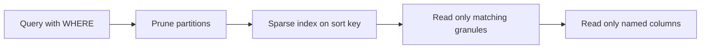

## 🎯 TL;DR

> In a columnar MPP engine, **the physical design is the performance design.** Four decisions do most of the work: the **sort key**, the **partitioning**, the **distribution (bucketing)** and the **pre-aggregated tables** (rollups).

- The **sort key** decides which data blocks a filter can skip. Put the columns you filter on most, in a sensible order, first.
- **Partitions** are a data-management unit (drop, TTL, load by period). Use coarse partitions; too many small partitions create many small files and slow planning.
- **Distribution** spreads rows across nodes or buckets. A good key avoids skew and lets joins on the same key run locally.
- **Rollups and materialized views** store pre-computed aggregates, so dashboards read thousands of rows instead of billions.
- Engine names differ (ClickHouse `MergeTree`, StarRocks table models, Doris, Trino connectors), but the questions are the same. Always check the docs for your version before quoting a default.

## 🌱 Start simple (Junior)

> **💡 Analogy:** A phone book sorted by last name. Finding "Karimi" means jumping to the K section and reading a few pages. If the book were sorted by phone number, you would have to read every page. The **sort key** is the sort order of the phone book, and it decides how many pages you read.

Suppose a table of events with 5 billion rows, and most dashboards ask:

```sql
SELECT count(*), sum(amount)
FROM events
WHERE country = 'IR'
  AND event_date >= '2026-01-01';
```

If the data is stored sorted by `country` and then `event_date`, the engine can skip most of the file blocks that cannot match. If it is stored in arrival order, every block may contain Iranian rows from 2026, so the engine reads almost everything. The query text is identical; only the physical layout changed.

## 🔧 How it really works (Mid)

### Sort key and sparse indexes

ClickHouse `MergeTree` stores data in parts, sorted by the `ORDER BY` key. Its primary index is **sparse**: it keeps one index entry per granule (by default, one granule is 8192 rows). A query reads the index, finds the granules that could match, and skips the rest. Columns are stored separately, so only the columns named in the query are read.

```sql
CREATE TABLE events
(
  event_date  Date,
  event_time  DateTime,
  country     LowCardinality(String),
  event_type  LowCardinality(String),
  user_id     UInt64,
  amount      Decimal(12, 2)
)
ENGINE = MergeTree
PARTITION BY toYYYYMM(event_date)
ORDER BY (country, event_type, event_date, user_id);
```

The order of the sort key matters. Put low-cardinality columns that appear in most filters first (here `country`), because a prefix of the key is what the index can use. A query that filters only on `user_id` cannot use this index well, and you need either a different sort key, a projection, or a secondary index, depending on the engine.

### Partitioning

`PARTITION BY toYYYYMM(event_date)` creates one partition per month. Partitions help with retention (dropping a month is cheap), loads by period, and some pruning. They are **not** a substitute for the sort key. A common mistake is to partition by `user_id` or by day across many years, which creates thousands of partitions, each with tiny parts, and slows query planning and merges.

### StarRocks: table model, buckets and colocation

StarRocks needs the table model chosen at creation time. Its key columns define the sort order and the uniqueness behavior:

```sql
CREATE TABLE events_sr
(
  event_date  DATE,
  country     VARCHAR(8),
  event_type  VARCHAR(32),
  event_time  DATETIME,
  user_id     BIGINT,
  amount      DECIMAL(12, 2)
)
DUPLICATE KEY (event_date, country, event_type)
DISTRIBUTED BY HASH(user_id) BUCKETS 16;
```

- **Duplicate Key** keeps every row. Use it for raw facts (events, clicks).
- **Aggregate Key** pre-aggregates rows that share a key, using aggregate functions per column. Use it for rollups where you do not need the raw rows.
- **Unique Key** and **Primary Key** keep the latest row per key, which is how you do upserts. Their behavior and merge rules differ, so check the docs for your version.
- `DISTRIBUTED BY HASH(user_id) BUCKETS 16` splits data into 16 buckets. Tables that are joined on `user_id` and have the same bucket count and distribution can be placed in a **colocation group**, so the join runs on each node without shuffling rows across the network.

### Rollups with materialized views

A rollup is a table of pre-computed aggregates. In ClickHouse, a materialized view runs on each insert and writes into a target table:

```sql
CREATE TABLE sales_daily
(
  day      Date,
  country  LowCardinality(String),
  revenue  SimpleAggregateFunction(sum, Decimal(18, 2))
)
ENGINE = SummingMergeTree
PARTITION BY toYYYYMM(day)
ORDER BY (day, country);

CREATE MATERIALIZED VIEW sales_daily_mv TO sales_daily AS
SELECT toDate(event_time) AS day, country, sum(amount) AS revenue
FROM events
GROUP BY day, country;
```

`SummingMergeTree` adds up rows with the same key, but only during background merges. Until then, the target can hold several partial rows per key, so queries must still apply `sum(revenue) ... GROUP BY`. Forgetting this is a common bug.



## 🧠 Senior depth & trade-offs

- **Sort key design is a workload decision.** Choose the key from the top five query patterns, not from the schema. Cardinality matters: a very high-cardinality first column makes the prefix nearly unique, so the index can prune little for filters on the later columns. Test with `EXPLAIN` and the engine's index-usage output.
- **Partition granularity trade-off.** Daily partitions give good retention and pruning for recent-data queries, but they multiply the number of parts and merges. Monthly is a common middle ground. Partition by the column you filter and delete on, and keep the count in the hundreds, not the tens of thousands.
- **Small parts and merge pressure.** Frequent small inserts create many parts. Background merges must catch up, and read queries slow down while they do. Batch inserts (the usual guidance is a few thousand rows or more per insert, and not one row at a time) and monitor the number of active parts per partition. Check the exact limits in your version's docs.
- **Distribution and skew.** A bucket key with a hot value (one customer, one country code, a null value) puts most rows in one bucket, and that node becomes the bottleneck. Check the row and size distribution per bucket. Choose a key with high cardinality and a good spread, and consider a salted key for a known hot value.
- **Colocation is a constraint, not a free win.** Colocated joins need matching bucket keys and bucket counts. Changing the bucket count later usually means rebuilding the table. Plan the join keys for the big fact-to-fact or fact-to-dimension joins before the first load.
- **Materialized view freshness.** An insert-time view (ClickHouse) is always consistent with its source, but a bug in its query silently corrupts the rollup, and a backfill needs a manual rebuild. Async or scheduled materializations (StarRocks and others) trade freshness for simpler recovery. Know which one you run and how you verify it against the base table.
- **Monitor the physical layout.** Track parts per partition, bucket size skew, merge backlog, and the ratio of rows scanned to rows returned for your top queries. A rising scan ratio after a schema change means the sort key no longer matches the query pattern.
- **When not to over-model.** For small tables (a few million rows), any sensible layout is fast, and extra partitions and rollups are overhead. Physical tuning pays off on the largest tables and the most frequent queries.

## 🧪 Try it

1. **Exercise.** A multi-tenant table is queried as `WHERE tenant_id = ? AND event_date BETWEEN ? AND ?`. Choose a sort key and say which column you would use for bucketing in StarRocks.

<details><summary>Solution</summary>

Sort key: `(tenant_id, event_date, event_type)`. The tenant is the most common filter and has moderate cardinality, and the date range is the second filter, so a tenant plus date range reads a contiguous part of the sorted data. For bucketing, `tenant_id` alone is risky if one tenant is huge (skew). A safer choice is a high-cardinality key such as `user_id` for even buckets, or `tenant_id` only if the tenants are similar in size. Measure bucket size distribution before deciding.

```sql
-- check the spread of rows per tenant before choosing the bucket key
SELECT tenant_id, count(*) AS rows_
FROM events
GROUP BY tenant_id
ORDER BY rows_ DESC
LIMIT 10;
```

</details>

2. **Exercise.** You partition by day for 5 years of data. How many partitions do you have, and what would monthly partitions give?

<details><summary>Solution</summary>

Daily: 5 × 365 = 1,825 partitions (about 1,830 with leap days). Monthly: 5 × 12 = 60 partitions. Each partition holds parts and files, so the daily design has roughly 30 times as many partition directories and merge units. Unless you need daily deletes, monthly is usually enough.

</details>

## 💬 Interview corner

**"How would you physically design a fact table for a dashboard that filters by date and country?"** Expect the sort key, the partition, the distribution and a rollup, with reasons.

- **Mid answer:** "I partition by month on the event date, sort by country and date, and bucket by a high-cardinality key. For the dashboard I add a daily rollup, so the query reads a small table."
- **Senior answer:** "I start from the top query patterns and check the cardinality and skew of each candidate column. I keep partitions coarse to limit part counts, make the sort key match the filters, and bucket on a key that spreads evenly so joins can be colocated. The rollup is maintained by an insert-time or scheduled job, and I verify it against the base table with a reconciliation query."

**"Why does my query still scan everything after I added a partition?"** Model answer: "A partition only prunes when the filter matches the partition expression. Also, partitions are coarse, so the data inside a partition still has to be scanned unless the sort key helps. I would check the query plan for pruning, then check whether the filter columns are a prefix of the sort key."

## ⚠️ Common mistakes

- **Partitioning as the main optimization.** Partitions prune by period; they do not replace a good sort key.
- **Too many partitions.** Daily partitions on years of data, or partitions on high-cardinality columns, create many small parts.
- **Putting the highest-cardinality column first in the sort key.** It makes the later columns useless for pruning.
- **Bucketing on a skewed key.** One hot value puts most data on one node.
- **Forgetting that SummingMergeTree-style merges are eventual.** Queries on the rollup must still aggregate.
- **Changing bucket count or sort key later without a plan.** This usually means a rebuild of a large table.
- **Quoting defaults from memory.** Granule sizes, partition limits and merge settings change across versions.

## ✅ Check yourself (quiz)

1. A query filters on `country = 'IR'` and `event_date` for the last week. The table is sorted by `event_time` only. What is the most useful change?
   - A) Add more partitions by `user_id`
   - B) Sort by `(country, event_date, ...)` so the index can skip non-matching blocks
   - C) Switch to a row store
   - D) Remove the `WHERE` clause

<details><summary>Answer</summary>

**B** — The sort key determines which blocks can be skipped. A sort order that starts with the filter columns lets the sparse index prune most data. Partitioning by `user_id` (A) creates a huge number of partitions and does not help this filter.

</details>

2. Why is partitioning by day across ten years usually a mistake?
   - A) Days cannot be used as a partition key
   - B) It creates thousands of partitions with small parts, which slows merges and planning
   - C) It makes the sort key unusable
   - D) It forces full table scans

<details><summary>Answer</summary>

**B** — Thousands of partitions mean many small parts and merge units. The fix is a coarser partition, such as month, and a good sort key for fine-grained pruning.

</details>

3. **(Senior)** A StarRocks join between two fact tables on `user_id` shuffles large amounts of data every time. Which design change is the most direct?
   - A) Give both tables the same bucket key and bucket count, and place them in a colocation group
   - B) Increase the number of partitions on both tables
   - C) Use a Duplicate Key table for both
   - D) Add a `DISTINCT` to the query

<details><summary>Answer</summary>

**A** — Colocation works when matching rows of both tables are in the same bucket on the same node, so the join runs locally. Partition count (B) does not change bucket placement; a table model (C) does not change distribution; `DISTINCT` (D) adds work.

</details>

4. **(Senior)** A rollup built with `SummingMergeTree` shows revenue that is slightly too low after an insert, then correct later. What is the most likely reason, and what is the fix?
   - A) The base table lost rows
   - B) Merges have not yet combined partial rows per key; query the rollup with `sum(revenue) ... GROUP BY` instead of reading single rows
   - C) The materialized view is disabled by design
   - D) The rollup needs a larger sort key only

<details><summary>Answer</summary>

**B** — Summing happens at background merge time, so before a merge the same key can exist in several rows. A final `GROUP BY` with `sum` gives the right result at any time.

</details>

5. **(Senior)** Which trade-off is most accurate for a bucket key chosen as `country` on a table where 60% of rows are from one country?
   - A) Perfectly balanced, because there are few countries
   - B) Skewed: one bucket receives most rows, so one node becomes the bottleneck
   - C) Faster joins, because all rows are in one place
   - D) No effect; only the sort key matters for distribution

<details><summary>Answer</summary>

**B** — Distribution follows the bucket key. A dominant value creates a hot bucket. Check the size per bucket and choose a key with a better spread.

</details>

## 🗂️ Flashcards

| Front | Back |
|---|---|
| What does the sort key control? | Which blocks or granules a filter can skip, and how data is laid out on disk |
| Why is the ClickHouse primary index sparse? | It stores one entry per granule, not per row, so it stays small |
| What is partitioning mainly for? | Data management (retention, drops, period loads) and coarse pruning |
| Why avoid too many partitions? | Many small parts and merge units slow planning and queries |
| StarRocks Duplicate Key table | Keeps all rows; used for raw facts |
| What is a colocation group? | Tables with matching bucket keys and counts, so their join runs locally |
| Why does SummingMergeTree need a final GROUP BY? | Summation happens at merge time, so partial rows can exist |
| What is bucket skew? | One bucket holds disproportionate data because the key has a hot value |

## 🔗 Go further

- **star-snowflake-obt** explains the logical shapes these physical choices serve.
- **columnar-storage** and **compression** explain why column layout and sort order pay off.
- **clickhouse** and **starrocks-doris** cover the engine-specific table models and settings.
- **mpp-architecture** explains how distribution and shuffles work across nodes.
- **realtime-olap** covers streaming inserts and the small-parts problem in depth.
- **partitioning-sharding** covers the general concepts behind partitions and buckets.
- Check the official docs for your engine version before you copy any default value.
