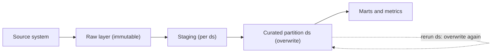

## 🎯 TL;DR

> A good batch pipeline is a **function of its inputs**: the same source data, the same code version and the same parameters (usually a date partition) must produce the same output. Running it twice must not change the result.

- Make every write **idempotent**: overwrite the partition you own instead of appending to it.
- Keep the **raw layer immutable**, so derived data can always be rebuilt after a bug fix.
- Process by **partition** (for example one `ds` per day), never by "whatever is new right now".
- Keep workers **stateless**. State lives in storage and metadata, so a failed task can be killed and retried safely.

## 🌱 Start simple (Junior)

> **💡 Analogy:** A recipe that is written for a specific date. Cooking "the 5 January batch" twice should give you one 5 January batch, not two batches stacked in the same pot. If the pot is emptied before cooking, running the recipe again is harmless.

Imagine a job that counts yesterday's orders and writes the result to a summary table:

```sql
-- Version A: appends on every run
INSERT INTO daily_orders_summary
SELECT '2026-01-05' AS ds, COUNT(*) AS orders
FROM orders
WHERE order_date = '2026-01-05';
```

If the scheduler retries this after a timeout, and the first attempt had actually succeeded, the table now has **two rows** for 2026-01-05. Every dashboard that sums the table counts that day twice.

```sql
-- Version B: replaces the day's rows
DELETE FROM daily_orders_summary WHERE ds = '2026-01-05';

INSERT INTO daily_orders_summary
SELECT '2026-01-05' AS ds, COUNT(*) AS orders
FROM orders
WHERE order_date = '2026-01-05';
```

Run version B ten times and the table still has one row for that day. (We will make the delete and insert atomic in the mid section.)

Three words to remember:

- **Idempotent:** running it again leaves the same final state.
- **Deterministic:** the same inputs always give the same output.
- **Partition:** a slice of the data, usually by date, that one run owns.

## 🔧 How it really works (Mid)

Idempotent writes come from a small set of patterns:

| Pattern | How it works | Good for | Watch out |
|---|---|---|---|
| Partition overwrite | Replace all rows of partition `ds` in one commit | Daily facts, aggregates | Rewrites the whole partition, even if few rows changed |
| MERGE on a business key | Update matching keys, insert the rest | Dimensions, CDC feeds | Needs a reliable unique key; costly on very large targets |
| Staging then atomic publish | Build in a temp location, then switch with one commit | Warehouse tables, files | Object stores have no atomic directory rename |
| Table-format commit | Iceberg or Delta commits a new snapshot atomically | Lakehouse tables | Old snapshots and files need expiry |

In Spark SQL, a partition overwrite looks like this:

```sql
SET spark.sql.sources.partitionOverwriteMode = dynamic;

INSERT OVERWRITE TABLE daily_orders PARTITION (ds)
SELECT order_id, customer_id, amount, ds
FROM staging_orders
WHERE ds = '2026-01-05';
```

With `dynamic` mode, only the partitions present in the query output are replaced. The default `static` behaviour can replace more of the table than you intended, which is why the setting matters. Check the docs for your Spark version.

The transformation itself should be a **pure function** of its inputs, with the date passed in as a parameter:

```python
def build_daily_summary(orders: list[dict], ds: str) -> list[dict]:
    """Same orders and same ds always give the same output."""
    day_orders = [o for o in orders if o["order_date"] == ds]
    counts: dict[str, int] = {}
    for o in day_orders:
        counts[o["status"]] = counts.get(o["status"], 0) + 1
    return [{"ds": ds, "status": s, "orders": n} for s, n in sorted(counts.items())]


if __name__ == "__main__":
    sample = [
        {"order_date": "2026-01-05", "status": "paid"},
        {"order_date": "2026-01-05", "status": "refunded"},
        {"order_date": "2026-01-04", "status": "paid"},
    ]
    print(build_daily_summary(sample, "2026-01-05"))
```

Notice what is **not** in the function: no `datetime.now()`, no random numbers, no reads of "the current" configuration. Those are the usual sources of non-determinism:

- The wall clock (`now()`, `current_date`, `date.today()`).
- Unordered `LIMIT` (`SELECT ... LIMIT 1000` without `ORDER BY` returns a different sample each time).
- Sources that change under you: an API that returns only the latest state, or a table that is updated during the run.
- Parallel writers that race on the same partition.

**The raw layer is append-only.** The landing zone keeps exactly what the source sent, with the load time. Corrections arrive as new rows or new versions; nobody edits raw data by hand. Everything downstream is derived and can be recomputed:



This is the core of **functional data engineering**, the idea popularized by Maxime Beauchemin: a partition is `f(immutable inputs, code version)`. To change a result, you fix the code and recompute the affected partitions. You do not patch rows in place.

**Partition-based processing** means every run answers one question: "build partition `ds` from its inputs." Late data does not need special handling in the run itself. It triggers a re-run of the affected partitions, which overwrite them again.

**Separating compute from state.** Task workers should hold no state that matters. Outputs go to object storage or the warehouse. Orchestration state (which runs succeeded, retry counts) lives in a metadata database, such as the one Airflow uses. Because the worker holds nothing, you can kill it, reschedule the task and get the same result.

## 🧠 Senior depth & trade-offs

- **Idempotency is cheaper than exactly-once.** End-to-end exactly-once across systems needs transactions that span them. An idempotent write gives the same final state under at-least-once delivery, which is usually far cheaper. At-least-once delivery plus an idempotent sink is "effectively once". See [[exactly-once]].
- **Overwrite cost.** Rewriting a 200 GB partition to fix 0.1% of its rows wastes compute. A MERGE on a key is cheaper but harder to reason about. Smaller partitions (hourly instead of daily) reduce rewrite cost but create more files and more tasks. This is a real trade-off, not a rule.
- **Side effects break idempotency.** Sending an email, calling a payment API, incrementing an external counter, or appending to an unkeyed topic each happen once per run, not once per result. Give external calls an idempotency key, or move them to an outbox step. See [[outbox-pattern]].
- **Non-reproducible sources.** A "latest rates" API cannot be asked for last Tuesday's answer. Store the raw response with its fetch time, or pin a snapshot ID when the source supports it (Iceberg and Delta tables do). Whether time travel is available depends on the engine and table format; check your version.
- **Time zones.** Use an explicit logical date, usually UTC or a business time zone named in the config. Mixing local time with UTC makes partitions overlap or leave gaps around daylight-saving changes.
- **Schema and code versions.** A rerun of an old partition with new code may produce different columns. Version the code, track schema changes, and treat a backfill that changes the schema as a migration.
- **Monitoring as the safety net.** Compare per-partition row counts and totals with the previous run and with the source. A rerun that changes the row count by 40% should block publication and alert someone, not silently overwrite a good partition. Tie this to the freshness and correctness targets in [[sla-slo]].
- **When not to use it.** Partition overwrite does not fit long-running streaming state, such as sessions or running totals. Use checkpointed state stores and keyed upserts there. For very large tables where a full-partition rewrite is too expensive, an incremental MERGE on keys is the right tool, even though its logic is harder to get right.

## 🧪 Try it

1. A job runs `INSERT INTO sales_daily SELECT ... WHERE order_date = :ds` every day. Rewrite it so that running it twice for the same `ds` gives the same table. Name the write pattern you used.
2. A pipeline filters `WHERE created_at > now() - interval '1 day'`. Explain why running it on Monday for last Friday's data gives different rows, and rewrite the filter so it uses the logical date.
3. An API returns the latest exchange rates. Explain why storing only the latest response breaks reproducibility, and what you should store instead.

<details><summary>Show solutions</summary>

**1.** Use a partition overwrite. In one transaction, `DELETE FROM sales_daily WHERE ds = :ds` followed by the `INSERT ... WHERE order_date = :ds`. Or use `INSERT OVERWRITE` on that partition. Running it again replaces the same partition, so the row count stays the same.

**2.** `now()` is the time of the run, not the day you asked for. On Monday, "the last 24 hours" is a different window from the one Friday's run saw, so the reruns read different rows. Use `WHERE order_date = :ds`, where `:ds` is the logical date the scheduler passes in.

**3.** The API returns a value that changes over time, so next week's rerun cannot fetch the same numbers. Store the raw response with its `fetched_at` timestamp and the source name in the immutable raw layer. Build the curated table from that stored copy.

</details>

## 💬 Interview corner

**Question: "How do you make a pipeline safe to rerun?"**

Mid answer: "I'd overwrite the daily partition instead of appending, so a retry doesn't create duplicate rows."

Senior answer: "I'd pass the logical date in as a parameter and read from an immutable raw layer or a pinned snapshot. Each partition is written atomically, by overwrite or by MERGE on a business key. Side effects go through idempotency keys or an outbox. Before publishing, I'd compare per-partition row counts with the previous run and the source, so a bad rerun is caught before consumers see it."

**Question: "Your job ran twice and the revenue doubled. What now?"** The mid answer is "remove the duplicates". The senior answer is to find why the write was not idempotent, fix it, rebuild the affected partitions from raw, and add a check that would have caught the doubling.

> **🎤 Say this in the interview:** "I design each run as a function of its logical date and immutable inputs. Reruns overwrite the partition they own, so retries are safe and backfills are just more runs. Exactly-once is built from at-least-once delivery plus idempotent writes."

## ⚠️ Common mistakes

> **⚠️ Watch out:** `datetime.now()` or `current_date` inside a task. The output depends on when the task ran, so a backfill quietly produces the wrong days.

- Appending on every run and then hiding the duplicates with `DISTINCT` in the report.
- Overwriting the whole table when only one partition should change. A static `INSERT OVERWRITE` can delete more than you meant.
- Partitioning by ingestion time when the business question is about event date. Late data then lands in the wrong partition.
- Editing raw data to "fix" bad rows. Keep raw as received, and fix the derived layer or append a correction.
- Relying on the scheduler never to run a task twice, instead of making the write idempotent.
- Using `LIMIT` without `ORDER BY` on a source that you later treat as a reproducible sample.

## ✅ Check yourself (quiz)

1. Which property means that running a task twice leaves the same final state as running it once?
   - A) Determinism
   - B) Idempotency
   - C) Durability
   - D) Serializability

<details><summary>Answer</summary>

**B** — idempotency is about repeated application leaving the same state. Determinism is about the same output for the same input, which is related but answers a different question.

</details>

2. A daily job appends rows for `ds = 2026-01-05`. The scheduler retries after a timeout, and the first attempt had already committed. What happens, and what is the fix?
   - A) Nothing; the database ignores duplicate rows
   - B) Duplicate rows appear; overwrite the `ds` partition instead of appending
   - C) The retry fails with a key error, which is always safe
   - D) The job is slower but still correct

<details><summary>Answer</summary>

**B** — an append-only write is not idempotent, so the retry doubles the day. Replacing the partition in one commit makes the retry produce the same result.

</details>

3. Which change makes this filter reproducible? `SELECT * FROM rates WHERE ts > now() - interval '1 day'`
   - A) Add `ORDER BY ts`
   - B) Replace `now()` with the run's logical date and filter on that date
   - C) Add `LIMIT 1000`
   - D) Use `SELECT DISTINCT`

<details><summary>Answer</summary>

**B** — `now()` changes every time the task runs. Ordering, limiting and deduplicating do not fix the window, which still depends on when the run happened.

</details>

4. **(Senior)** Events flow from Kafka into a warehouse with no transaction spanning both systems. Consumers may see an event more than once after a restart. What is the pragmatic design?
   - A) Turn on unlimited retries
   - B) Use at-least-once delivery and an idempotent write keyed by a unique event ID (upsert or MERGE), so redelivered events do not change the final state
   - C) Remove the primary key so inserts are faster
   - D) Run the consumer on a single thread

<details><summary>Answer</summary>

**B** — with at-least-once delivery, duplicates are expected. A write keyed by event ID makes the second delivery a no-op, which gives effectively-once results without a cross-system transaction.

</details>

5. **(Senior)** A rerun of last month's partition produces 40% fewer rows than the original run. What should the pipeline do?
   - A) Overwrite the partition, because the new run is newer and must be right
   - B) Compare the counts with the original run and the source, block publication, and investigate (for example a changed source snapshot or a code change)
   - C) Ignore it, because row counts are not reliable
   - D) Append the new rows to the old ones

<details><summary>Answer</summary>

**B** — a large unexplained change is a signal, not a success. Blocking publication keeps consumers on the last good data until someone understands the cause.

</details>

## 🗂️ Flashcards

| Front | Back |
|---|---|
| Idempotent | Applying it once or many times leaves the same final state |
| Deterministic | The same inputs and code version always give the same output |
| Why pass `ds` instead of `now()` | Reruns and backfills compute the day they were asked for |
| Functional data engineering | Partition = f(immutable inputs, code version); recompute and overwrite instead of mutating |
| Why keep raw immutable | Derived data can always be rebuilt after a bug fix |
| Idempotency vs exactly-once | Idempotent writes make at-least-once delivery behave as effectively-once |
| Why workers should be stateless | State lives in storage and metadata, so a failed task can be killed and retried |

## 🔗 Go further

- **dedup-idempotent-loads** applies these rules to removing duplicates at each layer.
- **pattern-backfill** and **backfills** show how the same rules are used to rebuild history.
- **airflow** explains logical dates and data intervals, which map directly onto the `ds` parameter used here.
- **medallion-architecture** and **lakehouse-table-formats** show the raw, curated and atomic-commit layers in practice.
- Glossary: [[idempotency]], [[incremental-processing]], [[partition]].
