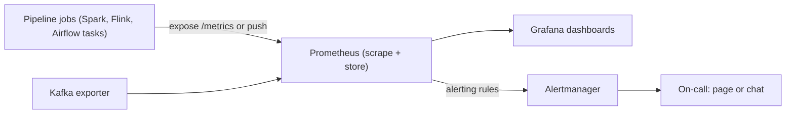

## 🎯 TL;DR

> **Pipeline monitoring** answers three questions at any moment: *Is the data fresh? Is the pipeline healthy? Is it keeping up?* You expose **metrics** from every job, collect them (for example with Prometheus), chart them (Grafana), and alert on **symptoms that users feel**, backed by an **SLO** (service level objective) that says what "good enough" means.

- **Metrics** are numbers over time: counters (only go up), gauges (go up and down), histograms (distributions such as run durations).
- Key pipeline metrics: **freshness** (age of the newest data), **job duration**, **records in and out**, **error count**, and **consumer lag** for streaming.
- An **SLA** is the promise to a consumer; an **SLO** is the internal target that protects it; an **SLI** is the measurement. Alert on SLO burn, not on every blip.
- Every page should lead to a runbook and, after a real incident, a **postmortem** that changes something.

## 🌱 Start simple (Junior)

> **💡 Analogy:** A car dashboard. The speedometer, fuel gauge and engine light do not fix the car. They tell you the state early enough that you can act. A pipeline needs the same: numbers that change over time, and a warning light that turns on before the driver is stranded.

Consider a daily `orders` pipeline that must finish by 07:00 so the sales team sees yesterday's revenue at 08:00. Three questions tell you whether it works:

| Question | Metric that answers it | Bad sign |
|---|---|---|
| Is the data fresh? | Time since the newest successfully loaded data | 9 hours old at 08:00 |
| Is the job healthy? | Failed runs, error count | Three retries, then a failure |
| Is the volume normal? | Records processed per run | 40% fewer rows than usual |

Two words you will see everywhere:

- **SLA (service level agreement):** a promise to people outside the team, for example "the `orders` table is ready by 07:00 on working days".
- **SLO (service level objective):** the internal target that makes the promise realistic, for example "the table is ready on time for 95% of days in a month".

Without a dashboard, you learn about a problem when the sales manager calls you. With one, you see the job slowing down at 03:00 and fix it before 07:00.

## 🔧 How it really works (Mid)

### The monitoring path



Prometheus is a **pull** system: it scrapes an HTTP endpoint on each target at a fixed interval and stores the samples as time series. Each series is identified by a metric name plus labels, for example `pipeline="orders"`. Grafana reads from Prometheus to draw graphs. Alertmanager receives alerts from Prometheus and routes them to people.

### Instrumenting a job

A job exposes three kinds of metrics. Here is a minimal Python example with the `prometheus_client` library:

```python
import time
from prometheus_client import Counter, Gauge, Histogram, start_http_server

RECORDS = Counter("pipeline_records_processed_total", "Records processed", ["pipeline"])
LAST_OK = Gauge("pipeline_last_success_timestamp_seconds", "Unix time of last successful run", ["pipeline"])
DURATION = Histogram("pipeline_run_duration_seconds", "Run duration in seconds", ["pipeline"])

def run(batch):
    start = time.time()
    n = transform_and_load(batch)          # your job logic
    RECORDS.labels(pipeline="orders").inc(n)
    DURATION.labels(pipeline="orders").observe(time.time() - start)
    LAST_OK.labels(pipeline="orders").set_to_current_time()

if __name__ == "__main__":
    start_http_server(8000)                # exposes /metrics for Prometheus
    run(load_batch())
```

- A **counter** only increases. Use `rate()` in PromQL to get records per second.
- A **gauge** holds the current value. The last-success timestamp is a gauge, because it is a state, not an accumulation.
- A **histogram** records durations so you can ask for the 95th percentile.

Short-lived batch jobs can finish before Prometheus scrapes them. For those, the usual options are a Pushgateway, or having the orchestrator record the metrics at the end of the run. Pushgateway is only for job-level metrics, not for high-volume data.

### Freshness: the most important metric

Freshness is the age of the newest data that the consumer can see. Measure it as the time since the last successful publish, and optionally as the age of the newest event time, which is a stricter measure.

```yaml
# Prometheus alerting rule: page if orders is more than 2 hours stale for 10 minutes
groups:
  - name: orders-pipeline
    rules:
      - alert: OrdersFreshnessBreached
        expr: time() - pipeline_last_success_timestamp_seconds{pipeline="orders"} > 7200
        for: 10m
        labels:
          severity: page
        annotations:
          summary: "orders is more than 2h stale"
```

The `for: 10m` clause stops a single late scrape from paging anyone.

### Streaming: consumer lag

For Kafka, **consumer lag** is the number of messages written to a partition that the consumer group has not committed yet. It is the log end offset minus the committed offset, summed per partition. Lag tells you how far behind the consumer is in messages, and you convert it to time with the production rate.

Lag is a **rate** problem, not just a size problem. If the backlog is `B` messages, the producer writes `P` per second and the consumers process `C` per second with `C > P`, the time to catch up is:

```text
drain time = B / (C - P)

Example: B = 2,000,000 messages, C = 50,000/s, P = 40,000/s
         drain time = 2,000,000 / (50,000 - 40,000) = 200 seconds

If P = 60,000/s instead, C - P is negative: the lag grows forever.
```

So an alert on "lag > 1 million" is weak. A better alert is "lag is growing for 15 minutes" or "estimated drain time exceeds the freshness SLO".

## 🧠 Senior depth & trade-offs

- **Define SLIs first, then SLOs.** An SLI is a measurement, such as "fraction of runs that publish by 07:00". An SLO is a target over a window, such as 95% over 30 days. The gap between 100% and the SLO is your **error budget**.
- **Error budget arithmetic.** For a daily job over 30 days, 95% means you may miss `30 × 0.05 = 1.5` days. Missing one day leaves you at 29/30 = 96.7%, which passes. Missing two gives 28/30 = 93.3%, which fails. A 99% target would allow 0.3 missed days, which means no misses at all, so 99% is rarely a sensible daily target.
- **Alert on burn rate, not on single failures.** Burn rate is how fast you consume the error budget. A fast burn (for example, a whole day of budget in one hour) pages. A slow burn opens a ticket. This removes most alert noise without missing real outages.
- **Alert on symptoms, dig with causes.** Page on "data is stale" or "consumer lag is growing". Do not page on "CPU is 80%": it may be fine. Put causes (CPU, GC, executor losses) on dashboards.
- **Cardinality is a cost.** Labels such as `pipeline` or `table` are fine. A label with `user_id` or `order_id` creates millions of series and can take Prometheus down. Keep high-cardinality detail in logs or in the warehouse.
- **Spark and Flink.** Spark exposes its own metrics (executors, stages, shuffle bytes) that you can scrape; use the Spark UI for diagnosis (see [[spark-ui-debugging]]). Flink exposes checkpoint duration and backpressure metrics, and Kafka source lag comes from the connector metrics. Watch checkpoint duration: when it grows toward the checkpoint interval, you are one slow hour from failure.
- **Airflow.** Track task duration, retries, and DAG-level "last successful run". Note that an orchestrator reporting "success" does not prove the data is correct; pair it with freshness and quality checks (see [[data-quality]]).
- **Clock problems.** Freshness depends on clocks. If a worker clock is wrong by 10 minutes, a freshness alert can be off by that much. Use the same time source for measurement and alerting, and compare event time with processing time when you need to know how late the data is.
- **Operational maturity.** Every alert needs an owner, a runbook link and an expected action. After a real incident, write a postmortem (see [[incidents-postmortems]]) and change one thing: a metric, a threshold, a retry policy, or the runbook. Otherwise the same incident returns with a new name.
- **When NOT to build this.** A nightly report used by one person does not need an SLO and a burn-rate alert. A heartbeat check and a Slack message may be enough. Match the machinery to the cost of being wrong.

## 🧪 Try it

A job `orders` writes the gauge `pipeline_last_success_timestamp_seconds{pipeline="orders"}` (Unix seconds). Two tasks:

1. Write a PromQL expression that returns how many seconds old the `orders` data is.
2. Given a Kafka backlog of `B = 3,000,000`, consumers at `C = 90,000/s` and producers at `P = 75,000/s`, how long until the lag is drained? What changes if the producer rate rises to `95,000/s`?

<details><summary>Your guess?</summary>

1. Age in seconds: current time minus the last success timestamp.

```promql
time() - pipeline_last_success_timestamp_seconds{pipeline="orders"}
```

Add `> 7200` to turn it into an alert condition, and `for: 10m` in the rule, as in the YAML example above.

2. Drain time = `B / (C - P)` = 3,000,000 / (90,000 - 75,000) = 3,000,000 / 15,000 = **200 seconds**. If the producer rate rises to 95,000/s, then `C - P = -5,000`: the consumers are slower than the producers, the denominator is negative, and the lag grows by 5,000 messages every second. More consumers (or more partitions to parallelize into) are the fix, not a longer wait.

</details>

## 💬 Interview corner

**Typical question:** "How would you monitor a daily data pipeline? What do you alert on?"

- **Junior answer:** "I would check the logs and set an alert if the job fails."
- **Mid answer:** "I expose metrics for duration, records processed and errors, with Prometheus and Grafana. I alert on freshness, meaning the time since the last successful load, and on failures after retries."
- **Senior answer:** "I define an SLO for freshness, such as 95% of days ready by 07:00, and alert on error-budget burn rather than single failures. For streaming I watch consumer lag as a growth rate and convert it to drain time. Causes like CPU and checkpoint duration live on dashboards, and every alert has a runbook."

> **🎤 Say this in the interview:** "I monitor symptoms the consumer feels: freshness, volume, and failures. The freshness SLO is what I alert on, through burn rate so one late run does not page anyone. For streaming, lag only matters as a rate against the drain time, so I alert when lag grows or the drain estimate breaks the SLO. Every alert has a runbook, and every real incident ends in a postmortem that changes something."

## ⚠️ Common mistakes

> **⚠️ Watch out:** Alerting on "job succeeded". A job can succeed and still publish yesterday's data, or zero rows. Alert on freshness and volume too.

- **Alerting on causes instead of symptoms.** High CPU is a cause. Stale data is a symptom users care about.
- **Threshold on lag size.** "Lag > 1 million" fires at peak traffic on a healthy system and misses a slow leak. Use growth and drain time.
- **High-cardinality labels.** Putting `order_id` in a label creates a new time series per order. Prometheus memory grows until it fails.
- **Scraping short-lived jobs and wondering why there are no metrics.** The job ends before the scrape. Use a Pushgateway or record at job end.
- **Paging for every failure.** Retries that succeed should not page anyone. Page on budget burn.
- **No owner, no runbook.** An alert nobody can act on is noise, and noisy alerts get muted.
- **Dashboards without alerts, or alerts without dashboards.** You need the graph to diagnose, and the alert to notice.

## ✅ Check yourself (quiz)

1. Which metric type is most appropriate for "the timestamp of the last successful run"?
   - A) Counter
   - B) Gauge
   - C) Histogram
   - D) Summary of job names

2. A daily job has a freshness SLO of 95% over 30 days. How many late days can you have and still meet it?
   - A) 0
   - B) 1
   - C) 2
   - D) 5

3. Consumer lag is 1,000,000 messages, the consumers process 30,000/s and the producers write 20,000/s. Roughly how long until the lag clears?
   - A) About 33 seconds
   - B) About 100 seconds
   - C) About 1 hour
   - D) It never clears

4. **Scenario (senior):** Your team pages on every failed task, and on-call is exhausted. What would you change, and what would you keep?

5. **Why/trade-off (senior):** Someone proposes a label `customer_id` on the rows-processed counter, so that "we can see per-customer throughput". What is the problem, and what is a better design?

<details><summary>Answer</summary>

1. **B** — A gauge holds a current state. The last-success time goes up and resets, so it is not an accumulating count (counter) nor a distribution (histogram).
2. **B** — 30 × 0.05 = 1.5. One late day gives 29/30 = 96.7%, which passes. Two late days give 93.3%, which fails.
3. **B** — Drain time = B / (C − P) = 1,000,000 / (30,000 − 20,000) = 100 seconds.
4. Keep failures as a signal, but change the alerting to burn rate on the SLO and to freshness. Retries that succeed should not page. Keep paging for fast budget burn and for freshness breaches, and send slow burns to a ticket. Every remaining alert gets a runbook; alerts without actions get removed.
5. A `customer_id` label creates one time series per customer, which means millions of series, huge memory use, and a slow or failing Prometheus. The better design is to keep per-customer detail in logs or in the warehouse (queried with SQL), and keep metrics at a low-cardinality level such as `pipeline` and `stage`.

</details>

## 🗂️ Flashcards

| Front | Back |
|---|---|
| SLI, SLO, SLA | SLI = measurement; SLO = internal target over a window; SLA = promise to consumers |
| Error budget | The allowed amount of failure implied by the SLO (for example 5% of days) |
| Counter vs gauge | Counter only increases (use `rate()`); gauge holds a current value |
| Freshness metric for a batch job | Time since the last successful publish, usually a gauge of the last success timestamp |
| Consumer lag | Log end offset minus committed offset, summed over partitions |
| Drain time formula | `B / (C - P)`; if `C <= P`, lag never clears |
| Burn-rate alert | Pages when the error budget is consumed quickly, not on single failures |
| Why avoid `user_id` labels | Every distinct value creates a new time series, which exhausts Prometheus |

## 🔗 Go further

- [[data-observability]] — anomaly detection on freshness, volume and schema, beyond fixed thresholds.
- [[data-quality]] — the tests that tell you the data is correct, not only that it arrived.
- [[incidents-postmortems]] — how to run an incident and turn it into a change.
- [[kafka-consumers]] — consumer groups, rebalancing and how lag builds up.
- [[spark-ui-debugging]] — diagnosing a slow Spark job after monitoring has flagged it.
- [[airflow]] — task-level retries, SLAs and alerting in an orchestrator.
