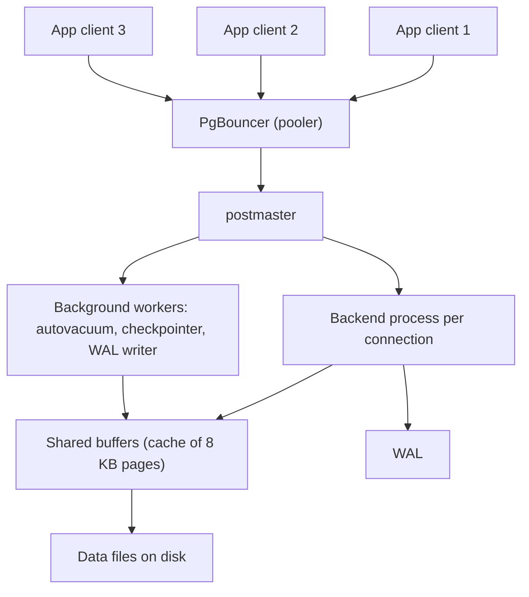

## 🎯 TL;DR

> PostgreSQL is a general-purpose **row-store** with a strong SQL engine, MVCC, a write-ahead log and a large extension ecosystem. It is the default OLTP database in many companies, and it is good enough for a surprising amount of analytics. Its operational weak spots are **connections**, **VACUUM and bloat**, and **replication slots**.

- Each client connection gets its own **backend process**, which is expensive. Use a pooler such as PgBouncer.
- MVCC leaves **dead row versions** behind. VACUUM removes them, and autovacuum must keep up.
- **Declarative partitioning** splits big tables. **Logical replication** and **replication slots** feed replicas and CDC.
- **JSONB** stores semi-structured data with indexes. **Extensions** such as TimescaleDB and Citus extend it toward time-series and horizontal scale.

## 🌱 Start simple (Junior)

> **💡 Analogy:** PostgreSQL is a **well-run office**. Every client who walks in gets their own assistant (a backend process). The assistant keeps notes on every change in a logbook (the WAL). When papers are crossed out and rewritten, someone has to clean up the old copies (VACUUM). If you have 10,000 visitors but only 20 desks, you need a receptionist who queues them (a connection pooler).

You can start with plain SQL:

```sql
CREATE TABLE orders (
  id         bigint GENERATED ALWAYS AS IDENTITY PRIMARY KEY,
  user_id    bigint NOT NULL,
  status     text   NOT NULL,
  amount     numeric(12,2) NOT NULL,
  created_at timestamptz NOT NULL DEFAULT now()
);

INSERT INTO orders (user_id, status, amount)
VALUES (1, 'PAID', 120.00), (2, 'NEW', 45.50);

SELECT status, count(*) FROM orders GROUP BY status;
```

That is enough for a junior to use PostgreSQL. The rest of this lesson is about what happens under the hood and what breaks at scale.

## 🔧 How it really works (Mid)

### Architecture in one picture



- The **postmaster** starts a **backend process for each connection**. Each process has its own memory, so 2,000 idle connections use a lot of RAM and CPU for scheduling. That is why applications need pooling.
- **Shared buffers** cache data pages. The default starting guidance in the docs is about 25% of RAM, with the OS page cache doing the rest of the work.
- Writes go to the WAL first, then the pages are written at checkpoints (see [[wal-mvcc]]).

### Connection pooling with PgBouncer

PgBouncer keeps a small set of real server connections and shares them among many client connections.

| Pool mode | A server connection is returned to the pool | Breaks |
|---|---|---|
| session | when the client disconnects | nothing, but gives little benefit |
| transaction | at the end of each transaction | session state: `SET`, session advisory locks, temp tables, session-level prepared statements (check the version notes for prepared statement support) |
| statement | after each statement | multi-statement transactions |

Transaction mode is the usual choice for web apps. Check your application for session-level features before you switch to it.

### VACUUM, bloat and wraparound

Because of MVCC (see [[wal-mvcc]]), an `UPDATE` writes a new tuple and leaves the old one as a **dead tuple**. A `DELETE` does the same. Dead tuples take space and make scans read more pages.

- **VACUUM** marks dead tuples as reusable. It does not usually shrink the file, and it updates the visibility map so index-only scans can skip pages.
- **VACUUM FULL** rewrites the table and takes an exclusive lock. Use it rarely, or use `pg_repack` for online rewrites.
- **Autovacuum** runs automatically. The default thresholds are often too lazy for a busy large table. Tune them per table with `autovacuum_vacuum_scale_factor` and related settings.
- **Bloat** is the gap between the physical size and the live data size. Check it with the statistics views, or with `pgstattuple` for an exact figure.
- **Freezing and wraparound.** Transaction IDs are 32-bit. Vacuum freezes old rows so the counter can keep going. If autovacuum cannot keep up, PostgreSQL stops accepting writes to protect data. Monitor the age of the oldest transaction ID per database.

### Partitioning

Declarative partitioning (range, list or hash) splits one logical table into child tables. Each partition has its own storage and indexes.

```sql
CREATE TABLE events (
  event_time timestamptz NOT NULL,
  user_id    bigint      NOT NULL,
  payload    jsonb
) PARTITION BY RANGE (event_time);

CREATE TABLE events_2026_01 PARTITION OF events
  FOR VALUES FROM ('2026-01-01') TO ('2026-02-01');
CREATE TABLE events_2026_02 PARTITION OF events
  FOR VALUES FROM ('2026-02-01') TO ('2026-03-01');

-- Pruning: only events_2026_01 is scanned
EXPLAIN SELECT count(*) FROM events
WHERE event_time >= '2026-01-10' AND event_time < '2026-01-11';
```

Partition pruning lets the planner skip partitions that cannot match, and dropping an old partition is much cheaper than a big `DELETE`. Partitioning does not make queries faster on its own. It helps when queries filter on the partition key.

### Logical replication and replication slots

- **Physical streaming replication** copies the WAL byte for byte to a standby. The standby is an exact copy of the whole cluster.
- **Logical replication** publishes row changes for chosen tables through a **publication**, and a **subscription** applies them on another server. It can replicate some tables only, and it can feed a different major version.
- A **replication slot** is the server's promise to keep the WAL that a consumer still needs. Logical replication and CDC tools like Debezium use slots.

The slot is safe for consumers and risky for the server. A stopped consumer makes the server retain WAL until the disk is full. See [[cdc]] for the pipeline side.

### JSONB

`jsonb` stores JSON in a binary form with keys deduplicated and fast access. Use `json` only when you must keep the exact text.

```sql
CREATE TABLE devices (id bigint PRIMARY KEY, attrs jsonb);
INSERT INTO devices VALUES (1, '{"os":"android","tags":["vip","beta"]}');

-- ->> returns text, -> returns jsonb
SELECT attrs->>'os' AS os FROM devices WHERE attrs @> '{"os":"android"}';

-- GIN index makes containment (@>) fast
CREATE INDEX devices_attrs_gin ON devices USING gin (attrs);
```

JSONB is good for optional attributes and flexible schemas. It is a poor choice for fields you filter, join and aggregate constantly. Promote those to real columns, or use a generated column with an index.

### Extensions

Extensions add types, index methods and whole features:

- **TimescaleDB** adds hypertables (automatic time partitioning), continuous aggregates and columnar-style compression for time-series. See [[time-series-db]].
- **Citus** distributes tables across nodes by a distribution column, which gives horizontal scale for multi-tenant and analytical workloads.
- **PostGIS** adds geospatial types and indexes.
- **pg_stat_statements** tracks query statistics, which is the first tool for finding slow SQL.

Each extension has its own operational costs and version constraints, so check its docs for your server version.

## 🧠 Senior depth & trade-offs

- **Connections are the first scaling limit.** Many applications open far more connections than the database can run efficiently. Pool at the edge, cap total connections, and size the pool to the number of cores and disks, not to the number of app threads. Watch for connection storms after a deploy or restart.
- **Autovacuum needs capacity.** On large, hot tables the defaults fall behind. Set per-table thresholds, watch `n_dead_tup` and the age of the oldest XID, and give autovacuum enough workers and I/O budget.
- **Long transactions are the usual cause of bloat.** An open transaction or a replica with `hot_standby_feedback` can hold back cleanup. Set timeouts for idle transactions and check the oldest snapshot.
- **Replication slots and disk safety.** Alert on retained WAL per slot. A paused CDC connector can fill the source disk, which is an outage on the production database.
- **Write amplification and indexes.** Every index on a table is updated on each write, and each update creates a new heap tuple unless HOT (heap-only tuple) updates apply. Too many indexes slow writes and bloat the table. Check `pg_stat_user_indexes` for indexes never used.
- **Planner statistics.** Bad row estimates produce bad plans. Run `ANALYZE` after large loads, and use `EXPLAIN (ANALYZE, BUFFERS)` to compare estimates with actual rows. See [[sql-query-optimization]].
- **Memory settings.** Tune `shared_buffers`, `work_mem` (per sort or hash operation, per connection) and `effective_cache_size` (the planner's estimate, not an allocation). A high `work_mem` multiplied by many connections can exhaust RAM.
- **Is Postgres enough as a warehouse?** For moderate data sizes, with modest concurrency and mostly selective queries, yes. Row storage makes wide analytical scans expensive. Columnar options exist (Citus columnar, TimescaleDB compression), but a dedicated columnar engine usually wins once scans over large tables dominate. Decide from measured query patterns, not from size alone. See [[columnar-storage]].
- **When not to use Postgres.** Very high write rates across many nodes, huge analytical scans, or workloads where a fixed schema is a poor match and document access patterns dominate. Then compare with [[nosql-families]] and warehouse engines.

## 🧪 Try it

1. **Pool sizing.** An app runs 40 threads per pod across 20 pods, and the database has 16 cores. Why is 800 direct connections a bad idea, and what would you configure in PgBouncer?
2. **Partition pruning.** Using the `events` table above, write a query that touches only February 2026 and explain why `WHERE date_trunc('day', event_time) = '2026-02-10'` can prevent pruning.
3. **JSONB query.** Write a query that returns the `id` of devices whose `attrs` contain the tag `"beta"` inside the `tags` array.
4. **Slot audit.** Write a query that shows, for each replication slot, how far its consumer is behind the current WAL position.

<details><summary>Show solutions</summary>

**1.** 800 backends would compete for 16 cores and use a lot of memory, and context switching would dominate. Use transaction pooling in PgBouncer with a small server pool (for example a few times the number of cores, shared by all pods), and cap client connections. The exact numbers depend on the workload, so measure.

**2.** `WHERE event_time >= '2026-02-01' AND event_time < '2026-03-01'` is sargable and lets the planner prune to the February partition. Wrapping the column in `date_trunc` hides it from the partition constraint, so the planner may scan all partitions. Rewrite it as a range on the raw column.

**3.**
```sql
SELECT id FROM devices WHERE attrs @> '{"tags":["beta"]}';
```
The containment operator matches arrays that include the element, and the GIN index can serve it.

**4.**
```sql
SELECT slot_name,
       active,
       pg_size_pretty(pg_wal_lsn_diff(pg_current_wal_lsn(), confirmed_flush_lsn)) AS lag
FROM pg_replication_slots
WHERE slot_type = 'logical';
```
A growing lag with `active = false` means the consumer is down or paused. A large lag with `active = true` means it is slow.

</details>

## 💬 Interview corner

**Question: "Our Postgres is slow under load. Where do you start?"** Mid answer: "I'd check connection count and pooling first, then slow queries with `pg_stat_statements`, then the plans with `EXPLAIN (ANALYZE, BUFFERS)`." Senior answer: "I'd check connections and pooling, then autovacuum lag and bloat, then long transactions, then slow plans. Only after that I'd consider hardware or partitioning. I'd make sure we have monitoring for each of these before the incident."

**Question: "Can we use Postgres as our analytics warehouse?"** Mid: "For small data and simple dashboards, yes. For large scans, a columnar engine is better." Senior: "I'd ask about data volume, concurrency, query shape and freshness needs. I'd measure with real queries, consider partitioning, and plan the move to a columnar engine if wide scans dominate. The CDC into the warehouse would use logical decoding, with slot monitoring."

**Question: "What is the difference between streaming replication and logical replication?"** Mid: "Streaming copies the WAL byte for byte, so the standby is the whole cluster. Logical copies row changes for selected tables and can work across versions." Senior: "Logical replication suits partial replication and migrations, but it needs primary keys on replicated tables, and DDL is not replicated automatically."

> **🎤 Say this in the interview:** "PostgreSQL gives each connection a process, so I put a pooler in front of it. MVCC creates dead tuples that VACUUM must clean, so I watch autovacuum lag and long transactions. For CDC I use logical decoding through a replication slot and alert on retained WAL."

## ⚠️ Common mistakes

> **⚠️ Watch out:** Raising `max_connections` to fix timeouts. More backend processes make the server slower. Pool the connections instead.

> **⚠️ Watch out:** Running `VACUUM FULL` on a busy production table during the day. It takes an exclusive lock and blocks reads and writes for the duration.

- Assuming autovacuum is always enough. Large, hot tables often need per-table tuning.
- Using `json` where `jsonb` is needed, which makes indexing and operators unavailable.
- Wrapping indexed columns in functions, which prevents index use and partition pruning.
- Leaving an unused replication slot after a CDC pipeline is removed.
- Setting `work_mem` high globally, then running out of memory when many connections sort at once.
- Treating `EXPLAIN` without `ANALYZE` as proof. Without `ANALYZE`, the plan is an estimate.

## ✅ Check yourself (quiz)

1. Why does PostgreSQL recommend a connection pooler for applications with many clients?
   - A) Each connection is a separate backend process with its own memory, so many connections are expensive
   - B) Connections cannot run queries in parallel
   - C) PostgreSQL does not allow more than 10 connections
   - D) Poolers replace the WAL

<details><summary>Answer</summary>

**A** — each connection gets a backend process with its own memory and scheduling cost. A pooler shares a small set of server connections among many clients.

</details>

2. What does VACUUM do?
   - A) It deletes the WAL files that are no longer needed
   - B) It marks dead row versions as reusable and maintains visibility information, so the space can be reused
   - C) It rebuilds all indexes from scratch
   - D) It changes the isolation level of running transactions

<details><summary>Answer</summary>

**B** — VACUUM cleans up dead tuples left by MVCC. It usually does not return space to the operating system, but it lets the table reuse the space.

</details>

3. Which query form lets the planner prune partitions of a table partitioned by `event_time`?
   - A) `WHERE date_trunc('month', event_time) = '2026-02-01'`
   - B) `WHERE event_time >= '2026-02-01' AND event_time < '2026-03-01'`
   - C) `WHERE to_char(event_time) LIKE '2026-02%'`
   - D) `WHERE event_time::text = '2026-02-01'`

<details><summary>Answer</summary>

**B** — a range on the raw partition column lets the planner compare it with the partition bounds. Functions and casts on the column hide that relationship from pruning.

</details>

4. **(Senior)** A CDC consumer has been down for three days, and the source disk is filling up. What is the cause and the correct response?
   - A) The consumer deleted rows; restore from backup
   - B) A logical replication slot keeps WAL until the consumer confirms it; restore or drop the consumer, and alert on retained WAL
   - C) Autovacuum is disabled; enable it
   - D) JSONB columns are too large; convert them to text

<details><summary>Answer</summary>

**B** — the slot forces the server to keep WAL that the consumer has not confirmed. Recovering the consumer lets WAL be released. Dropping the slot is the last resort when the consumer is no longer needed, and monitoring should catch this earlier.

</details>

5. **(Senior)** Under which condition is PostgreSQL a poor choice for a large analytical workload, even with partitioning?
   - A) When queries filter on the partition key
   - B) When queries scan wide ranges of many columns over very large tables, because row storage reads unused columns
   - C) When the table has a primary key
   - D) When you use `EXPLAIN`

<details><summary>Answer</summary>

**B** — row storage reads whole rows, so wide scans over many columns pay for data they do not need. Columnar engines read only the needed columns and compress them better.

</details>

## 🗂️ Flashcards

| Front | Back |
|---|---|
| Why PgBouncer | Shares a small pool of server connections among many clients, since each connection is a process |
| PgBouncer transaction mode breaks | Session state: session `SET`, session advisory locks, temp tables |
| What creates dead tuples | UPDATE and DELETE under MVCC leave the old row version behind |
| What VACUUM does | Reclaims dead tuples for reuse and updates the visibility map |
| Partition pruning requirement | Filter on a raw range of the partition key, not a function of it |
| `jsonb` vs `json` | `jsonb` is binary, indexable with GIN, and supports containment; `json` keeps exact text |
| Logical replication slot risk | Retains WAL until the consumer confirms it, which can fill the disk |
| Why `work_mem` is risky | It applies per sort or hash operation, per connection, so the total can be large |

## 🔗 Go further

- [[storage-engines]] explains the B-tree that PostgreSQL uses for indexes.
- [[wal-mvcc]] explains the WAL, checkpoints and MVCC behind VACUUM and slots.
- [[sql-indexing]] covers index types and when the planner uses them.
- [[sql-query-optimization]] shows how to read `EXPLAIN` output.
- [[cdc]] and [[replication]] apply logical replication to pipelines and failover.
- [[partitioning-sharding]] compares partitioning with sharding, which Citus automates.
- Check the PostgreSQL documentation for your major version before you rely on specific defaults or pool-mode features.
