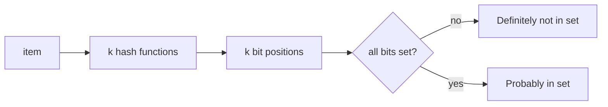

## 🎯 TL;DR

> **Probabilistic data structures** answer a question about a huge dataset with a small, fixed amount of memory, accepting a small, known error. You trade exactness for memory and speed.

- **Bloom filter**: "Is this item in the set?" It never misses a real member, but it sometimes says yes for a non-member (false positive).
- **HyperLogLog (HLL)**: "How many distinct items?" Typical error about 1 to 2% with a few kilobytes of memory, whatever the cardinality.
- **Count-Min Sketch (CMS)**: "How often did this item occur?" It never under-counts; it can over-count.
- **t-digest**: approximate percentiles (p50, p99), most accurate at the tails.
- **Reservoir sampling**: a uniform random sample of `k` items from a stream of unknown length, in one pass and `O(k)` memory.
- The most useful property for data engineers is **mergeability**: sketches built on partitions can be combined later, which fits distributed engines and daily-to-monthly rollups.

## 🌱 Start simple (Junior)

> **💡 Analogy:** Think of a doorman with a guest list who only keeps a *fingerprint* of each name. If the fingerprint is not on the list, the guest is definitely not invited. If it is on the list, the guest is *probably* invited, because two different names can share a fingerprint. A Bloom filter works the same way.

The classic interview question is: **"Count the daily unique users over billions of events."** Look at the naive approach first:

```python
seen = set()
for event in events:          # billions of events
    seen.add(event.user_id)   # set grows with every new user
print(len(seen))
```

This is correct, but the memory use grows with the number of distinct users. With 100 million users and 8-byte IDs, the raw IDs alone take about 800 MB, and a Python or Java hash set uses several times more. If you want this per country, per app, per hour, the memory multiplies by every group.

A HyperLogLog sketch answers the same question with **12 KB per group**, with an error of about 1%. That is the core trade: a tiny amount of error for a huge saving in memory and shuffle volume.

Three simple rules for juniors:

- Bloom filter: "definitely not" is reliable, "probably yes" is not.
- HLL: a number with an error bar, not an exact count.
- CMS: a frequency that may be a little too high, never too low.

## 🔧 How it really works (Mid)

### Bloom filter

A Bloom filter is a bit array of `m` bits plus `k` hash functions. To insert an item, compute `k` positions and set those bits to 1. To query, compute the same `k` positions: if **any** bit is 0, the item was never inserted. If **all** are 1, it probably was.



The false positive rate is approximately `(1 - e^(-k*n/m))^k` for `n` inserted items. With about **10 bits per item** and `k = 7`, the rate is roughly **1%**. Bloom filters cannot delete items (use a counting variant if you must), and two filters can be merged with a bitwise OR, if they have the same size and hash functions.

Where you meet them: skipping data files that cannot contain a key (Parquet and ORC support bloom filters per column chunk), and the per-file lookups inside key-value stores such as Cassandra and RocksDB, where a filter avoids disk reads for keys that are absent.

### HyperLogLog

HLL hashes each item to 64 bits. The first `p` bits choose one of `m = 2^p` registers. The remaining bits are scanned for the position of the first 1-bit (the "rank"), and the register keeps the **maximum** rank it has seen. Rare long runs of leading zeros mean that many distinct items were hashed, so the maximum rank gives an estimate of the count. Averaging over many registers (with a harmonic mean) makes it stable.

The standard error is about `1.04 / sqrt(m)`:

| Registers (`p`) | Memory (about) | Standard error |
|---|---|---|
| 2^10 = 1,024 | under 1 KB | about 3.3% |
| 2^12 = 4,096 | about 3 KB | about 1.6% |
| 2^14 = 16,384 | about 12 KB | about 0.8% |

Redis `PFADD` and `PFCOUNT` use this scheme with a 12 KB structure per key, and `PFMERGE` unions keys. The sketch size does not depend on how many distinct items you add.

Here is a compact, runnable implementation and a check against an exact set:

```python
import hashlib
import math
import random


def h64(item: str) -> int:
    return int.from_bytes(hashlib.blake2b(item.encode("utf-8"), digest_size=8).digest(), "big")


class HyperLogLog:
    """Approximate distinct count. Memory is fixed at 2**p registers, whatever the input size."""

    def __init__(self, p: int = 12):
        self.p = p
        self.m = 1 << p
        self.registers = [0] * self.m
        self.alpha = 0.7213 / (1 + 1.079 / self.m)

    def add(self, item: str) -> None:
        x = h64(item)
        idx = x >> (64 - self.p)                  # first p bits choose a register
        rest = x & ((1 << (64 - self.p)) - 1)     # remaining 64 - p bits
        rank = (64 - self.p) - rest.bit_length() + 1   # position of the leftmost 1-bit
        if rank > self.registers[idx]:
            self.registers[idx] = rank

    def count(self) -> float:
        z = sum(2.0 ** -r for r in self.registers)
        estimate = self.alpha * self.m * self.m / z
        zeros = self.registers.count(0)
        if estimate <= 2.5 * self.m and zeros:   # small-range correction
            estimate = self.m * math.log(self.m / zeros)
        return estimate

    def merge(self, other: "HyperLogLog") -> None:
        """Union of two sketches: register-wise maximum. Both must use the same p."""
        assert self.p == other.p
        self.registers = [max(a, b) for a, b in zip(self.registers, other.registers)]


if __name__ == "__main__":
    random.seed(1)

    # 1) HyperLogLog vs exact count
    exact = set()
    hll = HyperLogLog(p=12)
    for _ in range(500_000):
        user = f"user-{random.randint(1, 200_000)}"
        exact.add(user)
        hll.add(user)
    est = hll.count()
    print(f"HLL: exact={len(exact)} estimate={est:,.0f} "
          f"error={abs(est - len(exact)) / len(exact):.2%} registers={hll.m}")

    # 2) Merge: two days of data, union via register-wise max
    day1, day2 = HyperLogLog(12), HyperLogLog(12)
    for i in range(0, 60_000):
        day1.add(f"u{i}")
    for i in range(30_000, 90_000):
        day2.add(f"u{i}")
    day1.merge(day2)
    print(f"merged estimate for 90,000 true distinct: {day1.count():,.0f}")
```

Run it: the error is typically in the low single digits of percent, in line with the table above. The merge result is the union of the two days, so a weekly distinct count is just seven merges, never a rescan of the raw events.

### Count-Min Sketch

A CMS is `d` rows of `w` counters. Each insert increments one counter per row, chosen by a different hash. A query returns the **minimum** of the `d` counters. Collisions only add to counters, so the minimum never under-counts. The error bound is: with `w = ceil(e / eps)` and `d = ceil(ln(1/delta))`, the over-count is at most `eps * N` (where `N` is the total count) with probability at least `1 - delta`.

CMS plus a small heap gives approximate top-K (heavy hitters). This is the usual answer in [[design-top-k]].

### t-digest and percentiles

Exact percentiles need every value sorted. A t-digest keeps a compressed list of centroids, with **more resolution near the tails** (p99, p999), which is where people look. It is mergeable, so per-partition digests can be combined. Many engines expose it as an approximate percentile function; check what the function returns for your data before you quote the number in a report.

### Reservoir sampling

To keep a uniform sample of `k` items from a stream of unknown length: keep the first `k` items. For item number `i > k`, pick a random number `j` in `[1, i]`; if `j <= k`, replace slot `j`. Every item has the same `k / i` chance of ending in the sample. Use it when you need a representative sample for a quick check, not for exact totals.

### Mergeability summary

| Structure | Merge operation | Notes |
|---|---|---|
| Bloom filter | bitwise OR | same `m` and hash functions |
| HyperLogLog | register-wise max | same `p` |
| Count-Min Sketch | element-wise sum | same `w`, `d` and hashes |
| t-digest | combine centroids | re-compress after merge |
| Reservoir sample | weighted re-sampling | not a simple sum |

## 🧠 Senior depth & trade-offs

- **Error is a product decision.** A 1% error on "unique visitors" is fine for a dashboard, not for billing or fraud thresholds. State the error bound in the metric definition, and keep an exact path (or a sampled audit) for anything money-related.
- **Engines.** ClickHouse `uniq` is approximate and `uniqExact` is exact, which is a real choice in queries. Spark `approx_count_distinct` takes a relative standard deviation parameter, so you choose accuracy against cost. Redis HLL is a native type. Check the exact behaviour and defaults in the docs for your version.
- **Cardinality is not the same as size.** HLL counts distinct values. Exact `COUNT(DISTINCT ...)` on a high-cardinality key can be the most expensive step in a query, because it forces a shuffle or a large hash table. Approximate distinct removes that cost, which is why it appears in dashboards.
- **Sketches in a pipeline.** Store the sketch (bytes) as a column for each partition and group, then merge at query time. This makes backfills and late data cheap: recompute one partition's sketch and merge again. Exact sets cannot do this without keeping all the IDs.
- **Hashing discipline.** Two sketches merge correctly only if they use the same hash function, seed and parameters. A changed seed silently produces nonsense. Put the parameters in the schema and version them.
- **Adversarial and skewed inputs.** Sketches assume good hashing. Hash functions with poor distribution or chosen-input attacks degrade the estimate. Use a well-tested 64-bit hash, not a home-made one.
- **Bloom filters in storage engines.** The filter size is a space-versus-read trade-off. Too small, and the false positive rate causes extra disk reads. Too large, and the filter wastes memory. Monitor the "filter useful" counters your engine exposes.
- **When not to use them.** Do not use approximate structures for identifiers you must return to a user (you cannot list the members of a Bloom filter), for regulated counts, or when the dataset is small enough that an exact set fits comfortably in memory.

## 🧪 Try it

Use Python 3.10 or later and the HLL class from the Mid section.

1. **Memory math.** You have 1,000 groups (country x app) and 365 days of data. Each day's sketch is 12 KB. How much storage do the daily sketches need in total? Show the arithmetic. Then explain how a yearly count per group would be computed.
2. **Accuracy vs p.** Change `p` to 10, 12 and 14, run the same 500,000-event test, and record the error for each. Compare the results with the table in the Mid section.
3. **Bloom sizing.** For 1 million items and a target false positive rate of about 1%, how many bits do you need? Use about 10 bits per item and show the calculation, then check it with the `BloomFilter` idea from the Mid section.

<details><summary>Show solutions</summary>

**1.** 1,000 groups x 365 days = 365,000 sketches. 365,000 x 12 KB = 4,380,000 KB, which is about 4.38 GB. A yearly count per group is the merge of its 365 daily sketches, which needs no access to raw events.

**2.** Lower `p` means less memory and more error (about 3.3% at p=10, about 1.6% at p=12, about 0.8% at p=14). The measured error for one run will fluctuate around these values.

**3.** About 10 bits per item x 1,000,000 items = 10,000,000 bits, about 1.25 MB. With the optimal `k` of about 7, the false positive rate is roughly 1%. Check by inserting a million items and testing another million non-members.

</details>

## 💬 Interview corner

**Question: "Count daily unique users over billions of events."**
Mid answer: "I'd use HyperLogLog per day. It gives about 1% error with a few kilobytes, and the sketches merge across partitions."
Senior answer: "I'd build an HLL sketch per partition, group and day, store the sketch bytes, and merge them for weekly or monthly views. I'd state the error bound in the metric definition. For anything used in billing I'd keep an exact count on a sampled or smaller path to validate the sketch. I'd also check that every producer uses the same hash function and precision, because sketches with different parameters cannot be merged."

**Question: "When would you use a Bloom filter in a data pipeline?"**
Mid: "To check whether a key might already exist before a lookup, for example deduplicating new IDs against a large set."
Senior: "When a false positive costs a cheap extra read and a false negative costs correctness. For example, a bloom filter per file that says whether a key can exist there, so the engine skips files. I'd monitor how often the filter helps and size it for the target false positive rate."

> **🎤 Say this in the interview:** "I trade a small, stated error for a large memory saving. HyperLogLog gives distinct counts that merge across partitions, Bloom filters give fast set membership with no false negatives, and Count-Min gives frequencies that never under-count. The choice depends on whether the cost of error is acceptable."

## ⚠️ Common mistakes

> **⚠️ Watch out:** A Bloom filter "yes" is not a guarantee. It can be a false positive, so always confirm before taking an action that cannot be undone.

> **⚠️ Watch out:** Merging HLL sketches built with different precision or different hash seeds gives a wrong number, often without an error.

- Quoting an approximate count as exact in a report, without the error bound.
- Using `COUNT(DISTINCT)` on a huge key when an approximate distinct would answer the question.
- Forgetting that a Bloom filter cannot delete items.
- Assuming CMS under-counts. Collisions make it over-count.
- Treating a reservoir sample as the full population total, or scaling a sample total without the sampling fraction.
- Building a home-made hash function for sketches.

## ✅ Check yourself (quiz)

1. A Bloom filter returns "not present". What can you conclude?
   - A) The item is definitely not in the set
   - B) The item is probably not in the set
   - C) The item was deleted
   - D) The filter is full

<details><summary>Answer</summary>

**A** — A Bloom filter has no false negatives, so a "not present" answer is certain. A "present" answer can be wrong (false positive).

</details>

2. Which structure answers "how many distinct users" with fixed memory and merges across partitions?
   - A) Count-Min Sketch
   - B) HyperLogLog
   - C) Reservoir sampling
   - D) Bloom filter

<details><summary>Answer</summary>

**B** — HyperLogLog keeps fixed-size registers that merge by a register-wise maximum. Count-Min is for frequencies, reservoir sampling for samples, and a Bloom filter for membership.

</details>

3. Why is the Count-Min Sketch estimate for an item never lower than its true count?
   - A) Each counter stores the exact value
   - B) Hash collisions only add to counters, and the query takes the minimum over several rows
   - C) The sketch stores a log of inserts
   - D) The estimate is rounded up

<details><summary>Answer</summary>

**B** — Every insert adds to one counter in each row, so each counter is at least the item's own count. Collisions only add more, and the minimum across rows is the least inflated value.

</details>

4. (Senior) You have daily HLL sketches for 90 days and need a quarterly distinct count. Which approach is correct, and why not sum the daily counts?
   - A) Sum the 90 daily estimates
   - B) Merge the 90 sketches with a register-wise maximum, then count
   - C) Average the daily estimates
   - D) Recompute from raw events, because sketches cannot be combined

<details><summary>Answer</summary>

**B** — Summing daily counts double-counts users who appear on many days. Merging sketches gives the union, so a user counted on 30 days contributes once. Option D is wasteful because sketches are designed to be combined.

</details>

5. Why do approximate percentiles like t-digest concentrate accuracy at the tails?
   - A) The middle of the distribution is easier to compute
   - B) The structure keeps finer centroids near the extremes, where p99 and p999 are measured
   - C) The tails are stored exactly as a list
   - D) The median is never estimated

<details><summary>Answer</summary>

**B** — Tail percentiles are the ones people monitor, so the digest keeps more resolution there. The middle can be coarser without hurting the important numbers.

</details>

## 🗂️ Flashcards

| Front | Back |
|---|---|
| Bloom filter: false negatives? | None. A "not present" answer is always right. |
| Bloom filter: false positives? | Yes. A "present" answer can be wrong, at a rate you size with bits and `k`. |
| HyperLogLog: what does it estimate? | Distinct count, with about 1.04 / sqrt(m) standard error |
| HLL merge operation | Register-wise maximum (same precision and hash) |
| Count-Min Sketch error direction | Only over-counts, never under-counts |
| t-digest strength | Accurate percentiles near the tails (p99, p999) |
| Reservoir sampling | Uniform sample of k items from an unknown-length stream |
| Why sketches matter in pipelines | Fixed memory, mergeable across partitions, cheap backfills |

## 🔗 Go further

- Related lessons: [[design-unique-counts]] for the full design of a unique-count pipeline, [[design-top-k]] for heavy hitters with a sketch plus a heap, and [[dsa-for-de]] for the hashing and heap basics behind these structures.
- Glossary: [[bloom-filter]], [[hyperloglog]], [[cardinality]].
- Practice: take one exact `COUNT(DISTINCT)` in a report you own, measure its runtime on a large table, and compare it with an approximate function's result and error on the same data.

