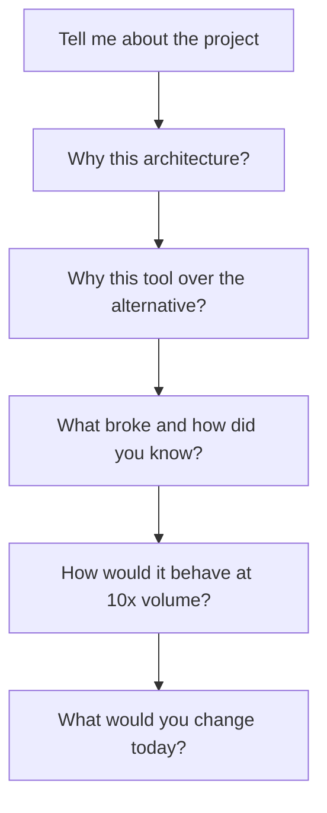
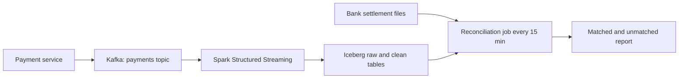

## 🎯 TL;DR

> A **project deep-dive** is a story you can defend for 30 minutes. The interviewer picks one project and keeps asking "why?" until you reach the edge of what you know.

- Prepare **4 to 6** projects that cover different skills: batch, streaming, modeling, a migration, an incident, and a platform or cost project.
- For each one, know the **context and scale**, your **role**, a **diagram**, **three key decisions** with their trade-offs, the **biggest incident**, the **metrics**, and the **lessons**.
- Be ready for the **rejected alternatives**. A decision without an alternative is a guess in the interviewer's eyes.
- Know the **numbers** cold: volume, latency, cost, team size. Round them, but do not invent them.

## 🌱 Start simple (Junior)

> **💡 Analogy:** Think of a project as a house you built. A visitor does not need the full blueprint. They want to know: what it was for, which walls you built yourself, why you chose this foundation over another, what leaked in the first winter, and what you would do differently now.

You will be asked to describe a project as if you are walking someone through it. A good narrative has a clear shape:

1. **Context:** what problem, for whom, how big.
2. **Your part:** what you owned, and what you did not own.
3. **The design:** a simple picture of the data flow.
4. **Decisions:** the choices you made, and what you rejected.
5. **Trouble:** what broke, and how you found out.
6. **Results and lessons:** the numbers and what you learned.

Use this card as a template. Fill one card per project, on one page:

```text
PROJECT: [short name]
Context & scale: [who uses it, volume per day, latency need, team size]
My role: [what I owned; what I did NOT own]
Architecture: [one diagram, 5 to 8 boxes, arrows labeled with the protocol or format]
Decision 1: [choice] over [alternative] because [reason] | trade-off I accepted: [cost]
Decision 2: [choice] over [alternative] because [reason] | trade-off I accepted: [cost]
Decision 3: [choice] over [alternative] because [reason] | trade-off I accepted: [cost]
Biggest incident: [what broke] | detected by [how] | fixed by [what] | prevented by [what now]
Metrics: [before → after, measured how, over what period]
Lessons: [what I would change if I rebuilt it today]
```

> **⚠️ Watch out:** Do not describe a project you cannot explain in detail. Interviewers ask about the parts you list. If you mention a tool, be ready to say why it was chosen and how it failed.

## 🔧 How it really works (Mid)

The interviewer drills down in layers. Expect the sequence below, and prepare one answer per layer:



**Choose projects that show different skills.** Four strong projects usually cover:

- a **batch** pipeline with a warehouse or lakehouse target
- a **streaming** or near-real-time pipeline with state, late data or replay
- a **modeling** project (dimensional model, data contract, or semantic layer)
- an **operations** project: an incident, a migration, or a cost reduction

**Make the decisions explicit.** A decision has four parts: the **choice**, the **alternative**, the **reason**, and the **cost you accepted**. Here is a filled example.

**Worked example (illustrative numbers, replace with your own).** A payment reconciliation project:

- Context: about 40 million payment events per day. Average rate is 40,000,000 / 86,400 ≈ 463 events per second, and peak is about 5 times that, roughly 2,300 per second. Finance needed matched transactions within 15 minutes.
- Architecture: the payment service publishes to a Kafka topic, Spark Structured Streaming writes raw and cleaned rows to Iceberg tables on object storage, and a reconciliation job runs every 15 minutes against bank settlement files.



Decisions:

1. **Kafka over JDBC polling of the payment database.** Polling would add read load to the transactional database, and a replay would need a full re-read. Kafka gives several consumers and a replay window. The cost: operating a cluster and handling duplicate events.
2. **Iceberg over Hive-style partitions.** Late corrections from banks forced rewrites of whole day partitions. Iceberg supports row-level MERGE and time travel. The cost: a catalog to run and a learning curve for the team.
3. **At-least-once delivery with a dedup key over "exactly-once" claims.** The sink deduplicates on `transaction_id` with a MERGE. The cost: a dedup step on every run, and a rule that a duplicate must carry the same payload.

Biggest incident: a producer began sending amounts with two decimal formats. The streaming parser cast the new format to NULL without an error, so 0.8% of transactions were unmatched for three days. The finance control caught the gap. We added a schema-compatibility rule in the registry, made the parser fail on bad values, and added a row-count control for each 15-minute window. Unmatched transactions fell to under 0.05% of daily volume.

Notice the structure: each decision names a rejected option, the incident names how it was detected, and the metric names how it was measured.

## 🧠 Senior depth & trade-offs (Senior)

At senior level the interviewer tests **depth under pressure**. Prepare for these questions for every project:

- **"What would break at 10 times the volume?"** For the example above, 10 times the peak is about 23,000 events per second. Name the first bottleneck (usually the partitioning of the topic or the MERGE cost per micro-batch), and say what you would measure first.
- **"What did you give up?"** Every decision has a cost. Name it without being asked. "We accepted a 15-minute reconciliation delay to avoid a streaming join on settlement files, which arrive in batches" is a senior answer.
- **"Who decided, and what was yours?"** Be exact. If the architecture was a group decision, say what you proposed, what you changed after review, and what you implemented.
- **"How do you know it worked?"** Name the metric, the source of truth, and the period. A metric measured on a dashboard you built yourself needs an independent check.
- **"What would you do differently today?"** A real answer names a concrete change, such as a contract test at the producer, or a dedup key that includes a version. Avoid "nothing, it was perfect".

Sanitize the details. If the data or numbers are confidential, use rounded ranges ("tens of millions of events per day") and describe the mechanism, not the company's data. Never share internal names or figures you are not allowed to disclose.

## 🧪 Try it

**Exercise 1: Extract the decisions.** Read this description and list three decisions with their rejected alternatives.

> "We moved the customer events from a nightly CSV export to a Kafka pipeline that lands Parquet files in S3, and we use dbt for the marts. We kept Airflow for scheduling but split the DAGs by domain."

<details><summary>Solution</summary>

1. **Kafka pipeline over the nightly CSV export.** Rejected: nightly batch export. Reason: freshness and replay. Cost: operating the stream and handling duplicates.
2. **Parquet on S3 landing over CSV.** Reason: columnar format, cheaper and faster scans. Cost: files are less readable by hand.
3. **Airflow DAGs split by domain over one large DAG.** Rejected: a single monolithic DAG. Reason: ownership and smaller blast radius.

The description does not name a rejected alternative for dbt. A strong candidate asks the interviewer, or says "I would be ready to explain why dbt over hand-written SQL jobs, for example versioned and tested models".

</details>

**Exercise 2: Do the scale arithmetic.** Your pipeline handles 86 million rows per day with a peak of 4 times the average. Compute the average rate, the peak rate, and the backlog after a 1-hour outage at the average rate.

<details><summary>Solution</summary>

- Average: 86,000,000 / 86,400 ≈ 995 rows per second.
- Peak: 4 × 995 ≈ 3,980 rows per second.
- Backlog after 1 hour at average rate: 995 × 3,600 ≈ 3.58 million rows (the same as 86 million / 24).

Recovery needs a processing rate above the average, otherwise the backlog never shrinks. State that in the answer.

</details>

**Exercise 3: Turn a claim into a metric.** Rewrite this claim so an interviewer can check it: "We made the pipeline much faster."

<details><summary>Solution</summary>

"p95 end-to-end latency, measured from event timestamp to availability in the mart, fell from 45 minutes to 6 minutes. We compared 30 days of production data before and after the change, and the volume was similar (about 40 million events a day in both periods)."

The rewrite has a metric, a percentile, a start and end point, a baseline, and a period. Note that you must also say the volumes were comparable; otherwise the comparison is not fair.

</details>

**Exercise 4: Fill your own card.** Fill the template for one project. Then read it aloud and time it. The target is 3 minutes for the overview, and 30 minutes is the time you should be ready to cover in depth.

<details><summary>Solution</summary>

There is no single correct card. Check it against this list: every template line is filled; each decision has an alternative and an accepted cost; the incident has a detection method; every number has a period. If the overview takes more than 3 minutes, cut the context, not the decisions.

</details>

## 💬 Interview corner

> **🎤 Say this in the interview:** "Walk me through your most complex data project." Start with the context and scale, then the architecture, then the decisions.

**Senior model answer (short):** "I built a payment reconciliation pipeline handling about 40 million events a day, with peaks around 2,300 per second. I chose Kafka over polling the payment database to protect the transactional system and to allow replay, and Iceberg over partitioned Hive tables so late bank corrections could be applied with MERGE instead of rewriting full partitions. The hardest incident was a silent decimal-format change that left 0.8% of transactions unmatched for three days, which we caught with a row-count control and now block with schema compatibility rules. Unmatched transactions dropped below 0.05% of volume, and if I rebuilt it I would put the contract test at the producer on day one."

## ⚠️ Common mistakes

- **Describing the tool list instead of the decisions.** "We used Kafka, Spark and Airflow" is not a narrative.
- **No rejected alternative.** It makes every choice look accidental.
- **Numbers without a method.** "It was 10x faster" needs a baseline, a measurement, and a period.
- **Hiding the incident.** Interviewers assume every real project had one. Describe it openly.
- **Overstating ownership.** If a senior engineer designed the core, say so and describe your real contribution.
- **Diagram overload.** One diagram with 5 to 8 boxes is enough. Explain the rest verbally.
- **Confidential data.** Use ranges and mechanisms. Do not disclose internal names or figures.

## ✅ Check yourself (quiz)

1. In a project narrative, what is the minimum information for each key decision?
   - A) The tool name only
   - B) The choice, the rejected alternative, the reason, and the cost accepted
   - C) The date it was made
   - D) The number of people in the meeting

<details><summary>Answer</summary>

**B** — a decision is only defensible when the alternative and the cost are visible. The tool name alone looks like a guess.

</details>

2. A pipeline handles 40 million events a day. What is the average rate per second, to the nearest event?

   - A) 463 per second
   - B) 4,630 per second
   - C) 46 per second
   - D) 1,000 per second

<details><summary>Answer</summary>

**A** — 40,000,000 / 86,400 ≈ 462.96, which rounds to 463. Always show the arithmetic when you give an estimate.

</details>

3. The interviewer asks, "What would break at 10 times the volume?" Which answer is strongest?

   - A) "It would be fine, Spark scales."
   - B) "I would add more machines."
   - C) "The first bottleneck is likely the MERGE cost per micro-batch and the topic partitioning; I would measure batch duration and lag first, then decide."
   - D) "I have not thought about it."

<details><summary>Answer</summary>

**C** — it names a plausible bottleneck, the evidence you would collect, and the order of investigation. That is the depth a senior interview tests.

</details>

4. **(Senior)** You cannot disclose the real numbers of a project. What is the right approach?

   - A) Invent plausible numbers
   - B) Refuse to discuss the project
   - C) Use rounded ranges and describe the mechanism, and say which figures you are not allowed to share
   - D) Use the numbers of a different company

<details><summary>Answer</summary>

**C** — honesty plus discretion. Invented numbers will be probed and destroy your credibility. Rounded ranges and clear mechanisms still show your depth.

</details>

## ✅ Self-assessment checklist

- [ ] I have 4 to 6 projects covering batch, streaming, modeling, and operations
- [ ] Each project has a filled card with context, role, diagram, decisions, incident, metrics, and lessons
- [ ] Every key decision lists a rejected alternative and an accepted cost
- [ ] Every number has a baseline, a measurement method, and a period
- [ ] I can give a 3-minute overview and go 30 minutes deep on any project
- [ ] I can answer "what breaks at 10x?" and "what would you change today?" for each project
- [ ] Confidential details are rounded or removed

## 🗂️ Flashcards

| Front | Back |
|---|---|
| How many projects should you prepare? | 4 to 6, covering different skills |
| What are the four parts of a decision? | Choice, rejected alternative, reason, accepted cost |
| How do you compute average events per second? | Daily events divided by 86,400 seconds |
| Why keep a rejected alternative in the story? | Without it the choice looks like a guess |
| What is the most useful incident story structure? | What broke, how detected, how fixed, how prevented now |
| What should a metric always include? | Baseline, measurement method, and period |
| How should you handle confidential numbers? | Use rounded ranges and describe the mechanism |

## 🔗 Go further

- [[star-framework]] gives the structure for each story inside a project narrative.
- [[incidents-postmortems]] explains how to write up the incident part of your narratives.
- [[senior-expectations]] shows what depth each level is expected to reach.
- [[how-to-prepare]] places this preparation inside an overall study plan.
- [[senior-signals]] lists the signals that interviewers look for while you walk through a project.
