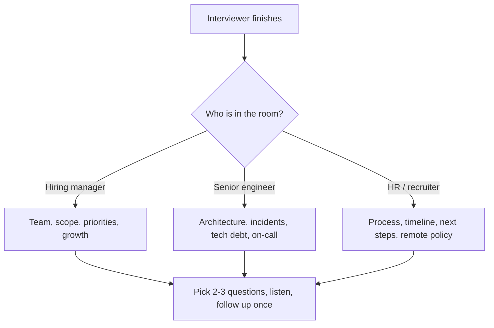

## 🎯 TL;DR

> At the end of most interviews you will hear "Do you have any questions for us?" This is a real evaluation, not a formality. Good questions tell the company that you think like an engineer who will own a system, and they tell you whether the job is worth taking.

- Ask questions that are **specific to the data platform**, not generic ("What is your culture?").
- Prepare **5 to 7** questions, and use **2 or 3** in the interview. The rest are backup.
- Ask about **how work really happens**: incidents, data quality, ownership, deadlines, and how decisions are made.
- Listen to the answer. A follow-up question shows more seniority than a new one.

## 🌱 Start simple (Junior)

> **💡 Analogy:** A house viewing. A good buyer does not only admire the kitchen. They open the fuse box, ask how old the roof is, and ask what the neighbours are like. The seller learns that you are serious; you learn what you would really live with.

When the interviewer asks "Any questions?", most candidates say "No, thanks" or ask about salary in the first minute. Both lose points. A simple structure works for almost every case:

1. **What the team does:** "What does the data platform look like today?"
2. **How it works day to day:** "How do you handle a broken pipeline at 3 a.m.?"
3. **What success looks like:** "What would make someone successful in the first six months?"

Here is a weak and a strong version of the same question.

| Weak | Strong |
|---|---|
| "Do you use Spark?" | "Which parts of the pipeline run on Spark, and which are plain SQL in the warehouse? Where does most of the processing time go?" |
| "Is the company good?" | "How many people consume the warehouse tables, and who owns the definitions when two teams disagree on a metric?" |
| "What is the salary?" | "How is the compensation structure set for this role, and when is the next review?" (Salary details are covered in [[negotiation-iran]].) |
| "Is there on-call?" | "How is on-call shared across the data team, and what was the most common alert last month?" |

A question that you can **answer partly yourself** in a short sentence is usually weak. A question that invites a story is strong.

## 🔧 How it really works (Mid)

Interviewers answer questions in a predictable way. Knowing this helps you pick the right question for the right person.

**Question map by topic** (use 1 or 2 per category, depending on time):

- **Data architecture:** Which storage layer is the source of truth (warehouse, lakehouse, operational DB)? How do you handle late-arriving data and backfills? Is the stack batch, streaming or both?
- **Scale:** Roughly how many events or rows per day, and how fast is the growth? What is the largest table and the slowest pipeline today?
- **Quality and trust:** How do you know the numbers are right? Who gets paged when a metric is wrong? Is there a data contract with producers?
- **Ownership:** Who owns a dataset end to end? Do analysts write transformations, or only engineers? How are new tables reviewed?
- **Team:** How big is the data team, and how does it split between platform, pipelines and analytics? Who would I work with most?
- **On-call and reliability:** What is the on-call rotation, and how many pages per week? What did the last postmortem change?
- **Tech debt:** What part of the stack would you replace if you had a quarter? What is the most fragile job?
- **Growth:** What does the senior path look like here? Is there a staff track, and how are promotions decided?
- **Process:** What happens after this interview, and when do you expect a decision?

### Turning a question into a conversation

A good question has three parts: **context**, **the question**, and **why you ask**. You do not need to say the third part out loud, but it helps you pick a sharp question.

> **🎤 Say this in the interview:** "We run hourly batches into Iceberg, and I saw a few freshness incidents in the job logs. How do you decide when a late partition is re-processed versus accepted as is?"

The answer will often lead you to a second, deeper question. Ask one follow-up; it shows you were listening.

### Reading the signals

- **Enthusiastic, specific answer:** good sign; the team has real problems and cares about them.
- **Vague answer, "we are a family":** ask one more concrete question ("Who was on call last Tuesday?"). Vague answers to concrete questions are data.
- **Interviewer does not know:** politely ask who would know. This is common in large companies and not a red flag by itself.
- **Hostility to the question:** this matters. Note it for your decision, not for the interview.

## 🧠 Senior depth & trade-offs

At senior level, the questions are judged on whether they show **judgment**. A senior candidate asks about trade-offs the company has already made, not about features.

**Questions that signal seniority:**

- "What trade-off did the team make when you chose the current warehouse, and would you make it again?"
- "Where do the data contracts end today, and which producers still break them?"
- "How do you decide between a new table and changing an existing mart? Who has the final say?"
- "When a quality check blocks a pipeline, how often does that happen, and does the business accept the delay?"
- "What would you change in the on-call setup if the team doubled next year?"

**Questions that expose risk (ask carefully, in a friendly tone):**

- "How many people were on the data team two years ago, and what changed?" (High turnover shows up here.)
- "Which system has no owner right now?" (Unowned systems are common and often the real work.)
- "How long does it usually take to get a new source onboarded?" (Long answers mean slow change.)

**Trade-offs to be ready to discuss:**

- **Asking too many questions vs too few.** Five strong questions beat fifteen weak ones. Ask only what you would use to decide.
- **Asking about problems vs asking about strengths.** Problems reveal more. Ask "What is the hardest part of the data platform now?" and be ready to listen to a real answer.
- **Asking about compensation in the first interview.** It can be right in some processes, but it is often better left for the recruiter or the offer stage. Check the process before you ask.

**What you should be able to tell the interviewer by the end:** what you would build first, what risk you would check in your first month, and what you would want to know before saying yes.

## 🧪 Try it

This is a guide, so the practice is a **written question bank**. Before your next interview, fill in this table with your own questions. Keep each question under 25 words.

| Category | My question | Who to ask | Follow-up if the answer is vague |
|---|---|---|---|
| Architecture | | Senior engineer | |
| Scale | | Hiring manager | |
| Quality | | Senior engineer | |
| On-call | | Team member | |
| Growth | | Hiring manager | |

Then check your list with these three tests:

1. Can the answer show me something I cannot find on the company website?
2. Would a weak candidate ask this? (If yes, rewrite it.)
3. Does it fit the person I am asking?

## 💬 Interview corner

**Typical question:** "Do you have any questions for us?"

- **Junior answer:** "No, I think you covered everything." This ends the conversation and suggests you are not curious.
- **Mid answer:** "How is the data team organized, and what do you use for orchestration?" This is fine, but generic.
- **Senior answer:** names a real trade-off from their stack, asks how it is handled, and follows up with a question about ownership or incidents.

> **🎤 Say this in the interview:** "You mentioned that the warehouse and the lakehouse both serve finance. Which one is the source of truth for revenue, and how do you keep the two in agreement? I would want to understand where the reconciliation work sits before I could say what I would do in my first quarter."

## ⚠️ Common mistakes

- **Asking only about salary, benefits or remote work** in the first round. Those topics matter, but they make you look focused on the wrong things.
- **Asking a question the website already answers.** It shows you did not prepare.
- **Asking "Do you have any questions?" back to the interviewer** as a reflex without a question of your own.
- **Making the question a test.** "Do you know what Iceberg is?" is not a question. Ask what you actually want to learn.
- **Not listening to the answer.** If the interviewer says the team is small and busy, asking about a large cross-team project looks careless.
- **Asking too many questions in a row.** It feels like an interrogation. Ask one, listen, then move on.
- **Ignoring the interviewer's role.** A recruiter cannot answer architecture questions, so ask them about process and timing.

## ✅ Check yourself (quiz)

1. Your interviewer is the hiring manager, and time is almost up. Which question is the best fit?

   - A) "What is your vacation policy?"
   - B) "What would make someone successful in the first six months on this team?"
   - C) "Do you use Airflow?"
   - D) "Is the company stable?"

Answer

**B** — it is about the role and the team, it invites a real answer, and the hiring manager is the person who can answer it. The other options are either better suited to a recruiter, answerable from a website, or too closed to start a conversation.

2. Which question is the weakest, and why?

   - A) "How do you handle a late partition that arrives after the daily job has run?"
   - B) "Which tables have no clear owner today?"
   - C) "Do you have a lot of data?"
   - D) "How often do you have incidents that reach business users?"

Answer

**C** — it is closed (yes or no) and generic; a candidate can find the answer from the company's size. The other three are specific and open the conversation to how the team works.

3. A senior engineer says, "We have some tech debt in the orchestration layer." What is the strongest follow-up?

   - A) "Is that a big problem?"
   - B) "Which job or DAG causes the most pages, and what would it take to replace it?"
   - C) "Can you tell me about the next promotion cycle?"
   - D) "Do you plan to hire more people?"

Answer

**B** — it asks for a concrete example and shows you understand that debt is about specific costs. A is a closed question; C and D change the topic before the answer is explored.

4. **(Senior)** You ask "How do you decide between a new table and changing an existing mart?" and the answer is "Whoever shouts loudest." What does this tell you, and what would you ask next?

   - A) Nothing; it is a normal answer for all teams
   - B) The team may lack a clear ownership model for shared data; ask who reviews changes to shared marts and how conflicts are resolved
   - C) The team is very well organized
   - D) You should avoid this company immediately

Answer

**B** — a missing decision process for shared data often leads to duplicated tables and inconsistent metrics. The follow-up asks for the actual process, which tells you whether the problem is known and managed. Do not treat one answer as a final verdict.

## 🗂️ Flashcards

| Front | Back |
|---|---|
| Why are questions to ask a real evaluation? | They show how you think about ownership, quality and trade-offs, and help you judge the job |
| How many questions should you prepare? | 5 to 7, and use 2 or 3 in the interview |
| Which questions do senior candidates favour? | Trade-offs, ownership, incident and on-call reality, and decision processes |
| What makes a question weak? | It is closed, generic or answerable from the website |
| Best follow-up to a vague answer? | Ask for one concrete example ("Who was on call last Tuesday?") |
| Who should you ask about process? | The recruiter or HR; ask architecture questions to the senior engineer or the hiring manager |

## 🔗 Go further

- **interview-loop** describes the stages where these questions are asked and who you will meet.
- **behavioral-questions** covers the stories you will tell in the same interview, so your questions and stories fit together.
- **how-to-prepare** gives the overall preparation plan for data engineering interviews.
- **iran-de-market** describes the local company and market context, which helps you choose questions about remote work, on-prem stacks and team structure.
- **negotiation-iran** covers how to talk about compensation at the offer stage.
