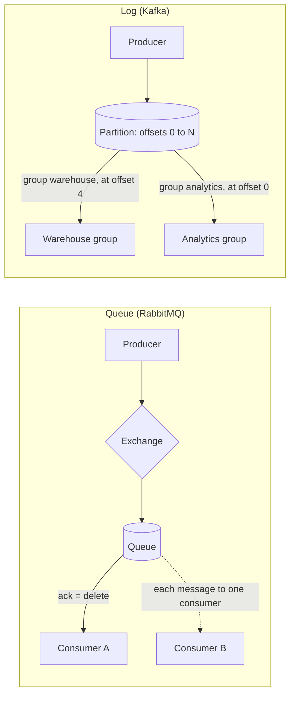

## 🎯 TL;DR

> A **message queue** (RabbitMQ) hands each message to one consumer and **deletes it once acknowledged**. A **distributed log** (Kafka) **appends** messages to a retained, ordered sequence, and each consumer group keeps its own **offset** (its bookmark) so it can re-read history.

- Queue: the broker tracks what is **left to deliver**. Log: each reader tracks **where it is**.
- Queue: competing consumers **share** the work. Log: each consumer group gets the **full stream**; inside a group, partitions are shared.
- Logs give replay and many independent readers. Queues give per-message routing, priorities and simple work distribution.

## 🌱 Start simple (Junior)

> **💡 Analogy:** A queue is a **bank teller line**. Each customer is served once and leaves. A log is a **notice board with dated entries**. Anyone can read any entry, at any time, for as long as the board keeps it.

Imagine an `order_created` event that two teams need:

- **Warehouse**: must pack each order exactly once.
- **Analytics**: wants every event, and next month wants to recompute last week after a bug fix.

With a **queue**, the warehouse consumer acknowledges the message and the broker deletes it. Analytics never sees it, unless the producer also sent a copy to a second queue.

With a **log**, the events stay for 7 days. Warehouse and analytics each keep their own offset. Analytics can rewind to yesterday without asking the warehouse.

Three words cover most of this topic:

- **Producer**: writes messages.
- **Consumer**: reads messages.
- **Offset**: a number that means "I have processed everything up to here."

Run this small model (`python3 queue_vs_log.py`):

```python
from collections import deque

# Queue: reading removes the message
queue = deque(["m1", "m2", "m3"])
print("queue get:", queue.popleft())
print("left in queue:", list(queue))

# Log: reading never removes; each reader keeps its own offset
log = ["e0", "e1", "e2", "e3"]
offsets = {"warehouse": 2, "analytics": 0}

def read(group):
    pos = offsets[group]
    if pos >= len(log):
        return None
    offsets[group] = pos + 1
    return log[pos]

print("warehouse:", read("warehouse"))
print("analytics:", read("analytics"))
print("analytics:", read("analytics"))
print("log still has:", log)
```

Expected output:

```text
queue get: m1
left in queue: ['m2', 'm3']
warehouse: e2
analytics: e0
analytics: e1
log still has: ['e0', 'e1', 'e2', 'e3']
```

## 🔧 How it really works (Mid)

**Queue (RabbitMQ, classic queue model).** Producers publish to an **exchange**. The exchange routes each message to one or more **queues** using bindings (direct, topic, fanout and headers rules). The broker pushes messages to consumers, up to a **prefetch** limit of unacknowledged messages. When a consumer acknowledges, the broker deletes the message. If the consumer dies first, the broker **redelivers** the message to another consumer.

Competing consumers on one queue receive messages round-robin. That scales the work, but two consumers can finish out of order, and a redelivered message can arrive after newer ones. So a queue gives **no ordering guarantee** once there are several consumers.

**Log (Kafka).** A **topic** is split into **partitions**. Each partition is an append-only sequence: every record gets the next **offset** (0, 1, 2, ...). Reading a record does not delete it; records disappear when **retention** (time or size) expires. Consumers **pull** by asking for "partition 3, from offset 4000".

A **consumer group** is the unit of sharing. Inside a group, each partition is read by at most one consumer. Across groups, every group reads everything independently.



| Question | Queue (RabbitMQ) | Log (Kafka) |
|---|---|---|
| What happens after a read? | The message is deleted after ack | Nothing; the offset moves forward |
| Who remembers progress? | The broker, per message | The consumer, per group and partition |
| Several independent readers | Needs a separate queue (and copy) per reader | Free: one group per reader |
| Replay old events | Not possible after ack | Yes, within retention |
| Ordering | Per queue, lost with many consumers | Per partition only |
| Routing per message | Rich (exchanges, bindings, priorities) | By topic and key |

## 🧠 Senior depth & trade-offs

- **The ack point defines delivery semantics.** In a queue, acking after processing gives at-least-once: a crash after processing but before the ack causes a duplicate. Acking before processing gives at-most-once: a crash loses the message. Kafka behaves the same way through offset commits. Both need an idempotent consumer for effectively-once results. See [[idempotency]] and [[exactly-once]].
- **Scaling differs.** A queue scales by adding consumers to one queue, and ordering is the price. A log scales by partitions: a group's parallelism is capped at the partition count, and per-key ordering holds because the key picks the partition.
- **Backlog shows up differently.** A growing queue means messages pile up in broker memory and disk, and RabbitMQ can block publishers when a resource alarm fires. A growing log backlog is **consumer lag**: data stays safe on disk until retention deletes it. A consumer that falls behind past retention loses data it never read. Alert on [[consumer-lag]], not only on broker disk.
- **Replay has a cost.** Re-reading a week of events reprocesses a week of work. Sinks must tolerate duplicates, and the load must fit in spare capacity.
- **Storage.** A log keeps bytes for the whole retention window. Queues drain, so they hold less data, but that alone is no reason to keep event history in a queue.
- **Newer features blur the line.** RabbitMQ has a log-like stream type, and Kafka has newer queue-like consumer models. Check the docs for your version before claiming a feature is missing.
- **When not to use a log.** Task queues with per-message TTL, priorities, delayed retries and request-reply RPC fit RabbitMQ well. A log is a poor fit when each message needs its own routing rules and you never replay.

## 🧪 Try it

Run the script from the Junior section, then answer these before you check.

1. Call `queue.popleft()` a second time. What is printed, and what is left in the queue?
2. Set `offsets["analytics"] = 0`, then call `read("analytics")` five times in a row. What comes back?
3. Two consumers share a RabbitMQ queue. Consumer A receives `order-1` and crashes before acking. Consumer B receives `order-2` and finishes it, then `order-1` is redelivered. Which one is processed first, and why does this matter?
4. A Kafka topic has 4 partitions and a consumer group has 6 consumers. How many consumers get no partition?

<details><summary>Show answers</summary>

**1.** `m2` is printed and `['m3']` is left.

**2.** `e0`, `e1`, `e2`, `e3`, then `None`. The log removed nothing; the reader simply ran past the end.

**3.** `order-2` is processed first, and `order-1` after it. This is the ordering loss of a queue with competing consumers and redelivery.

**4.** Two. Each partition goes to at most one consumer in a group, so 2 of the 6 consumers stay idle.

</details>

## 💬 Interview corner

**Question: "Queue or log for this system?"** Mid answer: "Kafka for events, because it keeps them and lets many services read them. RabbitMQ for background jobs, because it routes and acks each message." Senior answer: "I ask three things: do we need replay, do several independent teams read the same events, and does ordering matter per entity? Two or more yeses point to a log. If the work items need per-message routing, priorities or delayed retries, a queue fits. Either way I state the ack point and how duplicates are handled."

**Question: "Does Kafka guarantee message order?"** Mid answer: "Within a partition, yes." Senior answer: "Within a partition, in offset order, for a producer configured correctly. Not across partitions, and not across producers writing the same key without coordination. Ordering across an entity needs one key per entity."

> **🎤 Say this in the interview:** "A queue removes work once it is done, so it fits task distribution. A log keeps history and lets each reader keep its own position, so it fits events that need replay and several consumers. I choose by replay needs, reader count and ordering scope, and I always design the consumer to tolerate duplicates."

## ⚠️ Common mistakes

> **⚠️ Watch out:** "Kafka is just a faster queue." A Kafka consumer group does not delete messages; the group's offset is the only record of progress. Treating a log as a queue hides retention and lag problems until data is already gone.

- Expecting global ordering from a queue with several consumers, or from a topic with several partitions.
- Acknowledging a RabbitMQ message before the work is done, then losing it on a crash.
- Forgetting that a Kafka consumer that falls behind past retention never sees the expired records.
- Copying the same events into many queues when one log with several groups would do.
- Setting long retention on a log without budgeting the disk.

## ✅ Check yourself (quiz)

1. In RabbitMQ, when is a message removed from a classic queue?
   - A) When it is published
   - B) When a consumer reads it
   - C) When the consumer acknowledges it
   - D) When `retention.ms` expires

<details><summary>Answer</summary>

**C** — the message is removed on ack. Delivery alone does not delete it; if the consumer dies first, the broker redelivers it.

</details>

2. A Kafka topic has 4 partitions and a consumer group has 6 consumers. How many consumers get no partition?
   - A) 0
   - B) 2
   - C) 4
   - D) 6

<details><summary>Answer</summary>

**B** — each partition goes to at most one consumer in the group, so 2 of the 6 are idle.

</details>

3. Two analytics teams need the same events, and one wants to recompute last month after a bug fix. Which design fits?
   - A) One RabbitMQ queue shared by both teams
   - B) Two RabbitMQ queues, one per team, each with a copy of every message
   - C) One Kafka topic, with each team in its own consumer group
   - D) One Kafka topic and one shared consumer for both teams

<details><summary>Answer</summary>

**C** — each group keeps its own offset, so the teams read independently, and a recompute is just moving an offset back within retention. Option B works but duplicates messages, and acked messages cannot be replayed.

</details>

4. **(Senior)** A consumer commits its Kafka offset before writing to the database. The process crashes right after the commit. What happens to that batch, and what design fixes it?
   - A) It is written twice; add a second consumer
   - B) It is lost, because the offset moved past it; commit after a successful write and make the write idempotent
   - C) It stays in retention, so nothing is lost
   - D) Kafka redelivers it from the broker's cache

<details><summary>Answer</summary>

**B** — the committed offset says "done" although the write never happened. Commit after the write, and make the write idempotent so the redelivery after a crash is harmless.

</details>

5. **(Senior)** Your company runs Kafka, but you still choose RabbitMQ for a payment-retry workflow. What is the strongest justification?
   - A) Kafka cannot store messages
   - B) Per-message ack, delayed retries and per-message routing fit work items better than an ordered log
   - C) RabbitMQ guarantees global ordering
   - D) Kafka does not support consumer groups

<details><summary>Answer</summary>

**B** — work items need per-message acknowledgement, retry and routing. A log is a poor fit for that shape of work. The choice should rest on the workload, not on fashion.

</details>

## 🗂️ Flashcards

| Front | Back |
|---|---|
| Queue: when is a message deleted? | When the consumer acks it, not when it is read. |
| Log: what happens on read? | Nothing is deleted; the consumer's offset moves forward. |
| Offset | A per-partition position: "I have processed up to here." |
| Consumer group | Consumers that share a topic's partitions; each group reads the full stream. |
| Ordering in Kafka | Guaranteed within a partition, not across partitions. |
| Consumer lag | How far a group's offset is behind the end of the log. |
| Competing consumers | Several consumers on one queue; each message goes to one of them. |
| At-least-once | Ack after processing; a crash can cause a duplicate. |

## 🔗 Go further

- `kafka-architecture`: how partitions, replicas and leaders work.
- `kafka-consumers`: offsets, commits and rebalancing.
- `delivery-semantics`: at-most-once, at-least-once and exactly-once in practice.
- `backpressure`: what to do when consumers fall behind.
- Glossary: [[consumer-lag]], [[exactly-once]], [[idempotency]].

