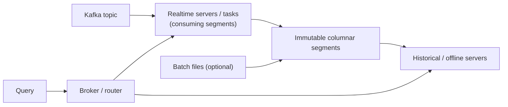

## 🎯 TL;DR

> A **real-time OLAP engine** (Apache Druid, Apache Pinot) ingests events from a stream such as [[kafka-architecture|Kafka]] and makes them queryable within seconds, serving **many concurrent, low-latency analytical queries** to end users.

- It is built for **user-facing dashboards and APIs**: thousands of queries per second, p99 latency in the tens to low hundreds of milliseconds.
- Data is stored in **immutable, columnar segments** with heavy indexing, so filters and aggregations touch little data.
- Freshness is the selling point: an event can be queryable seconds after it is produced, not after the next nightly batch.
- The price: a fixed schema, limited joins, operational complexity, and a real need to think about segment and index design.

## 🌱 Start simple (Junior)

> **💡 Analogy:** A nightly warehouse report is a **newspaper**: printed once a day, very accurate for yesterday. A real-time OLAP engine is a **stock ticker** on a screen: every trade appears within seconds, and thousands of people look at it at the same time.

Imagine a food-delivery app. Each order event (`order_id`, `city`, `status`, `amount`, `ts`) lands in Kafka. The business wants a page where a restaurant owner sees "orders and revenue in the last hour, by status", refreshed every few seconds, for 50,000 restaurant owners at peak.

A normal warehouse can answer that query, but not for 50,000 people hammering it at once with a 300 ms budget. A real-time OLAP store is designed exactly for this pattern: **fast aggregations, high concurrency, fresh data**.

Here is the kind of query it serves:

```sql
-- Pinot-style SQL: orders per status for one city in the last hour
SELECT status, COUNT(*) AS orders, SUM(amount) AS revenue
FROM orders
WHERE city = 'Tehran'
  AND ts > ago('PT1H')   -- Pinot time function; Druid uses its own time filters
GROUP BY status
ORDER BY orders DESC;
```

Two words to remember: **OLAP** means "aggregate over many rows", and **real-time** means "the rows arrive continuously and are queryable right away".

## 🔧 How it really works (Mid)

Both Druid and Pinot follow the same broad design:



1. **Ingestion.** A realtime server consumes a Kafka partition directly, with no separate ETL job in the middle. Rows sit in an in-memory "consuming" segment and are queryable immediately.
2. **Sealing.** When a time or row threshold is reached, the segment is flushed and becomes an **immutable columnar segment**, stored on disk (or deep storage) and loaded by a server that serves it.
3. **Query.** A broker fans the query out to the servers that hold the relevant segments, each computes a partial aggregate, and the broker merges them. Time pruning means old segments are skipped entirely.

What makes queries fast is the **index and pre-aggregation** layer:

- **Dictionary encoding and bitmap/inverted indexes** on dimension columns (`city`, `status`), so a filter becomes a bitmap intersection.
- **Range and sorted indexes** on time columns.
- **Rollup** (Druid): at ingestion, rows with identical dimension values and truncated timestamps are merged, so storage and query work shrink. A per-minute rollup of raw events can cut row counts sharply, but you lose the raw detail.
- **Star-tree index** (Pinot): pre-computed aggregates over chosen dimension combinations, traded for extra storage and build time.

**Upserts.** Pinot can keep the latest row per **primary key**, which is how it serves CDC streams (an order changes status, and the dashboard must show the new one). A minimal schema and table fragment:

```json
{
  "schemaName": "orders",
  "primaryKeyColumns": ["orderId"],
  "upsertConfig": {
    "mode": "FULL",
    "comparisonColumns": ["updatedAt"]
  },
  "routing": { "instanceSelectorType": "strictReplicaGroup" }
}
```

`FULL` replaces the whole row for a key; `PARTIAL` merges columns according to per-column strategies. `comparisonColumns` decides which version wins when events arrive out of order. (Check the upsert docs for your Pinot version: the set of options and their defaults change between releases.)

## 🧠 Senior depth & trade-offs

- **Freshness vs. file count.** Smaller flush thresholds make data visible faster but create more, smaller segments. Too many segments raise per-query overhead and metadata pressure. Tune by time *and* row count.
- **Upsert needs co-location.** Upsert state lives per server, so every event for a primary key must land on the same server. This means partitioning the Kafka topic by the primary key and using a strict replica-group routing, which limits how you can scale and recover. Without that, the same key can be "live" in two places.
- **Cardinality is the enemy.** A `GROUP BY user_id` over millions of keys creates huge intermediate maps on the broker and servers. Real-time OLAP is strong for bounded dimensions (city, status, product) and weak for unbounded ones. Pre-aggregate or change the question if you need it.
- **Joins.** Historically these engines were weak at large joins. Newer multi-stage query engines improve this, but the safe design is to **denormalize at ingestion** (join in the stream processor, for example [[flink]]) and keep the serving table wide.
- **Compared with ClickHouse.** ClickHouse is a general-purpose columnar DBMS with SQL joins, strong compression, and flexible `MergeTree` tables; it is often the simpler choice when you do not need native stream ingestion at this scale. Druid and Pinot shine at high-concurrency, time-bounded, multi-tenant serving with native Kafka ingestion and tiered storage. Compare them on your concrete workload: concurrency, join needs, upsert needs and team skills.
- **What to monitor.** Ingestion lag per partition (see [[consumer-lag]]), number of consuming segments, segment count per table, query p99 per table, and CPU/heap on servers that hold dictionaries and upsert maps.
- **When not to use it.** Ad-hoc exploration by analysts over petabytes, complex many-table joins, or batch-only data. A lakehouse engine or a warehouse is cheaper and more flexible there.

## 🧪 Try it

You must support a dashboard: **10,000 events per second**, each event has `merchant_id` (about 50,000 merchants), `status` (5 values), `amount`, and `event_time`. Requirements: queries show the last 24 hours per merchant, p99 under 300 ms, at 2,000 queries per second.

1. Which fields become dimensions, which become metrics, and which should be the time column? Why?
2. Estimate the raw event volume per day. Show the arithmetic.
3. Would you enable upsert? What would change if status updates arrive as CDC events?

<details><summary>Show solution</summary>

**1.** `merchant_id` and `status` are dimensions (used in filters and `GROUP BY`). `amount` is a metric (aggregated with `SUM`). `event_time` is the time column, used for pruning and retention. Do not put `event_id` into a dimension index: it is unique and useless for grouping.

**2.** 10,000 events/s × 86,400 s = 864,000,000 events per day, about 0.86 billion. At an assumed 100 bytes per row before compression, that is about 86 GB/day raw.

**3.** If events are immutable facts (one row per order), no upsert is needed. If `status` changes over time and the dashboard must show the current state, use upsert with `primaryKeyColumns = [order_id]` and `comparisonColumns = [updated_at]`. Then the partitioning of the topic must be by `order_id`, and the routing must keep each key on one replica group.

</details>

## 💬 Interview corner

**Question: "When would you choose Pinot or Druid over ClickHouse or a warehouse?"**
Mid answer: "When we need dashboards with sub-second latency and data in seconds from Kafka."
Senior answer: "When concurrency is high, queries are time-bounded and filter on a small set of dimensions, and I need native stream ingestion and upserts at scale. I would check join needs and cardinality first, because those decide whether a general columnar DBMS is simpler and cheaper."

**Question: "How do you keep the latest state of an order in a real-time table?"**
Mid: "Use upsert with the order id as primary key."
Senior: "Upsert with a primary key and a comparison column, partition the topic by that key so one server owns it, and handle out-of-order events and deletes with a tombstone and a TTL on deleted keys. I would test recovery, because the upsert map has to be rebuilt after a restart."

> **🎤 Say this in the interview:** "Real-time OLAP engines trade flexibility for latency and concurrency. I choose them when the access pattern is a known set of aggregations over fresh data for many users, and I keep the serving table denormalized and bounded in cardinality."

## ⚠️ Common mistakes

> **⚠️ Watch out:** "Real-time" does not mean "exactly-once for free". Replays from Kafka and out-of-order events need an explicit strategy: upsert keys, comparison columns or idempotent keys.

> **⚠️ Watch out:** Using these engines as the system of record. They are serving stores; keep raw events in a lake or warehouse so you can rebuild.

- Putting unbounded identifiers (user ids, request ids) into dimension indexes.
- Forgetting the time column and then scanning all segments.
- Designing a star schema with many large joins at query time.
- Ignoring segment sizing: thousands of tiny segments hurt every query.
- Expecting an upsert table to scale horizontally without thinking about the partition key.

## ✅ Check yourself (quiz)

1. What is the main reason real-time OLAP engines are used for user-facing dashboards?
   - A) They have full ANSI SQL joins across many large tables
   - B) They serve high concurrency with low latency on fresh, streamed data
   - C) They store data in row format for fast single-row reads
   - D) They do not need any indexes

<details><summary>Answer</summary>

**B** — the design target is many concurrent aggregations with low latency on data that arrives continuously. Joins and row lookups are not their strength.

</details>

2. A `status` column changes from `PENDING` to `PAID` after the first event. Which feature keeps only the latest state?
   - A) Rollup
   - B) Star-tree index
   - C) Upsert with a primary key and comparison column
   - D) Bloom filter

<details><summary>Answer</summary>

**C** — upsert replaces the row for a primary key, using a comparison column to decide which version is newer. Rollup merges rows at ingestion but does not model "latest state" for a key.

</details>

3. **(Senior)** You enable upsert, and after a deploy some orders show two different statuses on different queries. What is the most likely cause?

   - A) The dictionary encoding is wrong
   - B) The topic is not partitioned by the primary key, so the same key is handled by different servers
   - C) Bitmap indexes are disabled
   - D) The time column is too coarse

<details><summary>Answer</summary>

**B** — upsert state is local to a server. If events for one key are spread across partitions, two servers each hold a "latest" version. Partition by the primary key and use strict routing.

</details>

4. **(Senior)** Why does flushing segments every 10 seconds instead of every 4 hours hurt query performance, even though data is fresher?

   - A) Fresh data cannot be indexed
   - B) More, smaller segments increase per-query fan-out and metadata overhead
   - C) Kafka will delete messages sooner
   - D) Dictionaries become larger than the data

<details><summary>Answer</summary>

**B** — each query touches more segments, and each segment has fixed costs. Freshness must be balanced against segment count, so tune both time and row thresholds.

</details>

5. Which workload is the **worst** fit for a real-time OLAP engine?

   - A) Live counts per campaign for the last hour, for 10,000 concurrent users
   - B) A monthly analyst exploration joining ten large tables
   - C) Per-city revenue dashboard refreshed every few seconds
   - D) Top products per store updated from Kafka

<details><summary>Answer</summary>

**B** — ad-hoc, multi-table joins over large history are a warehouse or lakehouse problem. The other three are the sweet spot: bounded dimensions, concurrency, fresh data.

</details>

## 🗂️ Flashcards

| Front | Back |
|---|---|
| Real-time OLAP engine | Stores immutable columnar segments and serves high-concurrency, low-latency aggregations on streamed data |
| Druid vs Pinot | Both ingest from Kafka directly; Pinot is known for upserts keyed by primary key |
| Consuming segment | In-memory segment receiving rows; queryable before it is sealed |
| Rollup | Ingestion-time merge of rows with identical dimensions and truncated time |
| Star-tree index | Pre-computed aggregates over chosen dimension combinations |
| Upsert | Keep the latest row per primary key, decided by a comparison column |
| Why partition by key for upsert | Each key's state lives on one server, avoiding duplicate "latest" versions |
| High-cardinality group-by | Expensive: huge intermediate maps per server and broker |

## 🔗 Go further

- [[serving-layer]] — where a real-time store fits in the full architecture.
- [[clickhouse]] and [[starrocks-doris]] — the main alternatives to compare against.
- [[pattern-realtime-aggregation]] — computing aggregates upstream before they reach the store.
- Official documentation for Apache Druid and Apache Pinot: check upsert, index and routing options for the version you run.
