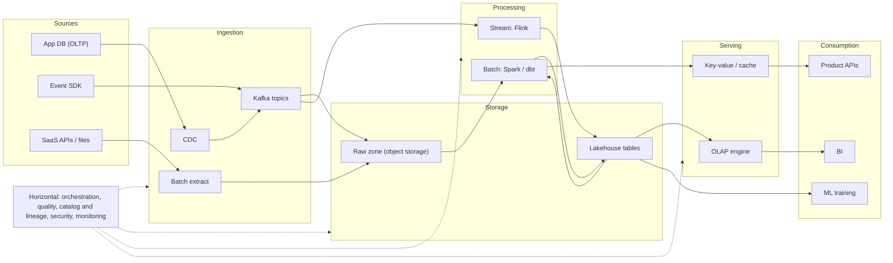
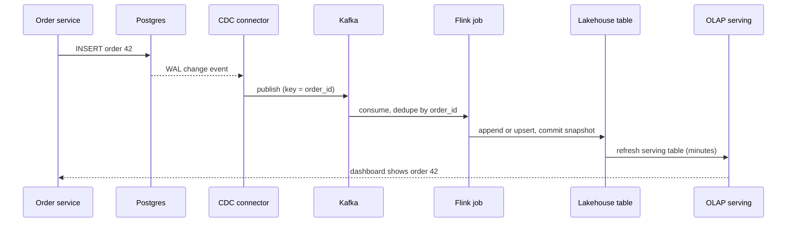

## 🎯 TL;DR

> A **reference architecture** is the standard map of a data platform: data comes from **sources**, moves through **ingestion** into **storage**, is transformed by **processing**, is exposed by **serving**, and is used by **consumers**. Horizontal layers (orchestration, quality, catalog, security, monitoring) cut across all of them.

- Each vertical layer has a job. Keep the jobs separate and you can replace one tool without rewriting the others.
- The **log** (usually Kafka) and **object storage** (S3, GCS, HDFS-compatible) are the two backbones most modern platforms share.
- A lakehouse table format (Iceberg, Delta, Hudi) lets several engines read and write the same data safely.
- The horizontal layers are not optional. Most platform failures are failures of orchestration, quality or ownership, not of the processing engine.

## 🌱 Start simple (Junior)

> **💡 Analogy:** Think of a city's food supply. Farms produce food (**sources**). Trucks bring it in (**ingestion**). A central warehouse stores it (**storage**). Kitchens cook it (**processing**). Shops display ready items (**serving**). Customers eat (**consumption**). Traffic lights, inspectors and a city map run across all of this (**orchestration, quality, catalog, security, monitoring**).

The same picture for data:

| Layer | Job | Typical tools |
|---|---|---|
| Sources | Where facts are produced | Application databases, event SDKs, SaaS APIs, files, IoT devices |
| Ingestion | Move data in, reliably | CDC connectors, Kafka producers, batch extract jobs, file drops |
| Storage | Keep data cheaply and durably | Object storage, lakehouse tables, warehouses |
| Processing | Clean, join, aggregate, enrich | Spark, Flink, dbt on a warehouse, SQL engines |
| Serving | Answer questions fast | OLAP engines, key-value stores, caches, APIs |
| Consumption | Use the results | BI dashboards, ML training, product features, reports |

A junior answer names the boxes. A good answer also says what each box guarantees and what happens when it fails.

## 🔧 How it really works (Mid)

Here is the reference picture. Solid arrows are data flow; the horizontal band is control and governance.



### Each layer in practice

**Sources.** Operational databases should not serve analytics queries. Capture changes with [[cdc]] (reading the database's write-ahead log) rather than running heavy `SELECT`s every hour. For events, use a schema-defined SDK and never let the producer invent fields silently.

**Ingestion.** Three patterns cover most cases: CDC for database changes, a [[kafka-architecture]] topic for events and a batch extract for SaaS APIs and files. Each path must answer one question: what happens on a duplicate and on a late record? Pick [[idempotency]] and a dedupe key at this layer, not at the dashboard.

**Storage.** A raw zone on [[object-storage]] keeps every input exactly as it arrived. On top, a [[lakehouse-table-formats|lakehouse table format]] adds ACID commits, schema evolution and snapshots. Here is an Iceberg table partitioned by day, written from Spark SQL:

```sql
CREATE TABLE lake.events.page_views (
  event_id   string,
  user_id    bigint,
  event_time timestamp,
  url        string
)
USING iceberg
PARTITIONED BY (days(event_time));
```

The `days(event_time)` transform lets queries that filter on `event_time` prune files without the writer adding a separate `event_date` column.

**Processing.** Streaming jobs (for example [[flink]]) produce low-latency tables; batch jobs ([[spark-architecture]], or SQL transformations with [[dbt]]) produce the daily and historical ones. Many platforms organize tables in layers, such as [[medallion-architecture|bronze, silver and gold]], so each layer has one clear contract.

**Serving.** Analysts' dashboards need an [[olap]] engine ([[clickhouse]] or another columnar store). Product features need point lookups, which is a key-value store or a cache. Pre-aggregate the hot queries; see [[serving-layer]].

**Consumption.** BI tools, feature pipelines for ML and product APIs read from serving or from the lakehouse. Each consumer should depend on a published table with a documented contract, not on a raw topic.

### Horizontal layers

- **Orchestration.** A scheduler such as [[airflow]] runs dependencies, retries and backfills. It should not do the heavy compute itself.
- **Quality.** Checks for freshness, row counts, null rates and uniqueness, run at ingestion and after each transform. See [[data-quality]].
- **Catalog and lineage.** A catalog says what tables exist and who owns them. [[lineage]] says where a number came from, which you need when a dashboard is wrong at 9 a.m.
- **Security.** Access control, encryption, PII masking and audit logs. See [[data-security]].
- **Monitoring.** Consumer lag, job duration, failed records, cost per table. See [[pipeline-monitoring]] and [[data-observability]].

### A single event, end to end



Each arrow is a place where a failure can duplicate or lose the event. The design question is which arrows need an idempotent write, which need an offset commit, and which need a dead-letter path ([[dead-letter-queue]]).

## 🧠 Senior depth & trade-offs

- **Separate storage from compute.** When data sits in open formats on object storage, several engines can read it. This is the main reason lakehouses replaced tightly coupled warehouse appliances, but you pay with more operational pieces and more cases where small files and stale metadata hurt.
- **Keep one raw copy.** Storing every input once, unchanged, and deriving everything else lets you reprocess after a bug. Teams that transform in place lose history and cannot prove what a number was.
- **The log is the integration backbone.** A durable, replayable log between systems decouples producers from consumers. It shifts the question from "is the warehouse up?" to "how far behind is each consumer?" (see [[consumer-lag]]).
- **Failure domains.** One Kafka cluster, one catalog, one orchestrator: each is a shared failure domain. Decide which of them must be highly available and which can be rebuilt. Name the recovery time for each.
- **Exactly-once is an end-to-end property.** A stream job with [[exactly-once]] checkpoints still duplicates records if the sink is not idempotent. Design the sink first.
- **Cost is an architecture decision.** Retention, replication, small files and full-table scans are the usual drivers. Put cost per table on the monitoring dashboard, so teams see the price of a query.
- **Ownership is part of the design.** Every table needs an owner, an SLA ([[sla-slo]]) and a contract for its schema. Without ownership the catalog becomes a list of unknown tables.
- **Do not build the full picture for one team.** For a small company with a few sources and a few dashboards, a managed warehouse, a managed ingestion tool and dbt cover most needs. Add a stream layer, a lakehouse and a separate serving store when a measured requirement (latency, scale, cost) forces you to. Use [[tech-selection]] to decide each box.

## 🧪 Try it

Work on paper. For each scenario, draw the layers, name the tool in each, and state one failure you would design for.

1. **Ride-hailing.** Drivers send GPS pings every 4 seconds; riders need a "nearby drivers" view in under 5 seconds; finance needs daily trip revenue. Map the three needs to layers.
2. **Retail.** Order data lives in a PostgreSQL database. Analysts want a dashboard that is at most 15 minutes behind. What do you use for ingestion, and why not a nightly full dump?
3. **Audit.** A regulator asks "which source produced this number on the report from last quarter?" Which horizontal layer answers this, and what must already exist for the answer to be possible?

<details><summary>Show solutions</summary>

**1.** Sources: driver app and GPS SDK. Ingestion: a Kafka topic keyed by driver ID. Processing: Flink for the live "nearby" state (a keyed state store per region). Serving: a key-value store or in-memory index for the 5-second lookup. Trip revenue: a batch layer (Spark or dbt) on the lakehouse, read by BI. Failure to design for: a driver's ping arrives twice, so the nearby view must be idempotent on `(driver_id, ping_time)`.

**2.** Use [[cdc]] (reading the WAL) into a Kafka topic, then land it in the lakehouse with micro-batches. A nightly full dump gives up to 24 hours of lag, scans the whole table each time, and adds load on the production database. CDC gives minute-level freshness and only the changes. Failure to design for: a restart replays changes, so the sink must upsert on the primary key.

**3.** [[lineage]] (with the catalog) answers this. It only works if every table records its inputs, its job version and its run time, and if the raw zone keeps the original data for the quarter. Without these, the team can only guess.

</details>

## 💬 Interview corner

**Question: "Design the data platform for a company with 50 sources."** Mid answer: "Ingestion with CDC and Kafka, a lake on S3 with Iceberg, Spark for batch, Flink for streaming, and a warehouse for BI, orchestrated with Airflow." Senior answer: "I'd start by asking which questions need answers within what latency and who owns each source. I'd keep one raw copy, make every ingestion path idempotent, and expose only published tables with contracts. The horizontal layers come first: ownership, quality checks and lineage. I'd add a streaming layer only where a measured latency requirement needs it, and I'd say what I would not build yet."

**Question: "Where does data quality fit?"** Mid: "After each transform, as tests." Senior: "At ingestion, on each transform, and before serving. The checks must block publication of bad data, not only report it."

> **🎤 Say this in the interview:** "I'll describe the six layers, then the horizontal ones, and I'll pick tools only after I know latency, volume and ownership. I'll state the failure I'm designing for in each path, because that is where the real trade-offs are."

## ⚠️ Common mistakes

> **⚠️ Watch out:** Drawing a box for every tool you know. A reference architecture shows layers and their contracts. Tools are one choice per layer, and interviewers want to hear why.

> **⚠️ Watch out:** Sending dashboards to the raw topic or the operational database. Consumers should read published tables, or you cannot change the internals without breaking them.

- Forgetting the horizontal layers. Quality, lineage and ownership usually decide whether the platform is trusted.
- Using a lakehouse for everything without a serving layer. Object storage is cheap, but a dashboard with many concurrent queries needs a faster engine.
- Mixing raw and curated data in one table. Keep the raw zone append-only and separate.
- Treating the scheduler as a compute engine. Orchestrators run and retry work; they do not process data at scale.
- Putting CDC on the production database without checking the replication slot or log retention.
- Assuming "exactly-once" holds across the whole pipeline because one engine offers it.

## ✅ Check yourself (quiz)

1. Which layer is responsible for keeping an unchanged copy of every input, so you can reprocess later?
   - A) Serving
   - B) Ingestion
   - C) Storage (raw zone)
   - D) Consumption

<details><summary>Answer</summary>

**C** — the raw zone in storage keeps the original data. Serving holds derived, query-friendly tables and consumption reads them. Ingestion moves data but should land it in storage, not transform it in place.

</details>

2. Where should you enforce idempotency for a pipeline that reads a Kafka topic and writes to a lakehouse table?
   - A) Only in the dashboard
   - B) In the sink write and the dedupe key, because redelivery is normal
   - C) By disabling retries
   - D) By using a larger partition count

<details><summary>Answer</summary>

**B** — at-least-once delivery means duplicates are normal. An idempotent sink (for example an upsert on a key, or a commit keyed by offset range) makes a retry safe. Disabling retries loses data, and more partitions do not remove duplicates.

</details>

3. A dashboard shows yesterday's revenue as 3% higher than the finance report. Which horizontal capability do you need to find the cause quickly?

   - A) Security
   - B) Lineage and the catalog (which jobs and inputs produced the table, and which versions ran)
   - C) Compression
   - D) A larger cluster

<details><summary>Answer</summary>

**B** — lineage shows the upstream tables and job versions behind the dashboard, so you can compare inputs and find the change. Without it, you search manually across jobs.

</details>

4. **(Senior)** A team wants to put a streaming engine, a separate OLAP store and a lakehouse in place for a company with 200 GB of data a month and 3 analysts. What is the main argument against this, and what would change your mind?

   - A) Lakehouses cannot store 200 GB
   - B) The operational cost of several systems is not justified by the requirements; a measured latency or scale requirement would justify each addition
   - C) OLAP stores must be used with streaming
   - D) Analysts cannot use SQL on lakehouses

<details><summary>Answer</summary>

**B** — each extra system adds operations, failure modes and on-call load. At this scale, a managed warehouse with ELT may meet every requirement. Add a component when a measured need (for example a 5-second freshness target or a concurrency limit) cannot be met without it.

</details>

5. **(Senior)** Why does "separate storage from compute" change failure behaviour, and what new risk does it add?

   - A) It removes all failures
   - B) Several engines can read the same data, so one team can recover or scale compute independently; the new risk is that small files and stale metadata degrade every engine
   - C) Compute and storage must be on the same disk
   - D) It makes backups unnecessary

<details><summary>Answer</summary>

**B** — the compute layer can be restarted, scaled or replaced without moving data. The cost is that table metadata and file layout become shared concerns: a bad write pattern (many small files, unmanaged snapshots) slows every engine that reads the table.

</details>

## 🗂️ Flashcards

| Front | Back |
|---|---|
| The six vertical layers | Sources, ingestion, storage, processing, serving, consumption |
| Horizontal layers | Orchestration, quality, catalog and lineage, security, monitoring |
| Why use CDC for a database source | It reads the change log, so there is no heavy query on production and changes arrive with low latency |
| Role of the raw zone | Keep every input unchanged so you can reprocess and audit |
| What a lakehouse table format adds | ACID commits, schema evolution, snapshots and safe concurrent writes on object storage |
| Why a log sits between systems | It decouples producers from consumers and lets each consumer replay at its own pace |
| Where exactly-once must be checked | End to end, including the sink, not only inside one engine |
| Who should consumers read from | Published tables with contracts, not raw topics or source databases |

## 🔗 Go further

- **[[tech-selection]]** gives the decision tables for choosing a tool in each layer.
- **[[data-estimation]]** shows how to size each layer from the product numbers.
- **[[medallion-architecture]]** explains the bronze, silver and gold layering used inside storage.
- **[[lakehouse-table-formats]]** compares the table formats in more depth.
- **[[serving-layer]]** and **[[kafka-architecture]]** go deeper into the two layers most designs get wrong.
- Draw the diagram from memory for a system you know, then compare it with the layers above. Note which horizontal layer you forgot.
