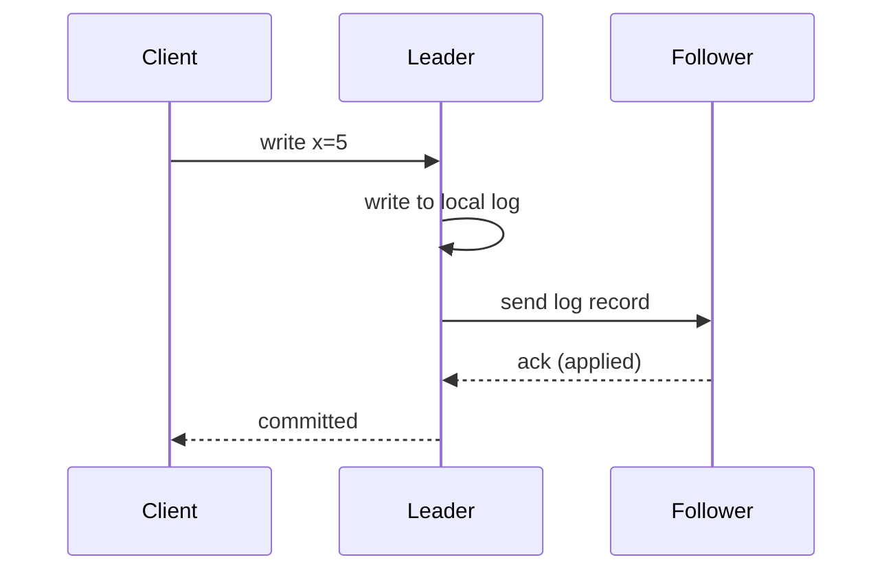

## 🎯 TL;DR

> **Replication** keeps copies of the same data on several nodes, so the system survives a machine failure and can serve more readers. Three families: **single-leader** (one node takes writes, followers copy them), **multi-leader** (several nodes accept writes and must resolve conflicts) and **leaderless** (any replica accepts writes; **quorums** decide what counts as done). Sync vs async sets the durability/latency trade-off. Async replicas lag, and lag creates anomalies users can see.

- Single-leader is the default in most relational databases and in many streaming logs.
- Multi-leader is used for multi-region writes, and it pays for that with conflict handling.
- Leaderless (Dynamo-style) favors availability for writes, and it pushes consistency into quorum rules.

## 🌱 Start simple (Junior)

> **💡 Analogy:** A company keeps its master price list in one file. Branch offices get copies by courier. If the courier is slow, a branch shows yesterday's prices; that is **replication lag**. If the head office burns down, one branch becomes the new master; that is **failover**. If the master file is wrong, every copy is wrong too, which is why replication is not a backup.

A minimal single-leader setup:

```text
clients ──writes──▶ [leader]  ──log stream──▶ [follower A]
                       │                      ──▶ [follower B]
clients ──reads───▶ followers (may be a little behind)
```

Three questions decide the design:

1. **Who accepts writes?** One node, several, or any?
2. **When does a write count as done?** After the leader writes it, or after a follower has it too?
3. **What happens when a node fails?** Who takes over, and what is lost?

## 🔧 How it really works (Mid)

**Single-leader.** The leader appends each change to its [[wal|write-ahead log]] (PostgreSQL WAL, MySQL binlog). Followers receive the log stream and apply it in the same order. Each follower tracks how far it has applied the log (an LSN or offset). Reads can go to followers, which is where lag appears.

**Sync vs async.** The difference is when the leader tells the client "committed":



- **Synchronous**: the leader waits for the follower ack. A committed write exists on two nodes, so failover does not lose it. The cost is latency, and one slow follower can stall writes.
- **Asynchronous**: the leader returns after its local write. It is fast, but if the leader dies before the follower got the record, that committed write is lost on failover.
- **Semi-synchronous**: one follower is synchronous and the rest are asynchronous. It is a common compromise. In PostgreSQL this is configured with `synchronous_standby_names`.

**Replication lag anomalies.** Asynchronous reads can break guarantees users expect:

- **Read-your-writes**: a user posts a comment, the next read goes to a lagging follower, and the comment is missing. Fix: read the user's own recent writes from the leader, or track the write position and read only from replicas that have reached it.
- **Monotonic reads**: a user refreshes twice and sees the data go backwards, because the two reads hit different replicas. Fix: pin a user's reads to one replica, for example by hashing the user id.
- **Consistent prefix**: a reader sees an answer before the question, because the two writes went through different partitions or paths. Fix: keep causally related writes in one partition or track their order.

**Multi-leader.** Each region has its own leader, so writes stay local and fast. The problem is conflicts: two leaders update the same row during a partition. Options:

- **Last-write-wins (LWW)** by timestamp. Simple, but it silently discards writes, and it depends on clocks.
- **Application merge**: keep both versions and merge them with business rules.
- **CRDTs**: data types whose merge is mathematically conflict-free (counters, sets). Only fits some data.

**Leaderless with quorums.** Dynamo-style systems (Cassandra, Riak, Voldemort, DynamoDB's design) have no leader. A write goes to all N replicas and succeeds after W acks. A read queries R replicas and takes the newest value. The rule is:

> If **W + R > N**, every read set overlaps every write set in at least one replica, so a read sees the latest acknowledged write (when there is no concurrent write and no sloppy quorum).

Worked check with N = 3:

| W | R | W + R | Overlap always? | What can go wrong |
|---|---|---|---|---|
| 2 | 2 | 4 | yes | nothing from this rule |
| 1 | 1 | 2 | no | a read can hit the one replica that missed the write |
| 3 | 1 | 4 | yes | writes need every replica, so one down node blocks writes |

Read repair (fixing stale replicas during reads) and anti-entropy (background comparison, often Merkle trees) bring replicas back in sync.

**Split brain and failover.** Failover means detecting that the leader is dead (a timeout, which can be wrong), choosing a new leader with the most up-to-date log, and redirecting clients. The danger is **split brain**: a network partition leaves the old leader alive, both sides accept writes, and the data diverges. Defenses: consensus-based election (see [[consensus]]), fencing tokens (a monotonic epoch that storage rejects from old leaders), and shutting the old leader down before promoting a new one.

## 🧠 Senior depth & trade-offs

- **Replicas are not backups.** A `DELETE` or a corrupted write is replicated faithfully. Keep point-in-time backups and, where useful, a delayed replica.
- **Quorums are not linearizability.** W + R > N removes the stale read in the simple case, but concurrent writes, sloppy quorums, hinted handoff, failed writes that partly applied and clock-based conflict resolution can still produce surprises. Consistency per query (for example `LOCAL_QUORUM` in Cassandra) is a choice you must document.
- **Cross-region latency.** A synchronous write across regions pays at least one round trip, often tens to hundreds of milliseconds. This is where [[cap-pacelc]] becomes practical: under partition you choose availability or consistency, and without partition you still choose latency or consistency.
- **Replication slots and WAL retention.** In PostgreSQL, a logical replication slot (used by [[cdc]] tools) keeps WAL until the consumer confirms it. A stuck consumer can fill the disk of the primary. Alert on slot lag.
- **Kafka's version of the problem.** Each partition has a leader and followers in the in-sync replica set (ISR). `acks=all` with `min.insync.replicas` gives a durability floor. Monitor under-replicated partitions and consumer lag. See [[kafka-architecture]].
- **Failover side effects.** After failover, clients may retry writes that already committed. Idempotent writes (see [[idempotency]]) make this safe; non-idempotent retries double-count.
- **What to monitor:** replication lag in seconds and bytes, time since last applied transaction, failover count, under-replicated partitions, and slot retention.
- **When not to replicate across regions.** If the business accepts stale reads for a few seconds, one region with async replicas is simpler and cheaper than multi-leader.

## 🧪 Try it

Predict the output of this script, then run it. It checks whether every read quorum overlaps every write quorum.

```python
from itertools import combinations

def always_overlap(n, w, r):
    nodes = range(n)
    for write_set in combinations(nodes, w):
        for read_set in combinations(nodes, r):
            if not set(write_set) & set(read_set):
                return False
    return True

for n, w, r in [(3, 2, 2), (3, 1, 1), (5, 3, 3), (5, 2, 3)]:
    print(f"N={n} W={w} R={r} overlap={always_overlap(n, w, r)}")
```

1. Which of the four configurations pass the `W + R > N` rule, and does the script agree?
2. For N = 5, what is the smallest W with R = 3 that still guarantees overlap? Show your arithmetic.
3. A single-leader PostgreSQL cluster uses async replication. A user's payment confirmation is committed, then the leader crashes. Describe the best and worst outcomes after failover.

<details><summary>Show solutions</summary>

1. `(3,2,2)` and `(5,3,3)` pass, because 4 > 3 and 6 > 5. `(3,1,1)` fails (2 is not above 3) and `(5,2,3)` fails (5 is not above 5). The script agrees: it prints `True`, `False`, `True`, `False`.
2. With R = 3, the rule needs W + 3 > 5, so W > 2, and the smallest W is 3.
3. Best case: the follower had the record and the payment survives. Worst case: the follower was behind, the new leader does not have the commit, and the customer's confirmation is lost while the customer already saw success. Fix: use synchronous or semi-synchronous replication for this data, or make the payment write idempotent and reconcile against the payment provider.

</details>

## 💬 Interview corner

**Q: What is the difference between synchronous and asynchronous replication, and what happens at failover?**

> **🎤 Say this in the interview:** Synchronous replication waits for a follower before acknowledging the commit, so failover loses nothing committed, at the cost of latency and availability when a follower is slow. Asynchronous replication acknowledges right away and is faster, but recent commits can be lost on failover. Most systems use semi-synchronous replication as a middle ground.

- **Junior answer:** explains that copies exist on other machines and that async may be behind.
- **Mid answer:** adds the WAL stream, lag, read-your-writes and monotonic-read anomalies, and the fix for each.
- **Senior answer:** covers quorum overlap (W + R > N) and its limits, split brain and fencing, cross-region latency, slot retention, and how it would monitor lag and failover.

**Follow-up: "Why does W + R > N not give linearizability?"** Because concurrent writes, failed partial writes, sloppy quorums and timestamp-based conflict resolution can still return an older value to some clients. Overlap removes the simple stale read, not every anomaly.

## ⚠️ Common mistakes

- Treating a replica as a backup. A bad `DELETE` replicates everywhere.
- Reading from a replica right after a write, and then reporting a "bug" that is really lag.
- Assuming W + R > N means strong consistency under concurrency.
- Using last-write-wins with client wall-clock timestamps, which silently loses updates when clocks disagree.
- Promoting a new leader without fencing the old one, which allows split brain.
- Running async replication for data where a lost commit has a real cost (payments, inventory) without a reconciliation process.
- Ignoring lag metrics until users complain.

## ✅ Check yourself (quiz)

1. What does `W + R > N` guarantee in a leaderless system with N replicas?
   - A) Linearizable reads at all times
   - B) Every read set overlaps every write set in at least one replica, so a read sees the latest acknowledged write in the simple case
   - C) Writes are faster than reads
   - D) Conflicts cannot happen

<details><summary>Answer</summary>

**B** — the overlap removes the simple stale read. It does not cover concurrent writes, sloppy quorums or conflict resolution, so A and D are too strong.

</details>

2. A single-leader system uses async replication. The leader commits a transaction, then crashes before any follower receives it. A follower is promoted. What happens?
   - A) Nothing; commits are always replicated first
   - B) The committed transaction is lost, because the new leader never had it
   - C) The old leader's writes merge automatically when it returns
   - D) Reads are blocked until the old leader comes back

<details><summary>Answer</summary>

**B** — async replication acknowledges before the follower has the record, so a crash in that window loses it. Semi-synchronous or synchronous replication closes this gap.

</details>

3. A user posts a comment, then the page reloads from a lagging follower and the comment is missing. Which anomaly is this, and what is the simplest fix?
   - A) Monotonic reads; pin the user to one follower
   - B) Read-your-writes; read the user's own recent writes from the leader or from a replica that has reached the write position
   - C) Split brain; fence the old leader
   - D) Consistent prefix; use one partition

<details><summary>Answer</summary>

**B** — the user does not see their own write, which is the read-your-writes guarantee. Monotonic reads is about going backwards across reads, and split brain is about two leaders.

</details>

4. **(Senior)** Two regions accept writes for the same user profile during a network partition. The system resolves conflicts with last-write-wins using client wall-clock timestamps. What can go wrong?
   - A) Nothing; LWW is always correct
   - B) A later update can lose to an earlier one if the writer's clock is behind, and the newer change is silently discarded
   - C) Both writes are rejected
   - D) Reads become linearizable

<details><summary>Answer</summary>

**B** — the winner is decided by clocks, not by causality. Clock skew can make an older write win, and LWW discards the other value without an error.

</details>

5. **(Senior)** Why does a single-leader cluster need fencing tokens or consensus-based election during failover?
   - A) To make reads faster on followers
   - B) To prevent split brain: a partitioned old leader may still accept writes, and fencing makes storage reject its stale requests
   - C) To remove the need for a WAL
   - D) To make replication synchronous

<details><summary>Answer</summary>

**B** — failover without a way to stop the old leader can produce two leaders accepting writes. Fencing and consensus-based election are the standard defenses.

</details>

## 🗂️ Flashcards

| Front | Back |
|---|---|
| Single-leader replication | One node takes writes; followers apply the leader's log in order |
| Sync vs async commit | Sync waits for a follower ack (no loss on failover, slower); async returns at once (faster, may lose commits) |
| Semi-synchronous | One synchronous follower, the rest asynchronous; a common middle ground |
| Read-your-writes | After a write, the same user must see that write; fix by reading from the leader or a caught-up replica |
| Monotonic reads | A user's successive reads never go back in time; fix by pinning reads to one replica |
| W + R > N | Every read quorum overlaps every write quorum in at least one replica |
| Last-write-wins | Conflict resolution by timestamp; simple, but it silently discards writes |
| Split brain | Two nodes both act as leader after a partition; prevented by consensus and fencing |

## 🔗 Go further

- [[quorum]] and [[consensus]] explain the mechanisms behind the rules above.
- [[consistency-models]] covers the guarantees that these anomalies break.
- [[cap-pacelc]] explains the availability and latency trade-offs for replicated systems.
- [[kafka-architecture]] shows ISR and replication in a log-based system.
- [[wal-mvcc]] covers the log that single-leader systems replicate.
