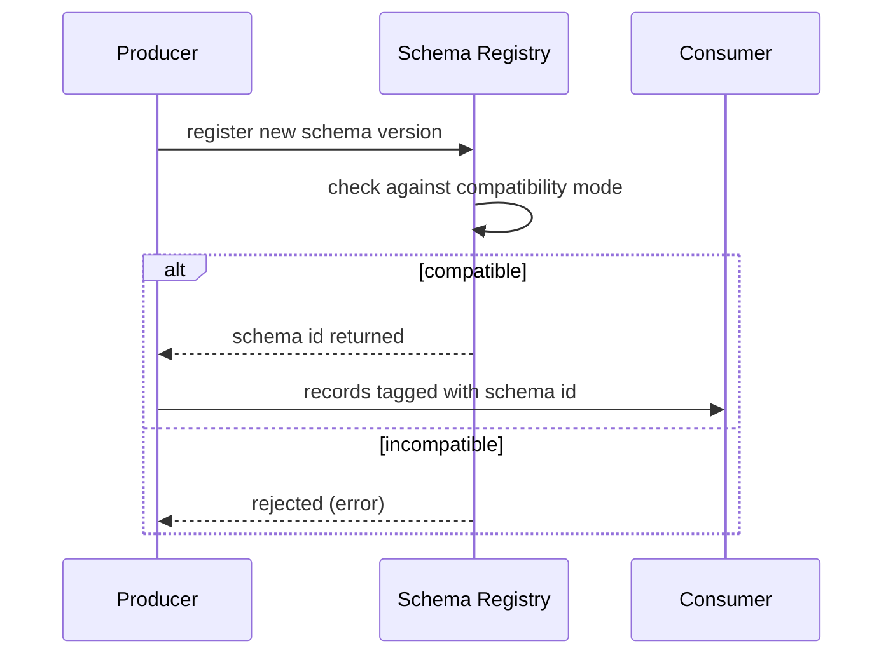

## 🎯 TL;DR

> **Schema evolution** is changing the structure of a dataset over time (add, drop, rename or retype a field) **without breaking the readers and writers** that already exist. What decides whether a change is safe is **compatibility**: which side must be able to read data written by the other side.

- **Backward compatible:** a *new* reader can read *old* data.
- **Forward compatible:** an *old* reader can read *new* data.
- **Full:** both directions work, so producers and consumers can be upgraded in any order.
- Safe moves: add a field **with a default**, never reuse a name or ID, rename through an alias or a column ID, and let a schema registry or a CI check reject the unsafe ones.

## 🌱 Start simple (Junior)

> **💡 Analogy:** Think of a paper form with numbered boxes, and thousands of old copies in filing cabinets. Adding a new box at the bottom is safe, because the old readers simply skip it. Deleting a box that some readers still look for leaves them with blanks. Renaming a box without telling anyone means they read nothing at all.

A small event stream makes this concrete. Version 1 of an order event:

```json
{"order_id": 42, "amount": 10.5}
```

Version 2 adds a `currency` field:

```json
{"order_id": 42, "amount": 10.5, "currency": "USD"}
```

Two questions decide if the change is safe:

1. **Old consumer, new data.** The v1 consumer receives v2 records. Most JSON parsers ignore the unknown `currency` field, so this works (forward compatible).
2. **New consumer, old data.** The v2 consumer reads v1 records, which have no `currency`. It needs a **default** (for example `"USD"`) or a `null` rule, otherwise it fails (backward compatible).

Rule of thumb: **adding** an optional field with a default is safe. **Removing** a field, **renaming** it, or **changing its type** is where pipelines break.

## 🔧 How it really works (Mid)

Every format encodes compatibility rules differently. The mechanism matters more than the names.

**Avro** stores a *writer schema* (the schema used to write the bytes) and reads with a *reader schema*. A resolution step matches fields **by name**:

- A field in the writer but not in the reader is skipped.
- A field in the reader but not in the writer must have a `default`, or reading fails.
- A reader can rename a field with an `aliases` list, which maps old names to new ones.
- Numeric promotion is allowed (`int` to `long`, `float` to `double`).

```json
{
  "type": "record",
  "name": "Trip",
  "namespace": "ride",
  "fields": [
    {"name": "trip_id", "type": "string"},
    {"name": "fare", "type": "double"},
    {"name": "currency", "type": "string", "default": "IRR"},
    {"name": "driver_id", "type": ["null", "string"], "default": null}
  ]
}
```

The nullable-field convention is `["null", "string"]` with `null` first, because the default must match the first branch of the union.

**Parquet** itself has no table-level schema; a directory of files plus a metastore forms the "table". Most readers (Spark, Arrow) match columns **by name**:

- A new column is read as `NULL` from older files.
- A dropped column stays in old files and is ignored by new readers.
- A rename looks like *drop + add*, so old values silently appear as `NULL` under the new name.
- Different files in the same folder can have different schemas. This is the most common source of silent drift in a lake.

**Iceberg** fixes the name problem. Every column gets a unique **field ID** stored in the table metadata, and data files reference IDs, not names. So:

- Renames and reordering are metadata-only and safe.
- A new column gets a new ID; old files return `NULL` for it.
- Dropping a column and adding one with the same name creates a **new ID**, so old values do not come back.
- Only safe type widenings are allowed (for example `int` to `bigint`, `float` to `double`, or a larger `decimal` precision).

**ClickHouse** works differently, because the data is stored in immutable parts:

- `ALTER TABLE ... ADD COLUMN` is a metadata change. Existing parts return the column's `DEFAULT` at read time.
- Changing a column type usually means rewriting data (a mutation). Check the docs for your version, because the rules differ between releases.
- A column used in the sorting or primary key cannot simply be dropped.

**Schema registry** (Confluent-style, used with Kafka) enforces the rules at write time. Each subject has a *compatibility mode*:



The main modes are `BACKWARD` (the usual default), `FORWARD`, `FULL`, `NONE`, and the `_TRANSITIVE` variants, which check against **all** previous versions and not only the last one. Confirm the default and the exact behaviour in your registry's docs.

## 🧠 Senior depth & trade-offs

- **Pick the mode from the deploy order.** If consumers always upgrade first, you need backward compatibility. If producers upgrade first, you need forward compatibility. If teams deploy independently, use full compatibility.
- **Transitive matters for replay.** A topic with 30 days of retention, or a backfill that reads old offsets, needs every old version to stay readable. A non-transitive check only compares with the latest version and can pass a change that breaks version 1 readers.
- **Removing a field is subtle.** Under Avro rules, a new reader without the field can read old data (backward OK). An old reader that expects the field, but gets new data without it, fails unless the field had a default in the old schema. The safe sequence is: stop writing the field, keep it as optional with a default, wait until all readers ignore it, then remove it.
- **Never reuse a name or ID with a new meaning.** The worst case is `amount` changing from dollars to cents. The types match, so nothing errors, and the numbers are wrong for months. Deprecate and add `amount_cents` instead.
- **Enum changes break readers.** Adding a symbol to an Avro enum is a breaking change for old readers unless the enum has a default symbol. Plan this as a two-step rollout.
- **Making a column required is breaking.** Changing `NULL`able to `NOT NULL` makes old writers' records invalid.
- **Lakes drift silently.** Options like schema merging in Spark read more files and can hide a type conflict. Enforce a contract at the producer, or a schema check in the pipeline, and alert on new unknown columns and on `NULL` rates for new fields.
- **When not to evolve the schema.** For truly unknown or sparse attributes, use a `MAP` or a JSON/`VARIANT` column instead of adding a new column every week. The cost is weaker typing and slower queries on those fields.

## 🧪 Try it

1. **Classify the change.** The v1 `Trip` record has `fare` as `double`. v2 renames it to `fare_amount` and changes the type to `decimal(12,0)`. Which compatibility does this break, and what is the safe multi-step rollout?
2. **Write the Avro reader field.** Add a `vehicle_type` field (values like `"car"`, `"bike"`) to `Trip` so that old data still reads. What must the field include?
3. **Iceberg rename.** You rename `driver_id` to `driver_key` in an Iceberg table. Do old files still return the driver values? Why or why not?

<details><summary>Show solutions</summary>

**1.** This is not a simple add. A rename looks like drop + add to a name-based reader, so `fare` becomes `NULL` for the new name, and the type change from `double` to `decimal` needs a cast that old readers may not do. Safe rollout: (a) add `fare_amount` as a new optional field with a default while still writing `fare`; (b) dual-write both; (c) migrate consumers; (d) stop writing `fare`; (e) remove it after all readers have moved. In Iceberg you would use a rename and a widening cast instead of a new column.

**2.** It needs a `default`, for example `{"name": "vehicle_type", "type": "string", "default": "car"}`. Without a default, a new reader reading old data (which has no field) fails, so the change is not backward compatible.

**3.** Yes. Iceberg references columns by field ID, so the rename is metadata-only and old files still return the values. A rename in a name-based format like plain Parquet would return `NULL`.

</details>

## 💬 Interview corner

**Question: "How do you add a column to a Kafka topic without breaking consumers?"** Mid answer: "I add it as an optional field with a default in the Avro schema and register it in the schema registry with backward compatibility."

Senior answer: "I'd make it an optional field with a default, check that the registry mode matches our deploy order, and use a transitive check if we replay old offsets. I'd make consumers ignore unknown fields and keep a dashboard for schema-rejection errors. Renames and type changes are a separate, multi-step migration, not a normal evolution."

**Question: "Why is Iceberg safer than Parquet for schema changes?"** Mid: "Iceberg tracks columns by ID, so renames and reordering are safe." Senior: "Parquet alone matches by name and has no table-level schema, so the same folder can mix schemas. Iceberg stores the schema history in metadata, which makes changes atomic and lets older files be read by ID."

> **🎤 Say this in the interview:** "A schema change is safe only if the readers and writers that exist during the rollout can still read each other's bytes. I choose the compatibility mode from the deploy order, I add fields with defaults, and I never reuse a name. For renames and type changes I use a multi-step migration, and I enforce the rules in the registry and in CI."

## ⚠️ Common mistakes

> **⚠️ Watch out:** Renaming a field is not evolution, it is drop + add. Old values silently become `NULL` (name-based readers) or stop matching (lookups).

- Adding a required field with no default. Old data cannot be read by the new schema.
- Changing a type from `string` to `int`, or from `int` to `string`. Most readers cannot promote these.
- Reusing a field name for a different meaning. No error is raised, so the bug is invisible.
- Assuming all Parquet files in a folder share one schema.
- Checking compatibility only against the latest version, then replaying an old topic.
- Relying on column position in CSV or in files without field names. Reordering breaks silently.
- Changing `NULL`able to `NOT NULL` in one step.

## ✅ Check yourself (quiz)

1. In Avro, which change is backward compatible when the reader's schema adds a new field?
   - A) The new field has no default
   - B) The new field has a default value
   - C) The new field is renamed from an existing one
   - D) The field type is changed from `int` to `string`

<details><summary>Answer</summary>

**B** — a new reader reading old records needs a value for the new field. A `default` provides it. Without one, resolution fails.

</details>

2. You want a Kafka topic whose producers are upgraded before its consumers. Which compatibility direction do you need?
   - A) Backward
   - B) Forward
   - C) Full only
   - D) None

<details><summary>Answer</summary>

**B** — when producers upgrade first, old consumers receive new data, so the old readers must handle the new schema (forward compatibility).

</details>

3. Why does renaming a column in a plain Parquet folder lose data, while the same rename in Iceberg does not?
   - A) Parquet does not support strings
   - B) Parquet matches by name, so the new name has no old values; Iceberg matches by field ID
   - C) Iceberg copies all data files on rename
   - D) Parquet renames are not allowed at all

<details><summary>Answer</summary>

**B** — a name-based reader sees the new name as a new, empty column. Iceberg references the stable field ID, so the rename changes only metadata.

</details>

4. **(Senior)** Your registry uses non-transitive `BACKWARD`. Version 3 passes, but a consumer replaying a 30-day-old offset range fails on version 1 records. Why, and what is the fix?
   - A) The registry is corrupt
   - B) Non-transitive checks compare only with the previous version, so v3 can be incompatible with v1; use the transitive mode for topics that are replayed
   - C) Replay does not use schemas
   - D) Avro cannot store more than two versions

<details><summary>Answer</summary>

**B** — the change from v2 to v3 was checked, and v2 to v1 was checked earlier, but v3 against v1 was not. Transitive modes check the new version against all previous ones, which is what a long replay needs.

</details>

5. **(Senior)** Your team wants to add 200 optional product attributes that vary by category, every quarter. What is a better design than 200 new columns each time?

   - A) Create a new table for every attribute
   - B) Store the sparse, changing attributes in a `MAP` or JSON/`VARIANT` column, and promote the frequently queried ones to real typed columns
   - C) Remove the schema and store everything as one text blob
   - D) Use `NOT NULL` for all new columns

<details><summary>Answer</summary>

**B** — a flexible column absorbs sparse changes without a schema migration each time, and the hot attributes get real typed columns for speed and type safety. The trade-off is weaker typing and slower access to the flexible part.

</details>

## 🗂️ Flashcards

| Front | Back |
|---|---|
| Backward compatibility | A **new** reader can read **old** data |
| Forward compatibility | An **old** reader can read **new** data |
| Full compatibility | Both directions; producers and consumers upgrade in any order |
| Avro reader adds a field | It needs a `default`, or old data cannot be read |
| Why is a rename risky in Parquet? | Name-based matching makes the new name an empty column |
| How does Iceberg make renames safe? | Columns are tracked by unique field IDs in metadata |
| What is transitive compatibility? | The new version is checked against all previous versions, not only the last one |
| Why is reusing a name with a new meaning dangerous? | No error is raised, so the wrong numbers flow silently |

## 🔗 Go further

- **pattern-schema-evolution** shows how a pipeline absorbs source changes end to end: registry, contracts, flexible columns and alerts.
- **schema-registry** covers the registry itself, its subjects, and the modes in detail.
- **lakehouse-table-formats** compares Iceberg, Delta and Hudi, which all solve the name-matching problem in different ways.
- **governance-contracts-mesh** covers data contracts, the organisational side of "who may change a schema".
- Read the documentation of your format and engine for the exact allowed type changes; the rules differ between Avro, Parquet readers, Iceberg, and ClickHouse releases.
