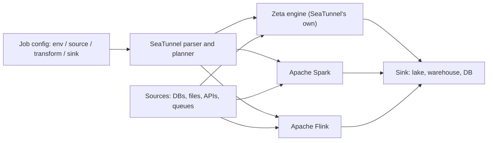

## 🎯 TL;DR

> A **data integration engine** moves data from sources to sinks using **configured connectors** instead of hand-written code. Apache SeaTunnel is one such engine: you describe a job in a config file (source, optional transform, sink), and it runs that job on an execution engine (its own Zeta engine, or Spark or Flink).

- You write **configuration**, not a Spark or Flink program, for the common cases: database to lake, API to warehouse, Kafka to storage.
- The execution engine underneath matters: Zeta is SeaTunnel's own, while Spark and Flink bring their own failure, scaling and state models.
- The trade-off is **speed of delivery and standardization** against **flexibility and the cost of debugging** when a connector or config does not fit your case.
- Use it when most of your work is "copy this table from there to here, reliably", and write custom code when the logic is the product.

## 🌱 Start simple (Junior)

> **💡 Analogy:** Think of a moving company with pre-made boxes and a checklist. You say "move the kitchen from house A to house B, pack these items, unpack them in this room". The company already knows how to handle boxes, stairs and fragile items. You only describe *what* to move. If your move involves a piano through a window, you may need a custom plan. That is when hand-written code makes sense.

A data integration job has three parts:

- **source**: where the data comes from (a MySQL table, a CSV folder, a REST API, a Kafka topic),
- **transform** (optional): small changes such as renaming fields, filtering, or SQL on the stream of rows,
- **sink**: where the data goes (a lake table, a warehouse, another database).

Here is a complete SeaTunnel-style job in HOCON, the configuration format it uses. The `env` block sets engine options, `source` reads, and `sink` writes. Check the exact connector options against the docs for your version, because connector names and parameters change between releases.

```hocon
env {
  parallelism = 2
  job.mode = "BATCH"
}

source {
  Jdbc {
    url = "jdbc:mysql://mysql.internal:3306/shop"
    driver = "com.mysql.cj.jdbc.Driver"
    user = "reader"
    password = "${DB_PASSWORD}"
    query = "SELECT id, customer_id, amount, created_at FROM orders"
  }
}

sink {
  Console {}
}
```

Run it with the SeaTunnel launcher and a config file path (the exact command depends on the release and the engine you choose). The point is the shape of the job: you did not write any reading, batching, or writing code.

For a junior, the big question is not "how do I write the job" but "does a connector exist, and does it behave the way I need?" That question is where most of the real work goes.

## 🔧 How it really works (Mid)

SeaTunnel separates the **job definition** from the **engine that runs it**.



The parts you configure:

- **Connectors.** Each source and sink is a plugin with options for connection, reading mode, partitioning and schema. Many connectors are built in: relational databases over JDBC, object storage files, common message queues, and many analytics stores. The more connectors a project has, the less custom code the team writes.
- **Parallelism and splits.** For a JDBC source, the engine can split a table into ranges (for example by a numeric key) and read them in parallel. The split column choice decides whether the load is balanced. A skewed key gives one slow split, the same skew problem seen in Spark (see [[data-skew]]).
- **Job mode.** A job is `BATCH` (read everything, then finish) or `STREAMING` (keep running and read new data). Streaming CDC is the reason many teams adopt such engines: the source reads a database change log, see [[cdc]].
- **Transforms.** Small operations such as field mapping, filtering, and SQL-style transforms run inside the job. Anything bigger (joins across sources, complex business logic) is a sign that the job belongs in dbt or Spark.
- **Schema.** Sources and sinks map types between systems. Type mismatches (for example decimal precision, timestamps with and without time zone, or Persian text with a wrong charset) are where most surprises happen. Check the mapping for every column that matters.

The **execution engine** decides the runtime properties:

| Engine | Strength | Keep in mind |
|---|---|---|
| Zeta (SeaTunnel's own) | Built for the integration use case; simple to deploy with few components | Smaller community than Spark or Flink; check the connector and feature matrix for your release |
| Spark | Mature cluster manager integration, familiar to Spark teams | Inherits Spark's cost model and job startup time |
| Flink | Streaming with checkpoints and exactly-once semantics where the connector supports them | Inherits Flink's state and checkpoint tuning |

Whether a job is exactly-once depends on the source and sink together, not on the engine name alone. A file sink with an atomic commit and a checkpoint-aware source can be exactly-once. A plain HTTP sink usually is at-least-once, so you need idempotent writes, as described in [[idempotency]].

## 🧠 Senior depth & trade-offs

**Where it pays off.** The strongest case is a large number of ordinary pipelines: dozens or hundreds of tables copied from operational databases into a lake, with the same retry, logging, and schema handling for all of them. Configuration files are easy to review, version, and generate from a catalog of tables. A small team can run many integrations without a custom codebase for each. This is also the reason to standardize: one tool, one way to monitor, one way to recover.

**Where it hurts.** Custom logic becomes awkward. Once you need stateful logic, custom retry policies per record, or complex joins, you are fighting the configuration model. You will end up with plugins, custom transforms, or SQL in odd places, and debugging a failure inside a generated execution plan is harder than reading your own Python. Also, connectors have their own quirks: a connector may not support a feature (incremental read, schema evolution, specific types) in the version you run. Verify the feature matrix before committing to a design.

**Failure handling is the real test.** Ask these questions for any integration tool:

- What happens on a bad record? Is there a dead-letter path ([[dlq-bad-records]]), or does the whole job fail?
- How does a retry interact with the sink? Re-running a batch can duplicate rows unless the sink supports idempotent upserts or the job writes to a staging table and commits atomically.
- Where is the checkpoint or offset stored? If the job restarts, does it resume or reread everything?
- How is schema drift detected? A new column in the source should not silently break the sink. Pair the tool with a [[schema-registry]] or contract checks where appropriate ([[data-quality]]).

**Choosing against custom jobs.** Use this rule of thumb:

| Situation | Better fit |
|---|---|
| 50 similar table copies, standard types, batch or CDC | Integration engine |
| One complex stream with state and custom windows | Flink or Spark code |
| SQL transformations on warehouse data | dbt, or the warehouse itself ([[etl-vs-elt]]) |
| Orchestration of many steps across tools | An orchestrator such as [[airflow]], calling the integration job as one step |
| Irregular APIs with custom auth and paging | Custom code, or an integration connector if one already exists |

Notice that an integration engine is rarely the whole platform. It moves data; an orchestrator schedules and monitors; a quality layer checks the result. Designing the boundaries between them matters more than the tool choice itself.

**Operations and governance.** Track job duration, rows read and written per run, rejected-record counts, and lag for streaming jobs. Keep the configuration files in version control and review them like code, since a changed password variable or a wrong `query` can silently change what you copy. Keep secrets out of the file itself: use environment variables or a secret store, as the example does with `${DB_PASSWORD}`.

**In Iranian on-prem environments**, the typical sources are Oracle and SQL Server in banks and telcos, and MySQL or PostgreSQL in product companies. Integration tools with JDBC connectors can cover many of these, but check driver licensing and support for the specific database versions you run.

**What to monitor:** job success rate and run time trend, rows per second per split (a slow split shows skew), retry counts, and dead-letter volume. A sudden drop in rows with no failure usually means a filter or schema mapping changed, not that the source went quiet.

## 🧪 Try it

You need Docker, and a local database to read from (for example a PostgreSQL container with a small `orders` table). Use the SeaTunnel docs for your version to find the matching connector options.

1. Write a batch job that reads 100 fake rows with the built-in fake source and writes them to the console. Change the parallelism and observe how many splits or tasks run.
2. Replace the console sink with a file sink (CSV or Parquet, whichever the connector supports). Run the job twice. Are there duplicate rows? What would you change to make the second run idempotent?
3. A source column `amount` is `DECIMAL(12,2)`, and the sink is a file format with a `DOUBLE` type. Explain what can go wrong with money values, and how you would catch it before production.

<details><summary>Show solutions</summary>

**1.** A correct run ends with 100 rows printed and a success status. Raising the parallelism on a small fake source usually does not change the output, but on a real JDBC source it changes the number of parallel reads, and the reading pattern can differ by split.

**2.** Running the same batch job twice without a deduplication step writes the rows twice into an append-only file sink. To make the job idempotent, write to a staging location with a run ID, then commit to the final location atomically (or overwrite the partition for that run). Alternatively use a sink that supports upsert on a key.

**3.** `DOUBLE` is binary floating point. Values like `0.10` cannot be represented exactly, so sums drift and comparisons fail. Money should use decimal types end to end. Catch it with a reconciliation check: compare the sum of `amount` in source and sink for a sample date, expect an exact match, and alert on any difference. Also check the schema mapping in the job config before the first production run.

</details>

## 💬 Interview corner

**Question: "When would you use SeaTunnel instead of writing a Spark job?"** Mid answer: "When the job is a standard copy from a database to a lake, with many tables and no complex logic. SeaTunnel has connectors for this, so I write configuration and it handles reading, parallel splits, and writing." Senior answer: "I'd choose it for a large number of similar integrations where standardization and low maintenance matter more than custom logic. I check three things first: whether the connectors and types I need are supported in my version, how failures and retries interact with the sink, and whether the schema mapping is correct for money and timestamps. If the logic becomes stateful or joins several streams, I move that part to Flink or Spark and keep the integration tool for the movement."

**Question: "Is an integration engine exactly-once?"** Mid: "It depends on the connector." Senior: "Exactly-once is a property of the source and sink combination, plus the engine's checkpoint behaviour. A checkpoint-aware source with an atomic commit sink can be exactly-once. Many sinks are at-least-once, so I design the writes to be idempotent, for example with upserts on a business key or staged commits per run ID."

> **🎤 Say this in the interview:** "I treat integration engines as a way to standardize many routine copies. I choose them when the work is connector-shaped, and I write custom code when the logic is the product. Before adopting one, I verify connector support, failure and retry behaviour at the sink, and type mapping for money and time."

## ⚠️ Common mistakes

> **⚠️ Watch out:** Assuming "it has a connector" means "it has the feature you need". Incremental reads, CDC, schema evolution and specific data types vary by connector and version. Check the matrix for your release.

> **⚠️ Watch out:** Rerunning a batch job into an append-only sink and getting duplicate rows. Plan the run identity and the commit strategy before the first run.

- Using a float type for money because the sink supports it.
- Putting database passwords directly in the config file that lives in Git.
- Assuming the engine's parallelism is free. A skewed split key gives one slow task and a long tail.
- Forgetting that the execution engine (Zeta, Spark, Flink) has its own resource and failure model, and that debugging requires knowing it.
- Using a config-driven tool for logic that needs real state or custom retry rules, then fighting the abstraction for months.
- Skipping reconciliation. A job that exits with success can still copy the wrong rows.

## ✅ Check yourself (quiz)

1. What are the three parts of a SeaTunnel job definition?
   - A) Input, process, output
   - B) Source, optional transform, sink
   - C) Producer, broker, consumer
   - D) Extract, load, validate

<details><summary>Answer</summary>

**B** — a job is defined by a source (or sources), an optional transform, and a sink, plus an `env` block for engine options. Option A describes the same idea in general terms, but the config names are source, transform, and sink. Option C describes Kafka, and option D describes the ETL steps in general.

</details>

2. A JDBC source is read with four parallel splits, but one split takes 80% of the run time. What is the most likely cause?

   - A) The sink is too fast
   - B) The split key is skewed, so one range holds most of the rows
   - C) The job mode is set to `BATCH`
   - D) The environment variables are missing

<details><summary>Answer</summary>

**B** — when the split column is skewed (many rows in one range), one split does most of the work. Choose a more evenly distributed key or a split strategy that balances the rows. Option C is a valid setting, and option D would cause a failure, not a slow split.

</details>

3. Why should a database password not appear in a job config checked into Git?

   - A) Git cannot store text files
   - B) Anyone with repository access can read it, and it persists in history even after removal
   - C) SeaTunnel refuses to start with a password in the file
   - D) Passwords slow down the job

<details><summary>Answer</summary>

**B** — repository access exposes the secret, and Git history keeps it even if the file changes later. Use environment variables or a secret store, as in `${DB_PASSWORD}`.

</details>

4. **(Senior)** A nightly job copies 80 tables with an integration engine. One table has a new column in the source, and the job reports success while the sink table is missing that data. Which control would have caught this earliest?

   - A) Increasing the parallelism
   - B) Schema drift detection and a contract check comparing source and sink columns before or after the run, with an alert on mismatch
   - C) Converting all types to strings
   - D) Switching the job mode to `STREAMING`

<details><summary>Answer</summary>

**B** — a success status only means the job ran without error, not that the mapping covers every column. Comparing expected and actual schemas, and alerting on drift, catches this at the first run. Option C hides type problems, and option D does not address the mapping.

</details>

5. **(Senior)** A team wants to implement a fraud signal that joins two streams, keeps a 30-minute state per account, and applies custom alerting rules. Should they use an integration engine for this? Justify your answer.

   - A) Yes, because integration engines support any logic
   - B) No; this is stateful, custom logic that the configuration model fights, so use Flink (or Spark Structured Streaming) for the processing and keep the integration tool for moving raw data in and out
   - C) Yes, if the sink is a file
   - D) No, because integration engines cannot read from Kafka

<details><summary>Answer</summary>

**B** — stateful joins and custom rules are where configuration-driven tools become hard to operate, and where the execution engine's state model matters most. A clean split uses the integration tool to move data and a stream processor for the logic. Options A and C misjudge the fit, and option D is not a reason that holds in general.

</details>

## 🗂️ Flashcards

| Front | Back |
|---|---|
| What is a data integration engine? | A tool that moves data from sources to sinks using configured connectors |
| The three parts of a SeaTunnel job | Source, optional transform, sink (plus env for engine options) |
| Zeta, Spark, Flink in SeaTunnel | Execution engines that run the same job definition |
| Why is "has a connector" not enough? | Features (incremental, CDC, types, schema evolution) vary by connector and version |
| Where do exactly-once guarantees come from? | Source and sink together, plus engine checkpoints; not the engine name alone |
| Why keep money in decimal types? | Float types cannot represent many decimal values exactly, so sums drift |
| Best fit for an integration engine | Many similar, connector-shaped copies with standard types |
| When to write custom code instead | Stateful, complex, or business-critical logic that is the product |

## 🔗 Go further

- **batch-ingestion** and **ingestion-tools** place integration engines among other ways to load data.
- **cdc** explains the change-data-capture pattern that streaming connectors use.
- **dlq-bad-records** covers how to handle records that fail, without losing the job.
- **spark-architecture** and **flink** explain the execution engines that SeaTunnel runs on, which you need for debugging.
- **etl-vs-elt** helps decide whether a transformation belongs in the pipeline or in the warehouse.
- Read the SeaTunnel docs for your version: connector list, feature matrix, and engine options change between releases.
