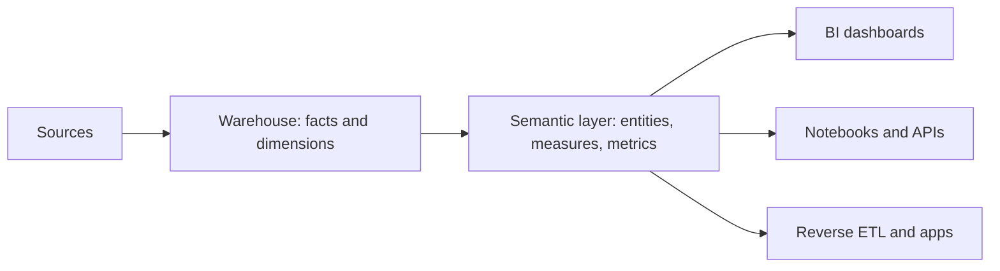

## 🎯 TL;DR

> A **semantic layer** (also called a metrics layer) is the place where a business metric is **defined once**: its formula, its filters, the dimensions you may slice it by, and its time rules. Every dashboard, notebook and API then asks the layer for the metric instead of writing its own SQL.

- The goal is **one definition, many consumers**. Two dashboards that show "active users" should show the same number.
- It sits between the modeled tables (facts and dimensions) and the tools that read them (BI, notebooks, reverse-ETL, apps).
- Implementations include the dbt Semantic Layer, Cube, and LookML inside Looker. They differ in where the definitions live and how queries are generated.
- It is a **governance and consistency** tool first. Performance is a side effect of pre-aggregation, not the main reason to build one.

## 🌱 Start simple (Junior)

> **💡 Analogy:** A company has one official kilogram. Every scale in the factory is checked against it. Without that reference, each department weighs things differently and nobody can add up the totals. A semantic layer is the official kilogram for numbers.

Imagine two analysts. Ali writes a dashboard query that counts every user who opened the app. Sara writes a query that counts only users who bought something. Both call the number "active users". In the monthly meeting the numbers differ by 40%, and the meeting is about the difference, not the business.

The fix is to agree on one definition and store it in one place:

- **Name:** `active_users`
- **Rule:** distinct `user_id` with at least one `session_start` event on the day, excluding internal test accounts
- **Grain:** one row per day
- **Slice by:** country, platform, plan

Now every tool asks for `active_users` by country, and gets the same answer.

## 🔧 How it really works (Mid)

A semantic layer separates three things that are often mixed in a single SQL query:

1. **Facts and dimensions** (the data, from [[star-schema]] modeling)
2. **Measures** (how to aggregate a column: `SUM(amount)`, `COUNT(DISTINCT user_id)`)
3. **Metrics** (a named business quantity built from measures, with filters and time rules)



A metric definition typically contains:

- **Base table or model**, with a primary key (the entity, for example `user`)
- **Measure** and aggregation (`COUNT(DISTINCT user_id)`)
- **Filters** that are part of the definition (exclude test users)
- **Allowed dimensions** and how to join to them (country comes from a dimension table)
- **Time grain and time column** (daily, by `event_date`)

The layer then **compiles** a request into SQL. A request for "active users by country, per week" becomes one query with the right joins, filters and aggregation. Here is the equivalent of that compiled SQL, written by hand, so you can see what the layer is doing:

```sql
-- The one definition of active_users, compiled for a weekly, per-country request
SELECT
  DATE_TRUNC('week', e.event_date) AS week,
  c.country,
  COUNT(DISTINCT e.user_id)        AS active_users
FROM fct_events e
JOIN dim_user c
  ON c.user_id = e.user_id
WHERE e.event_name = 'session_start'
  AND c.is_internal_test = FALSE
GROUP BY 1, 2;
```

Consumers never see this SQL. They see `active_users` and choose the dimensions.

### Three well-known implementations

- **dbt Semantic Layer** (built on the open-source MetricFlow): you define semantic models with entities, dimensions and measures in YAML, then metrics on top of them. Queries go through an API that the BI tool calls. Check the dbt docs for the syntax of your version.
- **Cube**: a service with *cubes* (a model of measures and dimensions over SQL), optional *pre-aggregations* stored in a fast engine, and APIs for BI and apps.
- **LookML** (Looker): *views* describe fields over tables, and *explores* define joins. The modeling layer is part of Looker, so the definitions are tied to that tool.

They all solve the same problem. The differences are whether the layer is independent of the BI tool, how it caches, and how well it handles non-additive metrics.

### Additive versus non-additive

Some metrics can be added across slices and some cannot:

- **Additive**: revenue. Sum of the country totals equals the global total.
- **Non-additive**: distinct users. The sum of daily active users over a week is **not** weekly active users, because a user active on three days is counted three times.
- **Ratios**: conversion rate is `purchases / sessions`. You must compute the ratio from the summed numerator and denominator, never average the daily ratios.

A correct layer knows which type each metric is, and refuses or rewrites a query that would average a ratio.

## 🧠 Senior depth & trade-offs

- **Where logic lives.** Put definitions in the warehouse (a dbt project, a SQL view) or in the layer (Cube, LookML). Logic in dashboards is the thing you are trying to remove. Keep one source of truth in version control with code review, the same way as other [[data-contract]]s.
- **Pre-aggregation and cost.** Pre-computed rollups make dashboards fast, but they must be refreshed and can go stale. Define freshness per metric (for example "updated hourly, up to 2 hours late") and show it in the tool.
- **Distinct counts at scale.** Exact `COUNT(DISTINCT)` on billions of rows is expensive. Engines offer approximate sketches such as [[hyperloglog]]. Tell the business which one a metric uses, because approximate and exact numbers disagree slightly.
- **Late data and restatement.** A metric for yesterday changes when late events arrive. Define the lookback window and when the number is considered final, or the layer will show different values to different users at different times.
- **Access control.** Row-level and column-level rules (for example, only finance sees revenue by customer) are easier to enforce in one layer than in twenty dashboards. Combine with [[data-masking]] for sensitive fields.
- **Adoption risk.** A semantic layer that is slower than a SQL query or that lacks a needed metric pushes people back to raw tables. Measure query latency and watch for "shadow metrics" in ad-hoc notebooks.
- **When not to build one.** A two-dashboard company with one definitions owner does not need a layer yet. Start with a shared, tested SQL model. Add a layer when metric disagreements start costing meetings.
- **Operating it.** Test metrics like code: unit tests with fixed fixture data, and a reconciliation check that a metric total matches the warehouse total for the same filters. See [[data-quality]].

## 🧪 Try it

Use PostgreSQL 13 or later (or DuckDB with minor syntax changes). Create a tiny event table and a dimension, then define the metric once.

```sql
CREATE TABLE dim_user (user_id text, country text, is_internal_test boolean);
INSERT INTO dim_user VALUES
 ('u1','IR',false), ('u2','IR',false), ('u3','DE',false), ('t1','IR',true);

CREATE TABLE fct_events (user_id text, event_date date, event_name text);
INSERT INTO fct_events VALUES
 ('u1','2026-01-05','session_start'),
 ('u1','2026-01-05','purchase'),
 ('u1','2026-01-06','session_start'),
 ('u2','2026-01-05','page_view'),
 ('u3','2026-01-06','session_start'),
 ('t1','2026-01-05','session_start');
```

1. Write a **view** `metric_active_users_daily` that returns `(event_date, country, active_users)` using the definition from the lesson. The test account `t1` must not be counted.
2. Write the **naive** query that Sara used: count distinct users of **any** event on each day, with no country and no test filter. Compare the results.
3. Explain why summing `active_users` over the three days would **not** give the weekly active users.

<details><summary>Show solutions</summary>

**1.**
```sql
CREATE VIEW metric_active_users_daily AS
SELECT e.event_date, c.country,
       COUNT(DISTINCT e.user_id) AS active_users
FROM fct_events e
JOIN dim_user c ON c.user_id = e.user_id
WHERE e.event_name = 'session_start'
  AND c.is_internal_test = FALSE
GROUP BY e.event_date, c.country;
```
Result: `2026-01-05 IR 1` (u1), `2026-01-06 IR 1` (u1), `2026-01-06 DE 1` (u3).

**2.** The naive query counts `u1`, `u2` and `t1` on 2026-01-05 (3 users), and `u1` and `u3` on 2026-01-06 (2 users). It includes the test account and a `page_view` user, so the number is different from the metric.

**3.** `u1` is active on both days. Summing the daily counts counts `u1` twice. Distinct users over the week must be computed over the whole week, not as a sum of days.

</details>

## 💬 Interview corner

**Question: "Two dashboards show different revenue. How do you fix it?"** Mid answer: "I'd find which filters and joins each query uses, then move the definition into one shared model and point both dashboards at it." Senior answer: "First I'd check whether the difference is a definition difference (refunds, test orders, currency) or a timing difference (late events, different refresh times). Then I'd define the metric once in the semantic layer with its filters and time rules, add a reconciliation test against the warehouse total, and state the freshness in the tool so the disagreement cannot come back silently."

**Question: "What is a semantic layer and why use one?"** Give the definition, then the two benefits: one definition for every consumer, and governance (access rules, tests, version control). Add that it is not the same as a [[data-warehouse]] or a [[materialized-view]], although it can use both.

> **🎤 Say this in the interview:** "A semantic layer defines each metric once, with its formula, filters and time rules, and every tool queries that definition. The hard parts are non-additive metrics, late data and freshness, so I always state how each metric behaves over time and across slices."

## ⚠️ Common mistakes

> **⚠️ Watch out:** Averaging daily ratios to get a period ratio. The average of daily conversion rates is not the conversion rate of the period. Sum the numerators and denominators first.

> **⚠️ Watch out:** Adding up daily distinct counts for a longer period. A user active on three days is counted three times.

- Defining a metric in a dashboard filter instead of in the shared model. The next dashboard will not inherit the filter.
- Calling two different things by one name ("active" for a login and "active" for a purchase). Use precise names.
- Forgetting the test and internal accounts in the definition, then arguing about the result.
- Treating the semantic layer as a cache. It defines meaning; caching is an optional optimisation.
- Building a layer before the team agrees on the definitions. The tool will encode the disagreement faster.
- Changing a definition without a version or a changelog, so last month's number moves with no explanation.

## ✅ Check yourself (quiz)

1. What is the main purpose of a semantic layer?
   - A) Store raw data cheaper than a warehouse
   - B) Define each business metric once so every consumer gets the same result
   - C) Replace the need for dimensional modeling
   - D) Run machine learning inside the BI tool

<details><summary>Answer</summary>

**B** — the core value is one shared definition with its filters and time rules. It uses the warehouse; it does not replace storage or modeling.

</details>

2. Which metric is **not additive** across days?
   - A) Revenue
   - B) Number of orders
   - C) Weekly distinct active users
   - D) Refund amount

<details><summary>Answer</summary>

**C** — a user active on several days is counted once per week but several times if you sum the days. Revenue, orders and refunds add up correctly across slices.

</details>

3. Two analysts report different conversion rates for the same month. Analyst A averaged the 31 daily rates; analyst B computed total purchases divided by total sessions. Which is correct for the monthly conversion rate, and why?
   - A) A, because averages are always more accurate
   - B) B, because a ratio must be computed from summed numerator and denominator; averaging daily ratios weights each day equally regardless of traffic
   - C) They are the same by definition
   - D) Neither, conversion rate cannot be measured monthly

<details><summary>Answer</summary>

**B** — a low-traffic day counts as much as a high-traffic day when you average ratios. Sum the numerator and the denominator, then divide.

</details>

4. **(Senior)** Your semantic layer serves `active_users` from a daily pre-aggregation refreshed at 02:00. A late batch of events arrives at 09:00 for yesterday. What should the metric definition and the tool state?

   - A) Nothing; the layer recalculates on every query
   - B) The lookback or finalisation rule (for example, yesterday is final after a fixed delay), the freshness of the rollup, and the fact that numbers before the final time may still change
   - C) Remove the pre-aggregation so late data is never a problem
   - D) Convert `active_users` to a sum of events

<details><summary>Answer</summary>

**B** — pre-aggregation trades freshness for speed. The definition must say when a number is final and how late data is handled, so users know which numbers can still move.

</details>

5. **(Senior)** Finance must see revenue by customer, but marketing should see revenue only by country. Where do you enforce this, and why is it better than per-dashboard filters?

   - A) In each dashboard's SQL, so each team controls its own rules
   - B) In the shared semantic or access layer, with row and column rules tied to the metric, so every consumer inherits the same policy and the rules are auditable
   - C) In the browser, by hiding columns
   - D) Nowhere; revenue is not sensitive

<details><summary>Answer</summary>

**B** — rules in dozens of dashboards drift apart and are hard to audit. Central access rules attached to the metric apply everywhere, and combining with [[data-masking]] keeps sensitive fields protected.

</details>

## 🗂️ Flashcards

| Front | Back |
|---|---|
| Semantic layer, in one line | Metric definitions (formula, filters, dimensions, time rules) kept in one place and queried by all tools |
| Measure vs metric | A measure aggregates a column (`COUNT DISTINCT user_id`); a metric is a named business quantity built from measures and rules |
| Why not sum daily distinct counts? | A user active on several days is counted several times |
| How to average a ratio correctly | Sum numerators and denominators, then divide |
| dbt Semantic Layer is built on | MetricFlow (open source) with semantic models and metrics in YAML |
| LookML is part of | Looker: views and explores in its modeling layer |
| Main value of a semantic layer | Consistency and governance; performance is a side benefit of pre-aggregation |

## 🔗 Go further

- **dimensional-modeling** and **star-framework** explain the facts and dimensions that a semantic layer sits on.
- **dbt** and **bi-analytics-engineering** show how metrics are built and tested in practice.
- **governance-contracts-mesh** covers ownership and contracts for shared definitions.
- **data-lineage** helps you trace a metric back to its source tables when a number looks wrong.
- Read the current docs of the tool you use (dbt, Cube, Looker). Syntax and features change between versions.
