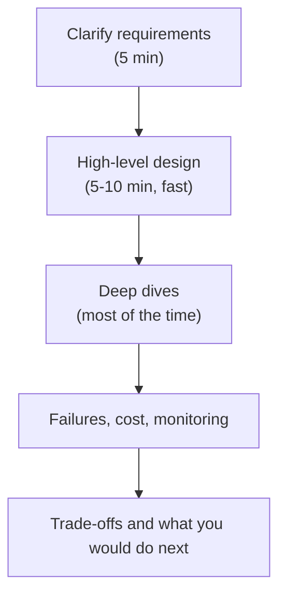

## 🎯 TL;DR

> A **senior** data engineer is judged less on how many tools they know and more on how they handle **ambiguity**, **trade-offs**, **ownership** and **other people**. Mid-level answers say *what* to build. Senior answers say *why this, not that*, what it costs, and how it fails.

- Seniors start from an unclear problem and turn it into a scoped plan with explicit assumptions.
- They speak from **real experience**: a failure, an optimisation with numbers, a decision they would make differently now.
- They own a system **end to end**: design, build, operate, on-call, cost, and the people who depend on it.
- In a system design round they move fast through basics and spend most of the time on the **deep dives** where the risk actually is.

## 🌱 Start simple (Junior)

> **💡 Analogy:** Two people build a bridge. The mid-level engineer follows the drawing and checks that each beam is strong. The senior asks where the bridge goes, how many trucks cross per day, what happens in an earthquake, who will repair it in ten years, and whether a ferry would be cheaper. The drawing is the same; the questions are not.

A simple comparison for the same task: *"Load orders from the shop database into the warehouse every hour."*

| Mid-level answer | Senior answer |
|---|---|
| "I will use a CDC tool to read the orders table and load it to the warehouse every hour with Airflow." | "I will first ask who uses the data and what a late hour costs. Then I compare CDC against a timestamp-based query: CDC is safer for deletes and load on the source, but adds a component to operate. I will make the load idempotent so a rerun does not duplicate orders, and I will alert when the freshness drops below the agreed target." |

Both answers are technically reasonable. The senior one shows the reasoning, the cost and the failure handling without being asked.

## 🔧 How it really works (Mid)

Most senior-level interview evaluations map to four areas. A simple way to remember them:

| Area | What the interviewer listens for |
|---|---|
| Problem navigation | Do you clarify requirements, define scope and state assumptions before designing? |
| Solution design | Do you choose a reasonable architecture and explain the data flow? |
| Technical excellence | Do you know how the tools behave under load and failure, and where the limits are? |
| Communication | Can you explain a complex design clearly, and adapt when the interviewer pushes back? |

A mid-level engineer usually scores well on solution design and technical excellence for their scope. A senior engineer must also score well on the first and fourth areas, because the problems they face are vague and cross-team.

### Depth versus breadth

- **Breadth** means you can name the components of a system: ingestion, storage, orchestration, serving.
- **Depth** means you can explain one of them well enough to predict its behaviour: what happens to Kafka consumer lag when a partition leader moves, or why a Spark shuffle spills.
- A mid-level answer is often broad and shallow. A senior answer is broad enough to be correct and deep where it matters.

### What "it depends" should sound like

"It depends" is a weak answer on its own. It becomes strong when you finish the sentence with the variables and a default:

> "It depends on the freshness target and the data volume. Under 10 minutes and under a few gigabytes per hour, I would use micro-batches with a managed table format. Above that, or if we need per-event latency, I would use a stream processor and accept the operational cost."

That answer names the variables, gives a threshold, and states what changes when the threshold is crossed.

## 🧠 Senior depth & trade-offs

- **Ownership:** a senior engineer knows which alerts page them, how the pipeline recovers from a failed run at 3 a.m., and who is the consumer. Systems without an owner are the most common cause of silent data loss.
- **Real failures:** be ready with two or three stories: a backfill that double-counted revenue, a schema change that broke a dashboard, a Spark job that ran out of memory after a skewed key appeared. For each, say the root cause, the detection gap and the change you made afterwards.
- **Quantified optimisation:** "I reduced the nightly job from 6 hours to 90 minutes by removing a shuffle and fixing a skewed join" is far stronger than "I improved performance". Show the before and after numbers, and the arithmetic if you estimated them.
- **Trade-off language:** state the options, the axis you are optimising (cost, latency, correctness, operational load), and the one you would reject and why.
- **Growing others:** reviews, design docs, pairing, and writing runbooks. Seniors multiply the team; interviewers look for evidence that you have done this.
- **Red flags:** blaming other teams for every incident, claiming a tool is "the best" without a context, designing without asking about scale, no mention of monitoring or failure, and an answer that never changes when the interviewer adds a constraint.

> **⚠️ Watch out:** Seniority is not years. A candidate with eight years of maintenance work and no design ownership can be less senior than a candidate with three years of owning one critical pipeline end to end.

## 🧪 Try it

Take one project you have worked on (or a public system you know well).

1. Write three sentences about the problem as it was given to you, and three questions you should have asked first.
2. Write one failure: what broke, how you found out, and what you changed.
3. Write one trade-off you made, with the option you rejected and the reason.

Example of a strong trade-off sentence

"We chose daily batch over hourly streaming for the finance mart, because finance reports close once a day and streaming would have doubled the on-call load for no business gain. The cost was that a late source file delays the report by up to 24 hours, which we accepted and documented."

## 💬 Interview corner

**Question:** "How is a senior data engineer different from a mid-level one?"

> **🎤 Say this in the interview:** "A mid-level engineer delivers well-defined pipelines and knows the tools. A senior one starts when the problem is vague, clarifies the goal and the constraints, and chooses a design they can explain with its trade-offs. They also own what they build in production, including failures and cost, and they raise the level of the people around them. I can show this with a project where I owned the design and the on-call, and I can tell you what I would change now."

- **Junior answer:** "Seniors know more tools and have more years."
- **Mid answer:** "Seniors design systems and mentor people."
- **Senior answer:** names the differences in ambiguity, trade-offs, ownership and growth, and supports each with an example and a number.

## ⚠️ Common mistakes

- **Speaking in tools, not decisions.** "We used Kafka and Spark" says nothing. "We used Kafka because we needed replay for 7 days, and we accepted the operational load" says something.
- **Jumping into the solution.** Seniors spend the first minutes on scope. Skipping this reads as a mid-level habit.
- **Spending equal time on every component.** In a system design round, the basics should take minutes. The deep dive is where the score is.
- **Having no failure story.** Every senior has broken production. Those who cannot describe a failure sound inexperienced.
- **Hiding uncertainty.** Saying "I am not sure about this detail; here is how I would verify it" is a senior behaviour.

## ✅ Check yourself (quiz)

1. Which behaviour is the strongest signal of senior-level **problem navigation**?
   - A) Naming the most tools in the first minute
   - B) Asking about scale, freshness and consumers before proposing an architecture
   - C) Drawing a diagram as quickly as possible
   - D) Choosing the newest technology

Answer

**B** — clarifying requirements and assumptions before designing is the core of navigation. Naming tools or drawing fast does not show judgment about the problem.

2. An interviewer asks: "Would you use streaming for this?" Which answer best shows a trade-off?
   - A) "Yes, streaming is always better."
   - B) "No, batch is simpler."
   - C) "It depends on freshness and volume. Under 15 minutes I would use micro-batches; below one minute I would accept a stream processor and its on-call cost."
   - D) "I have not worked with streaming."

Answer

**C** — it names the variables, gives thresholds and states the cost of the stronger option. Options A and B are absolute claims; D closes the discussion.

3. A candidate says: "The pipeline ran fine for two years." Which follow-up is most useful for the interviewer to probe seniority?
   - A) "What language did you write it in?"
   - B) "What broke, how did you find out, and what did you change afterwards?"
   - C) "How many lines of code were in the repository?"
   - D) "Which cloud region did it use?"

Answer

**B** — failure, detection and remediation show ownership and learning. Stability alone does not show whether the candidate understood the system.

4. **(Senior)** In a 45-minute design round, you have spent 30 minutes on the high-level diagram and the interviewer has not asked any deep question yet. What should you do?
   - A) Keep adding components until time runs out
   - B) Stop, name the two or three riskiest components (for example the state store or the backfill path), and propose to go deep on one of them
   - C) Ask the interviewer to finish the design for you
   - D) Restart with a different architecture

Answer

**B** — seniors move fast through basics and choose where the difficulty lies. Taking the initiative to go deep on risk is exactly what the round measures.

## 🗂️ Flashcards

| Front | Back |
|---|---|
| What does a senior answer add to a mid answer? | The reasoning, the trade-offs, the cost and the failure handling |
| The four leveling areas | Problem navigation, solution design, technical excellence, communication |
| Breadth vs depth | Breadth names the components; depth predicts how one component behaves under load or failure |
| Strong "it depends" answer | Names the variables, gives thresholds and states the cost of the other option |
| Where do seniors spend design-round time? | Mostly on deep dives into the riskiest parts |
| Red flag in a senior interview | Blaming others, no monitoring or failure discussion, no scale questions |
| What is a good failure story? | Root cause, how it was detected, and the change made afterwards |

## 🔗 Go further

- **senior-signals** lists concrete signals that interviewers look for, with examples.
- **delivery-framework** gives a structure for the system design round, including where to spend time.
- **behavioral-questions** and **star-framework** help you tell your failure and ownership stories clearly.
- **project-narratives** helps you prepare the two or three projects you will talk about.
- The Google SRE book (chapters on postmortems and monitoring) is a good source for the operations side of ownership.
