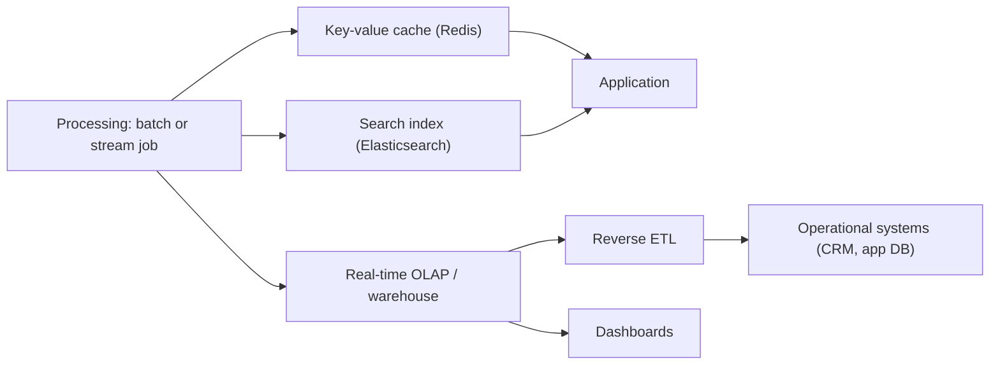

## 🎯 TL;DR

> The **serving layer** is the part of a data platform that delivers processed data to **applications and people** at the latency they need. Processing produces the answers; serving makes them available, quickly, to the right consumer.

- Pick the store by access pattern: **key lookups** (Redis, a key-value or document store), **search** (Elasticsearch / OpenSearch), **dashboards and aggregations** (real-time OLAP or a warehouse), and **operational systems** (reverse ETL into the CRM or the app database).
- Decide **what to pre-compute** (pre-aggregation) and **what to compute on the fly**. Pre-computing buys latency and costs freshness and storage.
- Every cache or copy needs an **invalidation and freshness policy**. Without one, the serving layer quietly disagrees with the source.
- Serving stores are not the system of record. Keep the raw data and the rebuild path.

## 🌱 Start simple (Junior)

> **💡 Analogy:** A restaurant. The **kitchen** (processing) cooks everything. The **counter and the menu board** (serving) decide what a customer sees, how fast, and in what form. Nobody orders by walking into the kitchen.

Suppose your pipeline computes each user's total spend per day. Three different consumers want it:

- The **mobile app** needs "my spend today" in under 50 ms. → a key lookup store such as Redis.
- The **support team** searches users by name, email or order id. → a search index such as Elasticsearch.
- The **analytics dashboard** shows spend per city per hour across millions of users. → an OLAP engine.

The same data, three shapes. The serving layer is the set of these shapes, plus the jobs that keep them in sync.

Here is the key-value shape, using Redis-style commands in Python:

```python
import redis

r = redis.Redis(host="cache", port=6379, decode_responses=True)

# Key per user per day; the pipeline writes the pre-computed total
key = "spend:user:42:2026-01-01"
r.set(key, 1250)
r.expire(key, 60 * 60 * 24 * 7)   # keep 7 days, then let it expire

print(r.get(key))  # "1250" -> O(1) lookup, no SQL, no scan
```

## 🔧 How it really works (Mid)



**Pre-aggregation vs. on-the-fly.**
- *Pre-aggregation*: the job computes the answer ahead of time (`spend per user per day`), and serving is a lookup. Latency is predictable, load is low, but the answer is only as fresh as the last job run and only for the shapes you anticipated.
- *On-the-fly*: the query computes the answer at request time from detailed data. Flexible and always fresh, but latency and cost depend on data size and concurrency.

A practical rule: pre-aggregate the **few, hot, known** questions (the app's home screen, the top dashboard tiles), and compute the **many, cold, ad-hoc** ones on demand.

**Cache invalidation.** A Redis copy of a fact goes stale when the source changes. Options:
- **TTL**: the value expires after N seconds. Simple, bounded staleness, some misses.
- **Write-through / event-driven update**: the pipeline updates the key whenever it changes the source (often driven by [[cdc]] events or stream output). Fresh, but the writer must handle partial failures.
- **Versioned keys**: write `spend:user:42:v37` and switch a pointer. Good for batch loads that replace whole sets atomically.

Each choice means a freshness budget (for example "at most 5 minutes stale"). Write it down and monitor it.

**Reverse ETL.** The processed result is pushed back into an operational system, such as a CRM field "lifetime value", so that sales staff see it where they work. It is still serving: the destination becomes a consumer with its own rate limits and failure modes, so write idempotent upserts keyed by the business id.

## 🧠 Senior depth & trade-offs

- **Serving SLOs.** Define latency (p99), freshness (max age of data), and availability per consumer. A dashboard can tolerate minutes of staleness; a fraud decision or a price cannot. These numbers decide the store.
- **Redis as a serving store.** It is fast because data sits in memory. Watch memory size per key, eviction policy (a cache eviction silently returns "missing"), and persistence settings. Treat a cache miss as a normal path, with a fallback to the source or a default value. Hot keys (one popular key with huge traffic) need replication or client-side caching; see [[hot-key]].
- **Elasticsearch as analytics, with limits.** It is excellent for full-text search, filters on many fields, and relevance ranking. As an analytics engine it has real costs: aggregations over high-cardinality fields use a lot of memory; there are no general joins; data is searchable only after a refresh interval (near-real-time, not immediate); and dynamic mappings can explode field counts. Use it for search and small-to-medium aggregations, and an OLAP engine for heavy dashboards. Check the docs for your version before quoting refresh or memory defaults.
- **Consistency across stores.** One event may update Redis, Elasticsearch and the OLAP table. If one write fails, they diverge. Use idempotent writes keyed by a stable id and a reconciliation job that compares counts or checksums. See [[pattern-reconciliation]].
- **Rebuildability.** A serving store must be rebuildable from the lake or the event log. If the Redis cluster is lost, a backfill should restore it without manual SQL. Test that path.
- **Security and scope.** Serving stores often expose data to many services. Apply per-consumer access and avoid putting raw personal data into caches that outlive their purpose.
- **Monitor.** Hit ratio and miss rate, p99 latency, freshness lag (time since the last successful update), evictions, and the size of each key family.
- **When not to add a serving layer.** If one warehouse query meets the SLO for a dashboard used by ten analysts, adding Redis and Elasticsearch adds sync bugs without benefit.

## 🧪 Try it

A product team wants three things from the daily order pipeline:

1. Order status lookup by `order_id` in the app, under 20 ms, with data no older than 1 minute.
2. Support staff search orders by customer email and partial product name.
3. A management dashboard with revenue per category per week, for the last two years.

Answer for each: which store, whether it is pre-aggregated or on-the-fly, and how you keep it fresh.

<details><summary>Show solution</summary>

**1.** A key-value store (Redis) keyed by `order:{order_id}`, written by a stream job or by [[cdc]] events from the orders database. Freshness is about 1 minute, so use event-driven updates and a TTL as a backstop. Pre-aggregation is not needed: the answer is one record.

**2.** A search index (Elasticsearch or OpenSearch) with `customer_email` as a keyword field and `product_name` as a text field. The index is updated from the same event stream, with idempotent writes keyed by `order_id`. A search refresh delay of a few seconds is acceptable here.

**3.** A columnar OLAP store or a warehouse. Pre-aggregate `revenue by category by week` in a daily job, since the question set is fixed and the dashboard is read often. Two years of weekly-by-category rows is a small table, so this is cheap. Keep the detailed orders available for ad-hoc questions.

</details>

## 💬 Interview corner

**Question: "How would you serve these metrics to a user-facing app?"**
Mid answer: "I'd precompute the metrics in a batch job and store them in Redis, so the app reads them quickly."
Senior answer: "I'd first agree on the SLO: latency, freshness and the consumer's failure tolerance. Hot, fixed answers go into a key-value store with event-driven updates and a TTL backstop. Ad-hoc or wide questions go to an OLAP engine. Both are rebuildable from the lake, and I monitor freshness lag and hit ratio."

**Question: "Why not use Elasticsearch for all analytics?"**
Mid: "It is slow for aggregations."
Senior: "It works well for search and small aggregations, but high-cardinality aggregations are memory-heavy, joins are limited, and results are near-real-time. For dashboards over large history I use an OLAP engine, and I use Elasticsearch for search and filtering on the same data."

> **🎤 Say this in the interview:** "The serving layer is about access patterns. I choose a store per consumer, decide what to precompute from the SLO, and treat every copy as something with an invalidation policy and a rebuild path."

## ⚠️ Common mistakes

> **⚠️ Watch out:** Caching without an invalidation policy. A Redis key with no TTL and no update path is a silent data bug that surfaces months later.

> **⚠️ Watch out:** Treating the serving store as the source of truth. When it is lost or corrupted, you must be able to rebuild it.

- Precomputing everything "just in case", which multiplies storage and pipeline cost.
- Using a cache miss as an error instead of a normal path.
- Choosing Elasticsearch for heavy analytics because it is already in the stack.
- Forgetting idempotent writes, so retries create duplicate or inconsistent values.
- Measuring only latency and never freshness.

## ✅ Check yourself (quiz)

1. Which store fits a mobile app that needs one user's current balance in under 10 ms?
   - A) A full-text search index
   - B) A key-value store such as Redis, keyed by user id
   - C) A warehouse with a full scan
   - D) A CSV file on object storage

<details><summary>Answer</summary>

**B** — the access pattern is a single-key lookup with a low latency target. A key-value store is built for that shape.

</details>

2. What is the main trade-off of pre-aggregation compared with on-the-fly computation?

   - A) It is always more accurate
   - B) It gives predictable low latency and low query cost, but the answers are only as fresh as the last job and only for anticipated shapes
   - C) It removes the need for storage
   - D) It makes joins unnecessary

<details><summary>Answer</summary>

**B** — pre-aggregation moves work to the pipeline. You gain latency and cost, and you lose freshness and flexibility.

</details>

3. A cached value stays wrong for hours after the source changes. Which policy most directly addresses this?

   - A) Increasing the Redis memory
   - B) A TTL, or an event-driven update triggered by source changes
   - C) Renaming the key
   - D) Removing the index on `user_id`

<details><summary>Answer</summary>

**B** — a TTL bounds staleness, and event-driven updates keep the cache aligned with changes. Memory and key names do not affect correctness.

</details>

4. **(Senior)** Why is an Elasticsearch terms aggregation on a field with tens of millions of distinct values risky in a serving layer?

   - A) Elasticsearch cannot store strings
   - B) High-cardinality aggregations consume a lot of memory on the nodes, which can destabilize the cluster under concurrent dashboard load
   - C) Aggregations are disabled for keyword fields
   - D) The refresh interval deletes the aggregation buckets

<details><summary>Answer</summary>

**B** — each distinct value needs bucket state, and that grows with cardinality. Under concurrency, memory pressure can hurt the whole cluster. Pre-aggregate or move the query to an OLAP engine.

</details>

5. **(Senior)** A reverse ETL job pushes a "lifetime value" field into the CRM every hour. Sales reports duplicated records after a retry. What is the right design fix?

   - A) Run the job less often
   - B) Make the write an idempotent upsert keyed by the stable business id
   - C) Add more CRM API keys
   - D) Store the value only in a CSV

<details><summary>Answer</summary>

**B** — with an idempotent upsert keyed by a stable id, a retry overwrites the same record instead of creating a new one. Frequency does not fix duplication, and the retry will still happen.

</details>

## 🗂️ Flashcards

| Front | Back |
|---|---|
| Serving layer | The stores and jobs that deliver processed data to apps and people at the required latency |
| Pre-aggregation | Compute answers ahead of time; serving becomes a lookup |
| On-the-fly | Compute the answer at request time from detailed data |
| Cache invalidation | Policy that keeps a copy consistent with its source: TTL, event-driven updates, versioned keys |
| Reverse ETL | Pushing processed data back into operational systems |
| Freshness SLO | Maximum acceptable age of the data a consumer reads |
| Elasticsearch limit | Near-real-time refresh, no general joins, memory cost of high-cardinality aggregations |
| Rebuildability | A serving store can be restored from the lake or event log without manual work |

## 🔗 Go further

- [[pattern-serving]] — the serving pattern in more depth, with implementation options.
- [[realtime-olap]] — the store to choose when dashboards need fresh aggregations at high concurrency.
- [[cdc]] — a common source of event-driven updates for serving stores.
- [[pattern-reconciliation]] — how to detect and repair drift between stores.
