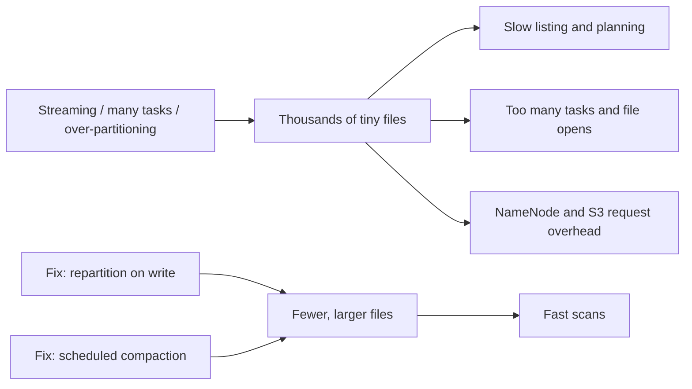

## 🎯 TL;DR

> **Small files problem:** a table made of thousands or millions of tiny files (kilobytes to a few megabytes each) is slow to list, slow to plan, and slow to read, even when the total number of bytes is modest.

- The cost is **per file**, not per byte: every file needs metadata lookups, a listing entry, an open call, and usually a task.
- Common causes: too many partitions, too many writer tasks, and streaming or micro-batch jobs that commit often.
- Fixes: write fewer and larger files, merge existing files (compaction), and use a table format that tracks files for you.

## 🌱 Start simple (Junior)

> **💡 Analogy:** Imagine moving a library of 1,000 books. You can carry one box of 1,000 books in one trip, or you can carry 1,000 single-book boxes. The total weight is the same, but the second way takes 1,000 times the labels, lifts and checks.

A data lake has the same issue. Suppose a day of events is 10 GB. Stored as 10 files of 1 GB each, a query opens 10 files. Stored as 100,000 files of 100 KB each, the same query must:

1. list 100,000 names from storage,
2. open 100,000 files (each open is a network round trip on S3 or HDFS),
3. read a footer and metadata from each one,
4. schedule work for each file.

The bytes are identical. The overhead is not.

```text
Same 10 GB, two layouts

  events/dt=2026-10-12/
    part-00000.parquet   1.0 GB     <- 10 files: fast
    ...
    part-00009.parquet   1.0 GB

  events/dt=2026-10-12/
    part-000000.parquet  100 KB     <- 100,000 files: slow
    ...
    part-099999.parquet  100 KB
```

A rule of thumb many teams use is to aim for files of roughly **128 MB to 1 GB** for columnar formats such as Parquet. The exact number depends on your engine and storage, so treat it as a starting point and measure.

## 🔧 How it really works (Mid)

### Where small files come from

Spark writes **one file per task, per output partition value**. If the job has 200 tasks and you write with `partitionBy("dt")` over 365 dates, each task that holds rows for a date writes its own file for that date. Worst case:

```text
tasks x distinct partition values = files
200 tasks x 365 dates            = up to 73,000 files for one write
```

The 200 comes from `spark.sql.shuffle.partitions` (default 200 in Spark SQL, before adaptive changes). If each task only has a few rows per date, each of those 73,000 files is tiny.

Other common sources:

- **Over-partitioning.** Partitioning by hour, user id, or a high-cardinality column creates many directories with little data in each.
- **Streaming and micro-batch.** A job that commits every minute creates 1,440 small files per partition per day.
- **Many small uploads.** Ingestion tools that write one object per record or per API page.
- **Failed or repeated jobs.** Retries and speculative tasks leave extra partial outputs that must be cleaned up.

### The fix at write time

Control the number of tasks that write each partition:

```python
from pyspark.sql import functions as F

# Bad: each of the 200 tasks writes a file for every date it holds
df.write.partitionBy("dt").parquet("s3a://lake/events")

# Better: send all rows of one date to one task, so one file per date
df.repartition("dt").write.partitionBy("dt").parquet("s3a://lake/events")

# Fixed file count for an unpartitioned output (no shuffle, but uneven sizes)
df.coalesce(16).write.parquet("s3a://lake/events_flat")
```

- `repartition(cols)` adds a **shuffle**: it costs network and time, but gives even, predictable files.
- `coalesce(n)` merges existing partitions **without** a shuffle. It is cheap, but it can make the upstream stage run with fewer tasks, and the output files may be uneven.
- Adaptive Query Execution (AQE) can merge small shuffle partitions at runtime, which reduces the tiny-task problem. Check your version's documentation for the exact settings.

### The fix for existing data: compaction

Compaction reads many small files and rewrites them as fewer large ones. In plain Hive or Spark on a folder, it is a job that reads a partition, writes it back with `coalesce`, and swaps the result in. Table formats make this safe and standard:

- **Delta Lake** provides an `OPTIMIZE` command.
- **Apache Iceberg** provides rewrite procedures such as `rewrite_data_files`.
- **Apache Hudi** provides clustering and compaction features.

These run as scheduled maintenance, not inline with every write.



## 🧠 Senior depth & trade-offs

- **HDFS NameNode memory.** In HDFS, every file and every block is an object in the NameNode's memory. Millions of tiny files consume NameNode heap for almost no data, and the NameNode becomes the bottleneck. This is the classic reason the problem was named in Hadoop shops. Verify the per-object cost for your Hadoop version before quoting numbers.
- **Object storage request cost.** On S3 and similar stores, the cost and latency are per request. Listing a prefix with millions of keys is paginated and slow. A job that opens 100,000 small objects pays for 100,000 GET requests and the latency of each one, even when the bytes are negligible.
- **Hive and Spark planning.** Engines build splits from file sizes. Many small files create many splits, each with startup overhead. Spark uses settings such as `spark.sql.files.maxPartitionBytes` and `spark.sql.files.openCostInBytes` to pack small files into tasks. These help reads, but they do not fix the storage layout.
- **Streaming trade-off.** Committing less often gives bigger files but higher latency. A common design is a short-interval stream into a staging area, then an hourly or daily compaction into the serving table. Decide the freshness target first, then the compaction schedule.
- **Compaction is not free.** Rewriting files costs compute and can conflict with concurrent writers. Table formats handle this with optimistic concurrency, but you still need a schedule and a monitor. Track file count and average file size per partition as metrics.
- **When not to fight it.** A table with a few hundred large files is fine. Do not add a compaction pipeline to a dataset that is small and queried rarely. Also avoid partitioning so finely that each partition is below the target file size.

## 🧪 Try it

Use a local Spark session (PySpark 3.x or later) and a folder, not S3.

1. Generate 1 million small rows with a `dt` column of 30 values. Write them with `partitionBy("dt")` and count the files in each directory. Then write again with `repartition("dt")` and compare the file counts.
2. Write the same data with `coalesce(4)` and check the file sizes. Explain why some files are larger than others.
3. Scenario: a stream commits every 60 seconds into `events/dt=.../hr=...`. Propose two changes that reduce the number of files per day without making the data more than one hour late.

<details><summary>Show solutions</summary>

**1.** Without the repartition, the file count per `dt` is roughly the number of tasks that hold rows for that date (often close to the shuffle partition count for wide data). With `repartition("dt")`, each date lands in one task, so you should see about one file per directory. Exact numbers depend on your data layout and local settings.

**2.** `coalesce` does not shuffle. Each of the 4 output tasks takes whatever upstream partitions it was assigned, so sizes differ when the input partitions were uneven. `repartition(4)` would give more even sizes at the cost of a shuffle.

**3.** Two changes: (a) write hourly partitions instead of minute partitions, so each commit appends to a larger file set, or keep minute data in a staging path and compact it into `hr=` partitions hourly; (b) raise the commit interval only where latency allows, or reduce task count per micro-batch with `coalesce` before the sink. Either way, schedule a compaction job for the hour that just closed.

</details>

## 💬 Interview corner

**Question: "Your Spark job writes thousands of tiny Parquet files. Why is that bad and what do you do?"**

- **Mid answer:** "Each file adds metadata and task overhead, so reads are slow. I'd add a `repartition` on the partition column before the write, and run a compaction job for the existing files."
- **Senior answer:** "The cost is per file: NameNode objects on HDFS, request latency and cost on S3, and one task or split per file at read time. I'd find the cause first: too many shuffle partitions, too fine a partition key, or a streaming commit interval. The write fix is `repartition` on the partition key so each partition gets one writer. For the backlog, I'd run table-format compaction on a schedule and track file count and average size as metrics, so the problem is caught before a query slows down."

> **🎤 Say this in the interview:** "Small files are a per-file overhead problem, not a bytes problem. I fix it at write time by controlling how many tasks write each partition, and I fix the backlog with compaction on a table format."

## ⚠️ Common mistakes

> **⚠️ Watch out:** `coalesce(1)` on a large dataset puts the whole write in one task. You get one file, but also one slow task and possibly an out-of-memory error. Pick a count that matches your target file size.

- Partitioning by a high-cardinality column (user id, order id). Use it for filtering only if it has a small number of values.
- Assuming that `partitionBy` alone makes good files. It only splits by value; the number of files still depends on task count.
- Compacting by copying files into a new folder without an atomic swap. Readers may see half-written data. Use a table format or a commit protocol.
- Forgetting retries. A re-run without a clean output path can leave duplicate files.
- Measuring only total size. Always check file count and average file size too.

## ✅ Check yourself (quiz)

1. A Spark job with 200 shuffle partitions writes `partitionBy("dt")` for 365 dates. Which statement is most accurate?
   - A) It writes exactly 365 files.
   - B) It can write up to 73,000 files, because each task may write one file per date it holds.
   - C) It writes one file per executor.
   - D) The number of files does not depend on the number of tasks.

2. Which change most directly reduces the number of files for the same data, with a shuffle?
   - A) `df.coalesce(1)`
   - B) `df.repartition("dt")` before `partitionBy("dt")`
   - C) Increasing the Parquet row group size
   - D) Using CSV instead of Parquet

3. Scenario: a table has 2 million files of 50 KB in S3. Which first step is the best?
   - A) Delete the oldest files.
   - B) Schedule a compaction (for example, a table-format rewrite) and track file count and average size.
   - C) Add more executors to the reading job.
   - D) Move the data to a local disk.

4. **Senior:** Why can `coalesce` be cheaper than `repartition` for a write, and when would you still choose `repartition`?
   - A) `coalesce` is always faster, so always use it.
   - B) `coalesce` avoids a shuffle but can produce uneven files and fewer upstream tasks; choose `repartition` when you need even sizes and the shuffle cost is acceptable.
   - C) `repartition` writes CSV only.
   - D) They are identical in every case.

5. **Senior:** A stream commits every minute into hourly partitions. What is the main trade-off of committing less often?
   - A) Larger files and fewer commits, but higher data latency.
   - B) Smaller files and lower latency.
   - C) No change in file size.
   - D) Duplicate rows are always created.

<details><summary>Answer</summary>

**1 — B.** Each task writes one file for each date it holds rows for, so the total can reach tasks × dates (200 × 365 = 73,000 in the worst case). A is wrong because files are not one per date.

**2 — B.** `repartition("dt")` sends each date to one task, so each partition gets one writer. `coalesce(1)` produces one huge task, and CSV or row group size do not change the file count.

**3 — B.** The problem is already on disk, so a rewrite (compaction) is the fix. Deleting data (A) loses data, and more executors (C) add more file opens.

**4 — B.** `coalesce` merges partitions without a shuffle, which is cheaper, but it can keep the input's uneven partition sizes and reduce the number of upstream tasks. `repartition` costs a shuffle but gives even output.

**5 — A.** Fewer, larger commits create bigger files and reduce overhead, but the data is visible later. Choosing the interval is a latency-versus-file-count decision.

</details>

## 🗂️ Flashcards

| Front | Back |
|---|---|
| What is the small files problem? | Many tiny files make reads and writes slow, even when total bytes are modest. The cost is per file. |
| Why does the number of files depend on tasks? | Spark writes one file per task per partition value the task holds. |
| What is compaction? | Rewriting many small files into fewer large files, usually as scheduled maintenance. |
| What does `repartition(col)` change? | It shuffles rows so each value of `col` goes to one task, giving about one file per value. |
| What does `coalesce(n)` change? | It merges to n partitions without a shuffle; sizes can be uneven. |
| Why is HDFS sensitive to small files? | Every file and block is an object in NameNode memory. |
| Which table formats offer compaction? | Delta Lake (`OPTIMIZE`), Iceberg (rewrite procedures), Hudi (clustering and compaction). |
| What should you monitor? | File count, average file size, and small-file count per partition. |

## 🔗 Go further

- [[spark-writes]] explains how Spark commits output, which decides whether a rewrite is safe.
- [[lakehouse-table-formats]] covers how table formats track files and make compaction atomic.
- [[small-files-problem]] is the glossary entry for a quick reminder.
- [[file-layout]] shows how directory and file layout affects query planning.
