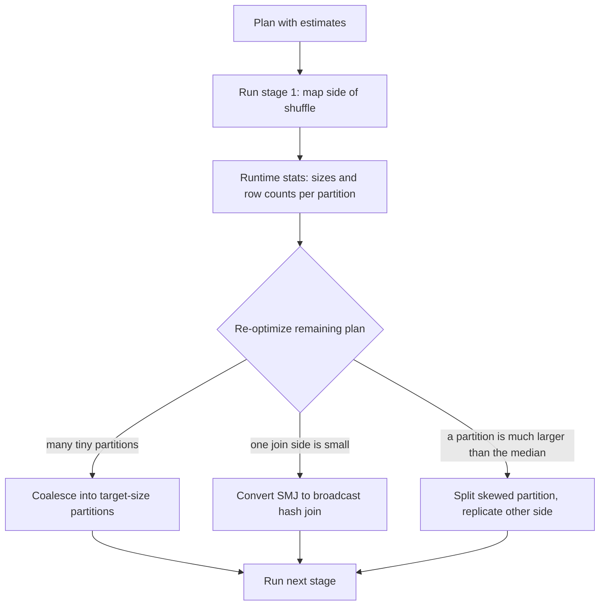

## 🎯 TL;DR

> **Adaptive Query Execution (AQE)** lets Spark change the physical plan **while the query runs**, using the real sizes of the shuffle outputs it has just produced instead of the estimates it had before the job started.

- AQE re-plans at **shuffle boundaries** (query stages). When a stage finishes, Spark knows the exact size and row count of its output and decides the next steps again.
- Three main actions: **coalesce** many small shuffle partitions into fewer, larger ones; **switch** a sort-merge join to a broadcast join when one side turned out to be small; **split** skewed partitions in a join.
- **Dynamic partition pruning (DPP)** uses the keys of a small, filtered dimension table at runtime to skip partitions of a large fact table.
- AQE is on by default in recent Spark 3.x releases. It cannot fix a bad query shape or a missing filter, and it does nothing for skew inside a single key that a broadcast cannot absorb.

## 🌱 Start simple (Junior)

> **💡 Analogy:** You plan a road trip with a map printed last month. Halfway there you hear that the bridge is closed and the other road is empty. A good driver changes the route at the next junction instead of following the printed plan to the end. AQE is that driver: it looks at the real traffic at each junction (each shuffle) and adjusts.

Before AQE, Spark chose the plan from **estimates**. Estimates are often wrong, especially after joins and filters on data without statistics. A common symptom: the optimizer picks a sort-merge join because it thinks a table is 500 MB, but after the filter it is 20 MB, and a broadcast join would have been far cheaper.

You can see the effect in one line of code:

```python
spark.conf.set("spark.sql.adaptive.enabled", "true")  # default true in recent 3.x

df = spark.table("orders").join(spark.table("customers"), "customer_id")
df.explain()
```

The plan starts with `AdaptiveSparkPlan isFinalPlan=false`. After an action runs, `df.explain()` shows the final plan with `isFinalPlan=true`, which contains the choices AQE actually made. Compare the two when you debug.

## 🔧 How it really works (Mid)

A Spark job is cut into **stages** at every shuffle. AQE uses these cut points:



**The main switches** (Spark 3.x defaults shown; check your version):

| Setting | Default | What it does |
|---|---|---|
| `spark.sql.adaptive.enabled` | `true` (since Spark 3.2) | Turns AQE on |
| `spark.sql.adaptive.coalescePartitions.enabled` | `true` | Merges small contiguous shuffle partitions |
| `spark.sql.adaptive.advisoryPartitionSizeInBytes` | 64 MB | Target size for coalescing and for splitting skew |
| `spark.sql.adaptive.skewJoin.enabled` | `true` | Splits skewed partitions in sort-merge and shuffled hash joins |
| `spark.sql.adaptive.localShuffleReader.enabled` | `true` | Reads shuffle data locally when no re-partitioning is needed after a broadcast conversion |
| `spark.sql.autoBroadcastJoinThreshold` | 10 MB | Size under which a table is broadcast (static planning) |

**Coalescing.** You often set `spark.sql.shuffle.partitions` to a large number, such as 2000, so that the biggest days of the year do not spill. Most days, the data is small and 2000 partitions means 2000 tiny tasks. AQE merges neighbouring partitions until they reach the advisory size, so the next stage runs with a sensible number of tasks. Treat the configured value as an **upper bound**, not a target.

**Join switching.** After the map side of a shuffle finishes, Spark knows the real size of each join input. If one side is below the broadcast threshold, the sort-merge join is replaced by a broadcast hash join. The big side is then not shuffled at all, which saves the most expensive part of the job. The `localShuffleReader` avoids a second shuffle for the big side when the partitioning is no longer needed.

**Skew handling.** For a sort-merge or shuffled hash join, a partition is considered skewed when it is much larger than the median partition and above a minimum size. AQE splits it into several sub-partitions and replicates the matching partitions of the other side, so the work is spread over several tasks. The exact factor and threshold are configurable (`spark.sql.adaptive.skewJoin.*`); check the docs for your version.

**Dynamic partition pruning.** Consider a fact table partitioned by `sale_date`, joined with a filtered date dimension:

```sql
SELECT f.product_id, SUM(f.amount) AS total
FROM sales f                              -- partitioned by sale_date
JOIN dim_date d ON f.sale_date = d.date_key
WHERE d.year = 2026 AND d.month = 10
GROUP BY f.product_id;
```

Without DPP, Spark scans every `sale_date` partition of `sales` and then filters. With DPP, Spark first evaluates the small filtered side (`dim_date`), collects the matching `date_key` values, and uses them as a **runtime filter** on the partitions of `sales`. Only October partitions are read. DPP works when the join key is the partition column on the large side, the filtered side is small enough to broadcast or to compute cheaply, and the join is an equi-join.

**What AQE does not do.** It only acts at shuffle boundaries, so it cannot change the first stage. It cannot split a single key whose rows cannot be divided (for example a skewed key in an aggregation, where you still need salting or a two-stage aggregation). It does not rewrite your business logic.

## 🧠 Senior depth & trade-offs

- **Stage barriers cost latency.** Re-planning waits for the stage to finish, so AQE adds a small coordination cost per stage. For very short queries with many stages, the overhead is visible; most batch ETL jobs gain much more than they lose.
- **Estimation still matters at the start.** The first stage is planned with static estimates. Good table statistics (`ANALYZE TABLE ... COMPUTE STATISTICS`), columnar formats with footers, and sensible partitioning give the first decisions a chance to be right. AQE corrects mistakes; it does not replace good layout.
- **Broadcast decisions after the fact can be expensive.** A broadcast requires the small side to fit in executor memory on every executor (the driver collects it first). AQE switches only when the runtime size is below the threshold, but the threshold is tuned for your memory settings. Raising `autoBroadcastJoinThreshold` too far is a classic cause of driver or executor OOM. See [[broadcast-join]].
- **Skew is not fully solved by AQE.** Splitting a skewed partition only helps where the join can replicate the other side. A hot key that is huge on both sides, or a skewed `GROUP BY`, still needs application-level fixes: salting, pre-aggregation, or isolating the hot keys. See [[data-skew]] and [[hot-key]].
- **Partition count and file layout interact.** Coalescing cannot merge partitions across the output files you write. A job that writes 2000 files of 1 MB still produces small files; add a repartition or a compaction step before the write. See [[small-files-problem]].
- **Debugging.** In the Spark UI, look at the SQL tab: the final plan shows the replaced nodes (for example `BroadcastHashJoin` instead of `SortMergeJoin`), and the stage view shows the number of tasks after coalescing. If you cannot tell which node was changed, compare `explain()` before and after execution.
- **Version notes.** AQE and DPP have changed over Spark 3.x releases (new skew rules, cost evaluators, more join types). When you make a claim in an interview, tie it to a version, or say "in recent Spark 3 releases" and check the docs for the one you run.

## 🧪 Try it

You can run these on any local Spark 3.x installation (PySpark or `spark-sql`). Use small generated data and check the plan with `explain()`.

1. Create a table `big` with 10 million rows and a `customer_id` column (`spark.range` with `% 1000`), and a small `small` table with 100 rows. Join them with `customer_id`. Compare `explain()` with AQE on and off (`spark.sql.adaptive.enabled`). Which join appears in the final plan?
2. Set `spark.sql.shuffle.partitions` to 2000 and run a `GROUP BY customer_id`. Check the number of tasks in the Spark UI stage with and without `spark.sql.adaptive.coalescePartitions.enabled`.
3. Write the DPP query above on a partitioned fact table (`PARTITIONED BY (sale_date)`), with `EXPLAIN` before and after, and find the `DynamicPruningExpression` in the plan. Explain why it is not present when the filter is on the fact table's own column.

<details><summary>Show solutions</summary>

**1.** With AQE on, after the shuffle stage that materializes the small side, Spark should replace the sort-merge join with a `BroadcastHashJoin` in the final plan if the filtered small table is below the broadcast threshold. With AQE off, the plan stays a `SortMergeJoin` with two shuffles. Note that if the "small" table is not small after your filter, the switch does not happen.

**2.** Without coalescing you see 2000 reduce tasks (a few of them with no data). With coalescing, the number of reduce tasks drops to the number that matches about the advisory size of the total shuffle data. For example, 2 GB of shuffle data with a 64 MB target gives about 32 tasks, not 2000.

**3.** Use `EXPLAIN FORMATTED` (or `explain()`) and look for `DynamicPruningExpression` on the `sales` scan. If the filter is on `sales.sale_date` directly (a static filter), Spark applies static partition pruning at planning time, so no dynamic expression is needed. DPP is for filters that come through a join.

</details>

## 💬 Interview corner

> **🎤 Say this in the interview:** "AQE re-optimizes at shuffle boundaries using exact runtime statistics. It coalesces tiny shuffle partitions, turns a sort-merge join into a broadcast join when one side is small after filters, and splits skewed partitions. Dynamic partition pruning uses the small side's join keys to skip fact partitions at runtime. It does not fix a single hot key that the join cannot split, so I still check for skew in the UI."

**Typical questions**

- *What does AQE change at runtime?* Coalescing partitions, switching join strategy, handling skew in joins. Explain each with the statistic it relies on.
- *What is the difference between static and dynamic partition pruning?* Static uses filter values known at planning time; dynamic uses values produced by the other side of a join while the query runs.
- *Why set `spark.sql.shuffle.partitions` high if AQE coalesces?* To avoid spills on the biggest days, and let AQE shrink the count on small days.
- *Why might a broadcast join still fail after AQE chose it?* The runtime size was under the threshold but the executors or driver lacked memory for the broadcast hash table.

**Mid-level answer:** names the three actions, explains that they use runtime statistics at stage boundaries, and says how to see the final plan.

**Senior answer:** adds stage-barrier cost, the interaction with table statistics and file layout, the limit that AQE does not solve single-key skew, and the memory risk of broadcasts. Ties the answer to the Spark version being run.

## ⚠️ Common mistakes

- **Assuming AQE is always on everywhere.** Check the setting for your version and platform. Some managed platforms enable it differently, so read the effective configuration.
- **Reading the initial plan and concluding AQE did nothing.** Look at the final plan after the action has run.
- **Raising `spark.sql.autoBroadcastJoinThreshold` to force broadcasts.** A bigger broadcast can crash the driver. Fix the filter or the statistics instead.
- **Expecting AQE to remove the need for partitioning work.** Coalescing does not change the number of output files.
- **Forgetting that DPP needs the partition column in the join.** If the fact table is partitioned by a column that is not the join key, DPP has nothing to prune.

## ✅ Check yourself (quiz)

1. At what point does AQE get the statistics it uses to re-plan?

   - A) At parsing, from table headers
   - B) At the end of a shuffle map stage, from the exact sizes of its output
   - C) At the start of the job, from the Metastore only
   - D) After the job has finished, for the next run

<details><summary>Answer</summary>

**B** — the stage boundary is where AQE has real output sizes. Metastore statistics are estimates and are used at planning time, not as AQE's runtime input.

</details>

2. A query joins a 50 GB fact table with a dimension that is 20 MB after a filter, but the plan still shows `SortMergeJoin` with two shuffles. What is the most likely reason?

   - A) AQE cannot run on joins
   - B) The filtered dimension is still above the broadcast threshold at runtime, so AQE keeps the sort-merge join
   - C) Sort-merge joins are always faster
   - D) The fact table must be cached first

<details><summary>Answer</summary>

**B** — the decision is made on the size at runtime, not on what you expect from the filter. Check the actual size of the filtered side in the Spark UI and compare it with the broadcast threshold. If the size really is under the threshold and no switch happened, the next question is whether AQE is enabled for that session.

</details>

3. **(Mid)** Which configuration should you raise if you want fewer, larger output files from a job, and which one does AQE affect?

   - A) AQE coalescing reduces output file count; raise `advisoryPartitionSizeInBytes`
   - B) AQE coalescing reduces shuffle tasks, not output files you write; to control output file size, repartition or compact before writing
   - C) `spark.sql.shuffle.partitions` controls output file size directly
   - D) Broadcast joins create output files

<details><summary>Answer</summary>

**B** — coalescing merges shuffle partitions inside the query. The number of files you write depends on the write stage's partitioning, so you need an explicit repartition or a compaction step.

</details>

4. **(Senior)** A job with AQE enabled still has one task that runs 40 minutes while the others finish in 2 minutes, in a sort-merge join on `user_id`. One user has 30% of the rows on both sides. Why might AQE not help, and what would you do?

   - A) AQE skew splitting always works for any key
   - B) Splitting is limited when both sides are huge for the hot key, and the join cannot replicate them cheaply; isolate the hot key (for example process it separately with a broadcast of its small counterpart, or salt both sides and aggregate after the join)
   - C) Increase the number of executors to 1000
   - D) Switch from Parquet to CSV

<details><summary>Answer</summary>

**B** — AQE replicates one side of a skewed partition, which is cheap when the other side is small. If the hot key is huge on both sides, the replication is expensive, so you need application-level handling: isolate the hot key, or salt it.

</details>

5. **(Senior)** Explain why dynamic partition pruning can skip reads that static pruning cannot, using a join on `sale_date`.

   - A) DPP reads the Parquet footers at runtime
   - B) The filter value is only known from the other side of the join while the query runs, so Spark can only compute the partitions to read after evaluating that side
   - C) DPP removes the join
   - D) DPP ignores partitions and reads the whole table

<details><summary>Answer</summary>

**B** — with a filter like `d.year = 2026` on the dimension, the set of matching `sale_date` values is unknown until the dimension side runs. Static pruning needs literal values at planning time; DPP computes them during execution and then prunes the fact scan.

</details>

## 🗂️ Flashcards

| Front | Back |
|---|---|
| What is AQE? | Runtime re-planning at shuffle (query-stage) boundaries using exact sizes of shuffle outputs |
| When does AQE re-plan? | After a shuffle map stage completes, when runtime statistics are available |
| What does coalescing do? | Merges small contiguous shuffle partitions toward the advisory size; fewer, larger tasks |
| What is the advisory partition size default? | 64 MB (`spark.sql.adaptive.advisoryPartitionSizeInBytes`); check your version |
| How does AQE help with a small side after filters? | Converts a sort-merge join into a broadcast hash join; the big side is not shuffled |
| What is dynamic partition pruning? | Runtime filter from the other side of a join that skips fact partitions |
| How do you see the final plan? | `explain()` after the action: `AdaptiveSparkPlan isFinalPlan=true` |
| What can AQE not fix? | A single huge key on both sides, bad query logic, or small files written by the job |

## 🔗 Go further

- **spark-shuffle** explains the exchange that AQE uses as its decision points.
- **spark-joins-skew** covers the join strategies and salting in depth.
- **spark-ui-debugging** shows how to read the SQL tab and compare plans before and after AQE.
- **spark-caching** matters when a plan branch is reused: a cached intermediate has fixed statistics, which changes the choices AQE can make.
- Read the Spark SQL performance tuning page for your version; the list of AQE settings changes between releases.
- Glossary: [[broadcast-join]], [[data-skew]], [[cost-based-optimizer]].
