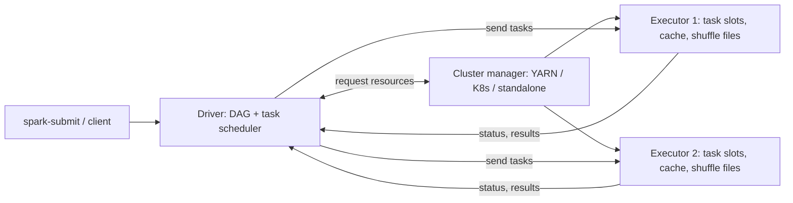
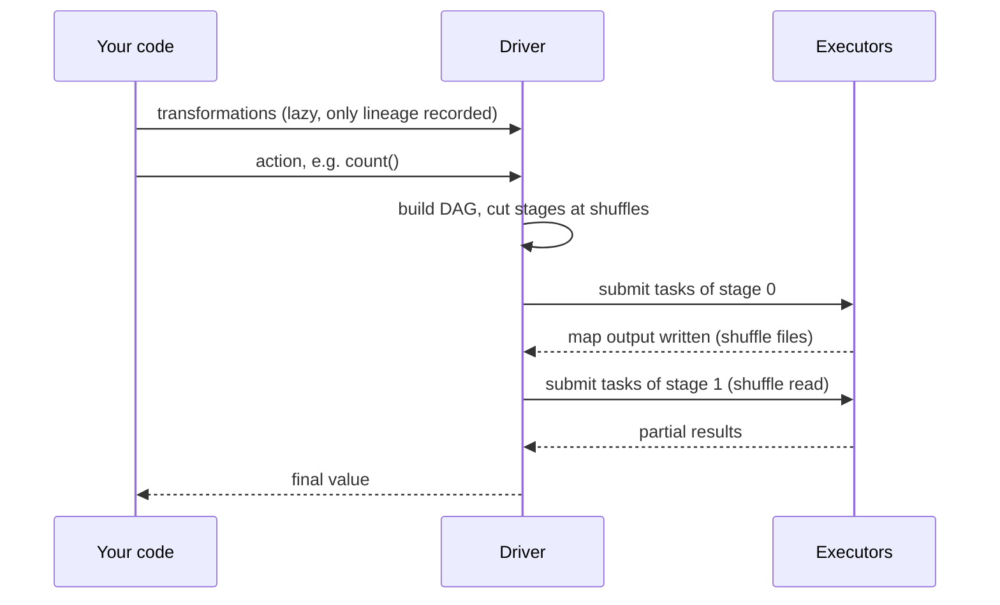

## 🎯 TL;DR

> A Spark application has **one driver** (it plans the work and tracks it) and **many executors** (they run the tasks on partitions of data). A **cluster manager** hands out the machines. Work is split into **jobs → stages → tasks**, and a **stage boundary** appears wherever data must be **shuffled**.

- Transformations are **lazy**: they only record lineage. An **action** (`count`, `collect`, `write`) triggers a job.
- Each stage is a set of tasks that can run without moving data between machines. A **wide** transformation (a shuffle) starts a new stage.
- Losing an executor is usually survivable (tasks are retried, lost partitions are recomputed). Losing the **driver** ends the application.

## 🌱 Start simple (Junior)

> **💡 Analogy:** A restaurant kitchen. The **head chef (driver)** reads the orders, plans the cooking steps and assigns them. The **cooks (executors)** do the actual chopping and frying on their own stations. The **staffing agency (cluster manager)** decides how many cooks you get and where they work.

A tiny word count shows the whole picture:

```python
from pyspark.sql import SparkSession

spark = SparkSession.builder.appName("wordcount").getOrCreate()
sc = spark.sparkContext

lines = sc.textFile("s3a://logs/2026-10-01/")      # lazy: nothing runs yet
words = lines.flatMap(lambda line: line.split())   # lazy
pairs = words.map(lambda w: (w, 1))                # lazy
counts = pairs.reduceByKey(lambda a, b: a + b)     # lazy, needs a shuffle

print(counts.count())                              # action: now Spark runs
```

Nothing is read until the last line. The first four lines only describe a plan. That is **lazy evaluation**: Spark waits until a result is requested so it can see the whole plan and optimize it.

## 🔧 How it really works (Mid)

**The three roles**

- **Driver**: the JVM process that runs your `main()`. It creates the `SparkSession`, turns your code into a DAG (directed acyclic graph) of stages, schedules tasks, keeps track of which partitions are done, and receives results (for example, the output of `collect()`).
- **Executors**: JVM processes on worker machines. Each has a number of **cores** (task slots). They run tasks, hold cached partitions in memory, and write **shuffle files** to local disk.
- **Cluster manager**: allocates containers or pods for the driver and executors. Common choices are YARN, Kubernetes and Spark standalone. Spark asks it for resources; it does not schedule individual tasks.

In **client mode** the driver runs on the machine that submitted the job. In **cluster mode** the driver runs inside the cluster. Choose client mode for interactive work and cluster mode for production, so that a laptop disconnect does not kill the job.



**Job, stage, task**

- A **job** is created by each **action**. One query can produce several jobs.
- A **stage** is a group of tasks that can run in a pipeline on the same data without moving it. The driver cuts a new stage at every **shuffle dependency** (a wide transformation).
- A **task** processes one partition in one stage. A stage with 200 input partitions runs 200 tasks.



**Narrow vs wide**

- **Narrow** transformations (`map`, `filter`, `flatMap`, `mapPartitions`, `union`) let each output partition be computed from one input partition. They pipeline inside one stage.
- **Wide** transformations (`reduceByKey`, `groupByKey`, `join` with unsorted inputs, `distinct`, `repartition`, `sortBy`) need every record with the same key to meet in one place. They force a **shuffle** and a stage boundary. See [[shuffle]].

Rule of thumb for the interview: **a new stage starts after every shuffle**, and **the number of tasks in a stage equals the number of its partitions**.

**Failures**

- **Task failure**: the driver retries the task, by default a few times, on another executor.
- **Executor loss**: running tasks are rescheduled. Cached partitions on that executor are gone; Spark recomputes them from **lineage** (the recorded chain of transformations) when they are needed. If the lost executor held **shuffle output** and no external shuffle service keeps it, the map tasks that produced it run again. This is why a `FetchFailed` error can resubmit an earlier stage.
- **Driver failure**: the application stops. In standalone cluster mode you can ask for automatic restart with `--supervise`; check the docs for your cluster manager.

## 🧠 Senior depth & trade-offs

- **Driver memory is a single point of pressure.** `collect()`, `toPandas()`, or a broadcast of a large table pull data into the driver JVM. A job that works on a sample and fails on production often does so here, with `OutOfMemoryError` on the driver rather than an executor.
- **Too many tiny tasks** make the driver a bottleneck: it schedules and tracks each task. Millions of 1 KB partitions are slower than hundreds of 128 MB ones.
- **Executor sizing** is a trade-off. Very fat executors (many cores, huge heap) suffer long GC pauses and contend for disk and network. Very thin ones waste memory on overhead and can't share broadcast data well. A common starting point is a few cores per executor, then measure. Verify exact memory settings in the docs for your version.
- **Dynamic allocation** adds and removes executors with load. Removing an executor is only safe for shuffle data if shuffle files outlive it (external shuffle service, or shuffle tracking in recent versions).
- **Monitoring**: the Spark UI shows jobs, stages, tasks, spill and GC per stage. The History Server reads event logs after the application ends. Watch for stages with a few very slow tasks (skew, see [[data-skew]]) and for stages that repeat after `FetchFailed`.
- **Kubernetes** replaces the YARN containers with pods; the driver pod owns the executor pods, and deleting the driver deletes them. See the related lessons on YARN and Kubernetes.
- **When not to use Spark**: a few gigabytes that fit on one machine. The cluster startup and shuffle overhead cost more than the work. A single-node engine is simpler and faster there.

## 🧪 Try it

Use this code for the first two exercises:

```python
df = spark.read.parquet("s3a://sales/2026/")          # (a)
big = df.filter(df.amount > 100)                      # (b)
by_cust = big.groupBy("customer_id").count()          # (c)
top = by_cust.orderBy("count", ascending=False)       # (d)
top.show(10)                                          # (e)
```

1. Which of lines (a) to (e) is an action? Which ones create a stage boundary?
2. How many stages does the job from `top.show(10)` have, and why? Assume the Parquet read produces 300 partitions and `groupBy` uses the default shuffle partition count.
3. A colleague writes `result = df.collect()` on a 40 GB table, then loops over the Python list. Name the component that runs out of memory and two safer alternatives.

<details><summary>Show solutions</summary>

**1.** Only (e), `show`, is an action. Line (c) `groupBy().count()` is wide (aggregation needs a shuffle). Line (d) `orderBy` is also wide: sorting needs range partitioning across executors. Lines (a) and (b) are narrow or lazy and create no boundary.

**2.** The `groupBy` shuffle creates the first boundary: the Parquet scan, the filter and the partial aggregation form one stage (one task per input partition, 300 here). The `orderBy` needs range partitioning, which adds another shuffle and boundary, so a typical plan has at least three stages. Confirm the exact count with `explain()`, because the plan depends on the version and on adaptive execution.

**3.** The **driver** runs out of memory, because `collect()` brings the whole table into the driver JVM. Safer options: keep the work distributed (`write` the result, or aggregate first and `collect()` only a small result), or use `take(n)` / `limit(n)` for inspection.

</details>

## 💬 Interview corner

**Question: "What triggers a new stage?"** Mid answer: "A shuffle, like `groupBy` or `join`." Senior answer: "A stage boundary is a shuffle dependency. Narrow transformations pipeline inside a stage; a wide transformation writes shuffle files on the map side and reads them on the reduce side, which starts a new stage. The number of tasks in each stage is its partition count."

**Question: "What runs on the driver vs executors?"** Mid: "The driver plans and schedules; executors run tasks and hold cached data." Senior adds: "Anything that brings data back to the driver (`collect`, `toPandas`, large broadcast) is a driver-memory risk, and that is usually the first OOM I check."

**Question: "What happens when an executor dies?"** Mid: "Its tasks are rescheduled elsewhere." Senior: "Tasks are retried and cached partitions are recomputed from lineage. If the dead executor held shuffle output without an external shuffle service, the producing stage is recomputed, which is why the job can appear to restart a stage. Without an external shuffle service and with dynamic allocation, scale-in can cause exactly this."

> **🎤 Say this in the interview:** "The driver builds a DAG of stages and schedules tasks; executors run them on partitions. Stages break at shuffles. Lazy transformations only run at an action. Losing an executor is recovered through lineage, but losing the driver ends the application."

## ⚠️ Common mistakes

> **⚠️ Watch out:** "Spark runs my code line by line when I call it." It does not. Transformations build a plan; nothing runs until an action. A slow line can be the action several lines later.

> **⚠️ Watch out:** `collect()` on a large DataFrame. It moves all data into the driver. Use `write`, or aggregate first.

- Thinking the number of executors alone sets parallelism. Parallelism is the number of **task slots** (total executor cores), capped by the number of partitions.
- Assuming a `count()` is free. It runs a full job unless the data is cached.
- Treating a `FetchFailed` as a network glitch only; it often means lost shuffle output and a recomputed stage.
- Running production jobs in client mode from a laptop or a notebook server that can disconnect.

## ✅ Check yourself (quiz)

1. Which action starts a new job?
   - A) `filter`
   - B) `select`
   - C) `count`
   - D) `withColumn`

<details><summary>Answer</summary>

**C** — `count` is an action. The other three are transformations: they only extend the plan.

</details>

2. Where does Spark cut a new stage?
   - A) After every `map`
   - B) At every shuffle dependency (wide transformation)
   - C) After every 128 MB of data
   - D) At each `cache()` call

<details><summary>Answer</summary>

**B** — narrow transformations are pipelined within a stage. A wide transformation requires a shuffle, and that creates the stage boundary.

</details>

3. Which component is responsible for requesting containers or pods for executors?
   - A) The driver's task scheduler
   - B) The cluster manager (YARN, Kubernetes, standalone)
   - C) The Parquet reader
   - D) The shuffle service

<details><summary>Answer</summary>

**B** — the cluster manager allocates resources. The driver then schedules individual tasks onto the executors it received.

</details>

4. **(Senior)** A job runs fine with 10 GB of input and fails with an OOM after you switch to 2 TB. The failing component is the driver, and the code calls `toPandas()` at the end. Why does the sample run pass, and what would you change?
   - A) Add more executors; the driver scales with them
   - B) The sample was small enough to fit in the driver; keep the result distributed (write it out) or aggregate before collecting
   - C) Switch to `RDD.count()`, which avoids the driver
   - D) Increase `spark.sql.shuffle.partitions`

<details><summary>Answer</summary>

**B** — `toPandas()` materializes the whole result in driver memory. Adding executors does not help the driver. Write the result to storage, or aggregate it first so the collected data is small.

</details>

5. **(Senior)** After an executor is removed by dynamic allocation, a long stage restarts from an earlier one. What is the most likely cause, and what is the fix?
   - A) Lineage is broken; disable caching
   - B) The removed executor held shuffle output that was not served by an external shuffle service or shuffle tracking, so the map stage is recomputed; enable an external shuffle service or shuffle tracking
   - C) Stages cannot restart; the error is in the UI only
   - D) The driver lost its heartbeat; increase driver memory

<details><summary>Answer</summary>

**B** — shuffle files live on the executor's local disk. If they go away with the executor, Spark must recompute the producing tasks. An external shuffle service (or shuffle tracking in recent versions) keeps them available after the executor is removed.

</details>

## 🗂️ Flashcards

| Front | Back |
|---|---|
| What does the driver do? | Runs `main()`, builds the DAG, schedules tasks, tracks progress, receives results |
| What do executors do? | Run tasks on partitions, cache data, write shuffle files |
| What does the cluster manager do? | Allocates containers or pods for driver and executors; does not schedule tasks |
| Client vs cluster mode | Client: driver on the submitting machine. Cluster: driver inside the cluster |
| What starts a job? | An action (`count`, `collect`, `write`, `show`) |
| Where does a stage boundary occur? | At each shuffle dependency (wide transformation) |
| How many tasks in a stage? | One per partition of that stage |
| Recovery from executor loss | Reschedule tasks, recompute cached partitions from lineage, recompute lost shuffle output |

## 🔗 Go further

- **spark-shuffle** explains what happens inside a wide transformation and how to size the partitions.
- **spark-catalyst** shows how the DataFrame plan built by the driver is optimized before tasks are created.
- **spark-ui-debugging** teaches you to read jobs, stages and tasks in the Spark UI.
- **spark-memory-tuning** and **spark-on-kubernetes** cover executor memory and running on pods.
- **yarn-vs-k8s** compares the two most common cluster managers.
