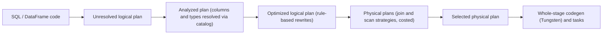

## 🎯 TL;DR

> In Spark, the **DataFrame** and **SQL** APIs describe **what** you want. The **Catalyst** optimizer turns that description into a **logical plan**, rewrites it with rules, picks a **physical plan**, and **Tungsten** compiles hot paths into tight generated code. The **RDD** API skips all of this, so Spark cannot optimize what you wrote.

- Pushdown (filters and columns) reduces the bytes read from storage. Constant folding removes work at plan time.
- A **Python UDF** is a black box to Catalyst: it blocks pushdown and forces rows to be serialized between the JVM and Python.
- `explain()` shows the plan at each stage. Reading it is the most important skill in Spark performance work.

## 🌱 Start simple (Junior)

> **💡 Analogy:** Asking a travel agent for "a cheap flight to Shiraz on Friday, economy, no more than one stop". The agent can search smartly. Compare that with "walk to every airport and check every flight yourself". The first gives the agent room to optimize; the second leaves no room at all. A DataFrame is the first style. An RDD with Python lambdas is closer to the second.

Both of these return the same rows:

```python
from pyspark.sql import functions as F

df = spark.read.parquet("s3a://warehouse/employees/")   # columns: id, name, dept, salary

# DataFrame: a declarative description Spark can rewrite
ok = df.filter(F.col("dept") == "data").select("name", "salary")

# RDD: opaque Python functions; Spark runs them as written
rdd = (df.rdd.filter(lambda r: r.dept == "data")
              .map(lambda r: (r.name, r.salary)))
```

The DataFrame version tells Spark which column is needed and which predicate to check. The RDD version hides both inside lambdas. Spark cannot look inside a lambda, so it cannot reorder or push anything through it.

## 🔧 How it really works (Mid)

**The APIs**

- **RDD**: low-level distributed collection of Python or JVM objects. No schema, no optimizer. Each record is an object, so Python RDDs pay serialization cost for every row.
- **DataFrame** (`Dataset[Row]` in Scala and Java; a plain DataFrame in PySpark): rows with a schema and column expressions. Catalyst optimizes it.
- **Dataset** (Scala and Java only): a typed DataFrame. Column expressions are optimized. A typed lambda such as `ds.map(x => ...)` is opaque, just like an RDD function.

**The Catalyst pipeline**



1. **Analysis** resolves names: `dept` becomes a specific column of a specific table, and types are checked.
2. **Logical optimization** applies rules until the plan stops changing. The important ones:
   - **Predicate pushdown**: move filters as close to the source as possible.
   - **Column pruning** (projection pushdown): read only the columns the query needs.
   - **Constant folding**: `F.lit(2) * F.lit(3000)` becomes `6000` at plan time.
   - **Boolean simplification**: `x AND TRUE` becomes `x`.
3. **Physical planning** chooses how to execute: which scan, which join algorithm (broadcast hash, shuffled hash, sort-merge), and where to add shuffles. With cost-based optimization enabled and table statistics present, Catalyst also uses row counts to pick the join order.
4. **Code generation**: Tungsten's **whole-stage codegen** fuses a chain of operators into one generated Java function, which avoids a virtual call per row and per operator. Tungsten also stores rows in a compact binary format and manages memory off the Java heap where possible.

**A worked example**

```python
q = (df.select("name", "dept", "salary")
       .filter((F.col("dept") == "data") &
               (F.col("salary") > F.lit(2) * F.lit(3000)))
       .select("name"))
q.explain(True)
```

In the optimized plan you should see:

- `6000` in place of `2 * 3000` (constant folding)
- `dept = data` and the salary condition in the scan node's `PushedFilters` (predicate pushdown into Parquet, which can skip row groups using statistics)
- a `ReadSchema` without `id` (column pruning)

`explain(True)` prints the parsed, analyzed, optimized and physical plans. In Spark 3.x, `explain("formatted")` gives a more readable tree. Exact text varies by version, so read it for the operators and their order rather than memorizing strings.

**Why UDFs block optimization**

A Python UDF is a function Catalyst cannot see into:

```python
from pyspark.sql.types import StringType

@F.udf(StringType())
def upper_py(s):
    return s.upper() if s else None

slow = df.filter(upper_py("dept") == "DATA")   # no PushedFilters for dept
fast = df.filter(F.col("dept") == "data")      # EqualTo(dept, data) is pushed
```

Because Catalyst cannot analyze the UDF, it cannot push the predicate into the scan, cannot prune columns used inside it, cannot estimate its output size, and must send each row from the JVM to a Python worker and back. Prefer built-in functions. When you must write Python logic, a **pandas UDF** (Arrow-based, vectorized) is much cheaper than a row-at-a-time UDF, although Catalyst still treats it as opaque.

## 🧠 Senior depth & trade-offs

- **Pushdown depends on the source.** Parquet and ORC can use min/max statistics and partition directories. A predicate on a computed expression, or on a format without statistics, is evaluated after the read. Check `PushedFilters` in the scan node rather than assuming.
- **Plan explosion.** A loop that calls `withColumn` a few hundred times, or repeated self-joins, builds a huge logical plan. Analysis and optimization then take minutes on the driver before any task runs. Fix it by building the columns in one `select`, or by breaking lineage with `df.checkpoint()` or `localCheckpoint()` at a sensible point.
- **Stats matter for joins.** Without statistics Catalyst guesses sizes. A broadcast join is chosen only when it estimates that one side is small enough, so a missing `ANALYZE TABLE` can produce a sort-merge join on a table that would have been broadcast. Check the physical plan, and verify the broadcast threshold setting for your version.
- **Typed vs untyped.** With a typed `Dataset`, a lambda `map` hides logic from the optimizer. Column expressions keep it visible. In PySpark this trade-off is mostly made for you.
- **Adaptive query execution (AQE)** re-optimizes at runtime, after shuffle stages finish, using real partition sizes. It complements Catalyst's static plan. See the AQE lesson.
- **Cost of optimization itself.** Very short jobs can spend more time planning than executing. For small data, a single-node engine or a plain SQL engine is often simpler.
- **Debugging in production**: compare the optimized plan to the physical plan, and watch for `Exchange` (shuffle) nodes that you did not expect, and for `Python` or `BatchEvalPython` nodes that mark a UDF boundary.

## 🧪 Try it

Use a `employees` DataFrame with columns `id, name, dept, salary` (Parquet).

1. Write the query that returns names of `data` employees earning more than `2 * 4500`. Run `explain(True)` and point to the constant that was folded and the filter that was pushed.
2. Replace the filter with a Python UDF that compares `dept`. Explain what disappears from the plan and why.
3. You have a 1000-column DataFrame built from 400 chained `withColumn` calls and the driver takes minutes before the first task starts. Propose two fixes.

<details><summary>Show solutions</summary>

**1.**
```python
q = (df.filter((F.col("dept") == "data") & (F.col("salary") > F.lit(2) * F.lit(4500)))
       .select("name"))
q.explain(True)
```
The optimized plan shows `9000` in place of `2 * 4500`. The `dept` equality appears in the scan's `PushedFilters`. Remember that `name` is the only output column, so `ReadSchema` does not need `id`.

**2.** The UDF version is `df.filter(upper_py("dept") == "DATA")`. The `PushedFilters` entry for `dept` disappears, because Catalyst cannot translate the UDF to a source filter. Rows are sent to Python and the filter runs after the scan, so more data is read and serialized. Built-in functions avoid this.

**3.** Two fixes: (a) replace the chain with one `select` that lists all the expressions, so analysis sees one projection instead of 400 nested ones; (b) break the lineage with `checkpoint()` or `localCheckpoint()` after building a large part of the plan, so the optimizer does not re-analyze an ever-growing tree.

</details>

## 💬 Interview corner

**Question: "What does Catalyst do?"** Mid answer: "It optimizes DataFrame queries: it pushes filters down and prunes columns." Senior answer: "It resolves the query against the catalog, applies rule-based rewrites until the plan is stable, chooses physical strategies, including join algorithms that depend on size estimates, and hands the result to whole-stage codegen. Its power depends on seeing the expressions, so I avoid UDFs on the critical path."

**Question: "RDD or DataFrame?"** Mid: "DataFrame, because it is optimized." Senior: "DataFrame for almost all structured work. RDD when I need low-level control of partitioning or custom binary processing that does not fit a schema. Even then I check whether a built-in expression or a pandas UDF covers it."

> **🎤 Say this in the interview:** "I write DataFrame expressions, not Python lambdas, so Catalyst can push filters into Parquet and prune columns. I check `explain` to confirm the pushdown, and I treat every Python UDF as a boundary that blocks optimization and costs serialization."

## ⚠️ Common mistakes

> **⚠️ Watch out:** Assuming `filter` after a UDF is as cheap as a filter on a raw column. The UDF hides the predicate from the source, so more data is read.

> **⚠️ Watch out:** Reading `explain()` once in development and never again. Data volume, statistics and AQE change the plan.

- Using RDD APIs for structured data "because they are more flexible", and losing the optimizer.
- Writing `df.rdd.map(...)` in the middle of a pipeline and then converting back. Each conversion is a row-object round trip.
- Chaining hundreds of `withColumn` calls in a loop (plan explosion).
- Expecting predicate pushdown into a source that has no statistics or no partitioning.
- Treating `explain` text as stable across Spark versions.

## ✅ Check yourself (quiz)

1. Which component rewrites the logical plan with rules such as predicate pushdown and column pruning?
   - A) Tungsten
   - B) Catalyst
   - C) The cluster manager
   - D) The Parquet reader

<details><summary>Answer</summary>

**B** — Catalyst is the optimizer. Tungsten handles memory layout and code generation, and the Parquet reader only executes the scan it is given.

</details>

2. Which expression is evaluated at plan time, before any task runs?
   - A) `F.col("salary") * 2`
   - B) `F.lit(2) * F.lit(3000)`
   - C) A Python UDF on `dept`
   - D) `df.count()`

<details><summary>Answer</summary>

**B** — both operands are literals, so constant folding replaces the expression with `6000`. The column expression depends on data at run time, and `count()` is an action that runs a job.

</details>

3. Why does a Python UDF on a filter usually block predicate pushdown?
   - A) UDFs can only run on the driver
   - B) Catalyst cannot translate an opaque function into a source filter, so the predicate is applied after the scan
   - C) Parquet does not support strings
   - D) UDFs disable column pruning for every column

<details><summary>Answer</summary>

**B** — the source only understands simple predicates. An opaque UDF cannot be converted into one, so the filter runs after the rows are read. Check the scan node's `PushedFilters` to confirm.

</details>

4. **(Senior)** A broadcast join was used in the test environment but a sort-merge join appears in production on the same query. What is the most likely cause, and what do you check?
   - A) Production has more executors, which disables broadcast
   - B) Catalyst lacks size estimates for the production table (missing statistics or a larger input) and no longer estimates that one side fits the broadcast threshold; compute statistics and compare the physical plans
   - C) Sort-merge join is always used on Parquet
   - D) Broadcast joins cannot use DataFrames

<details><summary>Answer</summary>

**B** — the join strategy depends on size estimates. Without current statistics, or with a larger real input, the planner may not pick a broadcast. Recompute statistics, check the threshold, and compare the two physical plans.

</details>

5. **(Senior)** A team wants to speed up a job by moving a business rule from a `filter` on a column into a typed `Dataset.map` lambda "for type safety". What is the trade-off?
   - A) None; typed lambdas are always faster
   - B) The lambda is opaque to Catalyst, so pushdown and column pruning on that logic are lost; keep the rule as a column expression, and use typed access only where it is needed
   - C) The lambda makes Parquet unreadable
   - D) The optimizer must run twice

<details><summary>Answer</summary>

**B** — a typed lambda hides its logic from the optimizer. Expressing the rule as a column expression keeps pushdown and pruning possible, and typed safety can be kept at the edges of the pipeline.

</details>

## 🗂️ Flashcards

| Front | Back |
|---|---|
| RDD vs DataFrame | RDD: opaque objects, no optimizer. DataFrame: schema plus expressions that Catalyst optimizes |
| What does Catalyst produce? | Analyzed, optimized logical plan, then a selected physical plan |
| Predicate pushdown | Filters applied as close to the source as possible, ideally inside the scan |
| Column pruning | Reading only the columns the query needs |
| Constant folding | Literal expressions evaluated at plan time |
| Why UDFs block optimization | Catalyst cannot see inside them, so pushdown and pruning stop at the boundary |
| What is Tungsten? | Binary row format, off-heap memory, and whole-stage code generation |
| Where do you verify an optimization? | `explain(True)` or `explain("formatted")`, scan node `PushedFilters` and `ReadSchema` |

## 🔗 Go further

- **spark-architecture** explains how the optimized plan becomes stages and tasks.
- **spark-aqe** covers runtime re-optimization, which complements Catalyst's static plan.
- **spark-shuffle** explains the `Exchange` nodes you see in every plan.
- **pyspark-api** and **python-dataframes** cover the Python-side API choices in more depth.
- **sql-query-optimization** gives the general SQL view of predicate pushdown and plan reading.
