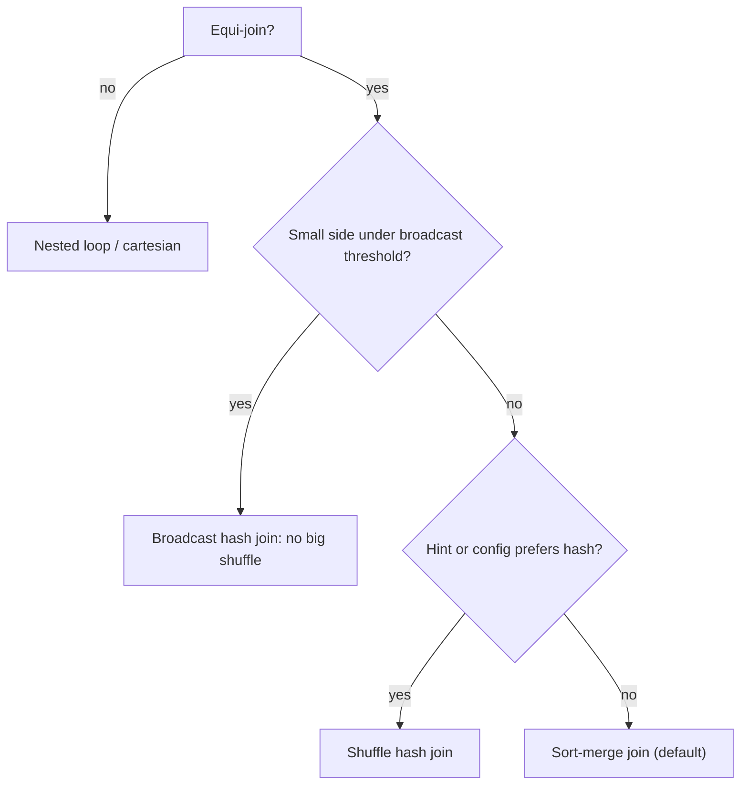

## 🎯 TL;DR

> A Spark join is cheap when one side is **small enough to copy everywhere** (broadcast) and expensive when both sides must be **shuffled by key**. Skew means one key holds so many rows that a single task becomes the bottleneck.

- Broadcast hash join: no shuffle of the big table. Needs one side that fits in executor memory.
- Sort-merge join: the default for two large tables. Both sides are shuffled and sorted by the join key.
- Shuffle hash join: both sides shuffled, the smaller side per partition is built into a hash table. Chosen less often.
- Skew: one or a few keys produce most of the rows. Fix it with AQE skew join, salting, or by isolating hot keys.

## 🌱 Start simple (Junior)

> **💡 Analogy:** You are matching a list of 10 000 orders against a list of 50 product names. You could photocopy the short product list and give a copy to every desk (broadcast). Or you could sort both big piles by product and walk through them together (sort-merge). Copying is faster when one list is short.

A small example:

```sql
SELECT o.order_id, c.country
FROM orders o
JOIN customers c ON o.customer_id = c.customer_id;
```

Spark has to answer one question for this query: **do the rows with the same `customer_id` end up on the same executor?** If `customers` is small, Spark can copy it to every executor and the question disappears. If both tables are large, Spark must move rows across the network so that equal keys meet. That movement is the **shuffle**, and it is where most join time goes.

Skew is the other problem. Suppose one customer, the "guest" account, has 40 % of all orders. All 40 % of those rows land in one partition, handled by one task. The other 199 tasks finish in seconds, and the job waits for that one task.

## 🔧 How it really works (Mid)

Spark picks a join strategy during planning. The main ones:

| Strategy | Shuffles | Needs | Typical use |
|---|---|---|---|
| Broadcast hash join (BHJ) | Only the small side is copied, big side is not shuffled | Small side fits in memory on each executor | Fact table joined to a small dimension |
| Sort-merge join (SMJ) | Both sides shuffled and sorted by key | Equi-join keys | Large table joined to large table (default) |
| Shuffle hash join (SHJ) | Both sides shuffled, hash table built per partition | Each partition of the smaller side fits in memory | Medium tables when SMJ sorting is costly |
| Broadcast nested loop / cartesian | Varies | No equi-join keys | Non-equi joins, last resort |

**Broadcast.** The setting `spark.sql.autoBroadcastJoinThreshold` (default 10 MB) tells the planner which estimated table sizes qualify. You can force it with a hint:

```sql
SELECT /*+ BROADCAST(c) */ o.order_id, c.country
FROM orders o JOIN customers c ON o.customer_id = c.customer_id;
```

```python
from pyspark.sql.functions import broadcast
result = orders.join(broadcast(customers), "customer_id")
```

Size estimates come from table statistics or file sizes. A filtered subquery can be much smaller than the base table, and Spark may not know that until runtime. With Adaptive Query Execution (AQE), Spark can switch a shuffle join to a broadcast after the first shuffle stage finishes and its real size is known.

**Sort-merge.** Both sides are hash-partitioned by the key, sorted inside each partition, then merged. It can spill to disk, so it survives data bigger than memory. Its cost is two full shuffles.

**Bucketed tables.** If both tables were written with `bucketBy(n, key)` and the same `n`, Spark can join matching buckets without a shuffle. Bucketing must be set at write time and both sides must agree on it, so it is a design decision, not a runtime fix.



**Skew, in the UI.** In the Stages tab, look at the task duration and shuffle read size. If the max is 50 times the median, you have skew. The one slow task is usually reading a huge shuffle partition. Skew is about data, not about the cluster: adding executors does not help, because one task still gets the whole hot key.

**What AQE does for skew.** With `spark.sql.adaptive.enabled` and `spark.sql.adaptive.skewJoin.enabled` (true by default in recent Spark versions), Spark splits a large shuffle partition of a sort-merge join into several smaller tasks and replicates the matching rows from the other side. A partition is treated as skewed when it is larger than `spark.sql.adaptive.skewJoin.skewedPartitionFactor` (default 5.0) times the median partition size and larger than `spark.sql.adaptive.skewJoin.skewedPartitionThresholdInBytes` (default 256 MB). Check the docs for your Spark version before quoting these numbers.

## 🧠 Senior depth & trade-offs

- **Salting.** Add a random suffix to the hot key on the big side, and replicate the small side once per suffix:

```python
from pyspark.sql import functions as F

N = 16  # number of salt buckets
big_salted = big.withColumn("salt", (F.rand() * N).cast("int"))
small_exploded = small.withColumn(
    "salt", F.explode(F.array(*[F.lit(i) for i in range(N)]))
)
joined = big_salted.join(small_exploded, ["customer_id", "salt"]).drop("salt")
```

  Hot rows are now split into up to 16 tasks. The cost: the small side is N times larger, and salting is manual, so it is easy to get wrong. AQE skew join does a similar thing automatically, but only for sort-merge joins.

- **Isolate hot keys.** Pull the hot key out, broadcast the matching dimension rows for that key only, and join the rest normally:

```python
HOT = "guest"
hot_part = big.filter(F.col("customer_id") == HOT).join(
    F.broadcast(customers.filter(F.col("customer_id") == HOT)), "customer_id")
rest_part = big.filter(F.col("customer_id") != HOT).join(customers, "customer_id")
result = hot_part.unionByName(rest_part)
```

  This is often the cleanest fix when there is one known hot key. Be careful with `NULL` keys: `!= HOT` drops them, which is correct for an inner join but not for a left join.

- **NULL keys.** All `NULL` join keys hash to the same partition. For an inner join they never match, so filter them out before the join. For a left join, keep them but spread them out (replace with a random key), or handle them in a separate branch.

- **Sizing a 5 TB × 50 GB join.** 50 GB is too big for a default broadcast (10 MB threshold), and a manually broadcast 50 GB table is not realistic on most executors. The answer is a sort-merge join with the work reduced first: filter both sides before the join, select only needed columns, use partition pruning on the date column, and if the join runs repeatedly, bucket both tables on the join key. Arithmetic: 5 TB ≈ 5 120 GB; at 128 MB per partition that is about 40 000 partitions, so the shuffle is large and the number of tasks matters as much as the memory per task.

- **Monitoring.** Track stage duration, max/median task time, shuffle read per task and spill, using the Spark UI or the event log. Alert on max/median ratio, not on total job time.

- **When not to use AQE skew handling.** It applies to sort-merge and shuffle hash joins only. A skewed aggregation (`groupBy` on a hot key) is a different problem: salt it in two stages, or pre-aggregate.

## 🧪 Try it

Create two DataFrames in a local Spark session (PySpark 3.x):

```python
from pyspark.sql import SparkSession, functions as F
spark = SparkSession.builder.master("local[4]").getOrCreate()
big = spark.range(0, 2_000_000).withColumn(
    "customer_id", F.when(F.col("id") % 2 == 0, F.lit(0)).otherwise(F.col("id") % 1000))
small = spark.range(0, 1000).withColumnRenamed("id", "customer_id")
```

1. Run `big.join(small, "customer_id").explain()`. Which strategy is chosen? Then force `broadcast(small)` and compare.
2. Open the Spark UI, find the join stage and compare the max and median task time. Which key is hot, and how many rows does it have?
3. Apply the salting code above with N = 8 and check that the row count is unchanged.

<details><summary>Show solutions</summary>

**1.** With a 1000-row `small` table, Spark usually picks a broadcast hash join automatically. If you disable auto broadcast (`spark.sql.autoBroadcastJoinThreshold = -1`), it picks sort-merge. The explain output shows `BroadcastHashJoin` or `SortMergeJoin`.

**2.** Key `0` has about 1 000 000 rows (every even id); other keys have about 1 000 rows each. With a shuffle join, the task holding key `0` is far slower than the others.

**3.** Exploded `small` has 8 000 rows and each `big` row gets one salt, so the output count equals the count of the unsalted inner join (each `big` row matches exactly the 1 row of `small` with that key).

</details>

## 💬 Interview corner

**Question: "One task runs 2 hours while others finish in 2 minutes — what do you do?"**

- Mid answer: "I'd check the Spark UI for the slow stage, see that one task has much more shuffle read, and enable AQE skew join."
- Senior answer: "First I confirm it's data skew, not a bad node: the max task reads far more shuffle data than the median, and it has the same key pattern. Then I find the hot key. If one key dominates, I either isolate it with a broadcast of its dimension rows or salt the join. I also check whether AQE skew handling is on and whether the join is sort-merge, because AQE does not split broadcast joins. Finally I check for NULL keys, which often cause the same symptom."

**Question: "Join a 5 TB table with a 50 GB table."**

Senior answer: "The 50 GB side is too big to broadcast safely, so this is a sort-merge join. I'd reduce both inputs first with filters and column pruning, check for skew on the join key, let AQE coalesce and split partitions, and if the join runs daily I'd consider bucketing both tables on the key so the shuffle disappears."

> **🎤 Say this in the interview:** "I decide by the size of each side. Small side means broadcast; two large sides means sort-merge with reduced inputs. If one task is much slower than the rest, that is skew, and I fix it by splitting the hot key, not by adding executors."

## ⚠️ Common mistakes

> **⚠️ Watch out:** Adding more executors does not fix skew. A single hot key still lands in one task, and that task is the bottleneck.

> **⚠️ Watch out:** Broadcasting a table that is only "small" before filtering. The estimate may be based on the base table, and the driver or executors run out of memory when the broadcast is actually large.

- Assuming the broadcast threshold is about the table on disk, not its estimated size in memory after decompression.
- Forgetting that `NULL` keys all go to one partition.
- Using salting on a left join without also salting the small side correctly. The rows that do not match must still appear once.
- Turning off auto broadcast globally to "fix" one query, which makes every small dimension join slower.
- Measuring the job by total runtime instead of the max/median task time.

## ✅ Check yourself (quiz)

1. A join between a 4 GB fact table and a 6 MB dimension table is slow with a sort-merge join. What is the most likely fix?
   - A) Increase `spark.executor.cores` to 64
   - B) Broadcast the dimension table with a hint or ensure it is below the threshold
   - C) Switch the fact table to `bucketBy` in the same query
   - D) Set `spark.sql.shuffle.partitions` to 1

<details><summary>Answer</summary>

**B** — a 6 MB table is far below the default 10 MB broadcast threshold, so a broadcast hash join avoids shuffling the 4 GB fact table. Sort-merge here is an estimation problem, so a hint is the direct fix.

</details>

2. In the Spark UI, one task of a join stage reads 40 GB of shuffle data while the median task reads 200 MB. What is it?
   - A) A GC problem on one executor
   - B) Data skew on the join key
   - C) A network failure
   - D) Too many executors

<details><summary>Answer</summary>

**B** — the shuffle read size tells you the data is unevenly distributed. Check the hot key. GC or a slow node usually shows as a long task with a normal shuffle read.

</details>

3. Which statement about AQE skew join is correct?
   - A) It splits skewed partitions of sort-merge and shuffle hash joins, and it applies to broadcast joins too
   - B) It splits skewed partitions of sort-merge and shuffle hash joins, and it does not apply to broadcast joins
   - C) It removes the need for a join key
   - D) It works only in streaming queries

<details><summary>Answer</summary>

**B** — a broadcast join has no shuffle partition to split, so AQE skew handling does not apply. It works on shuffled sort-merge and shuffle hash joins.

</details>

4. **(Senior)** You have one hot customer with 30 % of 3 billion rows. Compare salting with isolating the hot key. When would you choose each?

   - A) Salting is always better because it needs no code changes
   - B) Isolating the key is simpler when there is one known hot key and the dimension rows for it are small; salting handles many hot keys without special-casing, at the cost of replicating the small side N times
   - C) Neither works on 3 billion rows
   - D) Both require bucketed tables

<details><summary>Answer</summary>

**B** — isolating one known key is cheap and readable. Salting is general, but it multiplies the small side by N and must be written carefully for outer joins.

</details>

5. **(Senior)** A left join produces the correct row count without skew, but adding salting doubles the output. What is the most likely mistake?

   - A) The salt column was not dropped before the join
   - B) The small side was not replicated for every salt value, or the salt was applied to both sides without the matching explode, so the wrong rows multiply
   - C) Left joins do not support salting
   - D) `F.rand()` must be seeded

<details><summary>Answer</summary>

**B** — salting only works if every salt value on the big side has a matching row on the small side. Applying a random salt to both sides, or exploding the small side wrongly, changes the match count.

</details>

## 🗂️ Flashcards

| Front | Back |
|---|---|
| Broadcast hash join | Small side copied to every executor; big side is not shuffled |
| Default join for two large tables | Sort-merge join: both sides shuffled and sorted by key |
| `spark.sql.autoBroadcastJoinThreshold` default | 10 MB (estimated size) |
| What causes skew | One key holds far more rows than others, so one task does most of the work |
| Symptom of skew in the Spark UI | Max task time or shuffle read far above the median |
| AQE skew join applies to | Sort-merge and shuffle hash joins, not broadcast joins |
| Salting | Random suffix on the big side's hot key, small side exploded to match every suffix |
| Why `NULL` keys cause skew | All `NULL` keys hash to the same partition |

## 🔗 Go further

- **spark-shuffle** explains the exchange that every shuffle join depends on.
- **spark-aqe** covers the runtime switch to broadcast and the skew-split rule in detail.
- **spark-ui-debugging** shows how to read the stage and task metrics that reveal skew.
- **spark-memory-tuning** covers what happens when a skewed task runs out of memory.
- **sql-joins** covers join types, which matter for how salting and NULL handling must work.
