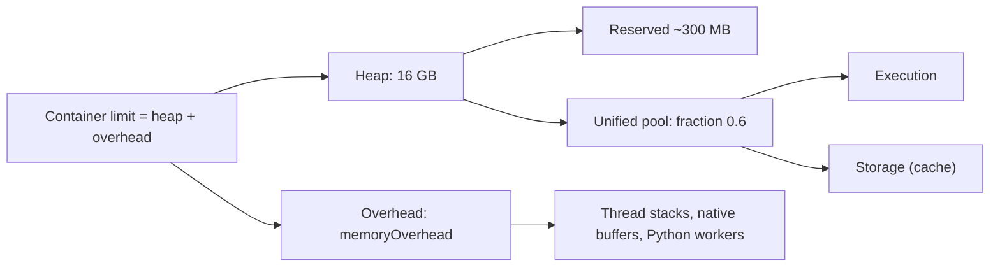

## 🎯 TL;DR

> Spark runs inside JVM containers. Two different memory systems can kill a job: the **JVM heap** (you get `java.lang.OutOfMemoryError`) and the **container limit** (YARN or Kubernetes kills the process, often with no Java error at all).

- Heap memory is split into **execution** (shuffles, joins, sorts, aggregations) and **storage** (cached data). Both share one pool, and execution can push storage out.
- **Overhead** (off-heap, native buffers, Python workers, threads) lives outside the heap but counts against the same container limit.
- **Driver** OOM usually means you brought too much data to one place (`collect()`, a big broadcast, a huge result).
- **Executor** OOM usually means one task got too much data (skew, a wide aggregation, a heavy UDF).

## 🌱 Start simple (Junior)

> **💡 Analogy:** An executor is a workshop with a desk (heap) and a storage shed next to it (overhead). The desk must hold the tools for the job in progress (execution) and the parts you saved for later (cache). If the desk is too full, Spark moves parts into a box on the floor (spill to disk). If the whole workshop, desk plus shed, is bigger than the rented room (the container), the landlord (YARN or Kubernetes) throws you out. That is the "OOM-killed" message.

Two things to remember:

1. A **Java OOM** is a message inside the job's logs. The JVM ran out of heap and stopped.
2. An **OOM-killed** executor is a message from the cluster manager. The process used more memory than its container allowed, and the container was killed. The JVM might not even know.

These need different fixes. A Java OOM usually needs less data per task or more heap. A container kill usually needs more overhead, or less off-heap use (Python, native libraries).

## 🔧 How it really works (Mid)

For an executor with `spark.executor.memory = 16g` the layout is roughly:



**Unified memory.** Spark takes `(heap - 300 MB reserved) x spark.memory.fraction` (default 0.6) as the unified pool. Execution and storage share it. Within the pool, `spark.memory.storageFraction` (default 0.5) marks a region that cached blocks can keep: execution can evict cached blocks only above that region. In practice: a big shuffle can push cached data out, but cached data cannot push out a running shuffle.

**Overhead.** `spark.executor.memoryOverhead` is extra non-heap memory per executor. Its default is the larger of 10 % of executor memory and 384 MB (the 384 MB floor is the value in recent docs). On Kubernetes with non-JVM jobs (PySpark with heavy Python UDFs), the default factor is 0.40. Set it explicitly once you know your job's real native usage.

**Spill.** When an execution operator (sort, hash aggregate, join) no longer fits in its share, it writes sorted or hashed chunks to local disk. The Spark UI shows this as "Spill (memory)" and "Spill (disk)" per stage. Some spill is normal and cheap. Heavy spill on every task means the partitions are too big, which is a sizing problem, not a memory leak.

**Driver vs executor OOM.**

| Symptom | Usual cause | First fix |
|---|---|---|
| Driver `OutOfMemoryError` | `collect()`, `toPandas()`, large `broadcast`, `spark.driver.maxResultSize` exceeded | Write results instead of collecting; reduce the broadcast |
| Executor `OutOfMemoryError` (Java) | One task with too much data (skew, big aggregation, large list in a UDF) | Repartition, fix skew, raise memory per task |
| Executor "Container killed ... exceeding memory limits" | RSS above container limit (overhead, Python, native) | Raise `memoryOverhead`, reduce Python memory |
| Long GC pauses, no error | Too many live objects, big heaps | Smaller executors, serialized storage, check GC time |

**Dynamic allocation.** With `spark.dynamicAllocation.enabled=true`, Spark adds and removes executors based on pending tasks. It needs either an external shuffle service or shuffle tracking (`spark.dynamicAllocation.shuffleTracking.enabled`) so that shuffle files survive removed executors. Idle executors are released after `spark.dynamicAllocation.executorIdleTimeout`. This helps shared clusters; it does not help a single skewed stage.

**Serialization.** `spark.serializer=org.apache.spark.serializer.KryoSerializer` makes RDD serialization smaller and faster. DataFrame and SQL data already use Spark's binary row format, so Kryo matters less there. Check the docs for your version before quoting defaults.

## 🧠 Senior depth & trade-offs

- **Driver is a single JVM.** Anything that brings data to the driver is a bottleneck: `collect()`, `toPandas()`, `count()` on a huge lazy result is fine, but `rdd.collect()` of a big result is not. Use `take(n)`, `limit`, or write to storage.
- **Broadcasts live on the driver first.** A large broadcast is built on the driver and copied to every executor. Size it in memory after decompression, not as files on disk.
- **Sizing a 2 TB job.** A rule of thumb: 4 to 5 cores per executor (more cores per executor means more tasks sharing one heap and one GC), and heaps around 16 to 32 GB, because very large heaps make GC pauses long. Arithmetic: 2 TB = 2 048 GB = 2 097 152 MB; at 128 MB per partition that is 16 384 tasks. With 40 executors of 5 cores, there are 200 concurrent tasks, so about 82 waves. Execution memory per task is roughly (16 - 0.3) x 0.6 / 5 ≈ 1.9 GB, which is the number to check against your largest partitions. Measure, then adjust; these are starting points.
- **More executors is not always faster.** Past a point, shuffle cost and driver coordination grow. Watch the stage timeline, not only the executor count.
- **GC tuning is the last resort.** If GC time is more than about 10 % of task time in the UI, first reduce the live objects: fewer cached copies, columnar formats, smaller partitions, and avoid `Dataset` objects in hot loops. G1 is the usual collector on modern JVMs; change collectors only with measurements.
- **Kubernetes.** Container limits are hard. The overhead you set is what the kubelet enforces, and a PySpark job with Arrow buffers and Python workers can exceed a heap-only sizing. Set `memoryOverhead` explicitly and watch the "exit code 137" (killed) in pod events. See **spark-on-kubernetes**.
- **Caching trade-off.** A cached DataFrame reserves storage memory inside the same unified pool, so it competes with execution. Cache only what is reused several times, and call `unpersist()` when you are done.

## 🧪 Try it

Consider this job, which runs with `spark.executor.memory=8g` and 4 cores:

```python
df = spark.read.parquet("s3://bucket/events/")     # 600 GB
agg = df.groupBy("user_id").agg(F.count("*").alias("n"))
rows = agg.collect()                                # step X
```

1. Explain which kind of OOM step X can cause and why.
2. Replace step X with a write, then compute how many partitions you need for 600 GB at 128 MB each, and the execution memory per task with 4 cores and 8 GB heap.
3. Name two signs in the Spark UI that a stage is spilling too much, and what you would change.

<details><summary>Show solutions</summary>

**1.** `collect()` pulls every aggregated row into the driver's heap. If `user_id` has many distinct values, the driver runs out of heap: a driver `OutOfMemoryError`. The fix is to write the result, not collect it.

**2.** Write with `agg.write.parquet(...)`. Partitions: 600 GB = 614 400 MB; at 128 MB each that is 4 800 partitions. Execution memory per task: (8 - 0.3) x 0.6 / 4 ≈ 1.15 GB. Partitions with more than that size will spill.

**3.** In the stage detail, the "Spill (memory)" and "Spill (disk)" columns are large and the slowest tasks spill the most. Fix: more partitions (smaller input per task), or more memory per task (fewer cores per executor, or bigger heap).

</details>

## 💬 Interview corner

**Question: "Executors keep getting OOM-killed on Kubernetes — debug it."**

- Mid answer: "I'd check the pod logs, see the exit code 137, and increase `memoryOverhead`."
- Senior answer: "First I separate the two OOMs. If the logs show a Java `OutOfMemoryError`, it's heap: I look for skew and big partitions in the Stages tab. If the pod was killed with exit code 137 and no Java error, it's container memory: heap plus overhead plus Python and native use is above the limit. I'd check the overhead, whether PySpark UDFs or Arrow are used, and the executor's peak RSS. Then I'd raise `memoryOverhead` explicitly, or reduce the Python memory, and confirm the fix in the next run's metrics."

**Question: "How do you size executors for a 2 TB job?"**

Senior answer: "I start from the partition count, about 16 000 partitions at 128 MB. I pick 4 to 5 cores per executor and a heap of 16 to 32 GB, so each task has enough execution memory for its partition. Then I calculate the concurrent tasks and the number of waves, and I check the spill and GC metrics in a test run before I scale up."

> **🎤 Say this in the interview:** "I split memory problems into driver, executor heap, and container overhead, because each has a different symptom and fix. I size executors from partition size and cores, then verify spill and GC in the UI rather than guessing."

## ⚠️ Common mistakes

> **⚠️ Watch out:** Increasing `spark.executor.memory` when the kill is from the container. The container limit is heap plus overhead, so a bigger heap alone can make the kill happen more often.

> **⚠️ Watch out:** Calling `collect()` on a large DataFrame to "look at the data". Use `show()`, `take()`, or write the output.

- Confusing the Java `OutOfMemoryError` with the cluster's "container killed" message.
- Setting very large heaps (100 GB+) to avoid spill, and then suffering long GC pauses.
- Using many cores per executor on a memory-heavy job, so tasks share a small amount of execution memory.
- Caching everything to speed up a single-use pipeline.
- Assuming dynamic allocation fixes slow stages. It changes executor count, not data distribution.

## ✅ Check yourself (quiz)

1. An executor is killed by Kubernetes with exit code 137, and the Java logs show no error. What is the most likely cause?
   - A) A Java heap overflow
   - B) Container memory (heap plus overhead, or Python and native memory) above the pod limit
   - C) The driver ran `collect()`
   - D) Broadcast join was too large

<details><summary>Answer</summary>

**B** — exit code 137 is the kernel or cluster killing the process for exceeding its limit. No Java error is printed because the JVM never got to throw one. Check overhead and off-heap use.

</details>

2. What does `spark.memory.storageFraction` control?
   - A) The share of disk used for shuffle files
   - B) The part of the unified pool that cached blocks are protected in, from eviction by execution
   - C) The number of cores per executor
   - D) The overhead size

<details><summary>Answer</summary>

**B** — execution can evict cached blocks only above the protected storage region. Raising it protects cache, at the cost of execution memory.

</details>

3. A job with `groupBy` on a skewed key shows one task with very large spill and the rest normal. What is the best first step?
   - A) Add more executors
   - B) Raise the driver memory
   - C) Address the skew (salting, pre-aggregation, or AQE) so the hot partition shrinks
   - D) Turn off spill

<details><summary>Answer</summary>

**C** — one hot partition is a data problem. More executors do not shrink it, and turning off spill makes it fail instead.

</details>

4. **(Senior)** You have 4 executors with 32 GB heap and 16 cores each, and tasks spill heavily. What is the trade-off in your fix?

   - A) Fewer cores per executor give each task more execution memory but reduce parallelism; more executors with fewer cores often balance this better
   - B) More cores always improve memory
   - C) Spill only happens on the driver
   - D) Cores have no effect on memory

<details><summary>Answer</summary>

**A** — with 16 cores sharing one heap, each task gets a small slice of execution memory. Fewer cores per executor (and more executors) gives each task more memory at the cost of less concurrency per executor. Measure the spill and the stage time.

</details>

5. **(Senior)** Dynamic allocation is on, but a single stage with a skewed key still runs for two hours. Why does dynamic allocation not help?

   - A) Dynamic allocation is only for streaming
   - B) It changes the number of executors, but one skewed task still processes the hot partition alone
   - C) It disables the shuffle service
   - D) It requires `collect()`

<details><summary>Answer</summary>

**B** — dynamic allocation adds or removes executors when tasks are pending. A single hot partition is still one task on one core, so extra executors sit idle. The fix is in the data distribution.

</details>

## 🗂️ Flashcards

| Front | Back |
|---|---|
| Java OOM vs container-killed | Java OOM is a heap error in the logs; container kill is the cluster stopping a process over its memory limit |
| Unified pool size | `(heap - 300 MB) x spark.memory.fraction` (default 0.6) |
| `spark.memory.storageFraction` | Protected cache share; execution can evict cache only above it |
| Default `memoryOverhead` | Larger of 10 % of executor memory and 384 MB (check your version) |
| Exit code 137 on Kubernetes | Process killed for exceeding its memory limit |
| Driver OOM common cause | `collect()`, `toPandas()`, large broadcast, big results |
| Spill in the UI | Spill (memory) and Spill (disk) per stage; heavy spill means partitions too big |
| Executor sizing starting point | 4 to 5 cores, 16 to 32 GB heap, then measure |

## 🔗 Go further

- **spark-architecture** explains the driver and executor roles that this lesson relies on.
- **spark-shuffle** covers the shuffle files that spill and dynamic allocation depend on.
- **spark-on-kubernetes** and **yarn-vs-k8s** cover how the container limit is set and enforced.
- **spark-joins-skew** covers the most common cause of a single oversized task.
- **spark-ui-debugging** shows how to read spill, GC and task metrics in practice.
