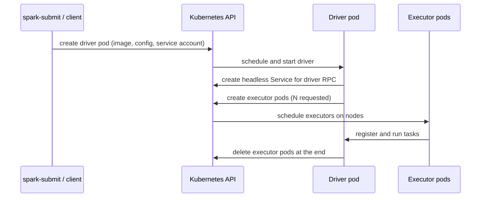

## 🎯 TL;DR

> Spark on Kubernetes (K8s) means Spark **asks the Kubernetes API for pods** when it needs compute, and gives them back when it does not. The driver is one pod, and each executor is another pod.

- The cluster manager is Kubernetes instead of YARN. Spark creates **executor pods** itself; nothing has to pre-start a fixed set of worker daemons.
- Dynamic allocation works without an external shuffle service, but only if Spark **tracks shuffle files** on the executors.
- Shuffle data lives on executor local disk. When an executor is removed (scale-down, node loss, spot preemption), its shuffle output goes with it, unless you add remote or recoverable shuffle storage.
- Almost every operational problem comes from three things: pod resources (memory limits, OOMKilled), pod placement (node selectors, spot vs on-demand), and the shuffle layer.

## 🌱 Start simple (Junior)

> **💡 Analogy:** Think of a restaurant that does not own a kitchen. For each big banquet, it rents a few kitchen stations from a shared building. The head chef (the **driver**) plans the menu and rents stations (**executor pods**). When the banquet ends, the stations go back to the building and other tenants can use them.

In YARN, the cluster already has NodeManagers running on every worker, and Spark asks YARN for containers. In Kubernetes, there are no Spark workers at all. Spark is just another client of the Kubernetes API.

A minimal submission in **cluster mode** (the driver also runs inside a pod):

```bash
spark-submit \
  --master k8s://https://k8s-api.internal:6443 \
  --deploy-mode cluster \
  --name daily-orders \
  --conf spark.kubernetes.container.image=registry.internal/spark:3.5.1-py \
  --conf spark.kubernetes.authenticate.driver.serviceAccountName=spark \
  --conf spark.executor.instances=4 \
  --conf spark.executor.memory=4g \
  --conf spark.executor.cores=2 \
  local:///opt/spark/work-dir/daily_orders.py
```

Read the flags as a checklist:

- `--master k8s://...` tells Spark which API server to talk to.
- `--deploy-mode cluster` puts the driver inside the cluster. `client` keeps the driver on your laptop or a gateway machine.
- `serviceAccountName` gives the driver the permissions it needs to create pods.
- The image must contain Spark and your job's dependencies. Executors run the same image.

You can watch the result with ordinary tools:

```bash
kubectl get pods -l spark-role=driver
kubectl get pods -l spark-role=executor
kubectl logs <driver-pod-name>
```

When the job finishes, the executor pods are deleted. The driver pod stays in `Completed` state so you can read its logs.

## 🔧 How it really works (Mid)

When you submit a job, the following happens:



Key details:

- **Driver to executor traffic** needs a stable address. Spark creates a headless Service for the driver, and executors connect to it by DNS name. Network policies that block pod-to-pod traffic break this silently, and the symptom is executors that never register.
- **Pod names and labels** carry the Spark application ID. This is how you find pods with `kubectl` and how monitoring systems group them.
- **Configuration sources.** Settings come from `spark.*` properties, from pod templates (YAML files that describe the driver and executor pods), and from defaults. Pod templates are the escape hatch for everything Spark does not have a property for.

**Pod templates** are the most useful tool in practice:

```yaml
# executor-template.yaml
apiVersion: v1
kind: Pod
spec:
  nodeSelector:
    workload: batch
  tolerations:
    - key: "spot"
      operator: "Equal"
      value: "true"
      effect: "NoSchedule"
  containers:
    - name: executor        # Spark looks for a container named "executor"
      resources:
        limits:
          memory: "6Gi"
```

```bash
--conf spark.kubernetes.executor.podTemplateFile=/opt/templates/executor-template.yaml
```

Use templates for node selectors, tolerations, affinity, extra volumes, and sidecars such as log shippers. Keep the Spark properties for things Spark understands directly, such as memory and cores.

**Dynamic allocation** lets Spark change the number of executors while the job runs:

```bash
--conf spark.dynamicAllocation.enabled=true \
--conf spark.dynamicAllocation.minExecutors=0 \
--conf spark.dynamicAllocation.maxExecutors=50 \
--conf spark.dynamicAllocation.shuffleTracking.enabled=true
```

On YARN, dynamic allocation normally relies on an **external shuffle service**: a daemon on each node that keeps shuffle files alive after the executor that wrote them is gone. Kubernetes has no such daemon by default. So Spark uses **shuffle tracking**: it keeps an executor alive while the executor still holds shuffle files that a running stage needs. Check the default for your Spark version, and set it explicitly.

The cost of shuffle tracking is that idle executors that hold shuffle data stay around longer, so the cluster may hold more pods than the work needs. The `spark.dynamicAllocation.shuffleTracking.timeout` setting limits how long that can last.

**Memory accounting** is where many jobs fail. The Kubernetes memory limit of an executor pod must cover:

- the JVM heap (`spark.executor.memory`),
- the off-heap and overhead memory (`spark.executor.memoryOverhead`, which defaults to a fraction of the heap with a minimum; check your version), and
- Python workers, if you use PySpark.

If the total goes above the pod limit, the kernel kills the container. The pod shows `OOMKilled` (exit code 137). Spark never sees a Java `OutOfMemoryError` in that case, so the Spark UI looks normal until executors vanish. Check `kubectl describe pod` when executors disappear.

## 🧠 Senior depth & trade-offs

**Shuffle storage is the central design decision.** Shuffle files are written to the local disk of each executor (usually an `emptyDir` volume or a node disk). Options:

| Option | What it gives you | Cost |
|---|---|---|
| Local disk + shuffle tracking | Simple, no extra services | Executor loss means recomputing the lost shuffle output; scale-down is slower |
| PVC-backed shuffle data (`KubernetesLocalDiskShuffleDataIO`, in the Spark 3.5 docs) | Shuffle data survives executor restart on the same volume | Storage class and volume lifecycle to manage; check the docs for your version |
| Remote shuffle service (Apache Celeborn, Apache Uniffle) | Shuffle is decoupled from executors, so dynamic scaling and spot instances become safe | Another distributed service to run and monitor |

Remote shuffle services are the modern answer for large jobs on spot capacity. They are not free: they add network traffic and a new failure domain, and you must size them for the shuffle volume. A useful number to keep in mind: a job that shuffles 2 TB and runs on 100 executors with local disk writes about 20 GB of shuffle per executor, and losing 10 spot nodes forces the recomputation of the stages that produced their share.

**Spot and preemption.** Executors are cheap to lose on paper, and expensive to lose in practice if they hold shuffle data. A common layout:

- driver on an on-demand node (the driver holds the application state; if it dies, the whole application fails),
- executors on spot nodes with a tolerant pod template,
- remote shuffle or enough retry headroom (`spark.task.maxFailures`, stage retries) so a preemption does not kill the job.

**Job lifecycle at scale.** Submitting with `spark-submit` directly is fine for a few jobs. For many jobs, use the **Spark Operator** (the Kubeflow `spark-operator` project, or the Apache Spark Kubernetes Operator). It defines a `SparkApplication` custom resource, handles submission, restarts with a retry policy, and exposes status through the Kubernetes API. Airflow and other orchestrators typically submit through the operator. **Livy** offers a REST interface for interactive sessions and job submission, which suits notebooks and gateways. Pick one submission path per team, or you will end up with three ways to configure the same job.

**YARN vs Kubernetes.** Choose on operational grounds, not on fashion:

| Question | YARN | Kubernetes |
|---|---|---|
| Who owns the workers? | Hadoop team, long-lived NodeManagers | Platform team, shared cluster for many workloads |
| Startup time of an executor | Container start on a warm node | Pod scheduling and image pull (cache images) |
| Shuffle service | Mature external shuffle service | No default; tracking or remote shuffle |
| Multi-tenant apps (Spark, Flink, Trino, services) | Mostly batch and Hadoop | Good fit; one scheduler for everything |
| Data locality | HDFS locality is possible | Usually none; compute and storage are separate |

In Iran, many teams run on-premises Kubernetes because public cloud is not an option. That usually means data lives in an object store or HDFS-compatible storage reached over the network, so you lose the data-locality advantage of YARN and should plan for network bandwidth.

**What to monitor:** pending executor pods (not scheduled, usually a resource or quota problem), `OOMKilled` count, executor churn per minute (a sign of dynamic allocation thrashing), shuffle bytes written and read, and the time between pod creation and executor registration.

**When NOT to use it:** if your Hadoop cluster already runs well and holds the data locally, moving Spark to Kubernetes adds risk without an obvious gain. Also avoid it for very small, latency-sensitive jobs where pod startup dominates the runtime.

## 🧪 Try it

You need a local Kubernetes cluster (kind or minikube) and a Spark image. Use the Spark distribution's `bin/docker-image-tool.sh` or any image that contains Spark, then:

1. Submit the bundled `SparkPi` example in cluster mode with 2 executors. Find the driver pod and print its logs. What does the final line say?
2. Delete one executor pod while the job runs (`kubectl delete pod <executor>`). What does the driver log say? Does the job survive, and why?
3. Set the executor memory limit lower than `spark.executor.memory` plus overhead. Run a job that caches a large DataFrame. Which status does `kubectl get pod` show?

<details><summary>Show solutions</summary>

**1.** The driver logs end with a line like `Pi is roughly 3.14...`. The driver pod is in `Completed` state after the run. The executors were deleted automatically.

**2.** The driver logs a lost executor and reschedules its tasks on a new executor. The job survives if the lost executor did not hold shuffle output that a later stage still needed. If it did hold shuffle output, Spark recomputes the stages that produced that output. This is the reason to care about shuffle storage on K8s.

**3.** The pod shows `OOMKilled` (the container was killed by the kernel). Spark may report that the executor was lost, not an out-of-memory error inside the JVM. Raise the limit or reduce `spark.executor.memory`, and check `spark.executor.memoryOverhead`.

</details>

## 💬 Interview corner

**Question: "How is Spark on Kubernetes different from Spark on YARN?"** Mid answer: "On Kubernetes, the driver and executors are pods created through the API server. There are no long-lived Spark workers, and dynamic allocation uses shuffle tracking instead of an external shuffle service." Senior answer: "The difference that matters is shuffle. On YARN, the external shuffle service keeps shuffle files alive when executors go away. On Kubernetes, I either accept recomputation with shuffle tracking, or I add a remote shuffle service like Celeborn so executors can be scaled or preempted safely. I also decide the submission path: Spark Operator for many scheduled jobs, Livy for interactive use."

**Question: "An executor keeps disappearing on K8s. What do you check?"** Mid: "Pod events and logs, to see whether it was OOMKilled or evicted." Senior: "First `kubectl describe pod` for `OOMKilled` or eviction reasons. If it is memory, I compare the container limit against heap plus `memoryOverhead` plus Python memory. If it is preemption, I check node labels and tolerations, and whether the lost executor held shuffle data that forced recomputation."

> **🎤 Say this in the interview:** "On Kubernetes, executors are pods that come and go, so the design questions are shuffle durability, memory limits that include overhead, and where the driver runs. I would keep the driver on stable capacity and put executors on cheaper capacity only if shuffle is handled by a remote service or I accept recomputation."

## ⚠️ Common mistakes

> **⚠️ Watch out:** Setting `spark.executor.memory=8g` with a pod limit of `8Gi` almost always fails. The overhead and Python workers need memory on top of the heap. Size the pod limit as heap plus overhead.

> **⚠️ Watch out:** Enabling dynamic allocation on K8s without shuffle tracking (or an external service) leads to executors being removed while stages still need their shuffle files. Set `spark.dynamicAllocation.shuffleTracking.enabled` explicitly.

- Running the driver on spot capacity. A preempted driver kills the whole application.
- Forgetting that the executor image must contain the same Python and library versions as the driver.
- Using `client` mode from a pod with no network path back from executors to the driver. Executors cannot register.
- Assuming HDFS-style data locality. On K8s, the data is usually in an object store across the network.
- Putting secrets in `spark.*` properties, where they show up in the Spark UI environment tab. Use Kubernetes Secrets mounted through pod templates.
- Not setting resource requests and limits, so the scheduler packs executors onto nodes and nodes start evicting pods.

## ✅ Check yourself (quiz)

1. In cluster mode on Kubernetes, where does the driver run?
   - A) On the machine that ran `spark-submit`
   - B) In a driver pod created by Spark on the cluster
   - C) On a dedicated Spark master pod that always runs
   - D) In the Kubernetes API server

<details><summary>Answer</summary>

**B** — in cluster mode, `spark-submit` creates a driver pod, and the driver then creates the executor pods. Client mode keeps the driver on the submitting machine (option A), but there is no always-on Spark master (option C) in this model.

</details>

2. Which setting is the most direct way to make dynamic allocation safe on Kubernetes without an external shuffle service?
   - A) `spark.dynamicAllocation.minExecutors=0`
   - B) `spark.dynamicAllocation.shuffleTracking.enabled=true`
   - C) `spark.executor.instances=1000`
   - D) `spark.sql.shuffle.partitions=1`

<details><summary>Answer</summary>

**B** — shuffle tracking keeps executors alive while their shuffle files are still needed. Option A only allows scaling to zero, option C fixes the count and disables scaling, and option D changes the number of shuffle partitions, not executor lifetime.

</details>

3. An executor pod is restarted and the Spark UI shows no Java `OutOfMemoryError`, but `kubectl describe pod` shows `OOMKilled`. What is the most likely cause?

   - A) A bug in the Spark scheduler
   - B) The container exceeded its memory limit (heap plus overhead plus Python memory) and the kernel killed it
   - C) The shuffle partition count is too low
   - D) The driver ran out of disk

<details><summary>Answer</summary>

**B** — `OOMKilled` means the kernel killed the container for exceeding its memory limit. The JVM never got a chance to throw an error, so the Spark UI does not show one. Raise the pod limit or reduce heap or overhead demand.

</details>

4. **(Senior)** You run 300 Spark jobs a day on spot executors on Kubernetes. Shuffles are large, and spot preemptions cause frequent stage recomputation. What change gives the best reliability per unit of effort, and what is its trade-off?

   - A) Increase `spark.executor.instances` so more executors survive
   - B) Add a remote shuffle service (Celeborn or Uniffle) so shuffle data does not depend on the executor that wrote it; the trade-off is an extra distributed service to run and size
   - C) Turn off dynamic allocation and keep the driver on spot too
   - D) Use `client` mode for every job

<details><summary>Answer</summary>

**B** — with a remote shuffle service, losing an executor no longer loses its shuffle output, so recomputation drops sharply. The price is operating another distributed service with its own capacity, failure modes, and network cost. Option A increases exposure to preemption, option C makes the driver a single point of failure, and option D does not address shuffle.

</details>

5. **(Senior)** Your team wants to submit jobs from a notebook UI and also run 200 scheduled jobs nightly. Which submission design is the cleanest, and why?

   - A) Use `spark-submit` from each Airflow task and from the notebook, with separate configs
   - B) Use the Spark Operator for the scheduled jobs (declarative `SparkApplication` resources, retries, status in the API) and a gateway such as Livy for interactive sessions, with shared templates for the common configuration
   - C) Run one long-lived driver that all jobs share
   - D) Use YARN for the notebook and Kubernetes for the batch jobs

<details><summary>Answer</summary>

**B** — the Spark Operator makes scheduled submissions declarative, observable, and retryable, and Livy serves interactive use. Sharing templates keeps the configuration in one place. A single long-lived driver (option C) couples unrelated jobs and their failures together.

</details>

## 🗂️ Flashcards

| Front | Back |
|---|---|
| What does the Spark driver become on K8s in cluster mode? | A driver pod created by spark-submit on the cluster |
| What creates executor pods? | The driver, through the Kubernetes API |
| Why does dynamic allocation need care on K8s? | There is no default external shuffle service; use shuffle tracking or a remote shuffle service |
| What is `OOMKilled` (exit code 137)? | The kernel killed the container for exceeding its memory limit; the JVM did not throw |
| What must a pod memory limit cover? | Heap + memoryOverhead + Python worker memory |
| What do pod templates control? | Node selectors, tolerations, affinity, volumes, sidecars for driver or executor pods |
| Celeborn / Uniffle role | Remote shuffle services that keep shuffle data outside executors |
| Spark Operator | Kubernetes operator that runs Spark applications from declarative SparkApplication resources |

## 🔗 Go further

- **spark-architecture** explains drivers, executors, and the job → stage → task hierarchy that you see in the pods.
- **spark-shuffle** covers why shuffle output matters, and why losing it causes recomputation.
- **yarn-vs-k8s** is the comparison topic for cluster managers in more depth.
- **kubernetes-for-data** covers the Kubernetes concepts (pods, requests and limits, namespaces) that this lesson assumes.
- **spark-memory-tuning** explains the heap, overhead, and off-heap accounting behind the pod-limit rule.
- Read the Spark documentation page on running on Kubernetes for your exact version. Property names and defaults for shuffle tracking, memory overhead, and shuffle data recovery change between releases.
