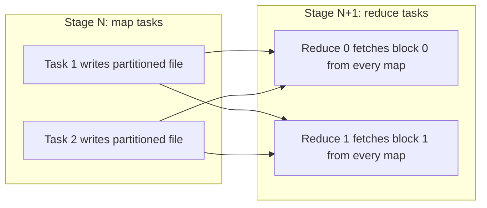

## 🎯 TL;DR

> A **shuffle** moves rows between executors so that all rows with the same key end up in the same partition. It is the most expensive thing Spark does: data is written to disk, sent over the network, and read back. Almost every performance problem you will debug starts with "how many shuffles, how big, and how many partitions?"

- Shuffles come from `groupBy`, `join` (non-broadcast), `distinct`, window functions with `PARTITION BY`, `orderBy`, and `repartition`.
- The number of shuffle partitions (`spark.sql.shuffle.partitions`) decides how big each reduce task is. Aim for partitions of roughly 128–256 MB.
- `coalesce` reduces partitions without a shuffle. `repartition` always shuffles, but it spreads data evenly. `partitionBy` on write creates folders, not memory partitions.

## 🌱 Start simple (Junior)

> **💡 Analogy:** A post office sorting room. Letters arrive from many trucks (map tasks), mixed together. Each letter must go to the bin for its postcode (the key). Workers take letters from their own truck and drop each one into a bin, which means a sorting bench with a bin per postcode. Then a second team collects everything in one bin and delivers it. Moving letters between benches is the shuffle.

```python
from pyspark.sql import functions as F

sales = spark.read.parquet("s3a://sales/2026/")
per_customer = sales.groupBy("customer_id").agg(F.sum("amount").alias("total"))
```

To compute a sum per customer, Spark must bring **every** row of customer 42 to **one** task, even if those rows were read by 200 different tasks. That movement is the shuffle. A `filter` or `select` does not need it, because each row can be processed where it lives.

## 🔧 How it really works (Mid)

A shuffle has two sides, separated by a stage boundary (see [[shuffle]] for the general idea and the architecture lesson for stages).

1. **Map side**: each map task partitions its output by the target reduce partition (computed from the key with a hash or a range) and writes it to **local disk**. With the sort-based shuffle (the default for years), each map task writes one data file and one index file, sorted by reduce partition. Buffers that do not fit in memory are **spilled** to disk and merged later.
2. **Reduce side**: each reduce task asks every executor that holds its blocks for them over the network, then merges and processes them.



**Partition count.** A DataFrame shuffle produces `spark.sql.shuffle.partitions` reduce partitions (default 200). RDD operations use `spark.default.parallelism` unless you pass a count. Both are fixed numbers, so they do not scale with the data. That is why they often go wrong.

**Sizing arithmetic.** Suppose a stage shuffles 300 GB:

- With 200 partitions: 300 GB / 200 = 1.5 GB per reduce task. Each task spills, runs for a long time, and risks an executor OOM.
- Target 200 MB per partition: 300 × 1024 MB / 200 MB ≈ 1,536 partitions.

Rule of thumb: keep partitions roughly 128–256 MB. Adaptive query execution (AQE, see the AQE lesson) can merge small post-shuffle partitions at runtime, which lets you start with a high count and let Spark shrink it.

**Spill.** When execution memory is not enough for a sort or aggregation, Spark writes sorted runs to disk and merges them. The Spark UI shows **Shuffle spill (memory)** and **Shuffle spill (disk)** per stage. Spill is not always a bug, but heavy spill on every task means partitions are too big.

**Repartition vs coalesce vs partitionBy**

| Operation | Shuffle? | Can increase count? | Even distribution? | Typical use |
|---|---|---|---|---|
| `repartition(n)` | Yes | Yes | Yes (round-robin) | Fix skewed or too few partitions |
| `repartition(col)` | Yes | Yes | Depends on key distribution | Co-locate rows by key before a write |
| `coalesce(n)` | No | No | Often not | Shrink the count before a small write |
| `partitionBy("dt")` (on write) | No (write layout) | n/a | n/a | Folder per value for partition pruning on read |

Example of the classic pattern for daily data:

```python
(sales.repartition("dt")          # one shuffle: all rows for a day land in the same task
      .write.partitionBy("dt")    # one folder per day
      .mode("overwrite")
      .parquet("s3a://lake/sales_daily/"))
```

Without `repartition("dt")`, each task writes its own file for every day it contains. With 200 tasks and 365 days, you can get up to 200 × 365 = 73,000 small files. With `repartition("dt")`, each day usually goes to one task, which gives about one file per day.

**Where shuffles appear in SQL.** `GROUP BY`, `JOIN` (sort-merge or shuffled hash), `DISTINCT`, window functions with `PARTITION BY`, `ORDER BY` on a large dataset (range partitioning, after sampling), and `UNION` followed by a dedup. `EXPLAIN` shows them as `Exchange` nodes, for example `Exchange hashpartitioning(customer_id, 200)`.

## 🧠 Senior depth & trade-offs

- **External shuffle service.** Shuffle files live on the executor's disk. If the executor leaves (for example, under dynamic allocation), the files are lost. An external shuffle service, a per-node process that serves the files, keeps them available. Shuffle tracking (Spark 3.x) keeps an executor alive while its shuffle data is still needed. Without one of these, scaling in can force earlier stages to recompute.
- **Push-based shuffle.** In recent Spark versions, mappers can push merged blocks toward reducers, which turns many small random reads into fewer larger ones. It is mainly supported on YARN and is version-dependent; check the docs for your release before relying on it.
- **Skew.** A shuffle is only as fast as its slowest reduce task. If one key has 60% of the rows, one task processes most of the data and the stage waits for it. Diagnose with the task-duration distribution in the Spark UI. Fixes: AQE skew handling for joins, salting the key (add a random suffix, aggregate twice), or handling the hot key separately. See [[data-skew]].
- **Compression and serialization** reduce shuffle bytes. Columnar, compact formats and fewer columns in the shuffle (column pruning before the shuffle) matter more than tuning in most real jobs.
- **Fewer shuffles.** Order matters: filter and project before a shuffle, combine aggregations on the same key, and use broadcast joins when one side is small (no shuffle for the big side). Reusing one shuffled DataFrame with `cache()` avoids repeating the shuffle, at the cost of memory.
- **Failure mode.** A lost shuffle block shows up as `FetchFailedException`. Spark retries by recomputing the map stage. A job that fails repeatedly at the same stage is often a hot executor, a disk problem, or too much spill.
- **Monitoring.** Watch shuffle read and write bytes per stage, the spill columns, and the gap between the fastest and slowest task. Those three numbers answer most shuffle questions.

## 🧪 Try it

1. A stage shuffles 300 GB and runs with the default partition count. Compute the average size per reduce task, and the partition count for a 200 MB target.
2. A colleague writes `result.coalesce(1).write.parquet(path)` on a 10 TB job and it runs for hours on one executor. Explain why, and propose a fix.
3. Compare two writes: `df.write.partitionBy("dt").parquet(p)` and `df.repartition("dt").write.partitionBy("dt").parquet(p)`. For 200 tasks and 365 days, estimate the file counts and explain the difference.

<details><summary>Show solutions</summary>

**1.** With the default 200 partitions, 300 GB / 200 = 1.5 GB per reduce task. For a 200 MB target: 300 × 1024 MB / 200 MB = 307,200 / 200 = 1,536 partitions. In practice, check the actual shuffle sizes in the Spark UI and adjust, or let AQE coalesce.

**2.** `coalesce(1)` does not shuffle, so it is a **narrow** operation. The upstream work (scan, filters, joins, aggregations that come before the `coalesce`) is folded into fewer tasks, and the final write runs in a single task. The whole 10 TB goes through one executor. Fix: keep the natural parallelism, then reduce partitions after the data is small (for example, after an aggregation), or use `repartition(n)` with a count sized to the output.

**3.** Without `repartition`, every task holds rows from many days, and each task writes a file for each day it contains: about 200 × 365 = 73,000 files in the worst case. With `repartition("dt")`, rows are hashed by `dt`, so each day mostly lands in one task, giving about 365 files. The shuffle costs time, but it prevents the small-file explosion that slows every later read.

</details>

## 💬 Interview corner

**Question: "What is a shuffle, and when does it happen?"** Mid answer: "It moves data between executors so keys can be grouped; it happens with `groupBy` and `join`." Senior answer: "It is a two-sided exchange: map tasks write partitioned files to local disk, reduce tasks fetch their blocks over the network. It is triggered by wide dependencies. I first count how many shuffles a query has, then look at the bytes and the partition size, not only the duration."

**Question: "How do you choose the number of shuffle partitions?"** Mid: "I set `spark.sql.shuffle.partitions` to something like 400 for a big job." Senior: "I start from the shuffle size and a target partition size around 128–256 MB, then check the spill and the task duration distribution. With AQE I can start higher and let Spark coalesce. I never treat the default 200 as a correct answer for every job."

**Question: "repartition or coalesce?"** Mid: "Repartition shuffles, coalesce doesn't." Senior adds: "`coalesce` can be unbalanced and it pushes upstream work into fewer tasks, so it is for shrinking a small result. `repartition` is for balancing, or for co-locating a key before a write."

> **🎤 Say this in the interview:** "A shuffle moves data by key across the network through local disk. I count shuffles first, size partitions to about 128–256 MB, and watch spill and task-time skew in the UI. For writes, I repartition by the partition column so that one folder gets one or few files."

## ⚠️ Common mistakes

> **⚠️ Watch out:** `coalesce(1)` before a write. It is a narrow operation, so the whole upstream computation runs in one task.

> **⚠️ Watch out:** Keeping `spark.sql.shuffle.partitions = 200` for every job. It is far too low for 1 TB and far too high for 1 GB.

- Using `partitionBy` on write with a high-cardinality column (user ID) and expecting a few files. You get one folder per value.
- Forgetting that a join on a skewed key runs one slow task, even with plenty of executors.
- Calling `distinct()` or `groupBy` on the full table when a `filter` or a pre-aggregation would shrink the data first.
- Treating a shuffle as free because the query looks like SQL. Check the `Exchange` nodes in the plan.
- Assuming that more executors always fix a shuffle. More partitions, better balance and less spill help more.

## ✅ Check yourself (quiz)

1. Which operation does **not** cause a shuffle?
   - A) `groupBy().agg()`
   - B) `repartition("customer_id")`
   - C) `filter`
   - D) `join` between two large tables without broadcast

<details><summary>Answer</summary>

**C** — `filter` is narrow: each row is checked where it lives. The other three move rows by key.

</details>

2. What does `coalesce(n)` do compared with `repartition(n)`?
   - A) It shuffles evenly, `repartition` does not
   - B) It avoids a shuffle and can only decrease partitions; it may leave them uneven
   - C) It always increases partitions
   - D) It writes files, `repartition` does not

<details><summary>Answer</summary>

**B** — `coalesce` merges existing partitions without a shuffle, so it cannot increase the count and can produce uneven sizes. `repartition` always shuffles and balances the data.

</details>

3. A 300 GB shuffle uses the default 200 partitions. What is the approximate size per reduce task, and what is the likely symptom?
   - A) 15 MB; the job is too fast
   - B) 1.5 GB; heavy spill and long tasks, risking executor OOM
   - C) 300 GB; Spark runs one task
   - D) 2 GB; no symptom

<details><summary>Answer</summary>

**B** — 300 GB / 200 = 1.5 GB per task. That is far above the 128–256 MB guideline, so the tasks spill and run slowly, and some may run out of memory.

</details>

4. **(Senior)** A stage where 199 tasks finish in 30 seconds keeps running for 40 minutes on one task. What is the most likely cause, and what do you do?
   - A) The driver is slow; add memory to the driver
   - B) Data skew: one key holds most rows; diagnose the hot key, then use AQE skew handling for joins, salt the key, or handle the hot key separately
   - C) Too many shuffle partitions; reduce them to 1
   - D) The external shuffle service is down

<details><summary>Answer</summary>

**B** — a single slow task among many is the classic signature of skew. Find the key with the most rows, then choose a fix that matches the operation (AQE for joins, salting for aggregations, or a separate path for the hot key).

</details>

5. **(Senior)** Dynamic allocation scales executors in aggressively, and after scale-in a job repeatedly recomputes earlier map stages. What is the most likely cause, and what is the fix?
   - A) The Parquet files are corrupt; rewrite them
   - B) Shuffle files were on removed executors and no external shuffle service or shuffle tracking was keeping them; enable one of these
   - C) The partition count is too high; set it to 1
   - D) Caching is disabled; enable it

<details><summary>Answer</summary>

**B** — shuffle output is stored on the executor's local disk. When that executor leaves, the output goes with it unless an external shuffle service or shuffle tracking keeps it available, and Spark then recomputes the map stage.

</details>

## 🗂️ Flashcards

| Front | Back |
|---|---|
| What is a shuffle? | Moving rows between executors so rows with the same key share a partition, through local disk and the network |
| Which operations shuffle? | `groupBy`, non-broadcast `join`, `distinct`, `PARTITION BY` windows, `orderBy` on large data, `repartition` |
| Default `spark.sql.shuffle.partitions` | 200 (fixed, not data-aware, so tune or let AQE coalesce) |
| Target partition size | Roughly 128–256 MB |
| `repartition` vs `coalesce` | `repartition` shuffles and balances; `coalesce` only reduces, without a shuffle, and can be uneven |
| What does `partitionBy` create? | Folders per value on storage (partition pruning on read), not in-memory partitions |
| What does an external shuffle service do? | Serves shuffle files after the executor that wrote them is gone |
| How to spot spill | Shuffle spill (memory) and (disk) columns in the Spark UI stage page |

## 🔗 Go further

- **spark-architecture** shows where shuffles sit between stages and tasks.
- **spark-catalyst** explains the `Exchange` nodes and how the optimizer adds or removes shuffles.
- **spark-aqe** covers runtime coalescing and skew handling.
- **spark-joins-skew** goes deeper into join strategies and hot keys.
- **spark-writes** and **small-files** explain how partition layout turns into file counts.
- **spark-memory-tuning** covers spill and executor memory.
