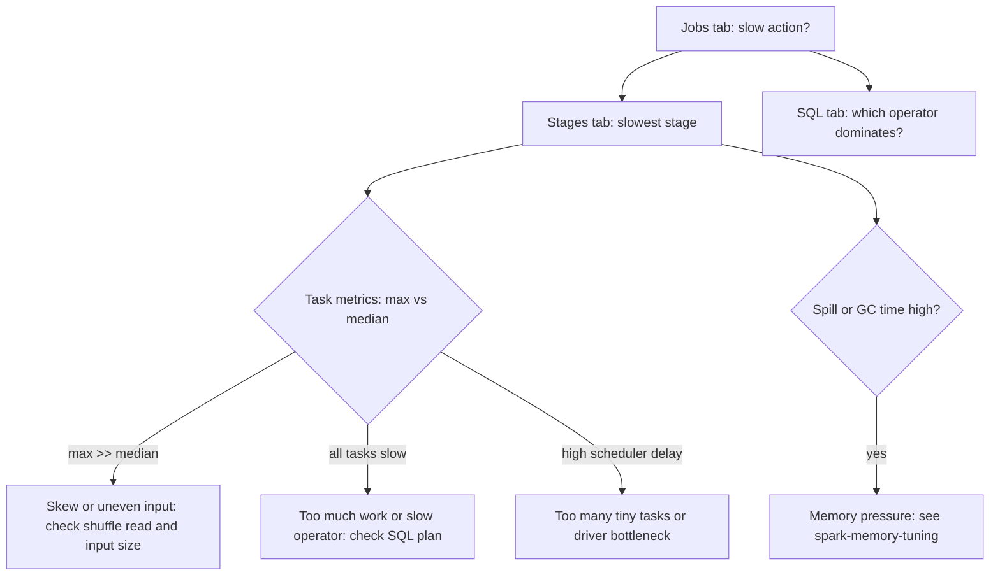

## 🎯 TL;DR

> Debugging a slow Spark job is a funnel: **which job**, then **which stage**, then **which task pattern**, then **which operator**. Each step narrows the cause, and each fix is verified by the same metrics.

- **Jobs** tab: which action was slow and how long each job took.
- **Stages** tab: which stage, and the **min / median / max** of its tasks. The spread tells you whether the problem is data or cluster.
- **SQL** tab: the physical plan for a DataFrame query, with rows and time per operator.
- **Executors** tab: GC time, spill, failed tasks and memory per executor.
- Compare the **median** and the **max** task. A large gap means skew. Equal slow tasks mean too little work per task or a slow operator.

## 🌱 Start simple (Junior)

> **💡 Analogy:** The Spark UI is the dashboard of a car. The speedometer (Jobs) tells you the job is slow. The engine temperature (GC) and the fuel gauge (spill) tell you why. You do not open the engine before you read the dashboard.

Here is a typical slow job:

```python
orders = spark.read.parquet("s3://bucket/orders/")
customers = spark.read.parquet("s3://bucket/customers/")
report = (orders.join(customers, "customer_id")
               .groupBy("country").agg(F.sum("amount").alias("revenue")))
report.write.mode("overwrite").parquet("s3://bucket/report/")
```

It takes 40 minutes. Where do you start? Open the UI at `http://<driver>:4040` (or the History Server after the job ends) and go to **Jobs**. The job that ends with `parquet` at the bottom is the write. The job with the `join` is the expensive one. You now know which part of the code to study.

Do not start by changing configuration. Start by finding the slowest **stage** in that job, then look at what that stage does.

## 🔧 How it really works (Mid)

A Spark **job** is one action (`write`, `count`, `collect`). A job is split into **stages** at each shuffle boundary. A stage runs many **tasks**, one per partition. Each task reports metrics. The UI aggregates them.



**Stage page: the summary metrics table.** This is where most diagnoses start. For each metric it shows Min, 25th percentile, Median, 75th percentile and Max:

- **Duration** and **Scheduler Delay**: time waiting to start. High delay means the driver or the scheduler is overloaded, or there are too many tiny tasks.
- **GC Time**: time in garbage collection. Above roughly 10 % of task time is a warning.
- **Input** and **Shuffle Read**: data read. A wide spread here is the signature of skew or of uneven file sizes.
- **Shuffle Write** and **Spill (memory / disk)**: data written and spilled. Spill means an operator did not fit in memory.

**SQL tab.** For DataFrame and SQL queries, each query shows its physical plan. Each operator (`Scan parquet`, `Exchange`, `SortMergeJoin`, `HashAggregate`) has metrics such as number of output rows and time. With Adaptive Query Execution, the plan shows the **final** plan after runtime changes, which is what actually ran. An `Exchange` is a shuffle; count them. Two `Exchange` nodes before a join usually mean two full shuffles.

**Executors tab.** Lists each executor with active and failed tasks, storage memory, shuffle read and write, task time, and GC time. A single executor with many failed tasks or a much higher GC time than the others is a hardware or memory outlier, not a data problem.

**Event logs and History Server.** The live UI disappears when the application ends. To look at it later, enable event logs (`spark.eventLog.enabled=true` and a `spark.eventLog.dir` on shared storage) and run the History Server. Production jobs should always write event logs; without them you cannot debug yesterday's slow run.

## 🧠 Senior depth & trade-offs

- **Read the spread, not the average.** A stage with a median of 20 seconds and a max of 45 minutes is one problem. A stage with median and max both at 3 minutes is a different problem: too little parallelism or an expensive operator.
- **Find the operator before you change the code.** Match the slow stage to its SQL node. A stage that reads shuffle data and ends with a `SortMergeJoin` is a join problem; a stage that starts with `Scan` and has thousands of tiny input partitions is a small-files problem (see the **small-files** topic).
- **Input skew vs shuffle skew.** Input skew (one scan task reads much more) usually means one huge file or many tiny ones. Shuffle skew (one reduce task reads much more) usually means a hot key. The fixes are different: see **spark-joins-skew**.
- **Speculative execution hides symptoms.** `spark.speculation` re-runs slow tasks. It can make a job finish while hiding a skew problem, and it can double writes if the output is not idempotent. Investigate the slow task before you turn speculation on.
- **Job-level vs cluster-level bottlenecks.** A driver that spends 30 % of wall time in planning (many small files, deeply nested plans, many `withColumn` calls) looks like a slow job, but no executor is busy. The stage timeline shows gaps between stages.
- **Monitoring at scale.** Export metrics (Spark's metrics system or the event log) to your monitoring stack and alert on stage duration and the max/median ratio. Do not rely on someone opening the UI.
- **When not to use the UI.** For a repeated job, the UI is a one-off microscope. Build a regression check on total job time, shuffle volume and spill from the event log, so a bad change is caught in CI or in the first run.

## 🧪 Try it

Use the job above, or any Spark job you can run locally (`spark-submit` in `local[*]` mode works, but skew and GC only show at scale).

1. Enable event logs in `spark-defaults.conf`:

```text
spark.eventLog.enabled           true
spark.eventLog.dir               file:///tmp/spark-events
spark.history.fs.logDirectory    file:///tmp/spark-events
```

Run a job, then start the History Server and open it at port 18080.

2. Given this summary for the slowest stage, name the problem:

| Metric | Min | Median | Max |
|---|---|---|---|
| Duration | 8 s | 11 s | 52 min |
| Shuffle Read | 120 MB | 130 MB | 38 GB |
| GC Time | 0.2 s | 0.4 s | 1.1 s |
| Spill (disk) | 0 | 0 | 0 |

3. The same job, but now: Duration min 5 s, median 6 s, max 9 s; Scheduler Delay median 4 s; 40 000 tasks. What is the problem and what would you change?

<details><summary>Show solutions</summary>

**1.** The History Server shows completed applications with their Jobs, Stages and SQL tabs. If the page is empty, check that the application wrote to the same `spark.eventLog.dir` and that the History Server reads the same path.

**2.** A classic hot key. Median and minimum tasks read about 130 MB, but one task reads 38 GB and runs 52 minutes. There is no GC or spill signal, so memory is not the cause. Check the join or aggregation key for a dominant value, then use AQE skew handling, salting or isolating the hot key (see **spark-joins-skew**).

**3.** Each task runs about 6 seconds, but scheduler delay is 4 seconds, which is most of the time. The cost is task overhead: 40 000 tiny tasks. Fix: reduce the partition count (coalesce, or fewer shuffle partitions via AQE coalescing), or compact small input files. More executors would not help; the driver is handling too many tasks.

</details>

## 💬 Interview corner

**Question: "A Spark job is slow. How do you optimize it?"**

- Mid answer: "I'd open the Spark UI, find the slowest stage, and look at the shuffle and the SQL plan. Then I'd tune partitions and memory."
- Senior answer: "I'd start with the baseline: total time, input size and the SLA. Then I'd go Jobs, Stages, SQL. In the stage I compare median and max task metrics to tell skew from uniform slowness, and check spill, GC and scheduler delay. I'd map the slow stage to its operator in the SQL plan and fix that operator's cause. Then I'd rerun and compare the same metrics, and add an event-log based regression check so the win stays."

**Question: "What does a big gap between median and max task time mean?"**

It means skew or uneven input. I check the shuffle read or input size per task, find the hot key or the oversized file, and fix that. I do not add executors, because the one slow task is still alone.

> **🎤 Say this in the interview:** "I debug Spark from the outside in. Job, then stage, then the spread of task metrics, then the operator in the SQL plan. The median-to-max ratio tells me whether I have a data problem or a resource problem before I change any config."

## ⚠️ Common mistakes

> **⚠️ Watch out:** Reading only the average task time. One huge task hides inside a healthy-looking average.

> **⚠️ Watch out:** Changing many configs at once. You cannot tell which change helped. Change one thing, rerun, compare the same metrics.

- Opening the Stages tab without knowing which job is slow.
- Forgetting that the live UI is gone after the application ends. Without event logs you have nothing to read.
- Treating GC time as a problem when it is 1 % of task time.
- Ignoring scheduler delay, which points to the driver or to too many tiny tasks.
- Tuning executors before reading the plan. The fix is often in the query, not the cluster.

## ✅ Check yourself (quiz)

1. In a stage's task metrics, median shuffle read is 100 MB and max is 20 GB. What is the most likely cause?
   - A) GC pressure on every executor
   - B) Skew on the key of the operator that reads this shuffle
   - C) Too many executors
   - D) A slow network for all tasks

<details><summary>Answer</summary>

**B** — a single task reading far more shuffle data than the median is a hot key or uneven partitioning. Uniform slowness would show a high median, not a huge max.

</details>

2. Where do you look to see whether a join is done with two shuffles or with a broadcast?
   - A) Environment tab
   - B) Storage tab
   - C) SQL tab, in the physical plan (look for `Exchange` nodes and the join operator)
   - D) Executors tab

<details><summary>Answer</summary>

**C** — the SQL tab shows the operators. A `SortMergeJoin` with `Exchange` nodes on both sides is two shuffles; a `BroadcastHashJoin` has no shuffle on the big side.

</details>

3. The live UI is gone after a nightly job finished, and you need to explain yesterday's slow run. What was missing?
   - A) A larger driver memory
   - B) Event logs written to shared storage, read by the History Server
   - C) A broadcast of the driver
   - D) Dynamic allocation

<details><summary>Answer</summary>

**B** — the live UI only exists while the application runs. Event logs persisted to durable storage let the History Server reproduce the tabs after the fact.

</details>

4. **(Senior)** The stage has 40 000 tasks, each about 6 seconds, and median scheduler delay is 4 seconds. What is the bottleneck and the trade-off of your fix?

   - A) The executors are too small; add memory
   - B) Task overhead dominates; reduce partitions or compact input, accepting less parallelism per task
   - C) The join is broadcast; switch to sort-merge
   - D) GC is too high; add cores

<details><summary>Answer</summary>

**B** — scheduling many tiny tasks costs more than the work in them. Fewer, larger partitions cut overhead, but each task does more work, so the trade-off is parallelism versus overhead. Measure both.

</details>

5. **(Senior)** Why can speculative execution hide a real problem?

   - A) It disables the event log
   - B) It re-runs slow tasks on other executors, so the job can finish while the skewed partition is still the root cause; it can also duplicate non-idempotent writes
   - C) It removes the stage summary metrics
   - D) It forces broadcast joins

<details><summary>Answer</summary>

**B** — speculation hides the symptom by retrying stragglers. The skew stays in the data. If the output is not idempotent, a speculative copy can produce duplicate writes, so check the write path before enabling it.

</details>

## 🗂️ Flashcards

| Front | Back |
|---|---|
| Where to start debugging | Jobs tab: find the slow action, then the slow stage |
| Median vs max task time | Large gap means skew or uneven input; uniform slowness means too much work or a slow operator |
| Scheduler delay high | Driver bottleneck or too many tiny tasks |
| Spill (disk) in the stage page | An operator did not fit in memory and wrote to disk |
| Where to see the real join strategy | SQL tab, physical plan (final plan with AQE) |
| `Exchange` in a plan | A shuffle; each one is a stage boundary with data movement |
| Why event logs matter | The live UI disappears after the application ends |
| Speculation risk | It can hide skew and duplicate non-idempotent writes |

## 🔗 Go further

- **spark-joins-skew** covers the fixes once you have found a hot key.
- **spark-memory-tuning** covers spill, GC and OOM in depth.
- **spark-aqe** explains why the SQL tab shows a final plan that differs from the initial one.
- **spark-writes** and **small-files** cover the output and input patterns that show up as many tiny tasks.
