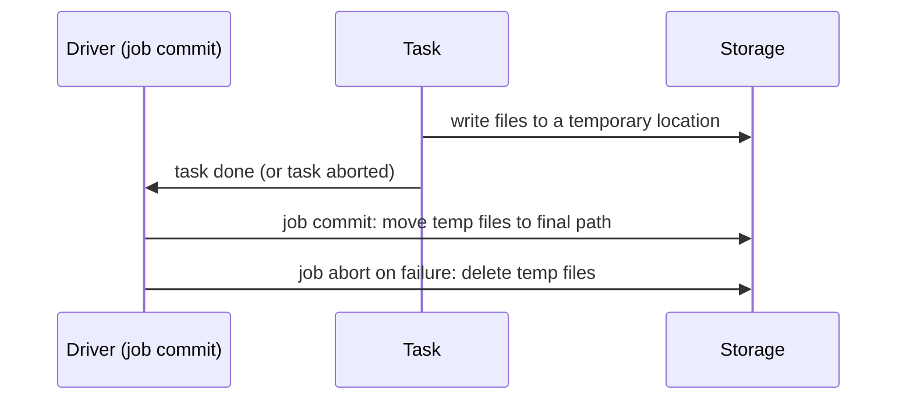

## 🎯 TL;DR

> A Spark write is **not one action**. It is many tasks writing temporary files, then a **commit** that makes some of them visible. Reliability depends on what happens when a task or the whole job fails between those steps.

- The **save mode** decides what existing data is kept: `append`, `overwrite`, `errorifexists`, `ignore`.
- A **commit protocol** decides how temporary output becomes final. On HDFS a rename is cheap and close to atomic; on S3 it is a copy plus a delete, so the protocol matters much more.
- An **idempotent** write gives the same result if it runs twice. Overwriting a partition is idempotent; a plain append is not.
- Table formats (Delta, Iceberg, Hudi) move the commit into a metadata log, which gives atomic visibility.

## 🌱 Start simple (Junior)

> **💡 Analogy:** Think of a restaurant kitchen. The cooks prepare the dishes in the back room (temporary files). Only when the waiter carries the plate to the table (the commit) does the customer see it. If the kitchen burns down halfway, you do not want half a dish on the table.

Here is the simplest write:

```python
df = spark.read.parquet("s3a://raw/orders/2026-10-12/")
df.write.mode("append").parquet("s3a://curated/orders/")
```

Three questions decide whether this is safe:

1. **What happens to existing rows?** `append` keeps them and adds new ones. `overwrite` removes what it is replacing first.
2. **What if the job fails halfway?** Some files may exist, some may not. Will readers see partial data?
3. **What if I run it again?** Will the rows appear twice?

The rest of this lesson is about these three questions.

## 🔧 How it really works (Mid)

### Save modes

| Mode | What it does | Re-run safe? |
|---|---|---|
| `append` | Adds new files next to existing ones | No, it duplicates rows |
| `overwrite` | Deletes the target, then writes | Yes, but deletes everything (see below) |
| `errorifexists` (default) | Fails if the path exists | Safe, but needs manual cleanup |
| `ignore` | Does nothing if the path exists | Silently skips data, which is risky |

**Overwrite has a trap with partitions.** In the default static mode, `overwrite` on a partitioned table replaces **the whole table**, not only the partitions in your DataFrame. To replace only the partitions that appear in the new data, set dynamic mode:

```python
spark.conf.set("spark.sql.sources.partitionOverwriteMode", "dynamic")

(df.write
   .mode("overwrite")
   .partitionBy("dt")
   .parquet("s3a://curated/orders/"))
```

With dynamic mode, a partition `dt=2026-10-12` is rewritten only if the DataFrame has rows for it. Other partitions stay. Table formats expose the same idea through `overwritePartitions()` (DataFrameWriterV2) and `replaceWhere`-style options. Check the docs for your Spark and table-format versions for the exact API.

### The commit protocol

Spark writes through a Hadoop **output committer**. A simple version works like this:



- **On HDFS**, the temporary folder is renamed into place. A rename is a metadata operation, so commit is quick, and the file-level commit is close to atomic.
- **On S3**, there is no real rename. "Rename" means **copy each object, then delete the original**. A directory of 10,000 files is 10,000 copies, and a failure in the middle leaves the output half-moved. The old default committers are known to be slow and not safe here.

The fix is an S3-aware committer. The Hadoop S3A **magic committer** writes each file as a pending multipart upload. Nothing is visible until the job commits, and the commit completes the uploads in one step. A typical configuration (check your Hadoop and vendor docs, because EMR and Databricks ship their own committers):

```text
fs.s3a.committer.name=magic
fs.s3a.committer.magic.enabled=true
```

Other S3A committers (`directory`, `partitioned`) are staging-based and suit different write patterns. Pick the one your platform documents.

### Idempotent writes

A write is **idempotent** if running it twice gives the same final state as running it once. Four practical patterns:

1. **Overwrite the partition** that the run owns (dynamic overwrite). A re-run replaces the same partition.
2. **Stage, then swap.** Write to `tmp/run_id=<uuid>/`, check row counts, then move or register the result in one metadata operation.
3. **MERGE on a key** with a table format. `MERGE INTO target USING source ON key ...` updates existing keys and inserts new ones.
4. **Deduplicate on a unique key** if the sink is append-only and the source can repeat rows (see [[dedup-idempotent-loads]]).

### Bucketing

`bucketBy(n, col)` hashes rows into `n` fixed buckets stored with the table, so later joins on `col` can skip a shuffle. It works with `saveAsTable`, which needs a catalog, not with a plain `path` write:

```python
(df.write
   .bucketBy(64, "customer_id")
   .sortBy("customer_id")
   .mode("overwrite")
   .saveAsTable("curated.orders_bucketed"))
```

Bucketing is most useful for repeated large joins on the same key. Choose `n` carefully, because it is fixed once written.

### Other sinks

- **JDBC (PostgreSQL, MySQL, Oracle).** Each task opens a connection and inserts in batches. A failure in the middle leaves some rows committed. Write to a staging table, then move the rows in one database transaction, or use `MERGE`.
- **Kafka.** Requires `key` and `value` columns (or they are serialized from the whole row). Delivery is at-least-once by default; exactly-once needs the idempotent or transactional producer settings and a consumer that can handle duplicates. See [[exactly-once]].
- **StarRocks and other OLAP stores.** Use the vendor's Spark connector, which loads in batches (often through the store's HTTP bulk-load API). Check whether the connector offers transactional or label-based loads, which give you a way to retry without duplicates.

## 🧠 Senior depth & trade-offs

- **Speculative execution and duplicate attempts.** With speculation on, two attempts of one task can write output. The committer must make only one visible. This is another reason to avoid naive writers on object stores.
- **Partial-failure cleanup.** After a failed job, temporary files and multipart uploads can stay behind and cost money. Configure cleanup (for example, the S3A pending-upload abort settings) and run periodic checks for orphaned uploads.
- **Table-format atomic commits.** Delta, Iceberg and Hudi write data files first, then commit a new snapshot or log entry in one atomic metadata update. Readers see the old snapshot or the new one, never a mix. This solves most partial-write issues, but it adds metadata that must be maintained (see [[small-files]] and snapshot expiry).
- **Commit cost versus file count.** Many small output files make the commit slow on S3 (more objects to complete) and make later reads slow. Control partition count before the write, not after.
- **Concurrency.** Two Spark jobs writing the same path with plain Parquet can corrupt each other's output. Use table formats with optimistic concurrency or separate paths per job.
- **When not to write from Spark directly.** For low-latency row-level updates into an OLTP database, a Spark batch is the wrong tool. Use CDC or an application-level outbox instead.
- **Monitoring.** Track rows written versus rows read, output file count and bytes, commit duration, and the number of failed or aborted attempts. A mismatch between read and written rows is an early warning of a filter or join bug.

## 🧪 Try it

Use a local Spark session (3.x or later) and local folders. Object-store behaviour is different, so for the S3 parts, read the docs instead of testing locally.

1. Write 1,000 rows with `dt` values for 3 dates to `out/orders` with `mode("append")`. Run the same code again. How many rows are there now? Then switch to `mode("overwrite")` with `partitionOverwriteMode=dynamic` and run it again on a DataFrame that only has one `dt`. Which partitions survive?
2. Explain in two sentences why `mode("overwrite")` without dynamic mode is dangerous for a daily job that only has today's data.
3. Design: a daily job loads a JDBC table from Spark. It fails at 70% of the rows. Describe a load plan that can be re-run safely.

<details><summary>Show solutions</summary>

**1.** After the first append you have N rows. After the second run you have 2N rows, because append does not check for existing data. With dynamic overwrite, only the `dt` in the new DataFrame is replaced; the other two dates stay. This is the test that proves the setting works.

**2.** Static overwrite replaces the whole table, so a job with only today's rows would delete all history. Dynamic overwrite replaces only the partitions present in the new data.

**3.** Write the 70%-failed run to a staging table (or a `run_id` column). The target is not touched until the staging load is complete and counted. Then use one database transaction to delete or merge the target partition and insert from staging. A re-run truncates the staging table first, so the result is the same either way.

</details>

## 💬 Interview corner

**Question: "Your Spark job writes to S3 and sometimes leaves partial output. Why, and how do you fix it?"**

- **Mid answer:** "The output committer on S3 is a copy and delete, so a failure in the middle leaves a mix. I'd use the S3A magic committer and make the job idempotent by overwriting only its partitions."
- **Senior answer:** "The root cause is that S3 has no atomic rename, so the default committer can leave half-moved output and it is slow. I'd use an S3-aware committer for plain files, but for anything shared I'd prefer a table format, which commits a snapshot atomically. Then I make the job re-runnable: dynamic overwrite of the owned partitions, or stage and swap. I'd also alert on orphaned multipart uploads, because they cost money."

**Question: "How do you get exactly-once output from Spark?"** Answer with idempotence first: exactly-once in effect means an idempotent sink (MERGE on a key, or overwrite of an owned partition) plus atomic commits. Spark's own guarantees apply inside the job; the sink must provide the rest.

> **🎤 Say this in the interview:** "A Spark write is safe when the commit is atomic and the job is idempotent. On S3 the first needs a proper committer or a table format, and the second needs overwrite of owned partitions or MERGE on a key."

## ⚠️ Common mistakes

> **⚠️ Watch out:** `mode("overwrite")` on a partitioned table without `partitionOverwriteMode=dynamic` deletes every partition, not just the ones you wrote.

> **⚠️ Watch out:** Appending in a retry loop duplicates rows. Retrying a job is only safe if the write is idempotent.

- Assuming a rename on S3 is atomic or cheap.
- Using `bucketBy` with `save("path")`. It needs `saveAsTable`.
- Thinking Kafka writes from Spark are exactly-once by default.
- Writing JDBC batches straight into a production table without staging, then being surprised by partial loads.
- Ignoring leftover temporary files and multipart uploads after failures.
- Choosing the number of output partitions without looking at file sizes (see [[small-files]]).

## ✅ Check yourself (quiz)

1. A daily job uses `mode("overwrite")` on a table partitioned by `dt`, and the DataFrame holds only today's partition. What happens in the default static mode?
   - A) Only today's partition is replaced.
   - B) The whole table is replaced, and history is lost.
   - C) The write fails with an error.
   - D) Duplicate rows are appended.

2. Why does the default file committer perform poorly and carry risk on S3?
   - A) S3 does not support Parquet.
   - B) A "rename" is a copy plus a delete, which is slow and not atomic.
   - C) S3 cannot store more than one file per folder.
   - D) Spark cannot write to S3 at all.

3. Which pattern makes a daily write safe to re-run?
   - A) `append` with a timestamp in the file name.
   - B) Dynamic overwrite of the partition the run owns.
   - C) `coalesce(1)` before writing.
   - D) Increasing `spark.sql.shuffle.partitions`.

4. **Senior:** A JDBC load of 10 million rows fails at row 7 million. Why is writing directly to the target table risky, and what is better?
   - A) It is never risky; JDBC is transactional by default in Spark.
   - B) Some batches are committed and others are not, leaving partial data; load to a staging table and move the rows in one transaction, or use MERGE.
   - C) JDBC does not support inserts.
   - D) Only the driver's memory is affected.

5. **Senior:** Why is Kafka a weaker sink than a table format for a Spark job's output?
   - A) Kafka is at-least-once by default, and a re-run can produce duplicates unless the producer and consumer are configured and designed for it.
   - B) Kafka cannot store strings.
   - C) Kafka always deduplicates by offset.
   - D) Spark cannot connect to Kafka.

<details><summary>Answer</summary>

**1 — B.** In static mode, overwrite removes the whole target before writing. Dynamic mode (`partitionOverwriteMode=dynamic`) would replace only `dt` for today, and that is the correct setting for this job.

**2 — B.** S3 has no atomic rename. The committer copies each object and deletes the original, so it is slow and can leave half-moved output after a failure.

**3 — B.** Overwriting the owned partition gives the same result on every run. Append (A) duplicates rows, coalesce (C) changes only the file count, and shuffle partitions (D) do not affect idempotence.

**4 — B.** Batches commit independently, so a failure leaves partial data. A staging table plus one transaction (or a MERGE) keeps the target consistent, and a re-run can start from scratch.

**5 — A.** Kafka sinks in Spark are at-least-once unless you enable idempotent or transactional producers and handle duplicates downstream. A table format gives atomic snapshot commits with idempotent options like MERGE.

</details>

## 🗂️ Flashcards

| Front | Back |
|---|---|
| What does `append` do on a re-run? | Adds the rows again, so it creates duplicates. It is not idempotent. |
| What is dynamic partition overwrite? | Replaces only the partitions present in the DataFrame; others stay. Set `spark.sql.sources.partitionOverwriteMode=dynamic`. |
| Why is a rename on S3 a problem? | It is a copy plus a delete, so it is slow and not atomic; a failure leaves mixed output. |
| What does the S3A magic committer do? | Writes pending multipart uploads and completes them at job commit, so nothing is visible early. |
| What is an idempotent write? | A write whose repeated run gives the same final state as one run. |
| Why does `bucketBy` need `saveAsTable`? | Bucket metadata must be stored in a catalog table, not only in a path. |
| How do you load a JDBC target safely? | Stage the rows, then move or merge them to the target in one transaction. |
| What does a table format add to a Spark write? | Atomic snapshot commits, so readers never see half-written data. |

## 🔗 Go further

- [[small-files]] explains the file-count side of the same writes.
- [[dedup-idempotent-loads]] covers how to make loads safe to re-run.
- [[delivery-semantics]] explains at-least-once, at-most-once and exactly-once.
- [[lakehouse-table-formats]] shows how table formats commit data atomically.
