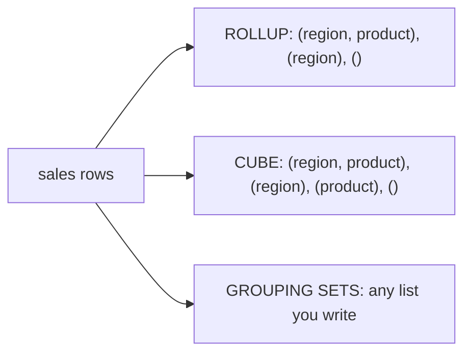

## 🎯 TL;DR

> **GROUPING SETS**, **ROLLUP** and **CUBE** compute several levels of subtotals in **one** query. **Conditional aggregation** (`SUM(CASE WHEN ...)`, or `FILTER`) turns rows into columns. **GROUPING()** tells you which NULLs are real data and which are subtotal markers.

- `GROUP BY ROLLUP (a, b)` gives `(a, b)`, `(a)` and the grand total `()`.
- `GROUP BY CUBE (a, b)` gives every combination: `(a, b)`, `(a)`, `(b)` and `()`.
- `GROUP BY GROUPING SETS ((a), (b))` gives exactly the levels you list, nothing else.
- `FILTER (WHERE ...)` restricts one aggregate; `CASE` does the same in every engine.
- Pivot (rows to columns) is conditional aggregation. Unpivot (columns to rows) is a `UNION ALL` or a `VALUES` join.

## 🌱 Start simple (Junior)

> **💡 Analogy:** A sales report with three levels: each shop, each region, and the whole country. Without these tools you write three queries and paste the numbers together. `ROLLUP` writes the three levels in one pass and marks which row is a subtotal.

We use this small table. Examples are PostgreSQL.

```sql
CREATE TABLE sales (region text, product text, amt int);
INSERT INTO sales VALUES
 ('EU','A',10), ('EU','B',20),
 ('US','A',30), ('US','B',40);
```

A plain `GROUP BY` gives one level:

```sql
SELECT region, product, SUM(amt) AS total
FROM sales
GROUP BY region, product;
```

Four rows, one per (region, product). To add the subtotal per region and the grand total, `ROLLUP` does it in the same query:

```sql
SELECT region, product, SUM(amt) AS total
FROM sales
GROUP BY ROLLUP (region, product);
```

This returns seven rows: the four detail rows, `EU` with `NULL` product (30), `US` with `NULL` product (70), and one row where both are `NULL` (100). Those `NULL`s in the subtotal rows are **markers**, not data. The next sections show how to tell them apart.

## 🔧 How it really works (Mid)

A grouping set is one `GROUP BY` list. The engine computes each set from the same input rows:

| Clause | Grouping sets produced for `(a, b)` | Count |
|---|---|---|
| `GROUP BY a, b` | `(a, b)` | 1 |
| `ROLLUP (a, b)` | `(a, b)`, `(a)`, `()` | n + 1 (hierarchy) |
| `CUBE (a, b)` | `(a, b)`, `(a)`, `(b)`, `()` | 2^n (all combinations) |
| `GROUPING SETS ((a), (b))` | `(a)`, `(b)` | exactly what you list |



**Telling subtotal NULLs from real NULLs.** `GROUPING(col)` returns `1` when the row is a subtotal for that column (the `NULL` is a marker) and `0` when it is a real value. With several columns, `GROUPING(a, b)` returns a bit mask.

```sql
SELECT
  CASE WHEN GROUPING(region) = 1 THEN 'ALL'    ELSE region  END AS region,
  CASE WHEN GROUPING(product) = 1 THEN 'ALL'   ELSE product END AS product,
  SUM(amt) AS total
FROM sales
GROUP BY CUBE (region, product)
ORDER BY region, product;
```

`CUBE` adds `(ALL, A) = 40` and `(ALL, B) = 60`. The label `'ALL'` is safe here, but if the table itself contained a real `NULL` region, `COALESCE(region, 'ALL')` would merge the real NULLs with the subtotals. `GROUPING()` avoids that mistake.

**Explicit sets.** When you need only some levels, `GROUPING SETS` is exact:

```sql
SELECT region, product, SUM(amt) AS total
FROM sales
GROUP BY GROUPING SETS ((region), (product), ());
```

This gives the region totals (30, 70), the product totals (40, 60) and the grand total (100). No detail rows.

**Conditional aggregation: rows to columns.** The portable pivot is `SUM(CASE WHEN ...)`:

```sql
SELECT region,
       SUM(CASE WHEN product = 'A' THEN amt END) AS a_total,
       SUM(CASE WHEN product = 'B' THEN amt END) AS b_total
FROM sales
GROUP BY region
ORDER BY region;
```

`EU 10 20` and `US 30 40`. The `ELSE` is omitted on purpose: a missing combination becomes `NULL`, not `0`, which is usually the honest answer. Use `COALESCE` for display if needed.

**`FILTER`: a cleaner form.** PostgreSQL (and SQLite, DuckDB) let you filter one aggregate directly:

```sql
SELECT region,
       SUM(amt)                       AS total,
       SUM(amt) FILTER (WHERE product = 'A') AS a_only
FROM sales
GROUP BY region;
```

`EU 30 10` and `US 70 30`. Several `FILTER` clauses in one `SELECT` share one scan. Other engines may not support it, so `CASE` is the form to know for any dialect.

**Columns to rows (unpivot).** In PostgreSQL, a `LATERAL VALUES` join turns a wide row into several narrow rows:

```sql
WITH wide AS (
  SELECT region,
         SUM(CASE WHEN product = 'A' THEN amt END) AS a,
         SUM(CASE WHEN product = 'B' THEN amt END) AS b
  FROM sales GROUP BY region
)
SELECT w.region, v.product, v.amt
FROM wide w
CROSS JOIN LATERAL (VALUES ('A', w.a), ('B', w.b)) AS v(product, amt)
ORDER BY w.region, v.product;
```

Result: `EU A 10`, `EU B 20`, `US A 30`, `US B 40`.

## 🧠 Senior depth & trade-offs

- **Cost grows with the number of sets.** `CUBE` over n columns produces 2^n grouping sets. Six dimensions give 64 sets. Engines usually compute all of them from one scan, but they expand each input row once per set (Spark calls this an `Expand` operator), so memory, shuffle and output size multiply. Prefer `ROLLUP` or explicit `GROUPING SETS` for the levels you really need.
- **Pre-aggregate for dashboards.** A `CUBE` over a billion-row fact table on every page load is expensive. Compute it nightly into a summary table, or use a materialized view, and let the BI tool read the small result. See [[materialized-view]] and [[star-schema]].
- **Dynamic pivot is not a single query.** `PIVOT` needs the output column names at compile time. If the categories are dynamic (new products appear daily), either generate the SQL in the orchestrator, or store the data in long form and pivot in the BI layer.
- **Engine support differs.** PostgreSQL, Oracle and Spark SQL support `GROUPING SETS`, `ROLLUP` and `CUBE`. MySQL 8 supports `WITH ROLLUP` only. ClickHouse uses postfix forms such as `WITH ROLLUP` and `WITH CUBE`. StarRocks supports the standard forms. Check the docs for your version before you rely on any of them.
- **PIVOT syntax.** Oracle and Spark SQL have a `PIVOT` clause. In Spark the form is `SELECT * FROM sales PIVOT (SUM(amt) FOR product IN ('A' AS a_total, 'B' AS b_total))`. It is a convenience for the same conditional aggregation shown above.
- **Ordering matters at the top.** Subtotal rows have `NULL` in the grouping columns, so `ORDER BY region` places them with the real `NULL` rows. Always order with `GROUPING()` as a key when you need subtotals last.
- **When not to use it.** If the report needs a running total or a rank within each group, that is a window function, not a grouping set. See [[window-function]].

## 🧪 Try it

Use the `sales` table from the beginning (PostgreSQL 13 or later).

1. Write a single query that returns, for each `product`, its total and the grand total, in one result, with the grand total labelled `'ALL'`.
2. Return one row per region with columns `total`, `a_only` (sum of product A) and `b_only` (sum of product B), using `FILTER`. Then rewrite it with `CASE` only.
3. Add a row to `sales` with `region` = `NULL` and `product` = `'A'`, `amt` = 5. Write a `ROLLUP` query where the real `NULL` region and the subtotal are both visible and distinguishable.

<details><summary>Show solutions</summary>

**1.**
```sql
SELECT
  CASE WHEN GROUPING(product) = 1 THEN 'ALL' ELSE product END AS product,
  SUM(amt) AS total
FROM sales
GROUP BY GROUPING SETS ((product), ())
ORDER BY GROUPING(product), product;
```
Result: `A 40`, `B 60`, `ALL 100`.

**2.**
```sql
-- FILTER
SELECT region,
       SUM(amt) AS total,
       SUM(amt) FILTER (WHERE product = 'A') AS a_only,
       SUM(amt) FILTER (WHERE product = 'B') AS b_only
FROM sales GROUP BY region ORDER BY region;

-- CASE
SELECT region,
       SUM(amt) AS total,
       SUM(CASE WHEN product = 'A' THEN amt END) AS a_only,
       SUM(CASE WHEN product = 'B' THEN amt END) AS b_only
FROM sales GROUP BY region ORDER BY region;
```

**3.**
```sql
INSERT INTO sales VALUES (NULL, 'A', 5);

SELECT
  CASE WHEN GROUPING(region) = 1 THEN 'ALL' ELSE COALESCE(region, '(null)') END AS region,
  SUM(amt) AS total
FROM sales
GROUP BY ROLLUP (region)
ORDER BY GROUPING(region), region;
```
The real `NULL` region shows as `(null)`, with its own total of 5, and the subtotal shows as `ALL`. `GROUPING()` is the only reliable way to tell them apart in the result; a plain `COALESCE(region, 'ALL')` would merge them.

</details>

## 💬 Interview corner

**Question: "Give me sales by region, by product, and the grand total, in one query."** Mid answer: "`GROUP BY ROLLUP (region, product)`." Senior answer: "`ROLLUP` gives the hierarchy I need. I'd label the subtotal rows with `GROUPING()`, not `COALESCE`, because real NULLs in the data would collide. If this runs on every dashboard load, I'd precompute it in a summary table."

**Question: "How do you pivot rows into columns in SQL?"** Mid: "`SUM(CASE WHEN ... THEN ... END)` per column." Senior: "That works in any engine. Native `PIVOT` is shorter, but it needs the column list at compile time. For unknown categories I'd generate the SQL or pivot in the BI layer."

> **🎤 Say this in the interview:** "`ROLLUP` gives me the hierarchy in one scan, and `GROUPING()` tells me which NULLs are subtotals. For pivots I use conditional aggregation, because it is portable, and I think about the cost of `CUBE` before I use it."

## ⚠️ Common mistakes

> **⚠️ Watch out:** `COALESCE(region, 'ALL')` treats a real `NULL` region as a subtotal. Use `GROUPING()` to decide.

> **⚠️ Watch out:** `SUM(CASE WHEN product = 'A' THEN amt ELSE 0 END)` gives `0` for a region with no product A rows, which hides the absence. Without the `ELSE`, you get `NULL`. Pick deliberately.

- Using `CUBE` when `ROLLUP` is enough, which multiplies the output.
- Forgetting that `ROLLUP (a, b)` is not the same as `ROLLUP (b, a)`. The order defines the hierarchy.
- Expecting `FILTER` to work in every engine.
- Writing a `PIVOT` with a fixed column list and expecting new categories to appear automatically.
- Ordering a report with subtotals and getting them mixed into the data rows.

## ✅ Check yourself (quiz)

1. How many grouping sets does `GROUP BY ROLLUP (a, b)` produce?
   - A) 1
   - B) 2
   - C) 3
   - D) 4

<details><summary>Answer</summary>

**C** — `ROLLUP (a, b)` produces `(a, b)`, `(a)` and `()`: a hierarchy of three levels. `CUBE (a, b)` would produce four.

</details>

2. A row has `GROUPING(region) = 1`. What does that tell you?
   - A) The region value is a real `NULL` in the data
   - B) The row is a subtotal, and its `NULL` region is a marker
   - C) The region is in the `FILTER` clause
   - D) The query has an error

<details><summary>Answer</summary>

**B** — `GROUPING()` returns `1` when the column is rolled up in that row. Real data `NULL`s return `0`.

</details>

3. Which expression is the portable way to count only product A sales per region?
   - A) `SUM(amt) FILTER (WHERE product = 'A')`
   - B) `SUM(CASE WHEN product = 'A' THEN amt END)`
   - C) `COUNT(product = 'A')`
   - D) `SUM(amt) WHERE product = 'A'`

<details><summary>Answer</summary>

**B** — `CASE` works in every SQL engine. `FILTER` is supported in PostgreSQL and some others, and `WHERE` inside an aggregate is not valid syntax.

</details>

4. **(Senior)** A dashboard runs `GROUP BY CUBE (country, device, channel, month, product, plan)` over a 2-billion-row fact table on every page load. What is the main problem, and what would you change?

   - A) `CUBE` is not allowed with more than 3 columns
   - B) It produces 2^6 = 64 grouping sets, each expanding the input; precompute the needed levels in a summary table on a schedule, or use only the levels needed through `GROUPING SETS`
   - C) `CUBE` returns the wrong totals
   - D) Add `DISTINCT` to speed it up

<details><summary>Answer</summary>

**B** — six columns give 64 grouping sets, and the engine expands the input for each. The fix is to compute the needed levels once, store them, and read the small result, instead of recomputing per request.

</details>

5. **(Senior)** A PIVOT query has a fixed list of product columns. New products appear every week and the report silently misses them. Why, and what is a robust design?

   - A) PIVOT cannot handle text values
   - B) The output columns are fixed at compile time, so new categories are not in the list; generate the column list from current data (in the orchestrator), or keep the data in long form and pivot in the BI layer
   - C) PIVOT always deletes new rows
   - D) The fix is to add `ROLLUP`

<details><summary>Answer</summary>

**B** — a native pivot needs its output columns known when the query is written. Dynamic categories need a generated query, or a long-format table that the presentation layer pivots.

</details>

## 🗂️ Flashcards

| Front | Back |
|---|---|
| `ROLLUP (a, b)` produces | `(a, b)`, `(a)`, `()`: a hierarchy of subtotals |
| `CUBE (a, b)` produces | All four combinations: `(a, b)`, `(a)`, `(b)`, `()` |
| `GROUPING SETS ((a), ())` | Exactly the listed levels, no others |
| `GROUPING(col)` | `1` when the row is a subtotal for `col`, `0` for real data |
| Portable pivot | `SUM(CASE WHEN x = 'v' THEN amt END)` per column |
| `FILTER (WHERE ...)` | Restricts one aggregate; supported in PostgreSQL and some other engines, not all |
| Unpivot in PostgreSQL | `CROSS JOIN LATERAL (VALUES (...), (...)) AS v(...)` |
| Cost of `CUBE` over n columns | 2^n grouping sets |

## 🔗 Go further

- [[sql-window-functions]] — ranks and running totals within groups, which grouping sets cannot do.
- [[sql-nulls]] — why `NULL` markers need care.
- [[sql-dialects]] — how PIVOT, FILTER and ROLLUP differ across engines.
- [[star-schema]] — the fact-and-dimension model these reports usually run on.
- [[materialized-view]] — precomputing expensive multi-level aggregates.

