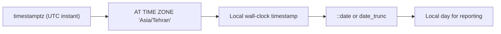

## 🎯 TL;DR

> Store **instants** in UTC (`timestamptz` or the equivalent). Convert to a local time zone only at the edges: when you display data or when you decide which local **day** an event belongs to. A **date** is a calendar day and is not a timestamp.

- A **timestamp with time zone** is a moment in time. A **timestamp without time zone** is a wall-clock reading with no zone attached, so it is ambiguous on its own.
- `date_trunc` (PostgreSQL) or `DATE_TRUNC` (many engines) rounds a value down to a day, week or month. Where the day boundary falls depends on the time zone you use.
- Date arithmetic is not always the same type: `date - date` gives an integer number of days in PostgreSQL, while `timestamp - timestamp` gives an interval.
- To report on days with no data, build a **date spine** (a complete calendar) and left-join your facts to it.

## 🌱 Start simple (Junior)

> **💡 Analogy:** A football match is at one moment in time. A friend in Tehran and a friend in Berlin both see it on their clock, and the clocks show different numbers. The match did not move; only the way of **reading** the clock changed. A time zone is the rule for reading a moment as a local clock time.

Use this small dataset for the whole lesson. The timestamps are stored in UTC:

```sql
CREATE TABLE events (id int, user_id int, happened_at timestamptz);
INSERT INTO events VALUES
 (1, 10, '2026-01-01 22:30:00+00'),
 (2, 10, '2026-01-02 08:00:00+00'),
 (3, 11, '2026-01-02 21:00:00+00'),
 (4, 11, '2026-01-03 23:45:00+00'),
 (5, 12, '2026-01-05 12:00:00+00');

CREATE TABLE daily_sales (day date, amount int);
INSERT INTO daily_sales VALUES
 ('2026-01-01', 10), ('2026-01-02', 20), ('2026-01-03', 5), ('2026-01-05', 30);
```

Two questions most people get wrong:

```sql
SELECT happened_at::date AS utc_day, COUNT(*) FROM events GROUP BY 1 ORDER BY 1;
```

This counts by **UTC** day. An event at 22:30 UTC on January 1 belongs to January 1 in UTC, but it is already January 2 in Tehran. Which answer is "right" depends on the business question, and the query must say which one it means.

## 🔧 How it really works (Mid)

**Instants vs wall-clock times.** In PostgreSQL, `timestamptz` stores an absolute instant (internally as UTC) and converts it to the session's time zone for display. `timestamp` stores the digits you gave it and attaches no zone. Many engines follow the same idea under other names: BigQuery `TIMESTAMP` is an instant and `DATETIME` is not; Snowflake has `TIMESTAMP_LTZ`, `TIMESTAMP_NTZ` and `TIMESTAMP_TZ`; Spark has `TIMESTAMP` (an instant shown in the session time zone) and a newer `TIMESTAMP_NTZ`. Check the docs for your version before relying on a specific name.



**Converting to a local day.** Use `AT TIME ZONE` to get the local wall-clock time, then truncate:

```sql
SELECT (happened_at AT TIME ZONE 'Asia/Tehran')::date AS local_day,
       COUNT(*) AS events
FROM events
GROUP BY 1
ORDER BY 1;
```

Tehran is UTC+3:30, so the events become: 2026-01-02 02:00, 11:30, 2026-01-03 00:30, 2026-01-04 03:15 and 2026-01-05 15:30. Local-day counts are Jan 2: 2, Jan 3: 1, Jan 4: 1, Jan 5: 1. Use the IANA name (`Asia/Tehran`), not a fixed offset like `+03:30`. Offsets and daylight-saving rules change over time, and the name keeps the history correct.

**Truncation.** `date_trunc('week', ts)` gives the Monday of ISO-style weeks in PostgreSQL. Iranian business weeks often start on Saturday, so compute the start yourself:

```sql
SELECT day,
       day - ((EXTRACT(DOW FROM day)::int + 1) % 7) AS saturday_week_start,
       amount
FROM daily_sales
ORDER BY day;
```

`EXTRACT(DOW ...)` gives 0 for Sunday through 6 for Saturday. Adding 1 and taking mod 7 turns Saturday into 0, so the formula subtracts the number of days since the last Saturday. For 2026-01-01 (Thursday) the week starts on 2025-12-27; for 2026-01-03 (Saturday) it starts on the same day.

**Differences.** For dates, `d2 - d1` is an integer number of days. For timestamps, `t2 - t1` is an interval. Convert intervals explicitly when you need seconds or minutes: `EXTRACT(EPOCH FROM (t2 - t1)) / 60`.

**Date spine.** A fact table only has rows for days that had activity. To show zero-sale days, generate every day and left-join:

```sql
SELECT g::date AS day, COALESCE(SUM(s.amount), 0) AS amount
FROM generate_series('2026-01-01'::date, '2026-01-08'::date, interval '1 day') AS g
LEFT JOIN daily_sales s ON s.day = g::date
GROUP BY g::date
ORDER BY 1;
```

Result: 01 → 10, 02 → 20, 03 → 5, 04 → 0, 05 → 30, 06 → 0, 07 → 0, 08 → 0. The `COALESCE` turns the NULL from the missing days into 0. This is why the spine is the first step of any rolling average or retention report.

**Jalali (Persian) dates.** SQL engines use the Gregorian calendar. For a Jalali view, build a dimension table once, with one row per Gregorian day and columns for `jalali_year`, `jalali_month`, `jalali_day` and the Jalali month name. Generate it in Python (a library such as `jdatetime`) or with a script, then join facts to it by the Gregorian date. For example, 2026-01-01 is 11 Dey 1404, and 2026-03-21 is 1 Farvardin 1405. Do not compute Jalali dates in every query.

## 🧠 Senior depth & trade-offs

- **Partition boundaries.** If you store UTC and partition the lake or warehouse by `DATE(happened_at)` in UTC, a Tehran day spans two UTC partitions. A "daily" job for Tehran then reads 2 partitions and must handle the overlap. Decide the reporting time zone once, and document it in the data contract.
- **Event time vs processing time.** The `happened_at` value is event time. The time a record reaches your pipeline is processing time. Late events move a record across day boundaries, so a daily total can change after you published it. Pair this with a [[watermark]] policy and [[backfill]] runs when you need corrections.
- **DST gaps and overlaps.** On a DST change, a local clock hour either does not exist or happens twice. A timestamp without time zone cannot tell these apart, so converting it later is ambiguous. This is one more reason to store `timestamptz`, or UTC plus the source zone name.
- **Engine-specific functions.** `date_trunc` argument order, `DATEDIFF` (argument order differs between engines), `DATE_ADD` and the `interval` syntax are not the same across PostgreSQL, MySQL, BigQuery and Spark SQL. When you write a migration, test the function on boundary values (month end, leap day, midnight, the first second of the week).
- **Storage and filters.** Filter on a range (`ts >= '2026-01-02' AND ts < '2026-01-03'`), not on `DATE(ts) = ...`. Wrapping the column in a function usually prevents an index or partition pruning from being used.
- **Calendars for business.** Fiscal years, ISO weeks, Saturday-start weeks and Jalali months are business rules, so keep them in a calendar dimension. Do not scatter `CASE` expressions across dashboards.

## 🧪 Try it

Use the `events` and `daily_sales` tables from the beginning of this lesson in PostgreSQL 13 or later.

1. Count events per **Tehran** local day, then per **UTC** day. Explain why the results differ for the event at 22:30 UTC on January 1.
2. List the days from 2026-01-01 to 2026-01-08 that have **no** row in `daily_sales`, using the date spine and an anti-join pattern (`WHERE s.day IS NULL`).
3. Group `daily_sales` by Saturday-start week and sum the amounts.

<details><summary>Show solutions</summary>

**1.**
```sql
SELECT happened_at::date AS utc_day, COUNT(*) FROM events GROUP BY 1 ORDER BY 1;
-- 2026-01-01: 1, 2026-01-02: 2, 2026-01-03: 1, 2026-01-05: 1

SELECT (happened_at AT TIME ZONE 'Asia/Tehran')::date AS local_day, COUNT(*)
FROM events GROUP BY 1 ORDER BY 1;
-- 2026-01-02: 2, 2026-01-03: 1, 2026-01-04: 1, 2026-01-05: 1
```
The event at 22:30 UTC on January 1 is counted on January 1 by the UTC query and on January 2 by the Tehran query, because Tehran is 3.5 hours ahead.

**2.**
```sql
SELECT g::date AS missing_day
FROM generate_series('2026-01-01'::date, '2026-01-08'::date, interval '1 day') AS g
LEFT JOIN daily_sales s ON s.day = g::date
WHERE s.day IS NULL;
-- 2026-01-04, 2026-01-06, 2026-01-07, 2026-01-08
```

**3.**
```sql
SELECT day - ((EXTRACT(DOW FROM day)::int + 1) % 7) AS saturday_week_start,
       SUM(amount) AS total
FROM daily_sales
GROUP BY 1
ORDER BY 1;
-- 2025-12-27: 30  (01 and 02 January)
-- 2026-01-03: 35  (03 and 05 January)
```

</details>

## 💬 Interview corner

**Question: "How do you count daily active users in a Tehran-based product?"** Mid: "Convert `happened_at` to Tehran local time with `AT TIME ZONE`, then take the date and count distinct users." Senior: "I'd fix the reporting zone in the metric definition, and I'd say how I handle events that arrive late and move a day after publication. I'd also partition by the same zone or accept a multi-partition read."

**Question: "How do you show days with zero sales?"** Mid: "Left-join to a generated date series and `COALESCE` to 0." Senior: "That is correct for a daily grain. For rolling metrics I need the spine before the window, otherwise `ROWS` frames count the wrong days, which links to [[sql-window-functions]]."

**Question: "Why store timestamps in UTC?"** Mid: "So they have one unambiguous meaning." Senior: "UTC removes DST ambiguity and makes ordering and joins between sources safe. I convert to local time only for display and for local-day business rules."

> **🎤 Say this in the interview:** "I store instants in UTC and convert to a named zone at the edge. I'm explicit about which day an event belongs to, I fill gaps with a date spine, and I put the calendar rules, including Saturday weeks and Jalali months, in a dimension."

## ⚠️ Common mistakes

> **⚠️ Watch out:** `DATE(happened_at) = '2026-01-02'` in a `WHERE` clause can prevent index or partition pruning. Use `happened_at >= '2026-01-02' AND happened_at < '2026-01-03'` (in the zone you mean) instead.

- Comparing a `timestamp` with a `timestamptz` without thinking about the session time zone.
- Using a fixed offset (`+03:30`) instead of a zone name, which misses historical and future rule changes.
- Counting "per day" in UTC for a local business without saying so.
- Using `ROWS` for a 7-day moving average when some days are missing.
- Computing `t2 - t1` and treating it as a number of days or seconds without `EXTRACT`.
- Building Jalali months by hand inside each report instead of one shared dimension.

## ✅ Check yourself (quiz)

1. Which type stores an absolute moment that displays differently in different time zones?
   - A) `date`
   - B) `timestamp without time zone`
   - C) `timestamp with time zone`
   - D) `varchar` holding ISO strings

<details><summary>Answer</summary>

**C** — `timestamptz` represents an instant. The other choices either drop the time (`date`), carry no zone (`timestamp`), or are strings that the database does not interpret as time.

</details>

2. An event happens at 22:30 UTC on 2026-01-01. Which local day does it belong to in Tehran (UTC+3:30)?
   - A) 2026-01-01
   - B) 2026-01-02
   - C) 2025-12-31
   - D) It depends on daylight saving time

<details><summary>Answer</summary>

**B** — 22:30 + 3:30 = 02:00 on January 2. In SQL, do not hard-code the offset. Use the zone name `Asia/Tehran` and let the database apply the rules that were in force on that date.

</details>

3. Why does a `LEFT JOIN` from a date spine to `daily_sales` need `COALESCE(SUM(amount), 0)`?
   - A) Without it the join returns duplicates
   - B) Days with no sales produce NULL from the aggregate, and the report needs 0
   - C) `SUM` cannot be used on dates
   - D) `COALESCE` is required for every `GROUP BY`

<details><summary>Answer</summary>

**B** — the spine keeps the missing days, so the joined sales columns are NULL. The `SUM` of no rows is NULL, and `COALESCE` turns it into 0.

</details>

4. **(Senior)** A daily job writes files partitioned by `DATE(event_ts)` where `event_ts` is UTC. A product manager asks for "yesterday in Tehran." What is the problem, and what do you do?

   - A) Nothing; UTC partitions always match local days
   - B) A Tehran day spans two UTC partitions, so read both and filter on the converted local timestamp, or agree on a partition column in the reporting zone
   - C) Switch the partition column to a string
   - D) Use `DISTINCT` to remove the duplicate days

<details><summary>Answer</summary>

**B** — the local day 2026-01-02 in Tehran covers 2026-01-01 20:30 UTC to 2026-01-02 20:30 UTC, which crosses a UTC date partition. Read both partitions and filter precisely, or decide the reporting zone for the partition key and record it in the contract.

</details>

5. **(Senior)** Why is the filter `WHERE DATE(happened_at) = '2026-01-02'` often slower than `WHERE happened_at >= '2026-01-02' AND happened_at < '2026-01-03'` on a large table with an index on `happened_at`?

   - A) The first form cannot compare dates
   - B) Wrapping the column in a function usually stops the engine from using the index on the raw column, while a range predicate can
   - C) The second form returns different rows
   - D) Indexes do not work with timestamps

<details><summary>Answer</summary>

**B** — the function call hides the column's order from the index, so the engine scans. A half-open range (`>=` start, `<` next start) uses the index and keeps the boundary right.

</details>

## 🗂️ Flashcards

| Front | Back |
|---|---|
| `timestamptz` vs `timestamp` | `timestamptz` is an instant; `timestamp` is a wall-clock reading with no zone |
| Where should stored times be? | UTC (or an instant type), converted to a named zone at display or business-rule time |
| `Asia/Tehran` vs `+03:30` | Use the zone name; fixed offsets miss rule changes |
| `date - date` in PostgreSQL | Integer number of days |
| Date spine | A generated calendar left-joined to facts to show zero-activity days |
| Saturday-start week | `day - ((EXTRACT(DOW FROM day)::int + 1) % 7)` in PostgreSQL |
| Why use a half-open range filter? | It uses the index on the raw column and avoids boundary mistakes at midnight |

## 🔗 Go further

- Previous lesson: NULLs, which decide what a missing timestamp means: `sql-nulls`.
- Use the spine with windows in `sql-window-functions`, and see how it appears in patterns such as retention and gaps in `sql-interview-patterns`.
- For the warehouse side, see the calendar dimension in `dimensional-modeling`, and late data in the [[watermark]] entry.
