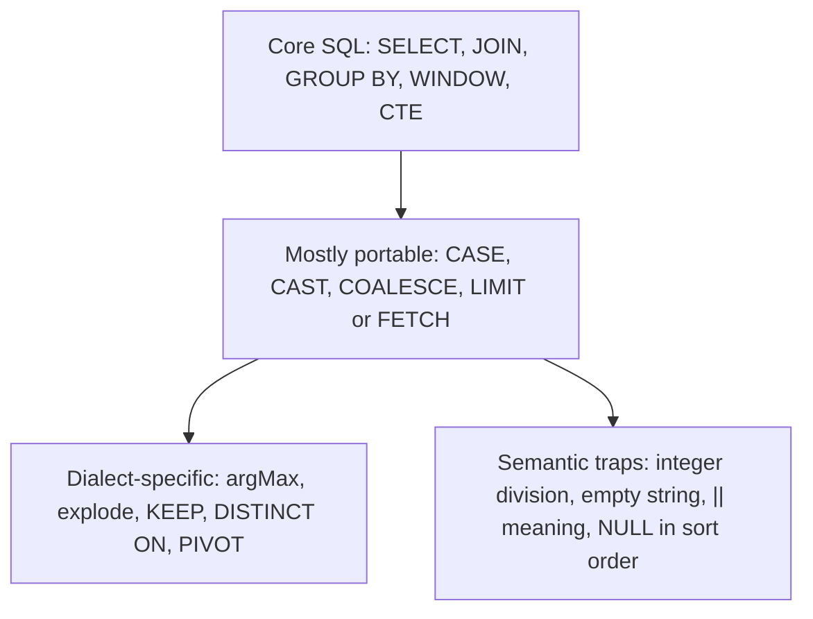

## 🎯 TL;DR

> SQL is a standard on paper and a family of dialects in practice. Most differences are **functions, types and edge-case semantics** (integer division, empty strings, `NULL` handling, date arithmetic), not the core `SELECT ... FROM ... WHERE ... GROUP BY`.

- In an interview, **state the dialect** you are writing for. If the question does not say, use **PostgreSQL** and say so; it is the safest, most standard choice.
- The dangerous differences are the **silent** ones: a query that runs but returns a different answer (`7 / 2`, `||` in MySQL, `''` in Oracle).
- Learn the same five ideas in each engine: row limit, string concatenation, date truncation, "latest value per key", and expanding arrays into rows.
- Engine-specific features (ClickHouse `argMax`, Spark `explode`, Oracle `KEEP (DENSE_RANK ...)`) are fast and powerful. Know them, and know what they replace in other engines.

## 🌱 Start simple (Junior)

> **💡 Analogy:** Languages with the same grammar but different slang. "Give me the bill" means the same in most English-speaking places, but a word that is polite in one place can be rude in another. A dialect difference that changes meaning is the one that bites you.

The `SELECT`, `WHERE`, `GROUP BY` and `JOIN` you already know work almost everywhere. The surprises are in the details:

```sql
SELECT 7 / 2;
```

What does this return? The answer depends on the engine:

| Engine | Result of `7 / 2` |
|---|---|
| PostgreSQL | `3` (integer division) |
| Oracle | `3.5` |
| Spark SQL | `3.5` (`div` gives `3`) |
| ClickHouse | `3.5` (`intDiv(7, 2)` gives `3`) |
| MySQL | `3.5000` |

The same SQL text, five answers. Two things to take from this: **always check a dialect before trusting integer arithmetic**, and **never copy a query from one engine to another without reviewing it**.

## 🔧 How it really works (Mid)

Think of SQL dialects in three layers:



Core SQL is almost identical everywhere. Dialect-specific functions are fine when you know the engine. Semantic traps are the ones to memorize.

**Five everyday tasks across engines.** These cover most real queries.

**1. Row limit.** PostgreSQL, Spark, ClickHouse and MySQL-family engines use `LIMIT n`. Oracle uses `FETCH FIRST n ROWS ONLY` (12c and later) or the older `ROWNUM` filter. The SQL-standard form is `FETCH FIRST`, so it is the most portable.

**2. String concatenation.** PostgreSQL, Oracle and Spark use `||`. In MySQL, `||` means logical **OR** by default, so `'a' || 'b'` evaluates to `0`. Use `CONCAT('a', 'b')`, which works everywhere except where the standard form is required.

**3. Start of the month.**

```sql
-- PostgreSQL
SELECT date_trunc('month', order_ts) FROM orders;
-- Oracle
SELECT TRUNC(order_ts, 'MM') FROM orders;
-- Spark SQL
SELECT date_trunc('month', order_ts) FROM orders;
-- ClickHouse
SELECT toStartOfMonth(order_ts) FROM orders;
```

**4. Days between two dates.**

```sql
-- PostgreSQL and Oracle: subtracting dates gives days
SELECT d2 - d1 FROM t;
-- Spark SQL
SELECT datediff(d2, d1) FROM t;
-- ClickHouse
SELECT dateDiff('day', d1, d2) FROM t;
```

**5. Latest value per key.** Take `events(order_id, status, ts)` and ask for the status at the most recent `ts` per order. Four engines, four idioms:

```sql
-- PostgreSQL
SELECT DISTINCT ON (order_id) order_id, status
FROM events
ORDER BY order_id, ts DESC;

-- Oracle
SELECT order_id,
       MAX(status) KEEP (DENSE_RANK LAST ORDER BY ts) AS status
FROM events
GROUP BY order_id;

-- Spark SQL
SELECT order_id, max_by(status, ts) AS status
FROM events
GROUP BY order_id;

-- ClickHouse
SELECT order_id, argMax(status, ts) AS status
FROM events
GROUP BY order_id;
```

The portable answer is a window function, `ROW_NUMBER() OVER (PARTITION BY order_id ORDER BY ts DESC) = 1` inside a subquery, which works in all four (see [[sql-window-functions]]). The native idioms are shorter and sometimes faster, so learn them, but know the portable one.

**Expanding arrays into rows.** Each engine has its own form:

```sql
-- PostgreSQL: table with an array column tags text[]
SELECT p.id, t.tag
FROM posts p
CROSS JOIN LATERAL unnest(p.tags) AS t(tag);

-- Spark SQL (Hive-style lateral view)
SELECT p.id, t.tag
FROM posts p
LATERAL VIEW explode(p.tags) t AS tag;

-- ClickHouse
SELECT id, tag
FROM posts
ARRAY JOIN tags AS tag;
```

Note the semantic trap: in Spark, `explode` drops rows whose array is `NULL` or empty. `explode_outer` keeps them. ClickHouse `ARRAY JOIN` also drops empty arrays unless you use `LEFT ARRAY JOIN`. Check the behaviour for your engine before assuming "one row per tag, nothing lost".

**Upsert.** PostgreSQL: `INSERT ... ON CONFLICT (key) DO UPDATE`. Oracle and Spark (for Delta or Iceberg tables): `MERGE`. MySQL: `INSERT ... ON DUPLICATE KEY UPDATE`. ClickHouse has no row-level upsert in the OLTP sense; see the senior section.

## 🧠 Senior depth & trade-offs

- **Pick the dialect by the workload.** PostgreSQL is the reference for transactional and general analytic SQL. Oracle is common in large banks and telecoms, where you meet its analytic functions, `MERGE`, `CONNECT BY` and `PL/SQL`. Spark SQL is for lakehouse batch jobs. ClickHouse is for fast, large analytical scans on append-heavy data. StarRocks is MySQL-compatible for interactive analytics.
- **Know the silent failures.**
  - Oracle treats `''` as `NULL`. A `WHERE comment IS NULL` also matches empty strings, and `'' = ''` is not true in Oracle, because the comparison is with `NULL`.
  - PostgreSQL folds unquoted identifiers to lowercase; Oracle folds them to uppercase. A quoted `"Name"` in PostgreSQL is a different identifier from `name`.
  - Spark: `/` always returns a double; use `div` for integer division. Spark's `CAST` to `int` of a non-numeric string returns `NULL` in non-ANSI mode and fails in ANSI mode, which depends on configuration. Check your settings.
  - ClickHouse: columns are non-nullable unless declared `Nullable(T)`, and `Nullable` has a storage and speed cost. A `NULL` in a non-nullable column does not behave the way you expect; check the docs for your version.
- **Null ordering differs by engine.** PostgreSQL sorts `NULL` last in `ASC`; Oracle sorts `NULL` last in `ASC` too, but MySQL sorts it first. A `LIMIT` query that depends on this can return different rows after a migration. Make the order explicit with `NULLS LAST`, where the engine supports it.
- **Migrations hide the most risk.** Moving a report from Oracle to a lakehouse means re-checking: integer division, `NULL` vs empty string, date arithmetic (Oracle's date minus date returns a fractional number when times are present), case sensitivity, and the order of ties in `ROW_NUMBER`. Write a test that compares the two results on a sample.
- **Engine-native features beat portable SQL at scale.** `argMax` or `max_by` in an aggregation is one pass; the portable window version can need a sort per key. The trade-off is portability. For a shared codebase that targets several engines, prefer the portable form and document the native option.
- **Stored procedures and `PL/SQL`, `T-SQL`, `PL/pgSQL`** are dialects of procedural code. Do not port them as plain SQL. Move the logic into the transformation layer (for example dbt models) so it is testable.
- **When not to care about dialects.** If the data is small and the team uses one engine, use its native features freely. The trap is writing "portable" SQL by habit when the platform is fixed.

## 🧪 Try it

For each question, state the dialect you are answering for.

1. In PostgreSQL, what does `SELECT 10 / 4, 10 / 4.0, 10 % 4;` return?
2. A table `users(id, nickname)` has some nicknames stored as `''`. In Oracle, write a query for "users without a nickname" that also catches the empty strings.
3. Rewrite `SELECT id, argMax(status, ts) FROM events GROUP BY id` (ClickHouse) as portable standard SQL that runs on PostgreSQL.
4. A Spark job uses `LATERAL VIEW explode(tags)`. Some posts have an empty `tags` array and must still appear in the output with a `NULL` tag. Fix the query.

<details><summary>Show solutions</summary>

**1.** `10 / 4` is `2` (integer division), `10 / 4.0` is `2.5` (numeric literal), `10 % 4` is `2`. Result row: `2, 2.5, 2`.

**2.**
```sql
SELECT id
FROM users
WHERE nickname IS NULL
   OR TRIM(nickname) = '';
```
In Oracle, `''` is `NULL`, so `nickname IS NULL` already catches empty strings. The `TRIM` check is still a good habit when the data may have whitespace. The reader who writes `nickname = ''` gets no rows in Oracle, which is the trap.

**3.**
```sql
SELECT e.id, e.status
FROM events e
JOIN (
  SELECT id, MAX(ts) AS max_ts
  FROM events
  GROUP BY id
) latest
  ON e.id = latest.id AND e.ts = latest.max_ts;
```
Or the window form, which avoids ties in the join: `ROW_NUMBER() OVER (PARTITION BY id ORDER BY ts DESC) = 1` in a subquery. Ties in `ts` return two rows in the join version; that is a point worth raising in the interview.

**4.**
```sql
SELECT p.id, t.tag
FROM posts p
LATERAL VIEW OUTER explode(p.tags) t AS tag;
```
`OUTER` (Spark's `explode_outer` equivalent) keeps posts whose array is empty or `NULL`, with a `NULL` tag. Plain `explode` drops them, which is a silent data loss.

</details>

## 💬 Interview corner

**Question: "Write a query for the latest status per order."** Mid answer: "A window with `ROW_NUMBER` ordered by timestamp descending, filtered to 1 in a subquery." Senior answer: "Portable SQL with a window function, and I'd state the tie rule. If the engine is ClickHouse I'd use `argMax` in one aggregation, and if it is Oracle I'd use `KEEP (DENSE_RANK ...)`. I'd name the dialect I am writing for first."

**Question: "Is this query portable to Spark?"** The answer is about review, not memorizing: look at integer division, `||`, empty strings, `NULL` ordering, identifier case, date arithmetic and array expansion.

> **🎤 Say this in the interview:** "I'll write this for PostgreSQL unless you tell me otherwise. The places I'd double-check for another engine are integer division, string concatenation, empty strings in Oracle, and how `NULL`s sort, because those change answers without an error."

## ⚠️ Common mistakes

> **⚠️ Watch out:** In MySQL, `'a' || 'b'` is not concatenation. Use `CONCAT`.

> **⚠️ Watch out:** `7 / 2` is `3` in PostgreSQL and `3.5` in Spark, ClickHouse and Oracle. Copying an average or percentage calculation between engines can change every result.

- Assuming ANSI behaviour everywhere, and never checking the engine.
- Writing `= ''` to find empty strings in Oracle.
- Using `explode` in Spark when empty arrays must be preserved, instead of `explode_outer`.
- Porting a `LIMIT n BY` (ClickHouse) or `DISTINCT ON` (PostgreSQL) query to another engine without a window-function rewrite.
- Relying on the default sort position of `NULL` after moving to another engine.
- Using native features everywhere, so the query cannot be moved to another engine when the platform changes.

## ✅ Check yourself (quiz)

1. Which engine returns `3` for `SELECT 7 / 2` with integer literals?
   - A) Spark SQL
   - B) PostgreSQL
   - C) ClickHouse
   - D) Oracle

<details><summary>Answer</summary>

**B** — PostgreSQL divides integers with integer division. Spark, ClickHouse and Oracle return `3.5`. Spark's `div` and ClickHouse's `intDiv` give `3`.

</details>

2. In Oracle, what does `''` evaluate to?
   - A) An empty string that is different from `NULL`
   - B) `NULL`
   - C) The number `0`
   - D) An error

<details><summary>Answer</summary>

**B** — Oracle treats the empty string as `NULL`. So `WHERE col = ''` returns nothing, and `WHERE col IS NULL` matches those rows.

</details>

3. Which ClickHouse function returns the status at the latest timestamp per group?
   - A) `argMin(status, ts)`
   - B) `argMax(status, ts)`
   - C) `groupArray(status)`
   - D) `uniqExact(status)`

<details><summary>Answer</summary>

**B** — `argMax(value, key)` returns the value at the maximum key. `argMin` would return the earliest.

</details>

4. **(Senior)** A ClickHouse query uses `LIMIT 1 BY user_id` to get the newest event per user, and you need it on Spark SQL. Which rewrite is correct and portable?

   - A) `SELECT * FROM events LIMIT 1` with a `GROUP BY user_id`
   - B) A subquery with `ROW_NUMBER() OVER (PARTITION BY user_id ORDER BY ts DESC) = 1`, filtered in the outer query
   - C) `SELECT DISTINCT user_id FROM events`
   - D) `WHERE ts = MAX(ts)`

<details><summary>Answer</summary>

**B** — the window version is portable and gives one row per user. `WHERE` cannot use an aggregate directly (D), `DISTINCT` drops the other columns (C), and a plain `LIMIT` ignores the group (A).

</details>

5. **(Senior)** A table of 10 billion rows in ClickHouse receives frequent updates to the same keys, and the team runs `ALTER TABLE ... UPDATE` for each change. What is the better design, and why?

   - A) Keep the `ALTER ... UPDATE` calls and add an index
   - B) Model the table as an append-only log with a versioned or replacing engine (or aggregate the latest value with `argMax`), and let background merges or queries resolve the latest version
   - C) Switch to `UNION ALL` for every update
   - D) Run `DELETE` and `INSERT` in a single transaction

<details><summary>Answer</summary>

**B** — ClickHouse is built for appends. `ALTER ... UPDATE` is an asynchronous mutation that rewrites data parts, which is expensive at this scale. An append-only design with a version column, and a replacing or `argMax`-based read, avoids rewriting billions of rows for each change.

</details>

## 🗂️ Flashcards

| Front | Back |
|---|---|
| `7 / 2` in PostgreSQL | `3` (integer division) |
| `7 / 2` in Spark SQL | `3.5`; use `div` for `3` |
| `||` in MySQL | Logical OR by default; use `CONCAT()` |
| `''` in Oracle | `NULL` |
| Row limit (standard) | `FETCH FIRST n ROWS ONLY` |
| Latest value per key | `DISTINCT ON` (PG), `KEEP (DENSE_RANK LAST ...)` (Oracle), `max_by` (Spark), `argMax` (ClickHouse) |
| Expand array to rows | `unnest` (PG), `explode` / `explode_outer` (Spark), `ARRAY JOIN` (ClickHouse) |
| Portable top-1 per group | `ROW_NUMBER() OVER (PARTITION BY ... ORDER BY ...) = 1` in a subquery |

## 🔗 Go further

- [[sql-window-functions]] — the portable form behind most "latest per key" questions.
- [[sql-nulls]] — three-valued logic and why `NULL` is never equal to anything.
- [[sql-datetime]] — date arithmetic and time zones in more depth.
- [[sql-advanced-grouping]] — PIVOT, ROLLUP and FILTER across engines.
- [[clickhouse]] and [[spark-architecture]] — the engines whose native features this lesson compares.

