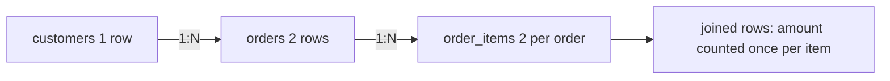

## 🎯 TL;DR

> A **join** combines rows from two tables by a condition. The join type decides what happens to rows **without a match**, and the join's cardinality (1:1, 1:N, N:M) decides whether your numbers **multiply**.

- `INNER` keeps only matched pairs. `LEFT` keeps every left row, filling the right side with NULL when there is no match.
- `FULL OUTER` keeps unmatched rows from both sides. `CROSS` makes every combination.
- **Semi join** (`EXISTS`) answers "is there a match?" without duplicating rows. **Anti join** (`NOT EXISTS`, or `LEFT JOIN ... IS NULL`) answers "is there no match?".
- Joining a 1:N table multiplies the rows of the 1 side. This "fan-out" is the most common cause of inflated revenue numbers.
- A NULL key never matches anything, not even another NULL.

## 🌱 Start simple (Junior)

> **💡 Analogy:** Two guest lists for a party. An **inner join** is "only people who are on both lists". A **left join** is "everyone on the first list, and their partner's details if the partner is on the second list, otherwise blank". Blank means NULL.

We will use these tables:

```sql
CREATE TABLE customers (id int, name text);
CREATE TABLE orders (id int, customer_id int, amount numeric);

INSERT INTO customers VALUES (1,'Ali'), (2,'Sara'), (3,'Reza');
INSERT INTO orders VALUES
 (10, 1, 100), (11, 1, 50), (12, 2, 200),
 (13, NULL, 30),   -- no customer at all
 (14, 9, 70);      -- customer 9 does not exist
```

Inner join:

```sql
SELECT c.name, o.id AS order_id, o.amount
FROM customers c
JOIN orders o ON o.customer_id = c.id;   -- same as INNER JOIN
```

Result: Ali 10 100, Ali 11 50, Sara 12 200. Reza (no orders) and orders 13 and 14 (no matching customer) are gone.

Left join keeps Reza:

```sql
SELECT c.name, o.id AS order_id
FROM customers c
LEFT JOIN orders o ON o.customer_id = c.id;
```

Result: Ali 10, Ali 11, Sara 12, **Reza NULL**. The left table (`customers`) is kept in full.

**Predict before you look:** how many rows does a `FULL OUTER JOIN` of these two tables return?

<details><summary>Your guess?</summary>

Six. The four matched or left-only customer rows (Ali 10, Ali 11, Sara 12, Reza NULL) plus the two right-only orders (order 13 with NULL customer, order 14 with customer 9). A full outer join keeps unmatched rows from both sides.

</details>

| Join | Keeps matched pairs | Keeps unmatched left | Keeps unmatched right |
|---|---|---|---|
| `INNER` | yes | no | no |
| `LEFT` | yes | yes | no |
| `RIGHT` | yes | no | yes |
| `FULL OUTER` | yes | yes | yes |
| `CROSS` | every pair (no condition) | — | — |

### Finding rows with no match (anti join)

"Customers who never ordered" is the classic interview question. Three correct ways:

```sql
-- 1. LEFT JOIN + IS NULL
SELECT c.id, c.name
FROM customers c
LEFT JOIN orders o ON o.customer_id = c.id
WHERE o.id IS NULL;

-- 2. NOT EXISTS (anti join)
SELECT c.id, c.name
FROM customers c
WHERE NOT EXISTS (SELECT 1 FROM orders o WHERE o.customer_id = c.id);

-- 3. NOT IN (works here, but read the trap below)
SELECT c.id, c.name
FROM customers c
WHERE c.id NOT IN (SELECT customer_id FROM orders);
```

All three return Reza. Form 3 hides a trap: `orders.customer_id` contains a NULL (order 13). `c.id NOT IN (1, 2, NULL, 9)` is never `TRUE`, because comparing with NULL is `UNKNOWN`. So if the subquery returns any NULL, `NOT IN` returns **zero rows**. Prefer `NOT EXISTS`.

## 🔧 How it really works (Mid)

A join is a filtered Cartesian product. Conceptually, the engine takes every pair `(left row, right row)`, keeps the pairs where the `ON` condition is `TRUE`, and then adds the unmatched rows that the outer join type asks for. The planner chooses a physical algorithm to do this efficiently:

- **Hash join:** build a hash table on the smaller input, probe it with the other. Usually the default for large equi-joins (`a.k = b.k`).
- **Sort-merge join:** sort both inputs on the key, then merge. Good when inputs are already sorted or are huge.
- **Nested loop:** for each left row, scan the right. Cheap only when the right side is tiny or indexed.

### Filter in ON versus WHERE

For outer joins, where a condition lives changes the result:

```sql
-- A: condition in ON -> keeps every customer
SELECT c.name, o.id
FROM customers c
LEFT JOIN orders o ON o.customer_id = c.id AND o.amount > 60;
-- Ali 10, Sara 12, Reza NULL

-- B: condition in WHERE -> removes customers without a big order
SELECT c.name, o.id
FROM customers c
LEFT JOIN orders o ON o.customer_id = c.id
WHERE o.amount > 60;
-- Ali 10, Sara 12  (Reza is gone: NULL > 60 is UNKNOWN)
```

In A, the condition decides which orders can match, and unmatched customers survive. In B, the `WHERE` runs after the join, sees NULL for Reza, and removes him, so the LEFT JOIN behaves like an INNER JOIN. If you want "left join with a filter", put the filter in `ON`.

### Cardinality and fan-out

| Relationship | Example | Effect on rows |
|---|---|---|
| 1:1 | customer → customer profile | row count stays the same |
| 1:N | customer → orders | each customer row is repeated once per order |
| N:M | orders ↔ products (via items) | rows multiply on both sides |



## 🧠 Senior depth & trade-offs

- **Fan-out is silent.** Adding a join to a 1:N table does not fail. It makes `SUM(orders.amount)` larger than the truth. Before joining, ask: "What is the grain of this table?" (see **grain**). Aggregate the many-side first, or use a semi join (`EXISTS`) when you only need to know that a match exists.
- **Join order and cardinality.** The optimizer estimates row counts for each join. Bad estimates (stale statistics, correlated columns) pick a nested loop where a hash join was needed. In Postgres, check `EXPLAIN ANALYZE` estimated versus actual rows.
- **Distributed joins.** In Spark, a join is a **shuffle** unless one side is small enough for a **broadcast join**. Skewed keys (one `customer_id` with millions of rows) send all work to one task. See **data-skew** and **spark-joins-skew**.
- **Indexes.** Index foreign keys used in joins (`orders.customer_id`). Without one, a nested loop on a big table is a full scan per outer row. See **sql-indexing**.
- **NULL keys never match.** Orphans with NULL keys silently drop out of inner joins and appear only as unmatched rows in outer joins. Decide explicitly what to do with them, do not let them disappear by accident.
- **Warehouses and star schemas.** In a star schema, facts join to dimensions many-to-one, which is safe. The danger is joining two fact tables to each other, which is many-to-many. Model that with a bridge table or aggregate each side first.
- **Check the docs for your engine** for join hints (`/*+ BROADCAST */`, `FORCE JOIN ORDER`) and their current syntax; do not assume they are available everywhere.

## 🧪 Try it

Use the `customers` and `orders` tables from this lesson, and add:

```sql
CREATE TABLE order_items (order_id int, sku text);
INSERT INTO order_items VALUES (10, 'A'), (10, 'B'), (12, 'C');
```

1. **Customers with their order count, including zero.** Show each customer name and how many orders they have. Reza must show 0.
2. **Orphan orders.** List the orders whose customer does not exist (including NULL customers).
3. **Inflated total.** The following query returns a number that is too big. Explain why, then write a correct version that sums the amount of orders that have at least one item.

```sql
SELECT SUM(o.amount)
FROM orders o
JOIN order_items i ON i.order_id = o.id;
```

<details><summary>Show solutions</summary>

**1.**
```sql
SELECT c.name, COUNT(o.id) AS n_orders
FROM customers c
LEFT JOIN orders o ON o.customer_id = c.id
GROUP BY c.name;
```
Result: Ali 2, Sara 1, Reza 0. `COUNT(o.id)` gives 0 for Reza because the joined id is NULL. `COUNT(*)` would wrongly give 1.

**2.**
```sql
SELECT o.id, o.customer_id, o.amount
FROM orders o
LEFT JOIN customers c ON c.id = o.customer_id
WHERE c.id IS NULL;
```
Result: orders 13 (NULL customer) and 14 (customer 9).

**3.** Order 10 has two items, so the join produces two rows for it, and its amount 100 is counted twice. The total is 100 × 2 + 200 = 400. The correct value over orders with at least one item is 300:
```sql
SELECT SUM(o.amount)
FROM orders o
WHERE EXISTS (SELECT 1 FROM order_items i WHERE i.order_id = o.id);
```

</details>

## 💬 Interview corner

**Q: Why did my revenue double after the join?**

> **🎤 Say this in the interview:** The join relationship is probably 1:N, so each parent row is repeated once per child row. Then `SUM` adds the repeated values. I would check the grain of each table, aggregate the many-side before joining, or use `EXISTS` if I only need to filter. I would also confirm with a row count before and after the join.

A **junior** answer says "because of a duplicate join" and offers `DISTINCT`. A **mid** answer names fan-out and cardinality, and proposes pre-aggregation. A **senior** answer adds the grain check, the cost of the join algorithm, and the skew risk on distributed engines.

**Q: What is the difference between a filter in `ON` and in `WHERE` for a LEFT JOIN?**

A condition in `ON` decides which right rows can match, so unmatched left rows are still returned. A condition in `WHERE` runs after the join and removes the NULL-extended rows, which turns the LEFT JOIN into an INNER JOIN in effect.

## ⚠️ Common mistakes

- **Filtering a LEFT JOIN in `WHERE`.** `WHERE o.amount > 60` quietly drops the customers with no orders. Move the condition into `ON` if you want to keep them.
- **`NOT IN` with a nullable subquery.** One NULL makes the whole predicate `UNKNOWN`, so you get zero rows. Use `NOT EXISTS`.
- **`COUNT(*)` after a LEFT JOIN.** It counts the NULL-extended row too. Use `COUNT(right_table.id)`.
- **Using `DISTINCT` to hide duplicates.** It makes the report look right while the join logic is still wrong.
- **Joining on a non-unique key without checking.** Confirm the key is unique on the side you expect (`SELECT key, COUNT(*) ... HAVING COUNT(*) > 1`).
- **Assuming NULL = NULL in joins.** Rows with NULL keys do not join. Use `IS NOT DISTINCT FROM` only if you really want NULL to match NULL.
- **Writing the cross join by accident.** Forgetting the `ON` clause in an old-style comma join produces every combination.

## ✅ Check yourself (quiz)

1. Which join keeps every row of the left table even when there is no match on the right?
   - A) `INNER JOIN`
   - B) `LEFT JOIN`
   - C) `CROSS JOIN`
   - D) `JOIN ... USING`

2. What does `customers c LEFT JOIN orders o ON o.customer_id = c.id WHERE o.amount > 60` return for Reza?
   - A) Reza with NULL
   - B) Reza with 0
   - C) Nothing for Reza
   - D) An error

3. Why does `WHERE id NOT IN (SELECT customer_id FROM orders)` return zero rows when the subquery contains a NULL?
   - A) `NOT IN` does not accept subqueries
   - B) Comparisons with NULL are UNKNOWN, so the predicate is never TRUE
   - C) NULL is converted to 0
   - D) The planner always drops NULLs first

4. Two rows both have a NULL join key. What happens with `a.key = b.key`?
   - A) They match
   - B) They do not match
   - C) The query errors
   - D) They match only in a FULL OUTER JOIN

5. **Senior question.** A report joins `orders` to `payments`, which has several payments per order (split payments). The total revenue is 30% too high after the join. Diagnose the problem and describe two fixes, one of which does not change the number of rows.

<details><summary>Answer</summary>

**1 — B.** `LEFT JOIN` keeps all left rows and fills the right side with NULL when nothing matches.

**2 — C.** The `WHERE` condition runs after the join, `NULL > 60` is UNKNOWN, and Reza is removed. Put the condition in `ON` to keep him.

**3 — B.** For every customer id, `id <> NULL` is UNKNOWN, so no row is ever returned. Use `NOT EXISTS`, which does not have this problem.

**4 — B.** NULL is not equal to NULL, so the join condition is never TRUE. Use `IS NOT DISTINCT FROM` only if you want NULL keys to match.

**5 — (senior answer).** This is fan-out. Each order is repeated once per payment, so `SUM(orders.amount)` counts it several times. Fix 1: aggregate `payments` to one row per order first, then join. Fix 2: use `WHERE EXISTS (SELECT 1 FROM payments p WHERE p.order_id = o.id)` when you only need orders that have payments, which keeps one row per order. Verify with a row count before and after the join.

</details>

## 🗂️ Flashcards

| Front | Back |
|---|---|
| INNER JOIN | Only pairs where the ON condition is TRUE |
| LEFT JOIN | All left rows; NULL-filled right side when unmatched |
| FULL OUTER JOIN | Unmatched rows from both sides are kept |
| Semi join | `EXISTS`: is there a match? No duplicates |
| Anti join | `NOT EXISTS` or `LEFT JOIN ... IS NULL`: no match exists |
| Fan-out | A 1:N join repeats the 1 side, which inflates SUM and COUNT |
| Why `NOT IN` can return nothing | One NULL in the subquery makes every comparison UNKNOWN |
| Filter in ON vs WHERE (LEFT JOIN) | ON keeps unmatched left rows; WHERE removes them |

## 🔗 Go further

- **sql-subqueries-ctes** covers `EXISTS`, correlated subqueries and CTEs used for pre-aggregation.
- **sql-nulls** explains three-valued logic in depth, the foundation of the `NOT IN` trap.
- **sql-indexing** shows how join keys are indexed and how the planner uses them.
- **sql-query-optimization** teaches how to read `EXPLAIN` output for hash, merge and nested-loop joins.
- **spark-joins-skew** and **spark-shuffle** show what the same joins cost on a distributed engine.
