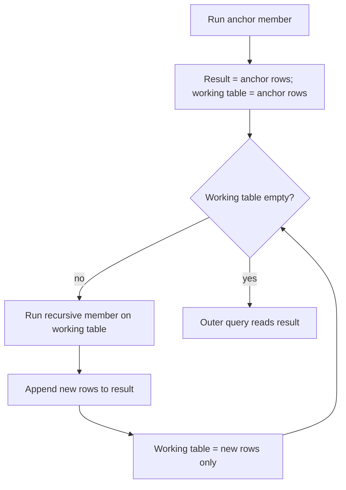

## 🎯 TL;DR

> A **recursive CTE** is a query that refers to itself. It starts from an **anchor** set of rows, then repeatedly joins a **recursive member** to the rows produced by the previous step, and stops when a step returns no new rows.

- Use it when the depth is unknown in advance: org charts, category trees, bill-of-materials, graph paths, and generated calendars.
- Shape: `WITH RECURSIVE name AS (anchor UNION ALL recursive_member)`. PostgreSQL needs the `RECURSIVE` keyword; SQL Server and Oracle do not use it.
- Every recursive query needs a **stop condition**. Without one it runs until a resource limit kills it.
- `UNION` instead of `UNION ALL` removes duplicate rows at each step, which can end a cycle for you (with a caveat, shown below).

## 🌱 Start simple (Junior)

> **💡 Analogy:** Nested folders. To list everything under the folder "Projects", you open it, look at its sub-folders, open each of those, and repeat until no sub-folders are left. A recursive CTE is that loop written in SQL.

We use this small table in the lesson. It is an org chart: each row points to its manager.

```sql
CREATE TABLE org (
  id         int PRIMARY KEY,
  name       text NOT NULL,
  manager_id int REFERENCES org(id)
);

INSERT INTO org (id, name, manager_id) VALUES
 (1, 'CEO',        NULL),
 (2, 'CTO',        1),
 (3, 'Data Lead',  2),
 (4, 'Engineer A', 3),
 (5, 'Engineer B', 3),
 (6, 'CFO',        1),
 (7, 'Analyst',    6);
```

The question: "Who works under the CTO, directly or indirectly?" A normal join cannot answer it, because you do not know how many levels exist. The recursive version:

```sql
WITH RECURSIVE reports AS (
  -- anchor: start with the CTO
  SELECT id, name, manager_id
  FROM org
  WHERE name = 'CTO'

  UNION ALL

  -- recursive member: people whose manager is already in the result
  SELECT o.id, o.name, o.manager_id
  FROM org o
  JOIN reports r ON o.manager_id = r.id
)
SELECT name FROM reports ORDER BY name;
```

Result: `CTO`, `Data Lead`, `Engineer A`, `Engineer B`. The anchor contributes the CTO, and each loop adds the next level down.

## 🔧 How it really works (Mid)

PostgreSQL evaluates a recursive CTE with a **working table**:

1. Run the anchor. Its rows go into the result and into the working table.
2. Run the recursive member. The self-reference reads **only the working table**, not the whole result.
3. Append the new rows to the result, and make them the new working table.
4. Repeat until a step produces no rows. The outer query then reads the accumulated result.



This explains a useful fact: each iteration sees only the rows found in the previous one, which is a breadth-first walk over levels.

**Carrying data down the tree.** Add a `depth` and a `path` column and pass them along in the recursive member:

```sql
WITH RECURSIVE tree AS (
  SELECT id, name, 0 AS depth, name AS path
  FROM org
  WHERE manager_id IS NULL
  UNION ALL
  SELECT o.id, o.name, t.depth + 1, t.path || ' > ' || o.name
  FROM org o
  JOIN tree t ON o.manager_id = t.id
)
SELECT repeat('  ', depth) || name AS org_chart
FROM tree
ORDER BY path;
```

The output (indentation is two spaces per level):

```text
CEO
  CFO
    Analyst
  CTO
    Data Lead
      Engineer A
      Engineer B
```

Sorting by `path` gives a readable tree order. Note the type rule: the anchor and the recursive member must produce the same column types. `0 AS depth` is an `integer`, and `t.depth + 1` is also an `integer`, so this works. A mismatch (for example text in one member and varchar in the other) raises an error in PostgreSQL.

**Generating a date series.** A recursive CTE can produce a calendar, which is useful for filling gaps in daily reports:

```sql
WITH RECURSIVE days AS (
  SELECT DATE '2026-01-01' AS d
  UNION ALL
  SELECT d + 1 FROM days WHERE d < DATE '2026-01-07'
)
SELECT d FROM days;
```

PostgreSQL also has `generate_series` for this, which is shorter. The recursive form is the portable one.

**Cycles.** Take a directed graph with a loop, `1 → 2 → 3 → 1`, plus a branch `3 → 4`:

```sql
CREATE TABLE links (src int, dst int);
INSERT INTO links VALUES (1,2), (2,3), (3,1), (3,4);

-- UNION removes duplicate rows, so the walk stops when it returns to a known node
WITH RECURSIVE reach(node) AS (
  SELECT 1
  UNION
  SELECT l.dst FROM reach r JOIN links l ON l.src = r.node
)
SELECT node FROM reach ORDER BY node;   -- 1, 2, 3, 4
```

With `UNION ALL`, this query would loop forever (1, 2, 3, 1, 2, ...). The caveat: `UNION` only deduplicates identical rows. If you add a `depth` column, every revisit has a new depth, so the duplicates are no longer identical and the loop does not stop. For that case, track the visited nodes explicitly:

```sql
WITH RECURSIVE walk(node, path) AS (
  SELECT 1, ARRAY[1]
  UNION ALL
  SELECT l.dst, w.path || l.dst
  FROM walk w
  JOIN links l ON l.src = w.node
  WHERE NOT (l.dst = ANY (w.path))   -- do not step onto a node already on this path
)
SELECT node, path FROM walk ORDER BY path;
```

This returns the walks `[1]`, `[1,2]`, `[1,2,3]` and `[1,2,3,4]`. The walk through `3 → 1` is cut off because `1` is already on its path. PostgreSQL 14 and later also offer a `CYCLE` clause that does this bookkeeping for you; check the docs for your version.

**Depth limit.** A cheap safety net is a condition on the level, for example `WHERE t.depth < 20` in the recursive member. Always add one when the data is not fully trusted.

## 🧠 Senior depth & trade-offs

- **Cost is iterations times fan-out.** Each iteration is a join. A deep, wide tree costs more than its row count suggests, because every level re-joins. The join key (`org.manager_id`) must be indexed, or every iteration becomes a scan. See [[database-index]] and [[sql-indexing]].
- **UNION vs UNION ALL.** `UNION` deduplicates at every iteration (a sort or hash). It is safer against cycles but slower. Use `UNION ALL` on trees you know are acyclic.
- **Search order.** Breadth-first (the default working-table behaviour) suits "all levels". Depth-first ordering matters when you need a path in a particular order. PostgreSQL 14+ has `SEARCH` clauses for this; verify the exact syntax in the docs.
- **Engine support differs.** Many analytical engines limit or lack recursive CTEs, and ClickHouse does not offer them in the usual form. Spark SQL support depends on the version. For series in ClickHouse, `numbers()` is the usual tool. Check your engine before designing around recursion.
- **Warehouses prefer precomputed closures.** For a hierarchy queried all day, a **closure table** (or a bridge table) stores every ancestor-descendant pair, populated by a recursive job once. Reads become simple joins. This is the standard modeling answer for variable-depth dimensions; see [[dimensional-modeling]].
- **Runaway recursion** holds locks and memory until it finishes or times out. Set a `statement_timeout` for ad-hoc analytics roles, and keep the depth guard.
- **When not to use it.** If the hierarchy has a known, fixed depth (two or three levels), a few explicit joins are simpler and faster to read.

## 🧪 Try it

Use the `org` table from the beginning (PostgreSQL 13 or later).

1. Return every employee with their depth below the CEO (the CEO has depth 0).
2. Using `generate_series` or the recursive date series, list each day from 2026-01-01 to 2026-01-07 and count how many `daily_sales` rows exist for it. Show days with zero rows too. (Assume `daily_sales(day date, amount int)` exists.)
3. Using the `links` table with the cycle, count the distinct nodes reachable from node 1 within at most 2 steps.

<details><summary>Show solutions</summary>

**1.**
```sql
WITH RECURSIVE t AS (
  SELECT id, name, 0 AS depth FROM org WHERE manager_id IS NULL
  UNION ALL
  SELECT o.id, o.name, t.depth + 1
  FROM org o JOIN t ON o.manager_id = t.id
)
SELECT name, depth FROM t ORDER BY depth, name;
```

**2.**
```sql
WITH RECURSIVE days AS (
  SELECT DATE '2026-01-01' AS d
  UNION ALL
  SELECT d + 1 FROM days WHERE d < DATE '2026-01-07'
)
SELECT days.d, COUNT(s.day) AS sales_rows
FROM days
LEFT JOIN daily_sales s ON s.day = days.d
GROUP BY days.d
ORDER BY days.d;
```
`COUNT(s.day)` counts only matched rows, so days with no sales show 0. `COUNT(*)` would show 1 for them, which is a classic mistake.

**3.**
```sql
WITH RECURSIVE walk(node, steps) AS (
  SELECT 1, 0
  UNION
  SELECT l.dst, w.steps + 1
  FROM walk w JOIN links l ON l.src = w.node
  WHERE w.steps < 2
)
SELECT COUNT(DISTINCT node) FROM walk;
```
Reachable within 2 steps from 1: 1 (0 steps), 2 (1 step), 3 (2 steps). Answer: 3. Node 4 needs 3 steps. The depth guard is what makes this finite, and `UNION` does not stop it alone because `steps` changes on every revisit.

</details>

## 💬 Interview corner

**Question: "How would you get all subordinates of a manager in a table with `manager_id`?"** Mid answer: "A recursive CTE: an anchor for the manager, and a recursive member that joins employees to the previous level on `manager_id`, with `UNION ALL` and an index on `manager_id`." Senior answer: "The same recursion, plus a guard for cycles in dirty data, a depth limit, and a note that for an analytical table read thousands of times a day I'd precompute a closure table in the warehouse instead of recursing on every query."

**Question: "Why does my recursive query never finish?"** Expected answer: a cycle with `UNION ALL`, or a recursive member that never stops producing rows. Fix: add a visited-path check, a depth limit, or switch to `UNION` when the row contents are identical on revisit.

> **🎤 Say this in the interview:** "A recursive CTE has an anchor and a recursive member that works on the previous level's rows. I always add a stop condition, and I check for cycles, because `UNION ALL` on cyclic data never ends."

## ⚠️ Common mistakes

> **⚠️ Watch out:** The recursive member cannot see the full result. It sees only the rows produced in the previous iteration. Expecting it to join against "everything found so far" gives wrong results.

> **⚠️ Watch out:** Forgetting `RECURSIVE` in PostgreSQL gives a syntax or "relation does not exist" error that looks unrelated to the recursion.

- Missing stop condition: the query runs until memory or time runs out.
- Using `UNION ALL` on a graph with cycles.
- Using `UNION` but adding a changing column (like `depth`), which defeats the deduplication.
- Unindexed join key, so each level becomes a full table scan.
- Mismatched column types between the anchor and the recursive member.
- Using recursion for a fixed two-level hierarchy, where two joins are clearer.

## ✅ Check yourself (quiz)

1. What is the role of the anchor member in a recursive CTE?
   - A) It is the stop condition
   - B) It produces the first set of rows that the recursion starts from
   - C) It replaces the outer query
   - D) It must always use `UNION`

<details><summary>Answer</summary>

**B** — the anchor produces the starting rows. The recursive member then runs on the previous iteration's rows until it returns nothing.

</details>

2. In PostgreSQL, during a recursive step, what does the self-reference read?
   - A) The full result accumulated so far
   - B) Only the working table, the rows produced by the previous iteration
   - C) The base table again, from the start
   - D) Nothing; it is a placeholder

<details><summary>Answer</summary>

**B** — each iteration reads only the rows added by the previous one. This is why the recursion can be understood as a level-by-level walk.

</details>

3. A graph has the cycle `1 → 2 → 1`. Which query terminates?
   - A) `WITH RECURSIVE r(n) AS (SELECT 1 UNION ALL SELECT l.dst FROM r JOIN links l ON l.src = r.n)`
   - B) `WITH RECURSIVE r(n) AS (SELECT 1 UNION SELECT l.dst FROM r JOIN links l ON l.src = r.n)`
   - C) Both terminate
   - D) Neither; cycles cannot be queried

<details><summary>Answer</summary>

**B** — `UNION` removes duplicate rows, so when node `1` is produced again there is nothing new and the working table becomes empty. `UNION ALL` keeps producing `1, 2, 1, 2, ...` forever.

</details>

4. **(Senior)** You need the full list of ancestors for every employee, and this query runs on every dashboard load across a 50-million-row dimension. What is a better design, and why?

   - A) Keep the recursive CTE and add `DISTINCT`
   - B) Precompute a closure table (ancestor, descendant, depth) with a scheduled job, so reads become simple indexed joins
   - C) Replace the hierarchy with a fixed set of columns and never update it
   - D) Use `UNION ALL` to speed it up

<details><summary>Answer</summary>

**B** — a closure table moves the recursive work to a batch job and makes the read path a join on indexed keys. Recursion on every query repeats the same traversal, and the cost grows with depth and fan-out.

</details>

5. **(Senior)** A recursive walk with a `depth` column and `UNION` runs forever on a cyclic graph. Why does `UNION` not help, and what would you change?

   - A) `UNION` only works with integers
   - B) Each revisit has a different `depth`, so the rows are not duplicates; track visited nodes in a path array, or add a depth limit
   - C) `UNION` is not allowed in recursive CTEs
   - D) The `depth` column should be removed and nothing else changed

<details><summary>Answer</summary>

**B** — deduplication compares whole rows. A new depth makes the revisited node look like a new row, so the loop continues. A visited-path check or a level limit is what stops it.

</details>

## 🗂️ Flashcards

| Front | Back |
|---|---|
| Recursive CTE, two parts | Anchor (starting rows) and recursive member (joins the previous step's rows) |
| What the recursive member reads | Only the working table: rows from the previous iteration |
| Stop condition | The recursion ends when a step produces no new rows |
| `UNION` vs `UNION ALL` in recursion | `UNION` deduplicates each step, which can end a cycle; `UNION ALL` is faster but loops on cycles |
| Cycle guard with path | Keep the visited nodes in an array and skip nodes already in it |
| Why depth limit matters | It bounds the work on bad or cyclic data |
| Closure table | Precomputed ancestor-descendant pairs that replace recursion at read time |

## 🔗 Go further

- [[sql-subqueries-ctes]] — the non-recursive CTEs this lesson builds on.
- [[sql-joins]] — the join that each iteration repeats.
- [[sql-query-optimization]] — how to read the plan of a recursive query.
- [[dimensional-modeling]] — how warehouses model hierarchies with bridge and closure tables.
- [[sql-interview-patterns]] — where recursion shows up in interview questions.

