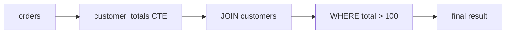

## 🎯 TL;DR

> A **subquery** is a query nested inside another query. A **CTE** (common table expression, the `WITH` clause) is a named subquery that you can read from top to bottom. Both let you break one hard question into smaller questions.

- **Scalar subquery:** returns one value, used like a number or a string.
- **Derived table:** a subquery in `FROM`, treated like a temporary table.
- **Correlated subquery:** refers to a column of the outer query, so it logically runs once per outer row.
- **CTE:** names a step, so the final query reads like a pipeline. Readability is the main benefit; performance depends on whether the engine inlines or materializes it.

## 🌱 Start simple (Junior)

> **💡 Analogy:** A cooking recipe. A subquery is "make the sauce first, then put it in the pasta". A CTE is writing "Step 1: sauce. Step 2: pasta. Step 3: serve" on the recipe card, so you can see each step by its name.

We use the tables from the joins lesson:

```sql
CREATE TABLE customers (id int, name text);
CREATE TABLE orders (id int, customer_id int, amount numeric);

INSERT INTO customers VALUES (1,'Ali'), (2,'Sara'), (3,'Reza');
INSERT INTO orders VALUES
 (10, 1, 100), (11, 1, 50), (12, 2, 200),
 (13, NULL, 30), (14, 9, 70);
```

**Scalar subquery:** orders bigger than the average order.

```sql
SELECT id, amount
FROM orders
WHERE amount > (SELECT AVG(amount) FROM orders);
```

The inner query runs once and returns one number, 90 (450 / 5). The outer query keeps orders 10 (100) and 12 (200). A scalar subquery must return at most one row and one column, or the database raises an error.

**Predict before you look:** what does this query return for Reza?

```sql
SELECT c.name,
       (SELECT MAX(o.amount) FROM orders o WHERE o.customer_id = c.id) AS biggest
FROM customers c;
```

<details><summary>Your guess?</summary>

Ali 100, Sara 200, and Reza **NULL**. The subquery runs for each customer. For Reza it finds no rows, and `MAX` over zero rows returns NULL. Your query still returns three rows, because a scalar subquery in `SELECT` never removes outer rows.

</details>

**Derived table:** a subquery in `FROM` that acts as a temporary table.

```sql
SELECT t.customer_id, t.total
FROM (
  SELECT customer_id, SUM(amount) AS total
  FROM orders
  GROUP BY customer_id
) AS t
WHERE t.total > 100;
```

Result: customer 1 with 150, and customer 2 with 200. The NULL customer forms its own group (total 30), and customer 9 has 70, so both are filtered out.

**CTE:** the same logic with a name.

```sql
WITH customer_totals AS (
  SELECT customer_id, SUM(amount) AS total
  FROM orders
  WHERE customer_id IS NOT NULL
  GROUP BY customer_id
)
SELECT c.name, t.total
FROM customer_totals AS t
JOIN customers AS c ON c.id = t.customer_id
WHERE t.total > 100
ORDER BY t.total DESC;
```

Result: Sara 200, then Ali 150. Read it top to bottom: first compute the totals, then attach names, then filter.

## 🔧 How it really works (Mid)

There are three ways to put a subquery inside a query, and each has a different place in the logical order:

| Form | Where it appears | What it returns | Example |
|---|---|---|---|
| Scalar | `SELECT`, `WHERE`, `HAVING` | one value | `WHERE amount > (SELECT AVG ...)` |
| Derived table | `FROM` | a set of rows, with an alias | `FROM (SELECT ...) AS t` |
| Predicate | `WHERE` | `TRUE`/`FALSE` | `WHERE EXISTS (SELECT 1 ...)`, `IN (SELECT ...)` |

### Correlated subqueries

A **correlated** subquery refers to a column of the outer query:

```sql
SELECT o.id, o.amount
FROM orders AS o
WHERE o.amount > (
  SELECT AVG(o2.amount)
  FROM orders AS o2
  WHERE o2.customer_id = o.customer_id   -- refers to the outer row
);
```

Conceptually, the inner query runs once for each outer `o` row, with that row's `customer_id`. This reads well and is exactly the kind of question people ask in interviews ("orders above that customer's average"). But you should not assume the database runs it row by row. Most optimizers **decorrelate** it: they rewrite it as a join with a pre-aggregated table. You can check this with `EXPLAIN`.

### Lateral joins: "the top row per group"

Sometimes the inner query needs to return **several** columns or **several** rows for each outer row, with `ORDER BY ... LIMIT`. PostgreSQL uses `LATERAL`, and SQL Server uses `CROSS APPLY`:

```sql
SELECT c.name, top1.id AS order_id, top1.amount
FROM customers AS c
CROSS JOIN LATERAL (
  SELECT o.id, o.amount
  FROM orders AS o
  WHERE o.customer_id = c.id
  ORDER BY o.amount DESC
  LIMIT 1
) AS top1;
```

Result: Ali with order 10 (100), and Sara with order 12 (200). Reza is dropped, because `CROSS JOIN LATERAL` behaves like an inner join. Use `LEFT JOIN LATERAL ... ON TRUE` to keep him with NULLs.

### CTEs and materialization

A CTE gives the optimizer a choice:

- **Inlined:** the CTE is treated like a subquery and merged into the main plan. Other filters can be pushed into it.
- **Materialized:** the result is computed once, stored in a temporary structure, and reused.

In PostgreSQL 12 and later, a non-recursive CTE that is referenced once is inlined by default. You can force the choice with `AS MATERIALIZED` or `AS NOT MATERIALIZED`. Other engines have their own rules, so check the documentation for your version rather than assuming.



## 🧠 Senior depth & trade-offs

- **Decorrelation decides the cost.** A correlated subquery that the optimizer cannot decorrelate runs once per outer row, which is slow on large tables. Check the plan. In PostgreSQL, a `SubPlan` node inside a filter often means row-by-row execution; a hash join or aggregate usually means it was rewritten.
- **`IN` versus `EXISTS` versus `JOIN`.** `EXISTS` is a semi join and stops at the first match. `NOT IN` has the NULL trap described in **sql-joins**. Prefer `EXISTS` / `NOT EXISTS` for presence checks.
- **Repeated CTE references.** A CTE referenced three times with a materialized plan computes its aggregation once. If it is inlined, the expensive part runs three times. If you see this, use `MATERIALIZED` (PostgreSQL) or store the intermediate result in a table.
- **Distributed engines.** Spark and other engines treat CTEs as named logical plans. Whether intermediate results are reused depends on the engine and on caching. For a heavy intermediate result used several times, write it to a table or cache it explicitly (see **spark-caching**).
- **Readability is a real cost saving.** A three-step CTE pipeline is easier to review, test and debug than a three-level nested subquery. Do not avoid CTEs for speed unless you measured a problem.
- **Recursive CTEs** are a separate feature with their own rules and termination conditions; see **sql-recursive-ctes**.

## 🧪 Try it

Use the tables from this lesson.

1. **Orders above their customer's average.** Return the id and amount of orders that are larger than the average amount of the same customer's orders. Use a correlated subquery.
2. **Biggest order per customer with LATERAL.** Show each customer name with their biggest order (id and amount). Write it twice: once that drops customers without orders, and once that keeps them.
3. **Customers with a large order.** List the names of customers who have at least one order over 90. Use `EXISTS`, not a join.

<details><summary>Show solutions</summary>

**1.**
```sql
SELECT o.id, o.amount
FROM orders AS o
WHERE o.amount > (
  SELECT AVG(o2.amount)
  FROM orders AS o2
  WHERE o2.customer_id = o.customer_id
);
```
Result: order 10 only. Ali's average is 75 and order 10 is 100. Sara has one order, so her average equals her order and nothing is larger. Order 13 has a NULL customer, so its inner `AVG` is NULL, and `amount > NULL` is never true.

**2.** Dropping customers without orders:
```sql
SELECT c.name, top1.id AS order_id, top1.amount
FROM customers AS c
CROSS JOIN LATERAL (
  SELECT o.id, o.amount
  FROM orders AS o
  WHERE o.customer_id = c.id
  ORDER BY o.amount DESC
  LIMIT 1
) AS top1;
```
Keeping them:
```sql
SELECT c.name, top1.id AS order_id, top1.amount
FROM customers AS c
LEFT JOIN LATERAL (
  SELECT o.id, o.amount
  FROM orders AS o
  WHERE o.customer_id = c.id
  ORDER BY o.amount DESC
  LIMIT 1
) AS top1 ON TRUE;
```
The second version also returns Reza with NULL, NULL.

**3.**
```sql
SELECT c.name
FROM customers AS c
WHERE EXISTS (
  SELECT 1
  FROM orders AS o
  WHERE o.customer_id = c.id AND o.amount > 90
);
```
Result: Ali (order 10 is 100) and Sara (order 12 is 200).

</details>

## 💬 Interview corner

**Q: What is the difference between a correlated subquery and a join?**

> **🎤 Say this in the interview:** A correlated subquery refers to the outer row and is logically evaluated once per outer row. A join combines two relations set-wise. Many correlated subqueries are rewritten into joins or semi joins by the optimizer, so the performance difference depends on the plan. I would check `EXPLAIN` before deciding, and I prefer `EXISTS` for presence checks.

A **junior** answer says "a subquery that uses a column from the outer query". A **mid** answer adds that it runs per row unless decorrelated, and gives an example. A **senior** answer covers decorrelation, the cost of `SubPlan` nodes, and how to verify the plan.

**Q: When does a CTE improve performance?**

It usually does not, by itself. A CTE improves **readability**. Performance changes only when the engine materializes a CTE that is used several times, which avoids repeated work. Otherwise an inlined CTE is the same as a subquery. Measure before you claim a speed-up.

## ⚠️ Common mistakes

- **Scalar subquery returning more than one row.** The query fails at runtime, often only with the production data. Add `LIMIT 1` with a clear `ORDER BY`, or use a join.
- **Expecting a correlated subquery to be fast.** Check the plan for row-by-row execution on big tables.
- **Using a CTE to "cache" a result.** A CTE is not a cache. Unless the engine materializes it, it is recomputed at each reference.
- **Mixing up `LATERAL` join types.** `CROSS JOIN LATERAL` drops outer rows with no result; `LEFT JOIN LATERAL ... ON TRUE` keeps them.
- **`NOT IN` with a subquery that can return NULL.** Use `NOT EXISTS`; see **sql-joins**.
- **Forgetting the alias for a derived table.** PostgreSQL and most engines require an alias on a subquery in `FROM`.
- **Reusing a CTE name as a real table name.** The CTE name shadows the table inside that query, which can give confusing results.

## ✅ Check yourself (quiz)

1. What does a scalar subquery return?
   - A) A set of rows
   - B) At most one row with one column
   - C) A table with an alias
   - D) A boolean only

2. What makes a subquery "correlated"?
   - A) It runs inside a CTE
   - B) It refers to a column of the outer query
   - C) It uses `UNION`
   - D) It returns NULL

3. In PostgreSQL 12 and later, how is a non-recursive CTE that is referenced once handled by default?
   - A) Always materialized
   - B) Inlined into the main query, unless you write `AS MATERIALIZED`
   - C) Never executed
   - D) Stored as a permanent table

4. Which join keeps customers without orders for a LATERAL top-1 query?
   - A) `CROSS JOIN LATERAL`
   - B) `LEFT JOIN LATERAL ... ON TRUE`
   - C) `INNER JOIN` with `WHERE`
   - D) `FULL OUTER JOIN`

5. **Senior question.** A query uses the same expensive aggregation CTE in three places. The team says "CTEs are slow, let's remove them." What is the likely problem, and what would you do instead?

<details><summary>Answer</summary>

**1 — B.** A scalar subquery produces one value. If it returns more rows, the query fails.

**2 — B.** The subquery refers to the outer row's column, so its result depends on that row.

**3 — B.** Since PostgreSQL 12, a side-effect-free non-recursive CTE referenced once is inlined by default. `AS MATERIALIZED` forces a single computation.

**4 — B.** `LEFT JOIN LATERAL ... ON TRUE` keeps the outer row with NULLs when the lateral subquery returns nothing.

**5 — (senior answer).** The CTE is not slow by itself. If it is inlined, the expensive aggregation runs once per reference, which is three times. The fix is to check the plan, then force one computation (`AS MATERIALIZED` in PostgreSQL), or store the intermediate result in a table or cache it explicitly on engines like Spark. Removing the CTE would only copy the logic three times, which makes the cost worse and the code harder to maintain.

</details>

## 🗂️ Flashcards

| Front | Back |
|---|---|
| Scalar subquery | Returns one value (at most one row, one column) |
| Derived table | Subquery in `FROM`; must have an alias |
| Correlated subquery | Refers to the outer row; logically evaluated per row |
| Decorrelation | The optimizer rewrites a correlated subquery as a join |
| CTE | Named subquery defined with `WITH`; improves readability |
| Inlined vs materialized | Inlined is merged into the plan; materialized is computed once and reused |
| `CROSS JOIN LATERAL` | Lateral join where a row with no result is dropped |
| `EXISTS` | Presence check; stops at the first match |

## 🔗 Go further

- **sql-recursive-ctes** covers recursive `WITH` for hierarchies and graphs.
- **sql-joins** explains semi and anti joins, and the `NOT IN` NULL trap.
- **sql-window-functions** is often a cleaner replacement for "top row per group" correlated subqueries.
- **sql-query-optimization** shows how to read `EXPLAIN` for `SubPlan` nodes and materialized CTEs.
- **spark-caching** covers how to reuse an expensive intermediate result on a distributed engine.
