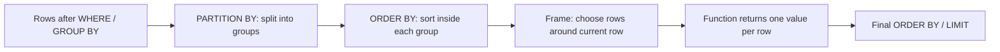

## 🎯 TL;DR

> A **window function** computes a value for **each row** using a set of related rows (its "window"), **without collapsing** those rows the way `GROUP BY` does.

- `PARTITION BY` splits rows into independent groups, but every row survives.
- `ORDER BY` inside `OVER (...)` sets the order within each group.
- The **frame** (`ROWS` or `RANGE`) picks which rows around the current row the function sees.
- Ranking functions answer "top N per group", offset functions answer "compared with the previous row", and windowed aggregates give running totals and moving averages.

## 🌱 Start simple (Junior)

> **💡 Analogy:** A class exam. `GROUP BY` says "give me the class average, one number." A window function says "give me every student's score **next to** the class average." Nobody disappears from the list.

We will use this small dataset in the whole lesson:

```sql
CREATE TABLE employees (id int, name text, dept text, salary int);
INSERT INTO employees VALUES
 (1,'Ali','data',9000), (2,'Sara','data',12000), (3,'Reza','data',12000),
 (4,'Nima','data',10000), (5,'Maryam','web',8000), (6,'Kian','web',8000),
 (7,'Parisa','web',7000);

CREATE TABLE daily_sales (day date, amount int);
INSERT INTO daily_sales VALUES
 ('2026-01-01',10), ('2026-01-02',20), ('2026-01-03',5), ('2026-01-04',15),
 ('2026-01-05',0), ('2026-01-06',30), ('2026-01-07',25), ('2026-01-08',40);
```

Compare the two results:

```sql
-- GROUP BY: 2 rows
SELECT dept, AVG(salary) AS dept_avg FROM employees GROUP BY dept;

-- Window: 7 rows, every employee keeps their row
SELECT name, dept, salary,
       AVG(salary) OVER (PARTITION BY dept) AS dept_avg
FROM employees;
```

The shape of a window call is `function(...) OVER (PARTITION BY ... ORDER BY ... frame)`. Every part of `OVER` is optional. `OVER ()` means "the whole result set is one window".

## 🔧 How it really works (Mid)

Window functions run **after** `FROM`, `WHERE`, `GROUP BY` and `HAVING`, and **before** the final `ORDER BY`, `DISTINCT` and `LIMIT`. For each row the engine:



**Ranking functions** differ only on ties:

```sql
SELECT dept, name, salary,
       ROW_NUMBER() OVER (PARTITION BY dept ORDER BY salary DESC) AS rn,
       RANK()       OVER (PARTITION BY dept ORDER BY salary DESC) AS rk,
       DENSE_RANK() OVER (PARTITION BY dept ORDER BY salary DESC) AS drk
FROM employees
ORDER BY dept, salary DESC;
```

| dept | name | salary | ROW_NUMBER | RANK | DENSE_RANK |
|---|---|---|---|---|---|
| data | Sara | 12000 | 1 | 1 | 1 |
| data | Reza | 12000 | 2 | 1 | 1 |
| data | Nima | 10000 | 3 | 3 | 2 |
| data | Ali | 9000 | 4 | 4 | 3 |
| web | Maryam | 8000 | 1 | 1 | 1 |
| web | Kian | 8000 | 2 | 1 | 1 |
| web | Parisa | 7000 | 3 | 3 | 2 |

- `ROW_NUMBER` always gives unique numbers. Order among tied rows is arbitrary, so add a unique tiebreaker (for example `, id`) when you need determinism.
- `RANK` gives ties the same number and **skips** the next ones (1, 1, 3).
- `DENSE_RANK` gives ties the same number and **does not skip** (1, 1, 2).
- `NTILE(n)` splits the ordered rows into `n` buckets of almost equal size. With 7 rows and `NTILE(4)`, the buckets have 2, 2, 2 and 1 rows: the extra rows go to the first buckets.

**Offset functions** read other rows of the same window:

```sql
SELECT day, amount,
       amount - LAG(amount) OVER (ORDER BY day) AS change_vs_prev,
       LEAD(amount) OVER (ORDER BY day)         AS next_amount
FROM daily_sales;
```

`LAG(x, 1)` returns the value from the previous row (`NULL` on the first row). `LEAD` looks forward. `FIRST_VALUE` and `LAST_VALUE` return the first or last value **of the frame**, which brings us to frames.

**Frames** decide which rows the aggregate sees. The syntax is `ROWS BETWEEN <start> AND <end>` or `RANGE BETWEEN <start> AND <end>`, with bounds like `UNBOUNDED PRECEDING`, `n PRECEDING`, `CURRENT ROW`, `n FOLLOWING`.

- `ROWS` counts **physical rows**.
- `RANGE` works on **the ORDER BY value**: all rows with the same value (peers) are treated together.
- If you write `ORDER BY` and no frame, the default is `RANGE BETWEEN UNBOUNDED PRECEDING AND CURRENT ROW`. Without `ORDER BY`, the frame is the whole partition.

```sql
SELECT name, salary,
       SUM(salary) OVER (PARTITION BY dept ORDER BY salary
                         ROWS BETWEEN UNBOUNDED PRECEDING AND CURRENT ROW) AS rows_sum,
       SUM(salary) OVER (PARTITION BY dept ORDER BY salary) AS range_sum
FROM employees
WHERE dept = 'web'
ORDER BY salary;
```

Parisa gets 7000 in both columns. Maryam and Kian both have salary 8000, so `range_sum` gives both of them 23000 (they are peers). `rows_sum` gives one of them 15000 and the other 23000, and which one is arbitrary.

## 🧠 Senior depth & trade-offs

- **Sorting cost.** Each distinct `(PARTITION BY, ORDER BY)` pair usually needs its own sort. Several windows with the same spec can share one sort, so reuse specs (the `WINDOW` clause, supported in PostgreSQL and MySQL 8) and avoid many different ones in one query.
- **Skew.** The rows of one partition are processed together. A huge partition (say, `dept = NULL` or one hot customer) becomes a single slow task. In Spark, a window with no `PARTITION BY` moves **all rows into one partition** and logs a warning for that reason. Think of it as a global sort on one executor. Check the plan with `EXPLAIN` or the Spark UI, see [[shuffle]].
- **Determinism for dedup.** The classic pattern "keep the latest row per key" is `ROW_NUMBER() OVER (PARTITION BY key ORDER BY updated_at DESC, id DESC) = 1`. Without a unique tiebreaker, the result can change between runs.
- **Streaming.** Over unbounded streams, a window with an unbounded frame keeps growing state. Flink SQL OVER aggregations need bounded frames and state-retention settings; check the docs for your version before promising a particular behaviour.
- **Engine support.** `QUALIFY` (filter on window results directly) exists in engines such as Snowflake, BigQuery, Databricks SQL and DuckDB, but not in PostgreSQL or MySQL. Where it is missing, wrap the window in a subquery or CTE.
- **When not to use it.** A window function that needs the whole table sorted per key is often more expensive than a pre-aggregated table, or a join against a pre-computed daily snapshot. Measure before choosing.

## 🧪 Try it

Run the dataset from the beginning of this lesson in PostgreSQL 13 or later (or any engine with window functions; adapt `day` arithmetic if needed).

1. **Second highest distinct salary per department.** Write it with `DENSE_RANK`, then explain why `ROW_NUMBER` would be wrong for "distinct" salaries.
2. **Percentage of department payroll.** For each employee, show `salary` as a percentage of the department total, rounded to 1 decimal place.
3. **3-day moving average** of `amount` in `daily_sales`, with the frame covering the current day and the 2 days before it.

<details><summary>Show solutions</summary>

**1.**
```sql
SELECT dept, salary
FROM (
  SELECT dept, salary,
         DENSE_RANK() OVER (PARTITION BY dept ORDER BY salary DESC) AS rnk
  FROM employees
) t
WHERE rnk = 2;
```
Result: `data 10000` and `web 7000`. `ROW_NUMBER` would pick Reza (12000, the second row of `data`), which is a duplicate of the top salary, not the second distinct value.

**2.**
```sql
SELECT dept, name,
       ROUND(100.0 * salary / SUM(salary) OVER (PARTITION BY dept), 1) AS pct_of_dept
FROM employees
ORDER BY dept, salary DESC;
```
The `100.0` matters: `100 * salary / SUM(...)` with integers uses integer division in PostgreSQL and gives 0 or 27 instead of 27.9.

**3.**
```sql
SELECT day, amount,
       AVG(amount) OVER (ORDER BY day ROWS BETWEEN 2 PRECEDING AND CURRENT ROW) AS ma3
FROM daily_sales;
```
Values (rounded): 10, 15, 11.67, 13.33, 6.67, 15, 18.33, 31.67. The first two rows use fewer than 3 rows, because the frame cannot go before the first row.

</details>

## 💬 Interview corner

**Question: "Second highest salary per department."** Mid answer: "I'd use a window with `DENSE_RANK` partitioned by department and filter `rnk = 2` in a subquery." Senior answer: "I'd use `DENSE_RANK` so ties don't shift the answer, and I'd state the tie semantics up front. I'd also check whether the table is large enough to need an index on `(dept, salary)`, and I'd note that the result for a department with only one distinct salary is empty."

**Question: "7-day rolling average."** Mid: "`AVG` over `ROWS BETWEEN 6 PRECEDING AND CURRENT ROW`." Senior: "That is correct only if there is exactly one row per day. If days are missing, `ROWS` counts the wrong days, so I'd build a complete calendar first, or use a `RANGE` frame on a date or timestamp where the engine supports interval offsets."

**Question: "Percentage of total per group."** Use `SUM(x) OVER (PARTITION BY group)` as the denominator, and watch integer division.

> **🎤 Say this in the interview:** "Window functions keep every row and add a computed column over a partition. I pick the ranking function by how I want ties handled, and I always think about the frame when I use `LAST_VALUE` or a moving average."

## ⚠️ Common mistakes

> **⚠️ Watch out:** `WHERE ROW_NUMBER() OVER (...) = 1` fails. Window functions are evaluated after `WHERE`. Use a subquery, a CTE, or `QUALIFY` where supported.

> **⚠️ Watch out:** `LAST_VALUE(x) OVER (ORDER BY day)` returns the current row, not the last row of the table, because the default frame ends at `CURRENT ROW`. Use `ROWS BETWEEN UNBOUNDED PRECEDING AND UNBOUNDED FOLLOWING`.

- Using `ROW_NUMBER` when you need ties to share a rank (use `RANK` or `DENSE_RANK`).
- Forgetting that `RANK` skips numbers and `DENSE_RANK` does not.
- Relying on `ROW_NUMBER` order among ties. The result is arbitrary unless the `ORDER BY` is unique.
- Using `ROWS` for time-based moving averages when some days are missing.
- Integer division in percentages (`100 * a / b`).
- Adding a window function without `PARTITION BY` to a big table and expecting parallelism.

## ✅ Check yourself (quiz)

1. Which function gives tied rows the same number and then **skips** the next numbers?
   - A) `ROW_NUMBER`
   - B) `RANK`
   - C) `DENSE_RANK`
   - D) `NTILE`

<details><summary>Answer</summary>

**B** — `RANK` gives tied rows the same rank and skips the following numbers (1, 1, 3). `DENSE_RANK` would give 1, 1, 2, and `ROW_NUMBER` never ties.

</details>

2. Why does this query fail?
   ```sql
   SELECT * FROM employees
   WHERE ROW_NUMBER() OVER (PARTITION BY dept ORDER BY salary DESC) = 1;
   ```
   - A) `PARTITION BY` is not allowed with `ROW_NUMBER`
   - B) Window functions are evaluated after `WHERE`, so the filter cannot see them
   - C) `ROW_NUMBER` requires a `LIMIT`
   - D) `salary` must be in the `SELECT` list

<details><summary>Answer</summary>

**B** — the logical order is `FROM`, `WHERE`, `GROUP BY`, `HAVING`, then window functions. Move the window into a subquery or CTE and filter there (or use `QUALIFY` where the engine supports it).

</details>

3. You write `SELECT day, LAST_VALUE(amount) OVER (ORDER BY day) FROM daily_sales;` and every row shows its own amount. What is the cause and the fix?

   - A) The table is not sorted; add an index
   - B) The default frame ends at `CURRENT ROW`; add `ROWS BETWEEN UNBOUNDED PRECEDING AND UNBOUNDED FOLLOWING`
   - C) `LAST_VALUE` does not work with dates; cast `day` to text
   - D) `ORDER BY` is not allowed in an `OVER` clause

<details><summary>Answer</summary>

**B** — with `ORDER BY` and no explicit frame, the frame is `RANGE BETWEEN UNBOUNDED PRECEDING AND CURRENT ROW`, so the "last" value is the current row. Extending the frame to `UNBOUNDED FOLLOWING` gives the true last value of the partition.

</details>

4. **(Senior)** A Spark job runs `row_number() OVER (ORDER BY event_time)` over 2 billion rows to assign a global sequence number, and the job is slow and then fails with an executor out-of-memory error. What is happening and what would you change?

   - A) The window needs a larger `LIMIT`
   - B) Without `PARTITION BY`, all rows go to one partition and one task; redesign so the sequence is per key, or generate IDs in a way that does not require a global ordering (for example a monotonic ID scheme plus a per-partition offset)
   - C) Spark does not support `ROW_NUMBER`; use `RANK` instead
   - D) The fix is to add `DISTINCT`

<details><summary>Answer</summary>

**B** — a window with no `PARTITION BY` is a global sort on one partition, which is a bottleneck and a memory risk. Either partition by a natural key, or accept a global ordering only on a small, aggregated dataset, or use a scheme that assigns IDs in parallel.

</details>

5. **(Senior)** Daily data has gaps: 2026-01-04 is missing. Your 7-day moving average uses `ROWS BETWEEN 6 PRECEDING AND CURRENT ROW`. Why is the result wrong, and what is a correct approach?

   - A) `ROWS` cannot be used with `AVG`
   - B) `ROWS` counts rows, so the window spans 7 rows that cover more than 7 calendar days; fill the gaps with a calendar table (or `generate_series`) first, or use a `RANGE` frame on the date when the engine supports interval offsets
   - C) The average should use `SUM` instead
   - D) Gaps only matter for `RANK`

<details><summary>Answer</summary>

**B** — with a missing day, 7 physical rows reach back more than 7 calendar days, so the average mixes periods. Build a complete date spine and left-join the data, then apply `ROWS`, or use a date-based `RANGE` frame where the engine supports it.

</details>

## 🗂️ Flashcards

| Front | Back |
|---|---|
| Window function vs GROUP BY | Window keeps every row and adds a value computed over a partition; GROUP BY collapses rows into one per group |
| `RANK` vs `DENSE_RANK` on ties (1, 1, ?) | `RANK` gives 3 (skips 2); `DENSE_RANK` gives 2 (no gap) |
| `ROW_NUMBER` with ties | Unique numbers, but the order among ties is arbitrary, so add a unique tiebreaker |
| Default frame when `ORDER BY` is present | `RANGE BETWEEN UNBOUNDED PRECEDING AND CURRENT ROW` (ties are peers) |
| Why `LAST_VALUE` returns the current row | The default frame ends at the current row; extend it to `UNBOUNDED FOLLOWING` |
| Can I filter on `ROW_NUMBER` in `WHERE`? | No; wrap it in a subquery or CTE (or use `QUALIFY` where supported) |
| `NTILE(4)` on 7 rows | Bucket sizes 2, 2, 2, 1 (the first buckets get the extra rows) |

## 🔗 Go further

- The question bank and roadmap cover this under the SQL track: pair this lesson with **sql-interview-patterns** for "top N per group", gaps-and-islands and deduplication problems.
- **sql-subqueries-ctes** explains the subquery and CTE pattern you need to filter on window results.
- **sql-nulls** matters for `ORDER BY` and ties with `NULL` values (check `NULLS FIRST` / `NULLS LAST` defaults for your engine).
- **sql-query-optimization** covers sort cost and how to read the plan for a window node.
- Read the documentation of your engine's window and frame syntax once; the standard is the same, but defaults and supported frame types vary.
