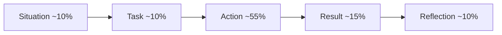

## 🎯 TL;DR

> **STAR(R)** is a four-part story shape for "tell me about a time when…" questions: **S**ituation, **T**ask, **A**ction, **R**esult, plus a second **R**eflection.

- **S + T** take about 20% of your answer: just enough context and *your* responsibility.
- **A** is the core, about half of the answer: what **you** did, step by step.
- **R (Result)** needs a number, a before and after, or a clear outcome.
- **R (Reflection)** shows what you learned and what you would do differently. It is the part that turns a story into a senior signal.

## 🌱 Start simple (Junior)

> **💡 Analogy:** A STAR answer is like a short news report. The lead says what happened and why it mattered, the middle says who did what, and the end says what changed. Nobody wants the full diary of the week.

The interviewer is not checking whether something dramatic happened. They want evidence of how **you** think and act. A story that is clear and specific beats a dramatic one that is vague.

Fill in this template, one line per letter:

```text
S (Situation): [where, when, scale, what was going wrong or what was needed]
T (Task):      [what YOU were responsible for, and the goal or deadline]
A (Action):    1) [first thing I did]
               2) [second thing I did, and why]
               3) [third thing I did, and what I checked]
R (Result):    [before → after, with a number if you have one]
R (Reflection):[what I learned, what I would change next time]
```

A junior example, short on purpose:

```text
S: Our nightly ETL job for the sales table took 5 hours and sometimes missed the 8 AM report.
T: My task was to make the job finish before 7 AM without changing the output.
A: 1) I profiled the job and found a full table scan on every run.
   2) I partitioned the table by date and filtered on the partition column.
   3) I compared the output of the old and new job for 2 weeks; they matched.
R: Runtime dropped from 5 hours to 55 minutes; the 8 AM report was never late again.
R: Next time I would ask for a row-count and checksum test before the first deploy.
```

> **⚠️ Watch out:** Most weak answers spend 80% of the time on the Situation. Keep S and T short. The interviewer will ask for more context if they need it.

## 🔧 How it really works (Mid)

A two-minute answer has a rough time budget. Use it as a guide:



Each question tests a **competency**, not a story. Common mappings:

| Question | Competency tested |
|---|---|
| "Tell me about a production incident." | Ownership under pressure, debugging method |
| "Tell me about a time you disagreed with a manager." | Judgement, communication, commitment |
| "Describe a technical decision you made." | Trade-off thinking, decision making |
| "How did you handle unclear requirements?" | Ambiguity handling, stakeholder work |

Use one story for several questions. A good story has a **decision point** (a moment you had to choose between options), and you can tell it from different angles.

**The "I" rule.** Interviewers cannot score "we". Say "we" for team context, but say "I" for your decisions and actions: "I proposed", "I checked", "I decided". If the team decided, say what **your** part was.

**Worked example (illustrative, replace with your own facts).** The question: "Tell me about a time you found a data quality problem."

> **Weak answer:** "We had a problem with the dashboard. The numbers were wrong for a while, and the team worked on it. It was stressful, but we fixed it and learned a lot. Things are better now."

What is missing: no scale, no owner, no method, no number, no reflection. The interviewer cannot tell what the candidate did.

> **Strong answer:** "**S:** Our finance dashboard showed revenue about 12% below the payment gateway totals for two days, and the finance lead found it on Monday. **T:** I was the on-call data engineer for ingestion; my goal was correct numbers the same day and no silent repeat. **A:** I compared row counts per partition between the raw zone and the warehouse, which isolated the gap to one source table starting on day 2. The upstream team had changed `amount` from integer cents to a decimal string, and my cast was turning unparseable values into NULL without an error. I patched the parser to fail loudly, backfilled the two days, and proposed a schema check at ingest that rejects type changes. **R:** Corrected numbers reached the dashboard in about 6 hours. The check has since caught three upstream changes before they reached the warehouse. **Reflection:** I now treat silent casts as bugs. I would have added the schema check before the first deploy, not after the incident."

The strong version is longer, but every sentence gives the interviewer something to score: a method, an owner, a result, and a lesson.

## 🧠 Senior depth & trade-offs (Senior)

For a senior role, the same structure carries more weight. Interviewers are looking for:

- **Scope and altitude.** Say the scale in business terms: how many users, how much money, how many teams were affected. "Two teams and about 40 dashboards" is more useful than "a big pipeline".
- **Decision quality.** In the Action, name the alternatives you rejected and why. "I chose Kafka over a nightly file drop because the downstream SLA was 15 minutes, and a file drop would have needed a 1-hour delay" shows trade-off thinking.
- **Influence without authority.** Seniors change direction through data, design docs and agreements, not through orders. Show how you got others to act.
- **Honest failure.** A senior can describe a failure, its cost, and their own mistake without blaming others. "My backfill overwrote good partitions because I tested only on a sample" is more credible than a story with no fault.
- **Measurable impact.** Use a metric the business already tracks: cost per run, late-data rate, time to detect, on-call pages per month. Agree on the metric before you claim the result.

**The three-level probe.** After your answer, interviewers usually ask three follow-ups: "Why that option?", "What else did you consider?", and "What would you do differently now?" Prepare an answer to each for every story. The Reflection part of STAR(R) is your preparation for the third question.

**When not to use STAR(R).** For hypothetical questions ("What would you do if…?") or system design questions, do not tell a story. Describe your reasoning: clarify requirements, state assumptions, propose options with trade-offs, then choose. STAR(R) is for things that already happened.

## 🧪 Try it

**Exercise 1: Fill the template.** Choose one project you know well. Fill the six lines of the template above. Then time yourself reading it aloud. The target is 110 to 130 words, about two minutes.

**Exercise 2: Find the missing piece.** Read this answer and name what is missing:

> "I fixed the Airflow DAG that kept failing. It took a while but we got it working in the end."

Expected: no Situation scale, no Task owner, no Action steps, no Result number, no Reflection.

**Exercise 3: Build one story, three angles.** Using your filled template, write the answer to two questions: "Tell me about a failure" and "Tell me about a time you improved a process." Use the same Action, but change the Situation and the Reflection so each answer fits its question.

## 💬 Interview corner

> **🎤 Say this in the interview:** "Tell me about a time you had to deal with an unreliable data source." Use the STAR(R) order and keep your answer around two minutes.

**Mid-level answer (short model):** "Our partner's daily files arrived late about once a week, and the downstream report was late too. I was asked to make the pipeline tolerant. I added a file-arrival sensor with a timeout, and an alert to the partner's contact when a file was more than two hours late. Late reports dropped from weekly to near zero for the next quarter."

**Senior-level answer (short model):** "Our partner's files were the cause of 40% of our data-quality incidents. I wrote a one-page data contract with them covering schema, arrival time and a correction process, and I negotiated the arrival SLA with their team lead. On our side I added schema validation at landing and a quarantine table for bad rows, so a bad file no longer blocked the good ones. Incidents from this source fell from about four per month to one per quarter, and I documented the process so the on-call team could run it without me."

## ⚠️ Common mistakes

- **A long Situation.** If the first 60 seconds are context, you have no time left for what you did.
- **Hiding behind "we".** The interviewer cannot tell what you contributed.
- **No result, or a vague one.** "It was better" is not a result. Use a number or a before and after.
- **No Reflection.** Without it, the story ends as history instead of growth.
- **Blame.** "The vendor broke it" ends the story with no ownership. Show what you did about it.
- **Re-using the same story for every question.** Interviewers notice. Keep several stories and map them to competencies.
- **Making up numbers.** You will be asked how you measured them. Use approximate values with a note, or use ranges.

## ✅ Check yourself (quiz)

1. What share of a good two-minute STAR(R) answer should be the Action?
   - A) About 10%
   - B) About 25%
   - C) About 55%
   - D) About 80%

<details><summary>Answer</summary>

**C** — the Action carries the signal. Keep Situation and Task short, and give Result and Reflection enough room to show impact and growth.

</details>

2. Which sentence is the best Action line for a senior answer?
   - A) "We decided to move to Spark."
   - B) "The team wanted Spark, so I helped."
   - C) "I proposed Spark over our Hive jobs after a two-week benchmark; I rejected the Flink option because our SLA was daily and the team had no Flink experience."
   - D) "I did the work and it went well."

<details><summary>Answer</summary>

**C** — it uses "I", names a decision, shows the evidence, and states the rejected alternative with a reason. That is the trade-off thinking interviewers score.

</details>

3. An interviewer asks, "Why did you choose that approach?" after your story. What is this probe testing?

   - A) Whether you remember the dates
   - B) Whether you made a deliberate decision and know its trade-offs
   - C) Whether you can speak quickly
   - D) Whether the project was large

<details><summary>Answer</summary>

**B** — the three-level probe checks decision quality. Prepare the alternatives and the reason for each before the interview.

</details>

4. **(Senior)** You have one incident story, but the question is "Tell me about a time you improved a process." What is the best approach?

   - A) Invent a second story
   - B) Use the same Action, but change the Situation and the Reflection to show the process improvement that came out of the incident
   - C) Skip the Result
   - D) Describe the whole company's history

<details><summary>Answer</summary>

**B** — one story with a clear decision point can answer several questions. Reframe the context and the lesson, but keep the facts consistent, because the interviewer may ask follow-ups on either version.

</details>

## ✅ Self-assessment checklist

Mark each item before you consider a story ready:

- [ ] Situation and Task fit in about 30 seconds together
- [ ] The Task names **my** responsibility, not the team's
- [ ] At least three Action steps, each starting with "I"
- [ ] At least one alternative I rejected, with the reason
- [ ] The Result has a number, or a clear before and after
- [ ] The Reflection says what I would change, not only what I learned
- [ ] I can answer "why?", "what else?", and "what would you change?" for this story
- [ ] I have checked every number I plan to say

## 🗂️ Flashcards

| Front | Back |
|---|---|
| What does STAR(R) stand for? | Situation, Task, Action, Result, Reflection |
| Which part is the core of the answer? | Action, about half the time |
| Why use "I" instead of "we"? | Interviewers score your own decisions and actions |
| What is a decision point? | A moment you chose between options; a good story has one |
| What are the three follow-up probes? | Why that option, what else did you consider, what would you change |
| When should you not use STAR(R)? | Hypothetical or system design questions; use structured reasoning instead |
| Why include a Reflection? | It shows learning and is your answer to "what would you change?" |

## 🔗 Go further

- [[behavioral-questions]] maps the most common question types to categories, so you know which story to use.
- [[senior-signals]] explains what seniors show beyond the STAR(R) structure: ownership, influence and impact.
- [[project-narratives]] shows how to prepare the deeper project stories that the Action part will be drilled into.
- [[senior-expectations]] describes what each level is expected to show.
- [[interview-loop]] explains where behavioral rounds fit in a typical interview process.
