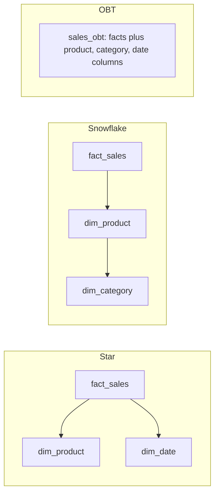

## 🎯 TL;DR

> **Star**, **snowflake** and **One Big Table (OBT)** are three shapes for the same analytical data. They differ in **how many joins** a query needs and **how many copies** of a descriptive value you store.

- **Star:** one fact table in the middle, with one flat table per dimension. Simple joins, some duplication inside each dimension.
- **Snowflake:** the dimensions are normalized into sub-tables (product → category → department). Less duplication, one more join per hop.
- **OBT:** every descriptive column is copied onto the fact rows. No dimension joins at read time, but updates are expensive and the table is wide.
- In columnar engines (ClickHouse, StarRocks, BigQuery, Snowflake, Spark over Parquet), the cost of a repeated string is much lower than in a row store, which is why wide tables are common. The trade-off moves from *joins* to *updates and governance*.

## 🌱 Start simple (Junior)

> **💡 Analogy:** A library. A **star** is a catalogue card for each book that points to the shelf, the author and the publisher, each in its own drawer. A **snowflake** puts the publisher's address in another drawer that the publisher card points to. An **OBT** writes the author's name, the publisher's name and the shelf on every single loan slip, so you never walk to another drawer, but a change of publisher means rewriting thousands of slips.

Consider sales with three descriptions: the product, the date and the customer. The **fact** table holds the events and numbers; the **dimensions** hold the descriptions:

```sql
-- Star: the fact table joins to each dimension directly
SELECT d.year_month, p.category, SUM(f.amount) AS revenue
FROM fact_sales AS f
JOIN dim_date    AS d ON d.date_key    = f.date_key
JOIN dim_product AS p ON p.product_key = f.product_key
GROUP BY d.year_month, p.category;
```

The question is always the same: **how many joins do I need, and where do I store the category name?**

## 🔧 How it really works (Mid)

### The three shapes



**Star.** The dimension is one denormalized table. `dim_product` holds `product_name`, `category` and `department` in the same row. Repeating `'Dairy'` across 10,000 products is accepted, because the dimension is small.

**Snowflake.** `dim_product` references `dim_category`, which references `dim_department`. Each attribute is stored once. The cost is extra joins whenever a query needs a deep attribute.

**OBT.** There are no dimension tables in the query path. Everything is one table:

```sql
CREATE TABLE sales_obt (
  sale_id        BIGINT,
  sale_date      DATE,
  year_month     VARCHAR(7),
  product_id     INT,
  product_name   VARCHAR(200),
  category       VARCHAR(100),
  customer_id    INT,
  customer_city  VARCHAR(100),
  customer_segment VARCHAR(50),
  amount         DECIMAL(12,2)
);

SELECT year_month, category, SUM(amount) AS revenue
FROM sales_obt
GROUP BY year_month, category;
```

The same report with a snowflake needs two extra joins (product → category). With OBT it needs none.

### Comparing the trade-offs

| Concern | Star | Snowflake | OBT |
|---|---|---|---|
| Joins at query time | Few (one per dimension) | More (chains) | None |
| Storage for repeated descriptions | Some duplication | Minimal | Maximal |
| Changing one attribute (e.g. category rename) | Update one dimension row | Update one row | Rewrite every fact row with that value |
| Ease for BI tools and analysts | Good, the standard model | Harder, many tables | Easiest: one table |
| Fit with Kimball-style SCD | Natural | Natural, more tables to version | Hard: history is repeated on every row |

The table shows the core point: joins are cheap only when the engine can do them well, and updates are cheap only when descriptions live in one place.

### Why columnar engines changed the answer

In a columnar format, each column is stored and compressed separately. A column such as `category` with 20 distinct values across 500 million rows compresses extremely well, and a query that reads only `category` and `amount` never touches the other columns. Duplication therefore costs far less than it did in a row store, and the join cost on large fact tables is what hurts. This is why OBT and wide star-like tables are common in ClickHouse, StarRocks, BigQuery and Spark over Parquet.

## 🧠 Senior depth & trade-offs

- **Rewrite cost is the real bill.** A product renamed in the source must update every OBT row for that product. On a lakehouse table format, that is a MERGE that rewrites the affected data files. For a fact table with billions of rows, a dimension change can become a large batch job. Star keeps the change in one small dimension row.
- **History.** Keeping SCD Type 2 history in an OBT means repeating the whole set of versioned attributes on every fact row, which is rarely practical. The usual answer is to keep a dimension (SCD2) for history, and build a wide table only for the current or point-in-time view.
- **Pick a grain before you widen.** Widening a fact table is safe only if the fact's grain stays fixed. Adding a column that is one-to-many with the fact (for example, multiple tags per order) silently multiplies rows and inflates sums. Check the join cardinality before you denormalize. See [[grain]].
- **Join performance in columnar MPP engines.** Dimension joins on ClickHouse, StarRocks and similar engines have improved, and they depend on the engine version, join algorithm and table layout (for example, a small dimension broadcast to all nodes). Check your engine's join docs before claiming that joins are "always slow" or "always free". Do not quote benchmark numbers from memory.
- **Layered approach is common.** Many teams keep a star (or snowflake) as the **source of truth** and publish a wide OBT as a **serving** table for dashboards. The OBT is rebuilt from the star, so it is disposable. This avoids the update problem while keeping the speed of a single table.
- **Monitor the OBT.** Watch its row count against the fact table (a bad join multiplies rows), its size growth, and the freshness of descriptive columns. A stale `category` in a rebuilt OBT is a silent error.
- **When not to use OBT.** Avoid OBT when many dimensions change often, when several fact tables share the same dimensions (you would copy the dimension into each), or when governance requires one place to change a definition. In those cases a star with a semantic layer is better.

## 🧪 Try it

1. **Exercise.** A product moves from category `Dairy` to `Fresh Food`, and the change applies to 800 products with 300 million historical sales rows. Compare the work needed in a star schema and in an OBT.

<details><summary>Solution</summary>

- **Star:** update 800 rows in `dim_product`. Facts are unchanged, because they reference `product_key`, and the new category shows in every report at once. (If history matters, this is an SCD problem, not a shape problem.)
- **OBT:** every one of the affected sales rows (potentially most of the 300 million) stores the old category as a copied string. You must rewrite all of them, typically in a batch MERGE or a full rebuild. This is the update cost of OBT.

</details>

2. **Exercise.** Write the query that lists revenue by `department` for the snowflake model (`fact_sales → dim_product → dim_category → dim_department`), then the OBT version (assuming `department` is a column in `sales_obt`).

<details><summary>Solution</summary>

```sql
-- Snowflake: three joins from fact to department
SELECT dep.department_name, SUM(f.amount) AS revenue
FROM fact_sales AS f
JOIN dim_product    AS p   ON p.product_key   = f.product_key
JOIN dim_category   AS c   ON c.category_key  = p.category_key
JOIN dim_department AS dep ON dep.department_key = c.department_key
GROUP BY dep.department_name;

-- OBT: no joins
SELECT department, SUM(amount) AS revenue
FROM sales_obt
GROUP BY department;
```

</details>

## 💬 Interview corner

**"Star or snowflake? When would you use OBT?"** Expect you to name the join and update trade-off, not to call one shape "best".

- **Mid answer:** "Star is the default for BI because it is simple to query. Snowflake normalizes dimensions and saves space but adds joins. OBT is fast to read but duplicates data, so I use it for serving tables."
- **Senior answer:** "I keep a star as the source of truth, because updates and history are cheap there, and publish an OBT for a specific dashboard when the engine handles wide scans well. I decide by the join cost on that engine, how often descriptions change, and whether the fact's grain stays fixed when I widen it."

**"Why do people use wide tables in ClickHouse?"** Model answer: "Columnar storage compresses repeated values well and reads only the columns a query names, so duplication costs less than in a row store. A wide table avoids dimension joins at read time, which are the expensive part in a large scan. The price is update cost, since a changed attribute has to be rewritten into every row, so I would keep the normalized model as the source and rebuild the wide table from it."

## ⚠️ Common mistakes

- **Saying OBT is always faster.** It is faster to read in many cases, but a rebuild or update can dominate the total cost.
- **Widening without checking the grain.** A one-to-many attribute multiplies fact rows, and sums double-count.
- **Putting SCD history in an OBT.** Every versioned attribute then repeats on every row.
- **Forgetting that a dimension change is now a fact rewrite.** The OBT team discovers this during the first big rename.
- **Treating snowflake as "more correct".** It saves space but adds joins and is harder for analysts. The right shape depends on the workload.
- **Quoting join or speed numbers from memory.** These depend on engine version and layout. Test on your data.

## ✅ Check yourself (quiz)

1. A BI team complains that every dashboard query joins five dimension tables. Which change most directly removes joins at read time?
   - A) Add an index on each dimension key
   - B) Publish a wide table with the descriptive columns copied onto the fact rows (OBT)
   - C) Normalize the dimensions further into a snowflake
   - D) Increase the number of partitions on the fact table

<details><summary>Answer</summary>

**B** — An OBT stores the descriptions on the fact rows, so the query reads one table. Indexes (A) can make joins cheaper but do not remove them; normalizing (C) adds joins; partitions (D) limit scanned data, not joins.

</details>

2. A product category is renamed. Which shape requires the largest write work?
   - A) Star, because only one dimension row changes
   - B) Snowflake, because only one category row changes
   - C) OBT, because the name is copied onto every sales row for that category
   - D) All three need the same work

<details><summary>Answer</summary>

**C** — In an OBT the name is stored in every fact row, so a rename rewrites many rows. Star and snowflake change a single dimension row, and the facts reference keys.

</details>

3. **(Senior)** You widen the sales fact with a `tags` attribute, but an order can have several tags, and revenue on the dashboard jumps by 30%. What happened?
   - A) The engine has a bug in `SUM`
   - B) The attribute is one-to-many with the fact, so each order was repeated per tag and the amount was summed multiple times
   - C) Columnar storage cannot store strings
   - D) The dashboard used `COUNT` instead of `SUM`

<details><summary>Answer</summary>

**B** — Adding a one-to-many attribute changes the grain: each order becomes several rows, and summing `amount` counts it once per tag. Keep multi-valued attributes in a bridge table, or aggregate them before the join.

</details>

4. **(Senior)** Why is a layered design (star as source of truth, OBT as serving table) common?
   - A) It removes the need for a warehouse
   - B) Updates and history stay cheap in the normalized model, and the wide table gives fast reads and can be rebuilt when it is disposable
   - C) OBT cannot be built from a star
   - D) Star schemas cannot be used with BI tools

<details><summary>Answer</summary>

**B** — Changes and history go to the place where they are cheap to apply; the OBT is derived, so it can be rebuilt instead of patched.

</details>

5. Which statement about joins in columnar MPP engines is most defensible?
   - A) Joins are always free on ClickHouse
   - B) Joins are always slow on any columnar engine
   - C) Join cost depends on the engine version, join algorithm and table layout, so it must be measured
   - D) Joins only matter for row stores

<details><summary>Answer</summary>

**C** — Engines differ in join implementations and improve over versions, so claim only what you measured or verified in the docs for your version.

</details>

## 🗂️ Flashcards

| Front | Back |
|---|---|
| Star schema | A fact table joined directly to flat dimension tables |
| Snowflake schema | Dimensions normalized into sub-tables (product → category → department) |
| One Big Table (OBT) | A wide table with descriptive columns copied onto the fact rows |
| Main cost of a star | Some duplication inside dimensions; a join per dimension |
| Main cost of an OBT | Rewriting many rows when a descriptive value changes |
| Why wide tables are common in columnar engines | Repeated values compress well and only the named columns are read |
| Widening a fact with a one-to-many attribute | Changes the grain and multiplies rows, inflating sums |
| Layered design | Star as source of truth, OBT rebuilt as a serving table |

## 🔗 Go further

- **dimensional-modeling** explains facts, dimensions and grain, the basis for all three shapes.
- **normalization** covers the normal forms behind the snowflake idea.
- **scd** shows how history is kept, which is the hard part of OBT.
- **columnar-storage** explains why repeated values and wide scans are cheap in columnar formats.
- **clickhouse** and **physical-modeling-olap** cover sort keys and table layout for wide tables.
- The grain term is in the glossary: [[grain]].
