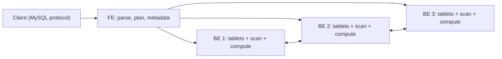

## 🎯 TL;DR

> **StarRocks** and **Apache Doris** are MPP analytical databases with a shared lineage and very similar designs: a **frontend (FE)** that plans queries and tracks metadata, **backend (BE)** nodes that store and scan **tablets** of columnar data, and (in StarRocks' shared-data mode) **compute nodes (CN)**. They serve fast interactive SQL, high-frequency loads and real-time upserts on large data.

- Choose the **table model** first: Duplicate (keep everything), Aggregate (pre-aggregate on the key), Unique or **Primary Key** (one current row per key).
- Loading is done with **Stream Load** (HTTP push), **Routine Load** (continuous from Kafka), **Broker Load** (bulk from object storage) and `INSERT` from external catalogs.
- **Materialized views** can be synchronous (updated with each load) or asynchronous (refreshed on a schedule, can span several tables).
- **External catalogs** let you query Iceberg and Hive tables in place, so the lakehouse and the warehouse share data.
- Operate it through **replicas**, **tablet** counts, **compaction** health and the **query profile**.

## 🌱 Start simple (Junior)

> **💡 Analogy:** A large library with a front desk and many storerooms. The front desk (FE) knows the catalogue and decides which storerooms a question needs; the storerooms (BE) hold the books and do the reading. Books are cut into numbered trays (tablets), and every tray has backup copies in other rooms. When many people ask questions at once, the desk sends each question to the right rooms in parallel and merges the answers.

Here is a small table, in StarRocks syntax:

```sql
CREATE TABLE orders (
  order_id   BIGINT NOT NULL,
  user_id    BIGINT NOT NULL,
  order_date DATE   NOT NULL,
  status     VARCHAR(16),
  amount     DECIMAL(12,2)
)
PRIMARY KEY (order_id)
DISTRIBUTED BY HASH(order_id) BUCKETS 16
PROPERTIES ("replication_num" = "3");

SELECT order_date, SUM(amount) AS revenue
FROM orders
WHERE order_date >= '2026-10-01'
GROUP BY order_date
ORDER BY order_date;
```

Three things to notice:

- The table has a key (`order_id`). That key decides how rows are stored and, in the Primary Key model, which row is the current version.
- `DISTRIBUTED BY HASH` spreads rows over 16 buckets. Each bucket is a **tablet**, and each tablet has 3 replicas on different backends.
- The query looks like ordinary SQL. The engine splits it into fragments that run in parallel on the backends.

## 🔧 How it really works (Mid)

### Architecture



- **FE** (frontend, Java) holds metadata (databases, tables, partitions, tablet locations, users), parses SQL, builds a distributed plan and coordinates queries. Several FEs run in a leader and follower arrangement for high availability. Clients connect with the MySQL protocol.
- **BE** (backend, C++) stores tablets on local disks, executes plan fragments, and performs most of the CPU work of scans, joins and aggregations.
- **CN** (compute node) appears in **shared-data mode**: data is kept in object storage, CNs are stateless compute with a local cache, and they scale up or down without moving data. Check the docs for which versions and features support this mode.

### Table models

The model decides how rows with the same key are stored and merged. Choose it before you load data, because it cannot be changed casually.

| Model | Keeps | Typical use | Watch out for |
|---|---|---|---|
| **Duplicate Key** | every row, sorted by key | event logs, raw facts | no deduplication; you must filter or dedupe in queries |
| **Aggregate Key** | one row per key, values merged with functions such as SUM, MAX, REPLACE | pre-aggregated metrics | only the declared aggregation is possible; "latest value" needs REPLACE and care |
| **Unique Key** | one row per key, the latest load wins | CDC-style current state | the merge semantics differ between versions; read the docs for your version |
| **Primary Key** | one current row per key, with a primary key index; supports efficient updates and deletes | real-time upserts, CDC | the index needs memory proportional to keys; size it |

The **sort key** (the leading columns of the key) controls how data is ordered on disk. Queries that filter on the first sort columns skip whole blocks, similar to what you saw in [[columnar-storage]] and [[predicate-pushdown]].

### Tablets, replicas and distribution

Each partition is split into **buckets** by a hash of the distribution column (`DISTRIBUTED BY HASH`). Each bucket is a tablet. Each tablet has several replicas on different BEs (usually three), and the FE keeps them consistent after loads.

Design rules that matter in practice:

- **Choose a distribution column with high cardinality and even spread.** A column with a few values (status, country) creates skew: one tablet becomes huge and one BE becomes the bottleneck.
- **Do not create too many tiny tablets.** Each tablet has metadata and per-file overhead. Pick a bucket count from the data size and the number of BEs, then check tablet sizes.
- **Replicas give availability and read parallelism**, at the cost of storage and write work. Three is the usual default.

### Loading

| Method | Mechanism | Good for |
|---|---|---|
| **Stream Load** | HTTP `PUT` of a file or payload; synchronous response | application pushes, small to medium batches |
| **Routine Load** | the cluster pulls continuously from Kafka and tracks offsets | streaming ingestion into a table |
| **Broker Load** | asynchronous bulk job that reads files from HDFS or object storage | large historical loads |
| **INSERT INTO ... SELECT** | SQL from an internal or external table | transformations inside the warehouse |

Stream Load example (the FE HTTP port is commonly 8030; the request is redirected to a BE):

```bash
curl --location-trusted -u loader:secret \
  -H "label: orders-2026-10-13-batch-001" \
  -H "format: json" \
  -T orders-2026-10-13.json \
  http://fe.internal:8030/api/shop/orders/_stream_load
```

The **label** is the idempotency key. A job with the same label is not loaded twice within the label retention period, so a retrying client should reuse the label. This is the same pattern as in [[idempotency]].

Routine Load from Kafka:

```sql
CREATE ROUTINE LOAD shop.orders_kafka ON orders
COLUMNS (order_id, user_id, order_date, status, amount)
PROPERTIES ("format" = "json", "desired_concurrent_number" = "4")
FROM KAFKA (
  "kafka_broker_list" = "kafka:9092",
  "kafka_topic" = "orders"
);
```

Routine Load stores the Kafka offsets with the load transactions, so restarts resume from the last committed offset. Pair this with a source that can emit duplicates only rarely, or with a Primary Key table, which turns redelivered rows into updates of the same key.

### Materialized views

- **Synchronous** views (rollup-style in Doris) are maintained as part of each load on a single base table. They are cheap to keep fresh and the optimizer can rewrite queries transparently.
- **Asynchronous** views are refreshed on a schedule or manually, can join several tables, and can be built on external catalogs. They are the usual choice for aggregated dashboards, but they are only as fresh as the last refresh.

```sql
CREATE MATERIALIZED VIEW daily_revenue
DISTRIBUTED BY HASH(order_date)
REFRESH ASYNC EVERY (INTERVAL 5 MINUTE)
AS
SELECT order_date, SUM(amount) AS revenue, COUNT(*) AS orders
FROM orders
GROUP BY order_date;
```

Check the refresh and rewrite behaviour in the docs for your version before promising freshness to users.

### External catalogs

An external catalog points the engine at an existing Iceberg or Hive metastore. You then query lake tables in place:

```sql
-- Iceberg tables from a REST or Hive catalog, queried alongside internal tables
SELECT c.region, SUM(o.amount) AS revenue
FROM lake.sales.orders AS o
JOIN shop.customers AS c ON o.user_id = c.user_id
GROUP BY c.region;
```

This is where the lakehouse and the warehouse meet. See [[catalogs]] for how the metastore keeps the table version consistent.

### Joins and colocation

For a join, the optimizer chooses among:

- **Broadcast join:** the small table is copied to every BE that scans the big table.
- **Shuffle (partitioned) join:** both sides are repartitioned by the join key, which costs a network transfer. See [[broadcast-join]] and [[shuffle]].
- **Colocate join:** tables in the same **colocate group** share bucket count, distribution column and replica layout, so matching buckets sit on the same BE. The join runs locally with no shuffle.

Colocation is powerful for a large fact table joined with a large dimension on the same key, for example `orders` and `order_items` by `order_id`. It has a cost: all tables in the group must be bucketed together, which makes rebucketing and schema changes harder.

### Compaction and versions

Every load writes a new version (a rowset or segment) on each tablet. Background **compaction** merges small versions into bigger ones. If loads are small and frequent, versions pile up faster than compaction can merge them, and queries get slower, and eventually the system rejects writes with a "too many versions" style error. The fix is to load in larger batches, or to reduce the load frequency, and to check compaction status before adding more load jobs.

## 🧠 Senior depth & trade-offs

- **ClickHouse vs StarRocks.** ClickHouse's MergeTree is excellent for append-heavy, single-table scans and aggregations on denormalized data, and it is very fast when you control the schema. StarRocks has a fuller MPP SQL engine with shuffle, broadcast and colocate joins, and better support for real-time upserts through the Primary Key model. In practice: ClickHouse is often chosen for event analytics on wide tables; StarRocks for multi-table SQL, dashboards with joins, and CDC-style current state. Measure your own queries; both change quickly. See [[clickhouse]] and [[realtime-olap]].
- **Upsert cost.** Primary Key tables keep an index of keys. Its memory grows with the number of distinct keys, and a huge key space on a small BE can cause failures. Size memory for the index, and consider a Duplicate table plus a periodic dedup view if updates are rare.
- **Freshness versus load.** Frequent small loads raise version counts and compaction work. A common pattern is micro-batches every 10 to 60 seconds, not per-event loads, with monitoring on the version count.
- **Skew and hot keys.** Skew on the distribution column is the most common cause of slow queries and unbalanced disks. Look at tablet sizes per BE and at the profile of a slow query. See [[data-skew]] and [[hot-key]].
- **Query profile.** Enable the query profile for a slow query and read it from the FE web UI or the profile output. Look for the operator that takes the most time, the rows scanned against rows returned (a poor filter), and the network time of exchanges (a shuffle that should have been a broadcast or colocate join). `EXPLAIN` shows the plan before execution.
- **Operations.** Watch FE leader health, BE disk usage, tablet count and size, replica health, compaction score and load job failures. Alert on failed Routine Load jobs; they often stop silently after an offset or schema error.
- **Backups and schema change.** Plan backups and restore tests before you need them. Schema changes on large tables can take time and resources; test them on a copy.
- **When not to use it.** Small datasets that fit in one database, OLTP workloads with many small transactional writes, and unbounded text search are better served elsewhere. A data lake query engine such as [[trino]] is the better choice when you rarely need the warehouse's storage.

## 🧪 Try it

On a local StarRocks or Doris cluster (the official quick-start images are enough), do the following:

1. Create the `orders` table above with the Primary Key model. Load 3 rows with Stream Load using `label`. Repeat the same Stream Load with the same label and confirm the rows are not doubled.
2. Insert an update for an existing `order_id` with a new `status`. Confirm the table returns one row for that key with the new value.
3. Create the `daily_revenue` async materialized view. Insert new rows, trigger a refresh, and compare the view with the same aggregation on the base table.
4. Run `EXPLAIN` on a join between `orders` and a small `customers` table. Identify whether the join is broadcast or shuffle.

<details><summary>Show solutions</summary>

1. The first load creates 3 rows. The second load with the same label is rejected or reported as already loaded, so the count stays at 3. The label is what makes the retry safe.
2. A Primary Key table replaces the row with the same key. `SELECT * FROM orders WHERE order_id = ...` returns one row with the new status.
3. Right after a load, the materialized view may be stale until the next refresh. After the refresh, the totals match the base-table aggregation. Freshness depends on the refresh schedule.
4. For a small right-side table, the plan shows a broadcast; for a large one it shows a shuffle (partitioned) join. Colocation, if set up, shows the join without an exchange.

</details>

## 💬 Interview corner

**Question: "How would you design a real-time order dashboard on StarRocks?"**

- **Mid answer:** "I'd load the orders topic from Kafka with Routine Load into a table, build a materialized view for the revenue per day, and point the dashboard at the view."
- **Senior answer:** "I'd use a Primary Key table keyed on `order_id`, so CDC updates overwrite the current state, and load it with Routine Load to get exactly-once-like behaviour through the key. I'd choose a distribution column with even spread, size the primary key index for the key count, and keep micro-batches large enough to avoid version pile-up. The dashboard reads an async materialized view with a refresh interval that matches the SLA, and I'd alert on Routine Load failures, compaction backlog and replica health."

**Question: "When would you pick ClickHouse over StarRocks?"**

Wide, append-heavy event tables with mostly single-table scans and rare updates, where you control the schema and need the fastest scans. StarRocks is more natural when the workload joins many tables, needs real-time upserts, or uses materialized views to serve dashboards.

> **🎤 Say this in the interview:** "I start with the table model, because it defines how duplicates and updates behave. Then I think about distribution for skew, the load pattern for version pile-up, and the query profile for performance. I choose between ClickHouse and StarRocks by join shape and update pattern, not by brand."

## ⚠️ Common mistakes

> **⚠️ Watch out:** Using a low-cardinality column (status, country, day) as the distribution key. One tablet grows huge, one BE is overloaded, and the cluster looks slow although it has spare capacity.

> **⚠️ Watch out:** Retrying a Stream Load without the same label. The retry can load the same batch twice in a Duplicate table.

- Picking the Duplicate model for CDC data and expecting updates to replace old rows.
- Creating thousands of tiny buckets because "more parallelism is better". Each tablet has overhead.
- Loading one row per request, which creates a version per tablet and then "too many versions" errors.
- Assuming an async materialized view is always fresh.
- Forgetting that Routine Load jobs can pause on schema or data errors and need an alert.
- Ignoring the query profile and tuning by guesswork.

## ✅ Check yourself (quiz)

1. Which table model keeps one current row per key and supports efficient real-time updates?
   - A) Duplicate Key
   - B) Aggregate Key
   - C) Primary Key
   - D) Random bucketing

<details><summary>Answer</summary>

**C** — the Primary Key model stores one current row per key and indexes keys so updates and deletes are efficient. Duplicate Key keeps every row; Aggregate Key merges by declared functions.

</details>

2. Why does a Stream Load retry reuse the same label?
   - A) The label sets the compression level
   - B) The label identifies the load job, so a repeated request with the same label is not applied twice
   - C) The label chooses the BE that stores the data
   - D) The label is required for Parquet files only

<details><summary>Answer</summary>

**B** — the label is the idempotency key for the load. Reusing it turns a retry into a no-op if the first attempt succeeded.

</details>

3. A fact table and a dimension table are joined on `customer_id` every query. Both are large. What is the strongest optimization to consider?
   - A) Put both tables in one column
   - B) Colocate the tables: same bucket count, distribution column and replica layout, so the join runs locally
   - C) Disable replicas
   - D) Use Duplicate Key on the dimension

<details><summary>Answer</summary>

**B** — colocation places matching buckets on the same BE, so the join avoids a network shuffle. The trade-off is tighter coupling between the tables' layouts.

</details>

4. **(Senior)** After a month of production, one BE has 3 times the disk usage of the others and queries that scan `orders` are slow. Which two things would you check first?

   - A) The FE JVM heap and the SQL dialect
   - B) Tablet sizes and the skew of the distribution column across buckets, plus the query profile of a slow query
   - C) The number of Kafka partitions only
   - D) The client's MySQL driver version

<details><summary>Answer</summary>

**B** — skewed distribution produces uneven tablets and BEs. Check tablet sizes per BE and the profile to see whether a few buckets dominate scan or memory cost.

</details>

5. **(Senior)** A team loads 500 small Stream Load requests per minute into one table. Queries slow down over the day and then loads start failing. What is the likely mechanism, and what would you change?

   - A) The Stream Load protocol is too slow to use
   - B) Each load adds versions per tablet faster than compaction merges them; batch the loads into larger, less frequent writes and monitor the compaction score and version count
   - C) The FE is out of disk, so disable the FE
   - D) Stream Load cannot write to Primary Key tables

<details><summary>Answer</summary>

**B** — version pile-up slows reads and eventually blocks writes. Larger batches and monitoring of compaction health address the root cause.

</details>

## 🗂️ Flashcards

| Front | Back |
|---|---|
| FE vs BE | FE plans queries and holds metadata; BE stores tablets and executes the work |
| What is a tablet? | A bucket of a partition with its own replicas on BEs |
| Duplicate Key model | Keeps every row; no deduplication |
| Primary Key model | One current row per key with a key index; efficient upserts and deletes |
| Why is a Stream Load label important? | It is the idempotency key that makes retries safe |
| Routine Load | The cluster pulls from Kafka continuously and tracks offsets |
| Sync vs async materialized view | Sync updates with each load on one table; async refreshes on schedule and can span tables |
| Colocate join | Matching buckets on the same BE, so the join avoids a shuffle |
| What causes "too many versions"? | Frequent small loads outpace background compaction |

## 🔗 Go further

- **lakehouse-table-formats** and **catalogs** explain the Iceberg and Hive tables you can query in place.
- **clickhouse** and **realtime-olap** compare the main alternative and the wider pattern.
- **mpp-architecture** explains the parallel engine model behind FE and BE.
- **kafka-exactly-once** explains the guarantees you need on the Kafka side of Routine Load.
- **trino** shows the query-engine alternative for lake data without a warehouse.
- Read the official docs for your version for table-model merge semantics, MV rewrite and CN support; these details change between releases.
