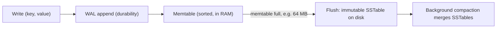

## 🎯 TL;DR

> A **storage engine** decides how bytes are laid out on disk and how they are changed. A **B-tree** updates pages **in place**: reads are fast, writes cause random I/O. An **LSM-tree** (log-structured merge tree) **appends** writes and merges files in the background: writes are fast, but reads and disk space need extra work.

- B-tree: one sorted tree of fixed-size pages. A write finds the right page and rewrites it.
- LSM-tree: writes go to a sorted in-memory buffer, which is flushed as immutable sorted files. Background **compaction** merges those files.
- Every design trades three costs against each other: **write amplification**, **read amplification** and **space amplification**.

## 🌱 Start simple (Junior)

> **💡 Analogy:** Compare a **filing cabinet** with a **notebook**. In the cabinet, you take out a card, cross out the old value and write the new one in the same place (B-tree). In the notebook, you always write the newest line at the end, which is fast. Once in a while you copy the notebook into a clean, sorted book and drop the crossed-out lines (LSM-tree and compaction).

Take a key-value store that holds `user:42 → "Ali"`. Now we update it to `"Sara"`.

- **B-tree:** find the page that holds `user:42`, change the bytes in that page, and write the page back to the same place on disk.
- **LSM-tree:** add `user:42 → "Sara"` to the in-memory buffer. The old value `"Ali"` stays in an older file until compaction removes it.

Reads work the other way around. A B-tree walks a short path from the root to one leaf. An LSM-tree checks the newest data first and then older files, until it finds the key.

| | B-tree | LSM-tree |
|---|---|---|
| Write | find the page, overwrite it | append to memory, flush later |
| Read | one path down the tree | check several places, newest first |
| Disk pattern | random writes | sequential writes |
| Typical use | balanced OLTP, point lookups | heavy ingestion, event logs, time-series |

You do not need the internals yet. Remember: **B-tree = update in place, LSM = write now and merge later.**

## 🔧 How it really works (Mid)

### B-tree pages

A B-tree stores data in **pages**. PostgreSQL uses 8 KB pages by default, and InnoDB (MySQL) uses 16 KB pages by default. A page holds hundreds of keys and pointers, so the tree is very **shallow**. Suppose one index entry takes about 100 bytes and a 16 KB page holds about 160 entries. Then:

- 3 levels index about 160³ ≈ 4 million leaf entries.
- 4 levels index about 160⁴ ≈ 655 million entries.

So a lookup in a billion-row table is usually 3 or 4 page reads, and the upper levels stay in the buffer cache.

An update finds the leaf page, changes it in place and writes the page back. When a page is full, it **splits**. To survive a crash, the engine first writes a record to the [[wal-mvcc|write-ahead log]] (WAL), and writes the modified page to the data file later, at checkpoint or flush time.

The cost is **write amplification**. Changing 100 bytes may rewrite a whole 8 KB page. For the page alone, that is 8192 / 100 ≈ 82 times more bytes than the application wrote.

### LSM-tree write path



1. The write is appended to a **WAL** so it survives a crash.
2. The write goes into the **memtable**, a sorted structure in memory (LevelDB and RocksDB use a skip list).
3. When the memtable is full, it becomes read-only and is written to disk as an **SSTable** (sorted string table). An SSTable is never changed after it is written.
4. A background **compaction** job merges SSTables. While merging, it keeps only the newest version of each key and removes tombstones (delete markers) when it is safe to do so.

A read checks the memtable, then the immutable memtables, then the SSTables from newest to oldest. The first version found wins.

### Bloom filters

Without help, a read for a key that does not exist must check every SSTable. Each SSTable therefore carries a **Bloom filter**: a bit array plus several hash functions.

- If the filter says "no", the key is **definitely absent**, so the file is skipped.
- If it says "yes", the key **may** be present. The engine then reads the file, and sometimes this is a **false positive**.

With about 10 bits per key, the false-positive rate is about 1%. For 1,000 keys, the filter takes 10,000 bits ≈ 1.2 KB. Bloom filters help **point lookups** only. They cannot help with range scans.

### Compaction strategies

| Strategy | How it works | Write amp | Read amp | Space amp | Typical user |
|---|---|---|---|---|---|
| Size-tiered | merge several files of similar size into one bigger file | lower | higher (more files) | higher (old and new copies coexist during merge) | Cassandra default for many tables |
| Leveled | levels grow by a fixed ratio (RocksDB default multiplier is 10); files in one level do not overlap in key range | higher | lower (about one file per level) | lower | RocksDB default, read-heavy workloads |
| Time-window | files grouped by time window; whole windows expire together | low | depends | low for TTL data | time-series with TTL in Cassandra (TWCS) |

The three **amplification** metrics, in plain words:

- **Write amplification** = bytes physically written to disk / bytes the application wrote.
- **Read amplification** = disk reads needed per lookup (files and blocks consulted).
- **Space amplification** = disk used / live data size.

Simplified model: if a byte is flushed once and then rewritten in each of 4 compaction levels, write amplification is about 1 + 4 = 5.

### RocksDB as a state backend

Two stream processors use RocksDB internally, which is a good real-world example:

- **Flink** can keep its keyed state in an embedded RocksDB instance on each task manager. The state can be bigger than the heap. Checkpoints upload SST files, often incrementally.
- **Kafka Streams** uses RocksDB as the default persistent store for state. Each store is backed by a **changelog topic** in Kafka, so the store can be rebuilt after a failure.

## 🧠 Senior depth & trade-offs

- **The RUM conjecture.** Read overhead, update overhead and memory (space) overhead cannot all be minimized at once. Each engine and each compaction setting picks two. Ask which of the three your workload pays for.
- **Write stalls.** LSM engines slow down or stop writes when compaction falls behind, for example when the number of level-0 files grows past a threshold. Monitor pending compaction bytes, level-0 file count and stall time. A write-latency spike with no change in traffic is often compaction debt.
- **Deletes are writes.** A delete creates a tombstone. Space comes back only after compaction reaches the tombstone. In Cassandra, tombstones also slow reads (the read must skip them) and must survive a configurable grace period (`gc_grace_seconds`, 10 days by default) before they are dropped, so repairs can propagate them. A table with heavy deletes can be slower to read than its row count suggests.
- **Compression.** LSM files are immutable blocks, so they compress well. This lowers space amplification and I/O, at a CPU cost.
- **Hardware.** B-trees were designed for disks where random I/O was costly. SSDs reduce that gap, but LSM engines still benefit from sequential writes and large batched I/O. Check the storage type before choosing.
- **Analytical engines use the same idea.** ClickHouse MergeTree writes immutable data parts and merges them in the background, so it behaves like an LSM design for inserts. This is why ClickHouse wants large batches and not one row per insert.
- **Metrics to watch:** p99 read and write latency, compaction backlog, level-0 file count, SSTables consulted per read (read amplification), Bloom filter hit rate, cache hit rate and disk usage versus live data.
- **When not to use LSM.** Read-heavy OLTP with frequent in-place updates of small rows, and workloads that need strong, cheap range queries on the same data, are often better on a B-tree engine such as PostgreSQL or InnoDB.

## 🧪 Try it

1. **Tree depth.** Pages are 8 KB, and each index entry is 64 bytes. How many entries fit per page (ignore headers)? How many levels do you need for 100 million keys?
2. **Write amplification.** A B-tree update changes 100 bytes, and the engine writes the full 8 KB page. Estimate the write amplification for the page write alone.
3. **Bloom filter cost.** A key that does not exist is looked up in 5 SSTables, and the false-positive rate per filter is 1%. What is the expected number of extra data-file reads per lookup?
4. **Run a toy LSM.** Run this script and predict the output before you run it.

```python
class TinyLSM:
    def __init__(self, memtable_limit=3):
        self.memtable = {}
        self.sstables = []              # newest is last; each table is never changed
        self.limit = memtable_limit

    def put(self, key, value):
        self.memtable[key] = value
        if len(self.memtable) >= self.limit:
            self.sstables.append(dict(sorted(self.memtable.items())))  # "flush"
            self.memtable = {}

    def get(self, key):
        if key in self.memtable:
            return self.memtable[key]
        for table in reversed(self.sstables):   # newest first
            if key in table:
                return table[key]
        return None

db = TinyLSM()
for k, v in [("a", 1), ("b", 2), ("c", 3), ("a", 9)]:
    db.put(k, v)
print(db.get("a"))         # ?
print(len(db.sstables))    # ?
```

<details><summary>Show solutions</summary>

**1.** 8192 / 64 = 128 entries per page. 128³ = 2,097,152 is less than 10⁸, and 128⁴ = 268,435,456 is more than 10⁸. So 4 levels.

**2.** 8192 / 100 ≈ 82. The page write alone is about 82 times the bytes the application changed, before the WAL record is counted.

**3.** Each filter gives a false positive with probability 0.01. Five filters give 5 × 0.01 = 0.05 extra file reads per lookup on average. A filter never gives a false negative, so no real hit is skipped.

**4.** The output is `9` and `1`. The first three puts fill the memtable and flush `{a:1, b:2, c:3}` as one SSTable. Then `a=9` goes into the new memtable. `get("a")` checks the memtable first and finds 9. The newest version wins.

</details>

## 💬 Interview corner

**Question: "Why does Cassandra use an LSM-tree while PostgreSQL uses a B-tree?"** Mid answer: "Cassandra targets high write throughput. It appends to a commit log and a memtable, and it flushes sorted files, so writes are sequential. PostgreSQL updates pages in place, which suits balanced read and write OLTP." Senior answer: "The choice follows the access pattern. Cassandra is write-optimized and reads use Bloom filters and partition keys to limit the files touched. I'd accept its compaction and tombstone costs to get write throughput that a B-tree would struggle to sustain across many nodes."

**Question: "Read latency on a write-heavy table doubled after a month. What do you check?"** Senior answer: "I'd check SSTables consulted per read, tombstone counts, and whether the compaction strategy matches the workload. Then I'd check Bloom filter effectiveness and cache hit rates. A growing level-0 file count or pending compaction bytes points to compaction debt."

> **🎤 Say this in the interview:** "A B-tree updates pages in place, so reads are cheap and writes cause random I/O. An LSM-tree appends to a log and a memtable, flushes sorted immutable files, and merges them in the background. I pick based on whether my workload pays more for reads or for writes, and I plan for compaction and tombstone costs."

## ⚠️ Common mistakes

> **⚠️ Watch out:** "LSM means writes are free." Writes are cheap for the application, but compaction later rewrites the same data several times. That cost appears as write amplification and as compaction load.

> **⚠️ Watch out:** A delete does not free disk space right away. It writes a tombstone, and the space is reclaimed only when compaction reaches the old data.

- Confusing the **WAL** (durability, sequential) with the **memtable** (speed, in memory). You need both.
- Using a Bloom filter for a range scan. Filters only help point lookups.
- Choosing leveled compaction for a write-heavy, time-expiring dataset, where time-window compaction usually fits better.
- Assuming a B-tree is always slow for writes. On SSDs with batched writes, B-tree engines handle a lot of writes well.
- Ignoring compaction metrics until the disk fills up or latency spikes.

## ✅ Check yourself (quiz)

1. Which structure turns most writes into sequential disk writes?
   - A) B-tree
   - B) LSM-tree
   - C) Hash index
   - D) Heap file with in-place updates

<details><summary>Answer</summary>

**B** — an LSM-tree appends to a WAL, buffers writes in a memtable, and flushes sorted SSTables. A B-tree updates pages where they already are, which means random writes.

</details>

2. Which statement about a Bloom filter is correct?
   - A) It can produce false negatives, so a "no" may be wrong
   - B) It can produce false positives, so a "yes" may be wrong, but a "no" is always right
   - C) It can be used to answer range queries
   - D) It removes the need for compaction

<details><summary>Answer</summary>

**B** — a Bloom filter never misses a key that was inserted, so "no" is certain. A "yes" can be wrong. Filters do not answer range queries, and they do not affect compaction.

</details>

3. A table is write-heavy with a 30-day TTL, and each day's data expires as a whole. Which compaction strategy fits best, and why?
   - A) Size-tiered, because it has the lowest space amplification
   - B) Time-window compaction, because files cover one time window and expire together without per-row tombstones
   - C) Leveled, because it has the lowest write amplification
   - D) No compaction, because TTL removes data automatically

<details><summary>Answer</summary>

**B** — time-window compaction groups data by time, so whole files expire together and are dropped without rewriting. Leveled compaction would rewrite data that is about to expire, and size-tiered keeps old and new copies around for longer.

</details>

4. **(Senior)** A team switches a read-heavy table from size-tiered to leveled compaction. What do they gain and what do they pay?
   - A) Higher write amplification, but lower space amplification and fewer files consulted per read
   - B) Lower write amplification, but more space and more files per read
   - C) Nothing changes, because compaction does not affect reads
   - D) Fewer tombstones, but no effect on disk usage

<details><summary>Answer</summary>

**A** — leveled compaction keeps levels non-overlapping, so a read checks about one file per level and disk space stays close to the live data size. The price is that each byte is rewritten more times as it moves down the levels.

</details>

5. **(Senior)** Why does a delete-heavy workload make reads slower even when the row count is small?
   - A) Deletes lock the whole table
   - B) Each delete adds a tombstone, and reads must scan past tombstones until compaction removes them
   - C) Deletes rebuild the B-tree on every call
   - D) Bloom filters stop working after a delete

<details><summary>Answer</summary>

**B** — the tombstones are data that a read must process. Until compaction clears them, a query can scan many dead entries to find a few live ones.

</details>

## 🗂️ Flashcards

| Front | Back |
|---|---|
| B-tree write path | Find the leaf page and overwrite it in place (after the WAL record) |
| LSM-tree write path | WAL append, then memtable, then flush to an immutable SSTable |
| Why SSTables are never changed | Immutability makes flush and merge sequential and lets readers avoid locks |
| Bloom filter guarantee | "No" is certain; "yes" can be a false positive (about 1% at 10 bits/key) |
| Write amplification | Bytes written to disk / bytes the application wrote |
| Leveled vs size-tiered | Leveled: lower read and space amp, higher write amp. Size-tiered: the reverse |
| What a tombstone is | A delete marker; space is reclaimed only after compaction reaches it |
| Who uses RocksDB inside | Kafka Streams (default state store) and Flink (embedded state backend) |

## 🔗 Go further

- [[wal-mvcc]] explains the WAL in detail, and how MVCC lets readers avoid blocking writers. Both engines depend on it.
- [[sql-indexing]] shows how the planner uses B-tree indexes, and what they cost on write.
- [[postgresql]] is the practical B-tree engine for OLTP, including its VACUUM and bloat behaviour.
- [[nosql-families]] lists which databases use LSM storage and how their data models follow from it.
- [[streaming-state]] covers how stream processors store keyed state, often on RocksDB.
- Read chapter 3 of *Designing Data-Intensive Applications* (Kleppmann) for the full comparison, and the RocksDB wiki for compaction tuning. Check the docs for your engine version before you rely on a default.
