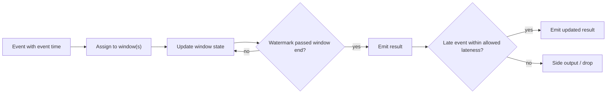

## 🎯 TL;DR

> A stream processor must answer two questions that batch jobs can avoid: **which time** each event belongs to (event time vs processing time), and **when it is safe to emit a result** even though more data may still arrive late.

- **Event time** is when something happened. **Processing time** is when your system saw it. They differ because of network delays, retries and outages.
- **Windows** group events by time: tumbling (fixed, no overlap), sliding (fixed size, overlapping), session (ends after a gap of inactivity), global (one window, custom trigger).
- A **watermark** is the system's claim: "I do not expect any more events older than this time." Results for a window are emitted when the watermark passes its end.
- **Late data** arrives after the watermark. You drop it, send it to a side output, or accept it within an **allowed lateness** and emit corrections.

## 🌱 Start simple (Junior)

> **💡 Analogy:** A school reports attendance for each day. A student's absence note might arrive a week later. If the principal publishes the daily attendance report immediately, it will be wrong. If the principal waits forever, the report is never published. A watermark is the principal saying: "I will publish day 3 once I am fairly sure the notes for day 3 are in."

Consider a stream of clicks. Each click has two times:

```text
click  event_time (when the user clicked)   arrival (when we received it)
  A    10:00:10                              10:00:11
  B    10:00:50                              10:00:52
  C    10:01:05                              10:01:06
  D    10:00:40                              10:01:20   <- phone was offline, arrived late
```

You want "clicks per minute". Click D belongs to the 10:00 minute, even though it arrived during the 10:01 minute. If you group by **processing time** (arrival), D lands in the wrong minute. Grouping by **event time** is correct, but then you must decide when the 10:00 minute is "done" so you can publish a count. That decision is the watermark.

Simple rule for juniors: **group by event time, decide completeness with a watermark, and say what happens to late data.**

## 🔧 How it really works (Mid)

**Windows.**

| Type | Shape | Example | An event belongs to |
|---|---|---|---|
| Tumbling | fixed size, no overlap | every 1 minute | exactly 1 window |
| Sliding (hopping) | fixed size, slide smaller than size | 10 min window every 1 min | size ÷ slide windows (here 10) |
| Session | ends after a gap of inactivity, per key | 30 min gap per user | the session it extends or merges into |
| Global | one window for all time | count-based batches | the single window; a trigger decides output |

**Watermarks.** A watermark `W(t)` is a monotonic value: "no more events with event time ≤ t are expected". A common heuristic is bounded out-of-orderness: `W = max(event_time seen) − allowed_delay`. With several parallel inputs, the operator uses the **minimum** watermark across them, so one idle or slow partition holds back everything. Idle sources need explicit handling, or the watermark never moves.

Worked example in Flink SQL, one-minute tumbling counts with a 30-second delay:

```sql
CREATE TABLE clicks (
  user_id STRING,
  url     STRING,
  ts      TIMESTAMP(3),
  WATERMARK FOR ts AS ts - INTERVAL '30' SECOND
) WITH ( ... );  -- connector options omitted

SELECT window_start, window_end, COUNT(*) AS clicks
FROM TABLE(TUMBLE(TABLE clicks, DESCRIPTOR(ts), INTERVAL '1' MINUTE))
GROUP BY window_start, window_end;
```

Trace the four clicks above in arrival order. A window `[10:00, 10:01)` closes when `W ≥ 10:01:00`, which needs a max event time of at least `10:01:30`.

| Arrives (event time) | max seen | W = max − 30s | Effect |
|---|---|---|---|
| A (10:00:10) | 10:00:10 | 09:59:40 | 10:00 count = 1 |
| B (10:00:50) | 10:00:50 | 10:00:20 | 10:00 count = 2 |
| C (10:01:05) | 10:01:05 | 10:00:35 | 10:01 count = 1 |
| D (10:00:40), late | 10:01:05 | 10:00:35 | D ≥ W, so accepted; 10:00 count = 3 |
| E (10:01:40) | 10:01:40 | 10:01:10 | W passes 10:01:00, so 10:00 **emits 3**; 10:01 count = 2 |
| F (10:00:30), very late | 10:01:40 | 10:01:10 | F < W, so it is **late**; dropped or side output |



**Triggers and accumulation.** A **trigger** decides when a window emits. Event-time windows usually fire when the watermark passes the window end. Additional **early** firings (for example every 10 seconds of processing time) show partial results sooner, and **late** firings re-emit when late events arrive within allowed lateness. The **accumulation mode** decides what each emission contains: the new delta only (discarding), the running total (accumulating), or a retraction of the previous value plus the new one (Beam's accumulating-and-retracting). Sinks must handle corrections, so the mode you pick has to match the sink's semantics.

**Allowed lateness and side outputs.** Flink's window API keeps a window's state for `allowedLateness` after the watermark passes its end. Late events inside that period update the result. Events beyond it are dropped by default, or routed to a side output (`sideOutputLateData`) where you can reprocess them later.

## 🧠 Senior depth & trade-offs

**The late-data question, answered properly.** An hourly aggregate receives an event that is 2 hours late. Three things decide the outcome:

- Is the window still within allowed lateness? If the allowed lateness is 0 or less than 2 hours, the event is dropped or sent to a side output.
- If the window is kept, each late event triggers a **correction**. A sink must support upserts keyed by window and dimension, or it will double count.
- If the event belongs to a window that was already emitted and dropped, correctness needs a batch backfill that recomputes the hour. This is the bridge between stream and batch, see [[watermark]] and [[backfill]].

**Choosing the watermark delay is a trade-off, not a constant.** Measure the distribution of `arrival_time − event_time` per source over a few weeks. Pick a delay around the p99 or p99.9 of that lateness, depending on how much you can tolerate losing from the stream and fixing later.

- Too small: windows close early, and many events go to the late path (wrong or corrected results).
- Too large: results arrive late, and state grows, because windows stay open longer.

Arithmetic example: 1-hour tumbling windows, 1 million active keys per window, about 100 bytes of state per key per window, and a 2-hour allowed lateness. A window stays alive for about 3 hours (1 current plus 2 for lateness), so you hold roughly 3 open windows: 3 × 1,000,000 × 100 B ≈ 300 MB of state for that aggregate, before any overhead. Double the lateness and you almost double the state.

**Event time needs the source to carry timestamps correctly.** Clock skew between producers, timestamps in local time zones, and events with no timestamp at all all break watermarks silently. Monitor the watermark lag (current time − watermark) and the rate of late events per source, and alert on both.

**Engine notes.** Flink has first-class event time, watermark strategies and side outputs. Spark Structured Streaming uses `withWatermark` and drops state for windows older than the watermark in append mode. Kafka Streams has windowing with grace periods. Check each engine's docs for exact semantics, because "late" and "dropped" are defined differently across them.

**When NOT to use event-time windows.** If you only need current counts for a dashboard and do not care about exact minute boundaries, processing-time windows are simpler and have no watermark to tune. The cost is that results change with outages and replays, so do not use them for billing or reconciliation.

## 🧪 Try it

Predict first. A tumbling window is 1 minute, the watermark delay is 30 seconds, and allowed lateness is 0. The events for minute 10:00 arrive as: 10:00:20, then 10:01:45 (which moves the watermark to 10:01:15), then 10:00:50.

- When does the 10:00 window emit?
- What happens to the event with timestamp 10:00:50?

<details><summary>Your guess?</summary>

The window emits when the watermark reaches 10:01:00. The event 10:01:45 sets max event time to 10:01:45, so the watermark is 10:01:15, which passes 10:01:00. The 10:00 window emits at that moment with the events seen so far (only 10:00:20). The event 10:00:50 then arrives after the watermark has passed its window end, and allowed lateness is 0, so it is dropped or sent to a side output. Your 10:00 count is silently missing it unless you monitor the late path.

</details>

Sketch the same trace with allowed lateness of 1 minute. The 10:00:50 event now updates the window and emits a correction.

## 💬 Interview corner

**Q: An event arrives 2 hours late. What happens to your hourly aggregate?**

> **🎤 Say this in the interview:** "It depends on the allowed lateness. If the window is still open, the late event updates the result and the sink receives a correction, so the sink must upsert by window and key. If the window is closed, the event goes to a side output and I recompute that hour in a batch backfill. I would not keep every window open for two hours by default, because that multiplies state, so I would size the lateness from the measured lateness distribution."

**Q: How do you choose the watermark delay?**

> **🎤 Say this in the interview:** "I measure the real gap between event time and arrival per source, then pick a delay near the p99 or p99.9 of that distribution. Too small means many events take the late path. Too large means slow results and more state. I monitor watermark lag and late-event rate, and I revisit the value when the source changes, for example when mobile clients start batching uploads."

## ⚠️ Common mistakes

- **Grouping by processing time when the business question is about when things happened.** Outages and replays then change the answer.
- **Setting one global watermark for many unrelated sources.** The slowest source holds back everything.
- **Forgetting idle partitions.** The minimum watermark never moves, and no window ever emits.
- **Assuming "allowed lateness" is free.** It multiplies state and delays cleanup.
- **Writing late corrections to a sink that only appends.** You double count.
- **Thinking a watermark is a guarantee.** It is a heuristic. Events can always arrive after it.

## ✅ Check yourself (quiz)

1. A user's phone is offline for 10 minutes and uploads clicks afterwards. Which time should a "clicks per minute" report use by default?
   - A) Processing time, because it is the arrival order
   - B) Event time, because the click happened when it happened
   - C) Ingestion time at the broker, because it is always monotonic
   - D) Whichever is faster to compute

<details><summary>Answer</summary>

**B** — event time reflects when the user clicked, so the clicks land in the correct minute. Processing or ingestion time would put them in the upload minute, which is wrong for the business question.

</details>

2. With 5-minute tumbling windows, how many windows does a single event belong to?
   - A) 1
   - B) 5
   - C) 0 or 1, depending on the watermark
   - D) It depends on the key

<details><summary>Answer</summary>

**A** — tumbling windows do not overlap, so each event belongs to exactly one window. Sliding windows are the ones where an event can belong to several windows.

</details>

3. A watermark has passed the end of window `[10:00, 10:01)`, and allowed lateness is 0. A new event with event time 10:00:45 arrives. What happens by default?
   - A) It is added to the window and the window re-emits
   - B) It is dropped or sent to the late-data path
   - C) It is added to the next window
   - D) The watermark moves back to 10:00:45

<details><summary>Answer</summary>

**B** — the window is closed for updates once the watermark passes its end and allowed lateness is exhausted. The event is late. Watermarks never move backwards, so option D is wrong.

</details>

4. *(Senior)* Why can a single idle Kafka partition stop all windows from emitting, and how do you fix it?

<details><summary>Answer</summary>

With several parallel inputs, the operator's watermark is the minimum across them. An idle partition never advances its watermark, so the minimum stays put and no window closes. Fix it by marking idle sources as idle (so they are excluded from the minimum) or by configuring a watermark idleness timeout, which your engine's docs describe under watermark strategies.

</details>

5. *(Senior)* A team sets the watermark delay to 10 minutes because "it is safer". Give two concrete costs of that choice.

<details><summary>Answer</summary>

First, every window result is delayed by roughly the delay, so dashboards and alerts are 10 minutes late. Second, windows and their state stay open longer, so memory and checkpoint size grow in proportion to the delay times the number of active keys. The right value comes from measuring the lateness distribution, not from picking a round number.

</details>

## 🗂️ Flashcards

| Front | Back |
|---|---|
| Event time | When the thing happened, as recorded by the producer |
| Processing time | When the system processes the event; differs from event time |
| Tumbling window | Fixed size, no overlap; each event in exactly one window |
| Sliding window | Fixed size, overlapping; each event in size ÷ slide windows |
| Session window | Closes after a gap of inactivity, per key |
| Watermark | Claim that no more events older than this time are expected |
| Allowed lateness | How long a window's state is kept after the watermark passes its end |
| Side output | Route for late events so they can be reprocessed later |

## 🔗 Go further

- **time-and-ordering** covers clocks, ordering guarantees and why timestamps lie. Read it before this lesson if time semantics feel fuzzy.
- **streaming-state** explains where window state lives, how it is checkpointed and what it costs.
- **stream-joins** applies the same time concepts to joining two streams, where watermarks decide when a join can be finalized.
- **pattern-late-data** and **pattern-realtime-aggregation** show these ideas as complete system designs with corrections, backfills and sink upserts.
- Glossary: [[watermark]] and [[backfill]] are the two terms this lesson relies on most.
