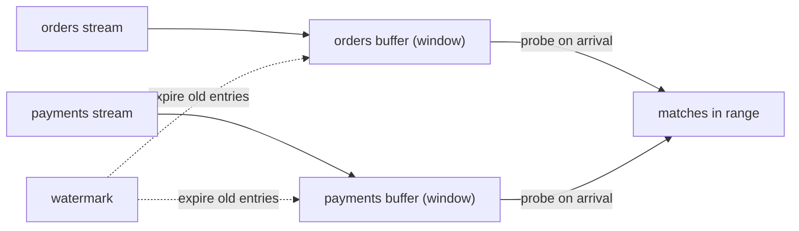

## 🎯 TL;DR

> A **stream join** matches events from two infinite inputs. Because neither side ever ends, the engine must decide **how long to remember** each side. That decision (a time window, a versioned table, or an external lookup) defines the join's correctness, cost and failure modes.

- **Stream-stream join:** match events that are close in **event time**. Both sides are buffered in state for a window.
- **Stream-table join:** enrich each event with the **current** value of a table. Only the stream side is buffered, and the table is state.
- **Temporal join:** enrich each event with the table value **as of the event's time**. Replays give the same answer.
- **Lookup join:** query an external store (a database, a cache) at processing time. Fast to set up, hardest to make deterministic.

## 🌱 Start simple (Junior)

> **💡 Analogy:** A restaurant waiter matches an order ticket with the payment slip for the same table. If the payment comes five minutes after the order, the waiter keeps the order ticket on the spike for a while. After a limit, the ticket is thrown away. That "keep it for a while" is a window, and the spike is state.

A small example. Orders and payments arrive as two streams:

```text
orders:    o1 at 12:00:00  (amount 500)
           o2 at 12:03:00  (amount 200)
payments:  p1 at 12:04:00  (for o1)
           p2 at 12:25:00  (for o2)  <- 22 minutes after the order
```

If the rule is "a payment counts if it comes within 10 minutes of its order", then `o1`/`p1` match, and `o2`/`p2` does not. The engine must keep `o2` in memory until `12:13:00` and then forget it. That memory is **state**, and the time limit is what keeps the state from growing forever.

## 🔧 How it really works (Mid)

**Stream-stream (interval) join.** The engine buffers each side for the window size. When an event arrives on one side, it looks in the buffer of the other side for matches in range. Flink SQL expresses this as an interval join:

```sql
SELECT o.order_id, o.amount, p.payment_id, p.event_time AS paid_at
FROM orders AS o
JOIN payments AS p
  ON o.order_id = p.order_id
 AND p.event_time BETWEEN o.event_time AND o.event_time + INTERVAL '10' MINUTE;
```

Each side's state is kept until the watermark passes its time plus the window. Arithmetic: 1,000 orders per second, each kept for 600 seconds, gives about 600,000 orders in state. At 1 KB per record, that is about 600 MB for this side alone, before the payments side and before the engine's own overhead. Doubling the window doubles the state.



**Outer joins** need the watermark. A left outer join can only emit "order with no payment" once it knows no payment will arrive in time, which is when the window closes.

**Stream-table join.** A table is the latest value per key, held as state (see [[kafka-streams]] for `KTable`). When a stream event arrives, the engine reads the table's current value and emits the enriched event. The stream side needs no window, because each event is looked up once.

```sql
-- Flink SQL: lookup of the latest state of the table at the processing time
SELECT o.order_id, c.tier
FROM orders AS o
JOIN customers FOR SYSTEM_TIME AS OF o.proc_time AS c
  ON o.customer_id = c.customer_id;
```

**Temporal join.** The table keeps a history of versions. For each event, the engine uses the version valid at the event's own timestamp, not at processing time. Example: an order at 09:00 converted with the exchange rate valid at 09:00, even if the job processes it at 09:05.

```sql
SELECT o.order_id, o.amount * r.rate AS amount_usd
FROM orders AS o
JOIN fx_rates FOR SYSTEM_TIME AS OF o.event_time AS r
  ON o.currency = r.currency;
```

**Lookup join.** The engine calls an external system (for example a JDBC database or a key-value store) per event, usually with an async call and a cache. It sees whatever the external store holds at that moment.

**Co-partitioning.** For distributed joins, both inputs must be partitioned on the join key with the same partition count. Otherwise matching keys land on different workers. Batch engines have the same concept; see [[spark-joins-skew]].

## 🧠 Senior depth & trade-offs

- **Determinism on replay.** The four join types differ here. Interval and temporal joins give the same output when you reprocess the same input (given the same event times). A lookup join, or a stream-table join against a table that changes, does not: the answer depends on when the event was processed. Reprocessing history after a bug fix will give different enrichments. Decide whether that matters for the business before you choose.
- **State size and window.** The cost is roughly `event rate × window length × record size` per side. A 24-hour window at 10,000 events per second is 864 million records per side. Use a smaller window, pre-filter, or move the join to a key-value store with TTL.
- **Late data.** A late event that arrives after the window (plus any grace period) is dropped or sent to a side output. The trade-off is correctness versus state: a longer grace period keeps state longer. See [[late-arriving-data]] and [[watermark]].
- **Hot keys.** A single customer with a million events makes one task or executor hold a huge buffer and slow everything. Salting or splitting the key helps, but changes the join semantics for that key. See [[hot-key]] and [[data-skew]].
- **Lookup join cost.** Every event is a network call unless cached. A cache lowers load but makes results stale by up to the TTL. Async lookups keep throughput up but can reorder output.
- **Outer join output timing.** Unmatched rows come out late, at window close, not when they arrive. Dashboards built on outer joins look "behind" by the window size.
- **Engine differences.** Kafka Streams offers stream-stream joins with windows, stream-table and global-table joins. Flink offers interval, temporal and lookup joins in SQL and the DataStream API. Spark Structured Streaming supports stream-stream joins with watermarks and time-range conditions. Check your engine's docs for which combinations it supports.
- **What to monitor.** State size per join operator, watermark lag, late-record drop count, and the lookup call latency and cache hit rate.

## 🧪 Try it

1. Given a 5-minute interval join (payment within 5 minutes after the order), which of these pairs match: order at 10:00 with payment at 10:04; order at 10:00 with payment at 10:06; order at 10:00 with payment at 09:58?
2. You enrich order events with a currency rate table. Your nightly reprocessing of last week's orders gives different totals than the original run. Name the likely join type and the fix.
3. Write a Flink SQL interval join that matches a `shipments` event to an `orders` event that happened up to 2 hours earlier.

<details><summary>Show solutions</summary>

**1.** The first pair matches (4 minutes is within 5). The second does not (6 minutes is outside). The third does not: the payment is before the order, so `BETWEEN o.event_time AND o.event_time + 5 min` excludes it.

**2.** This is most likely a lookup join or a stream-table join against a table that changed over time. Reprocessing uses today's rates, not the rates valid at each order's time. Fix it with a temporal join over a versioned rate table, so each order uses the rate valid at its own event time.

**3.**
```sql
SELECT s.shipment_id, o.order_id
FROM shipments AS s
JOIN orders AS o
  ON s.order_id = o.order_id
 AND o.event_time BETWEEN s.event_time - INTERVAL '2' HOUR AND s.event_time;
```
The order must be no later than the shipment and no earlier than two hours before it.

</details>

## 💬 Interview corner

**Question: "How do you join two streams?"** Mid answer: "Use a windowed join: match events from both streams within a time range, and keep both sides in state until the window expires." Senior answer: "First I'd check what the join is for. If I'm enriching with reference data, I'd use a temporal join, so replays are deterministic. If I'm matching two real events, like an order and its payment, I'd use an interval join with a window sized from the business SLA. Then I'd estimate state as rate times window times record size, set a watermark and a grace period, and decide where late events go."

**Question: "Why can a join give different results when you replay the data?"** Because a lookup or a stream-table join reads the table at processing time, not at event time. Temporal joins fix this with versioned tables.

> **🎤 Say this in the interview:** "A stream join is a question of memory. Each join type decides what state it keeps and for how long. I choose by the correctness I need: event-time matches for events, temporal lookups for reference data, and external lookups only when the answer can change over time."

## ⚠️ Common mistakes

> **⚠️ Watch out:** Using a stream-table join for reference data and then reprocessing history. Replays use the table as it is today, so past results change.

> **⚠️ Watch out:** Forgetting that state grows with the window. A "10-minute" window on a high-volume stream can be far larger than the team expects.

- Joining on processing time when the business question is about event time.
- Not defining what happens to late events. If the rule is silent, the engine's default decides.
- Expecting outer-join "no match" rows to appear immediately.
- Joining streams that are not co-partitioned on the join key.
- Ignoring hot keys until a single task falls behind.
- Calling an external database on every event without a cache or a timeout.

## ✅ Check yourself (quiz)

1. Which join needs a window in order to finish?
   - A) Stream-table join
   - B) Temporal join
   - C) Stream-stream join
   - D) Lookup join

<details><summary>Answer</summary>

**C** — a stream-stream join has two infinite inputs, so the engine must limit how long each side is buffered. The window is that limit. A stream-table join keeps the table as state instead.

</details>

2. A payment arrives 2 hours after its order, and the join window is 10 minutes. What happens?
   - A) It matches, because joins look at all history
   - B) It is dropped or sent to a side output, because it is late for the window
   - C) It replaces the order
   - D) It waits forever in state

<details><summary>Answer</summary>

**B** — once the window (plus grace period) has passed, the buffered order is gone. The late payment cannot match, so the engine drops it or routes it to a side output if one is configured.

</details>

3. Why is a temporal join preferred over a lookup join for currency conversion when you reprocess history?
   - A) It is faster on every query
   - B) It uses the table version valid at the event time, so the output is the same on replay
   - C) It needs no state
   - D) It works without event time

<details><summary>Answer</summary>

**B** — the temporal join looks up the version valid at the event's own timestamp. A lookup join reads whatever the table holds at processing time, which changes between runs.

</details>

4. **(Senior)** A stream-stream join keeps 2,000 events per second per side for a 30-minute window. Roughly how many records are in state for one side?

   - A) 60,000
   - B) 3,600,000
   - C) 1,000,000
   - D) 120,000

<details><summary>Answer</summary>

**B** — 2,000 events/s × 1,800 s (30 min) = 3,600,000 records per side. The count doubles for the second side, which is why window size is the main lever on state.

</details>

5. **(Senior)** Your team proposes a 7-day window for a join to be "safe". What is the main trade-off you should raise?

   - A) Joins with windows cannot be used in production
   - B) The state grows with the window, so cost and recovery time grow too; a larger window rarely fixes a missing business rule
   - C) A 7-day window removes the need for a watermark
   - D) Only batch engines support windows longer than an hour

<details><summary>Answer</summary>

**B** — state size scales with the window. A long window raises memory, checkpoint size and restore time, and it hides the real question: what is the business rule for how late a match can be? The fix is a clear SLA and a grace period, not an arbitrary large window.

</details>

## 🗂️ Flashcards

| Front | Back |
|---|---|
| Why does a stream join need a window? | Both inputs are infinite; the engine must limit how long each side is buffered |
| Stream-table join: what is the state? | The table (latest value per key); the stream side is not buffered |
| Temporal join vs lookup join | Temporal uses the table version at event time (deterministic); lookup uses the value at processing time |
| Interval join | A join where the time difference between the two events must fall in a range |
| Rough state estimate | Event rate × window length × record size, per side |
| Why are outer-join unmatched rows late? | They can only be emitted when the window closes and no match can arrive |
| Co-partitioning | Both inputs partitioned on the join key with the same partition count |

## 🔗 Go further

- [[kafka-streams]] shows stream-table joins with `KTable` and co-partitioning in code.
- [[stream-concepts]] explains event time, windows and watermarks, which every join here relies on.
- [[streaming-state]] covers state stores, TTL and checkpoints.
- [[pattern-late-data]] shows how to reconcile real-time joins with nightly batch results.
- [[spark-joins-skew]] covers the batch version of the same join and skew problems.
- Read your engine's join documentation for exact syntax and supported combinations; the concepts are stable across engines.
