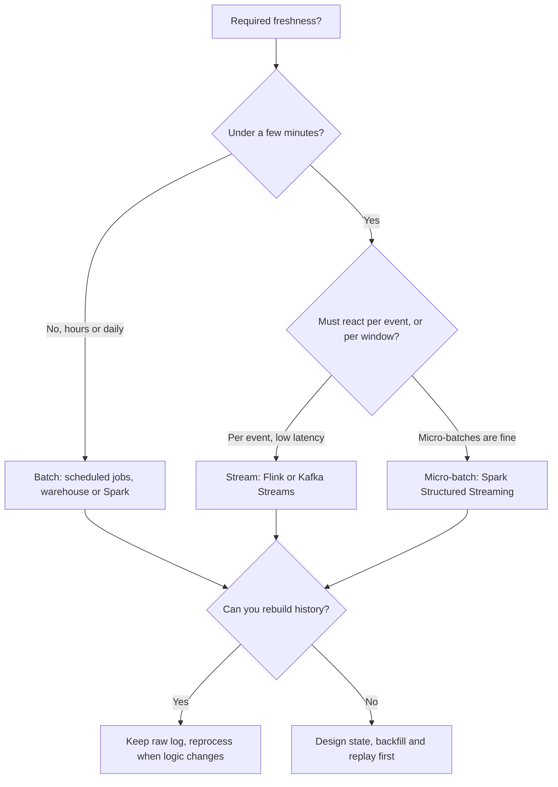

## 🎯 TL;DR

> **Technology selection** means choosing a tool by the **criteria** it must satisfy: latency, volume, correctness guarantees, team skills, operating cost and ecosystem. The tool name comes last.

- Start from requirements: freshness target, data volume, query shape, ordering and replay needs, and who will operate the system.
- Compare candidates on the same criteria, in a table, and say which criterion decides.
- Every tool is a trade-off. "Faster" usually means "more to operate" or "less flexible". Name the cost you accept.
- Benchmark on your own data before committing. Vendor claims and blog numbers depend on workload and version.

## 🌱 Start simple (Junior)

> **💡 Analogy:** Buying a car. "Best car" has no answer. For a family of six on a highway you pick a van; for a courier in a city you pick a scooter. The criteria come first (seats, fuel, road), and the brand comes last.

Data tools are the same. A junior answer is "Kafka, because everyone uses it". A senior answer is "Kafka, because we need replay for seven days, many independent consumers, and per-key ordering, and we can run a cluster."

Use this three-step habit for every choice:

1. **Write the requirement in numbers.** "Dashboard freshness under 5 minutes", "2 TB a day", "queries scan 500 GB at p95 under 3 seconds".
2. **List the criteria that the requirement makes decisive.** Often only two or three matter.
3. **Compare candidates on those criteria only.** Ignore features you will not use.

## 🔧 How it really works (Mid)

The first decision is usually batch or stream, because it changes almost every other choice.

Now the pairwise decisions. Each table lists criteria, not winners; the last row says when to pick each side.

### Messaging: Kafka vs RabbitMQ

| Criterion | Kafka | RabbitMQ |
|---|---|---|
| Core model | Distributed, partitioned log; consumers track offsets | Broker with exchanges and queues; messages removed after ack |
| Replay old data | Yes, within retention | Generally no; the message is gone after ack |
| Many independent consumers | Natural: each consumer group reads the full log | Needs fan-out exchanges and one queue per consumer |
| Per-key ordering | Yes, within a partition | Per queue, with a single consumer |
| Routing logic | Simple (topic and key) | Rich (direct, topic, fanout, headers exchanges) |
| Typical use | Event streams, CDC, integration backbone | Task queues, request/reply, complex routing |

Pick Kafka when the data is an event history that many systems read and reread. Pick RabbitMQ when messages are work items that should be done once and then gone, with routing that is awkward to express as keys. See [[queues-vs-logs]] for the underlying idea.

### Stream processing: Flink vs Spark Structured Streaming

| Criterion | Flink | Spark Structured Streaming |
|---|---|---|
| Execution | Record-at-a-time, pipelined | Micro-batches (the default model) |
| Latency | Typically lower, sub-second is possible | Usually seconds; depends on trigger and batch size |
| Event time and late data | First-class: watermarks, timers, keyed state | Supported with watermarks; fewer low-level controls |
| Shared batch and stream code | Possible, but a separate mental model | Same DataFrame API for batch and stream |
| Ecosystem fit | Strong for stateful event processing | Strong if the team already runs Spark and Spark ML |
| Operational note | Checkpoints, state backends, savepoints | Checkpoints, shuffle and micro-batch tuning |

Pick Flink for per-event logic with large keyed state, tight latency and complex event-time behaviour (for example fraud detection). Pick Spark when the team already lives in Spark, latency of seconds is enough, and batch and stream share the same transformations. Check the docs for your version before promising any latency number.

### OLAP engines: ClickHouse vs StarRocks vs Druid

| Criterion | ClickHouse | StarRocks | Druid |
|---|---|---|---|
| Strength | Very fast scans and aggregations on large, mostly append tables | MPP SQL with strong multi-table joins and materialized views | Real-time ingestion of event streams with time-based rollup |
| Data updates | Append-oriented; updates need specific table engines and patterns | Primary-key tables support upserts | Segment-based; time-centric designs |
| Joins | Improved over time, but design tables to avoid heavy joins | A focus of the engine | Limited joins; denormalize |
| Best for | Log analytics, event dashboards, ad-hoc aggregations on one wide table | Star-schema analytics with many joins and concurrent users | Real-time metrics and time-series exploration |

These are generalizations. Each engine changes quickly; the principle is that you choose by query shape (wide aggregations or joins), update pattern (append or upsert) and freshness, then benchmark. For details see [[clickhouse]] and [[starrocks-doris]].

### Table formats: Iceberg vs Hudi vs Delta

| Criterion | Iceberg | Hudi | Delta Lake |
|---|---|---|---|
| Design focus | Engine-neutral table spec with snapshots | Record-level upserts and incremental pulls | Transaction log tied to the Spark ecosystem |
| Partitioning | Hidden partitioning and partition evolution | Keys and partition paths; record-level index options | Partition columns; evolution is more manual |
| Engine support | Broad (Spark, Flink, Trino, and others) | Spark, Flink and others; narrower than Iceberg | Strongest in Spark and Databricks |
| CDC-style upserts | Supported; check the write mode for your engine | A core strength | Supported through MERGE in Spark |

A practical rule: choose Iceberg when several engines must read and write the same tables, Hudi when record-level incremental ingestion is the main workload, and Delta when the platform is Spark-centric. Read [[lakehouse-table-formats]] for the mechanics.

### Orchestration: Airflow vs Dagster

| Criterion | Airflow | Dagster |
|---|---|---|
| Unit of work | Tasks in a DAG | Software-defined assets (tables, models) |
| Lineage view | Task graph; data lineage needs extra tooling | Asset graph with data-aware status |
| Ecosystem | Very large set of operators and integrations | Smaller, growing; strong for dbt and Python assets |
| Testing | Possible, often with more setup | Designed for local testing of assets and resources |
| Team fit | Mature, widely known, many existing DAGs | Good for teams that model pipelines as tables |

Choose Airflow when the company already runs it and the work is many heterogeneous tasks. Choose Dagster when the team thinks in tables and wants asset lineage and testing built in. See [[airflow]] and [[orchestrator-alternatives]].

## 🧠 Senior depth & trade-offs

- **Criteria first, then candidates.** Write the criteria down with weights before you name a tool. This makes the decision defensible and easy to revisit when a requirement changes.
- **Count the operating cost.** A self-managed Kafka cluster, a Flink cluster and a lakehouse each need people on call. Managed services move the cost to money and to vendor limits. Estimate both, using [[data-estimation]] for the volume.
- **Team skill is a real constraint.** A technically better tool that no one can run is a worse choice. Name the skill gap and the training or hiring cost.
- **Lock-in is a spectrum.** Open table formats and open protocols (Kafka protocol, SQL, Parquet) reduce lock-in. Proprietary features may be worth it, if you state the exit cost.
- **Exactly-once and ordering are end-to-end.** Choose the messaging system for its ordering guarantee, the processor for its state model, and the sink for idempotency. A correct link in one part does not make the whole path correct. See [[exactly-once]].
- **Benchmark with your shape.** Run the real query set with real data volume and concurrency. Measure p95 and p99, not averages. Test the failure cases too: a broker restart, a checkpoint failure, a node loss.
- **Plan the reversal.** Ask how you would migrate away in a year. Keeping the raw data in open formats and the transformations in version-controlled code keeps that option open.
- **When not to choose at all.** If a warehouse with scheduled SQL meets a 15-minute freshness target, do not add a stream processor for prestige. Batch is cheaper to build, test and debug, and many incidents come from unnecessary streaming state.

## 🧪 Try it

Choose and justify for each case. Write a decision table with at least three criteria, then pick one option and name the trade-off you accept.

1. **Fraud alerts.** Card transactions arrive at 3,000 per second. A decision must be made within 300 ms, using a customer's rolling 10-minute spend. Choose the stream engine and say what state it needs.
2. **Monthly finance report.** Data arrives daily from 12 sources, reports are due on the 3rd of each month, and the team is three SQL analysts. Choose batch or stream, and an orchestrator.
3. **Clickstream dashboard.** 2 billion events per day, 40 columns, dashboards need p95 under 2 seconds on 7-day filters. Choose the OLAP engine and the table format for raw data.

Show solutions

**1.** Criteria: latency (300 ms), per-event decision, keyed state (rolling 10 minutes per customer), event time with late events. Choose **Flink**: per-event processing with keyed state and event-time timers fits the requirement. The state is one rolling aggregate per customer, kept with a bounded retention window and checkpointed. Trade-off: more operational work (checkpoints, state size monitoring) than a micro-batch engine, which is acceptable because the latency needs it. Spark Structured Streaming would often be too coarse for a 300 ms target.

**2.** Criteria: freshness (daily is enough), team skill (SQL), cost, testability. Choose **batch** with a warehouse and SQL transformations, orchestrated by an orchestrator the team can run (Airflow or Dagster). Streaming adds state and operational work with no benefit at a monthly deadline. Trade-off: late data from one source delays the report, so add completeness checks before publishing.

**3.** Criteria: query shape (wide aggregations, time filters), concurrency, ingestion, cost. Choose a **ClickHouse-style** columnar OLAP engine for wide-table aggregations on append-only events, with raw data in an open table format (Iceberg) on object storage as the system of record. Trade-off: joins to dimension tables must be designed around (denormalize or pre-join), and the team owns the engine's operations. Confirm the 2-second target with a benchmark on 7 days of data at expected concurrency.

## 💬 Interview corner

**Question: "Kafka or RabbitMQ for this system?"** Mid answer: "Kafka for high throughput and RabbitMQ for simple queues." Senior answer: "It depends on whether messages are events that many consumers reread, or work items that should be done once. If we need replay for a week and new consumers should read history, Kafka. If we need per-message routing and acknowledgement for background jobs, RabbitMQ. I'd also check the team's ability to run each."

**Question: "Flink or Spark for streaming?"** Mid: "Flink for real time, Spark for batch." Senior: "Latency target and state model decide. Sub-second per-event logic with keyed state points to Flink. Seconds-level micro-batches sharing code with batch point to Spark. I'd benchmark the actual job before I commit, because the state size is the real cost."

> **🎤 Say this in the interview:** "I'll state the requirement in numbers first, list the two or three criteria that decide, and compare the candidates only on those. Then I'll name the operating cost and the one trade-off I accept, and how I would validate the choice with a benchmark."

## ⚠️ Common mistakes

> **⚠️ Watch out:** Choosing a stream engine for a batch requirement. Streaming adds state, ordering and failure modes. Use it only when freshness or per-event logic needs it.

> **⚠️ Watch out:** Comparing features you will never use. The criteria come from your requirements, not from a feature list.

- Naming a tool before stating the latency, volume and query shape.
- Quoting benchmark numbers from a blog without checking the version, data shape or hardware.
- Ignoring operating cost and team skill, which are often the real constraints.
- Assuming a tool's guarantee holds end to end without checking the sink.
- Choosing the newest tool because it is new. Maturity and ecosystem are criteria too.
- Making a one-way decision without a migration path or a benchmark.

## ✅ Check yourself (quiz)

1. A team needs to replay the last 7 days of order events to a new consumer, and several independent services read the same events. Which messaging model fits best?
   - A) A task queue where each message is removed after one acknowledgement
   - B) A partitioned log with retention, where each consumer group tracks its own offsets
   - C) A single shared variable in a cache
   - D) Direct HTTP calls between services

Answer

**B** — a retained, partitioned log (the Kafka model) allows replay and many independent consumer groups. A queue that deletes messages on acknowledgement cannot replay them to a new consumer.

2. A pipeline needs per-event decisions within 300 ms using a rolling aggregate per customer. Which engine is the stronger fit, and why?

   - A) A nightly SQL job in a warehouse
   - B) Flink, because per-event processing with keyed state and event-time timers meets the latency and state requirements
   - C) A spreadsheet macro refreshed hourly
   - D) A micro-batch engine with a 15-minute trigger

Answer

**B** — the requirement is low latency with keyed, event-time state. Flink's model fits. A 15-minute trigger, or a nightly job, does not meet a 300 ms target.

3. Several engines (Spark, Trino and a streaming job) must read and write the same tables, and the team wants engine-neutral metadata. Which table format is the most natural choice?

   - A) A plain CSV folder with no metadata
   - B) Iceberg, whose design is engine-neutral with snapshots and hidden partitioning
   - C) A single-node SQLite file
   - D) A Parquet folder without any table metadata layer

Answer

**B** — Iceberg is designed as an open table specification that many engines implement. Plain folders have no transactional metadata, so concurrent writers and schema changes are unsafe.

4. **(Senior)** A team chooses Kafka for a workload of 200 messages per day from a small internal tool, with no replay need. What is wrong with the decision, and how would you judge it?

   - A) Kafka cannot handle 200 messages per day
   - B) The decision adds operating cost with no requirement that needs the log model; a simpler queue or a managed service matches the criteria better
   - C) Kafka requires a Spark cluster
   - D) Kafka makes all messages arrive out of order

Answer

**B** — the criteria (tiny volume, no replay, no fan-out) do not need a distributed log. Running and monitoring a Kafka cluster costs more than the workload justifies. Choose the simplest tool that meets the stated requirements, and name the trigger that would change the decision (for example a second independent consumer or a replay need).

5. **(Senior)** Your OLAP benchmark meets the average latency target, but the p99 is 6 times the target at peak concurrency. What do you conclude, and what do you do before choosing a different engine?

   - A) The engine is wrong; switch immediately
   - B) Averages hide the tail; check concurrency limits, query shape, table design (sorting or partitioning), caching and resource isolation, then re-benchmark at realistic peak load
   - C) p99 does not matter for dashboards
   - D) Remove the dashboards

Answer

**B** — a tail latency problem at peak is often caused by concurrency limits, scans that are too wide, or missing pre-aggregation. Fixing table design or isolating workloads can meet the target without a migration. Judge the engine only after the workload is tuned and measured at realistic load.

## 🗂️ Flashcards

| Front | Back |
|---|---|
| First question in any tool choice | What is the requirement in numbers (freshness, volume, query shape)? |
| Kafka vs RabbitMQ, the key difference | Kafka is a retained, replayable log with offsets; RabbitMQ removes messages after ack |
| When to choose Flink over Spark Structured Streaming | Per-event, low-latency logic with large keyed, event-time state |
| When to choose batch over stream | Freshness of hours or a day is acceptable and the team needs simplicity |
| Iceberg's main selling point | Engine-neutral table spec with snapshots and hidden partitioning |
| Hudi's main strength | Record-level upserts and incremental pulls |
| Airflow vs Dagster in one line | Task-centric DAG scheduling with a large ecosystem vs asset-centric modelling with built-in lineage and testing |
| What to do before committing to a tool | Benchmark with real data and concurrency, test failure cases, and name the migration exit |

## 🔗 Go further

- **[[reference-architecture]]** shows where each choice sits in the platform.
- **[[data-estimation]]** gives the volume numbers you need to compare options.
- **[[kafka-architecture]]** and **[[queues-vs-logs]]** explain the messaging trade-off in depth.
- **[[lakehouse-table-formats]]** compares table formats in more detail.
- **[[orchestrator-alternatives]]** covers the wider set of orchestration options.
- Pick one decision you made at work or in a project, write the table after the fact, and check whether your original criteria were the ones that mattered.
