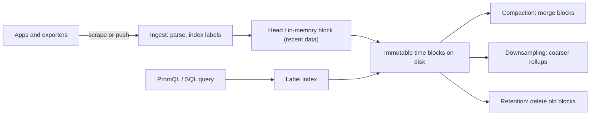

## 🎯 TL;DR

> A **time-series database (TSDB)** stores measurements that arrive as `(series, timestamp, value)` and is optimized for **appending in time order**, **compressing** long runs of similar values, and **querying by time range** with aggregations such as rate, average or percentile.

- A **series** is one unique combination of metric name and labels (tags), such as `cpu{host="a", region="eu"}`. Cost grows with the number of series, not with the number of points alone.
- Storage is **time-partitioned** and compressed. Old data is **downsampled** (kept as coarser rollups) and then **deleted** by retention rules.
- **High cardinality** (labels with millions of distinct values, such as `user_id` or a request id) is the classic way these systems fall over.
- Main options: Prometheus, VictoriaMetrics (Prometheus-compatible, long retention), TimescaleDB (PostgreSQL extension with SQL), and InfluxDB.

## 🌱 Start simple (Junior)

> **💡 Analogy:** A **thermometer log in a lab**. Every minute you write down the time and the temperature. You almost never edit an old line, you rarely look up a single minute, and you usually ask "what was the average per hour last week?"

A metric record is small: a name, a few labels, a timestamp and a number:

```text
http_requests_total{service="checkout", status="500"}  1700000000  42
http_requests_total{service="checkout", status="500"}  1700000015  45
http_requests_total{service="checkout", status="500"}  1700000030  47
```

Two properties make this data special:
- It almost always **arrives in time order**, so the engine can append instead of search.
- Consecutive values are **similar** (a counter rises slowly, a temperature changes gently), so they compress very well.

A typical question is a PromQL-style aggregation over a time range:

```text
sum by (service) (rate(http_requests_total{status="500"}[5m]))
```

It reads: "for each service, the per-second rate of 500 responses averaged over the last five minutes." The engine finds the matching series, reads only the time window, and computes the rate.

## 🔧 How it really works (Mid)



**Ingest.** Prometheus *pulls* metrics by scraping endpoints on an interval. Other systems *push* (remote write, line protocol, or SQL inserts). Each sample is appended to an in-memory head structure, and periodically written as an immutable block covering a fixed time range.

**Compression.** The Gorilla paper (Facebook, 2015) describes the technique used by many TSDBs:
- **Timestamps** are stored as *delta-of-delta*. Regular 15-second scrapes turn into long runs of zeros, which take almost no space.
- **Float values** are stored with **XOR** against the previous value. When consecutive values share most bits, only a few bits are written.

In practice a sample often takes only a couple of bytes instead of 16 bytes raw. Compression ratios depend heavily on how regular your data is.

**Index.** Each series has a label set, and an inverted index maps `label=value` to series IDs. A query like `{service="checkout", status="500"}` intersects postings lists, then reads the blocks of only those series.

**Downsampling.** Keep raw data for a short window (days), then store 5-minute or 1-hour aggregates (min, max, avg, count, sum) for longer. Some systems do this automatically; others need a job or continuous aggregates.

**TimescaleDB** works differently: it is PostgreSQL. A *hypertable* is a table split into **chunks by time**, and you query it with SQL:

```sql
SELECT create_hypertable('readings', 'ts');

SELECT time_bucket('5 minutes', ts) AS bucket,
       device_id,
       avg(temperature) AS avg_temp
FROM readings
WHERE ts > now() - interval '1 day'
GROUP BY bucket, device_id
ORDER BY bucket;
```

`time_bucket` does the downsampling at query time, and chunk pruning skips every chunk outside the day.

## 🧠 Senior depth & trade-offs

- **Cardinality is the cost driver.** Every unique label combination is a series with its own index entry, memory footprint and write path. Suppose 1,000 services × 50 endpoints × 4 status classes × 10 pods = 2,000,000 series. Adding a `user_id` label with 100,000 active users multiplies that potential by 100,000. Put unbounded identifiers in logs or traces, not in labels.
- **Ingestion and memory.** The head block keeps recent series in memory. High churn (pods that come and go, labels that change on every deploy) creates new series constantly, which inflates memory and index size even when each series is short-lived.
- **Retention vs downsampling.** Choose by question type. Dashboards for last week need 15-second resolution; quarterly capacity planning needs hourly rollups. Retention deletes whole blocks cheaply, which is why time partitioning matters.
- **Out-of-order and late data.** Most engines accept samples within a window and reject or drop very old ones. Check the limit for your engine before building a backfill job on top of it.
- **Choosing an engine.** Prometheus is the default for operational metrics and its own alerting. VictoriaMetrics suits larger scale and longer retention with Prometheus compatibility. TimescaleDB fits when you want SQL, joins with relational tables and PostgreSQL tooling. InfluxDB fits IoT-style workloads, check its current data model because versions differ a lot.
- **Relation to the rest of the stack.** A TSDB is not a general analytics store: it is weak for wide, high-cardinality event analysis. For that, use [[columnar-storage]] engines such as [[clickhouse]] or [[realtime-olap]].
- **Monitor the monitor.** Active series count, ingestion rate, rejected samples, query duration, disk usage per retention window, and compaction backlog.
- **When not to use it.** Free-form events, logs, or data you need to join with many other tables and update row by row.

## 🧪 Try it

You operate a metrics system for 400 services. Each service exposes 80 metrics, and each metric has labels `service`, `pod` (average 8 pods per service), `region` (3 values) and `endpoint` (average 20 per service).

1. Estimate the number of series, assuming every label combination occurs. Show the arithmetic.
2. A developer wants to add `customer_id` (about 2 million customers) to a latency histogram. What happens to the series count, and what would you suggest instead?
3. Design a retention plan: raw data for 14 days, 5-minute rollups for 1 year. Which question does each resolution serve?

<details><summary>Show solution</summary>

**1.** Per service, the label combinations are `pod × region × endpoint` for each metric: 8 × 3 × 20 = 480 combinations. Multiply by 80 metrics: 38,400 series per service. Across 400 services: 400 × 38,400 = 15,360,000, about 15 million series. Real data is usually sparser, but plan capacity on the upper bound and then measure.

**2.** The latency histogram has several buckets per series (say 12 buckets plus sum and count). Multiplying by 2 million customers makes the potential series count explode to billions. Instead, keep `customer_id` out of metrics, log the per-customer detail or use traces, and keep metrics at `service`, `endpoint` and `status` level.

**3.** Keep raw samples for 14 days (dashboards, alert debugging, sharp incident analysis). Keep 5-minute rollups (min, max, avg, count) for one year (trend and capacity planning, weekly reviews). Retention deletes old raw blocks while the rollups survive. The rollup job must be idempotent so reruns do not double-count.

</details>

## 💬 Interview corner

**Question: "Why is a time-series database different from a regular relational database for metrics?"**
Mid answer: "It is optimized for timestamped writes and time-range queries, and it compresses better."
Senior answer: "The write pattern is append-only and time ordered, so storage is time-partitioned and compressed with delta-of-delta and XOR encodings. Queries filter by time and labels first, so the label index and the chunk pruning matter most. The real constraint is cardinality, because each label combination is a series with its own memory and index cost."

**Question: "A monitoring system is slow and out of memory after a deploy. What do you check?"**
Mid: "Query load and disk space."
Senior: "Active series count and its growth, label values that became unbounded, such as request ids or user ids, series churn from pod restarts, and the rejected samples counter. Then I fix the labels first, because adding hardware only delays the problem."

> **🎤 Say this in the interview:** "A TSDB is designed for append-only, time-ordered data with heavy compression and time-based retention. The limiting factor is series cardinality, so I treat labels as a budget and move unbounded identifiers to logs or traces."

## ⚠️ Common mistakes

> **⚠️ Watch out:** Putting a unique id in a label. One label with millions of values turns a small metric into millions of series, and the cost shows up in memory long before disk.

> **⚠️ Watch out:** Confusing a rate with a raw counter. `http_requests_total` only goes up (until a restart), so you query `rate(...)` or `increase(...)`, not the raw value.

- Using a TSDB as the warehouse for event analysis with many dimensions.
- Setting retention without thinking about downsampling, then discovering the last quarter is gone.
- Averaging averages: the mean of per-pod averages is not the average across all requests when pods have different traffic.
- Assuming out-of-order or backfilled data will always be accepted.
- Ignoring series churn from short-lived pods and deploy-time labels.

## ✅ Check yourself (quiz)

1. What is a "series" in a time-series database?
   - A) A single timestamp
   - B) One unique combination of metric name and labels, with its values over time
   - C) A backup file of the database
   - D) A query result table

<details><summary>Answer</summary>

**B** — each unique metric name plus label set is one series. Cost and memory depend on the number of series.

</details>

2. Why does compression work so well on regular metrics?

   - A) Timestamps are stored as text
   - B) Delta-of-delta encodes regular intervals as near-zero values, and XOR encodes similar consecutive floats in few bits
   - C) Values are rounded to integers
   - D) The database drops every second sample

<details><summary>Answer</summary>

**B** — regular scrapes and slowly changing values produce repeated patterns, which those encodings compress very well.

</details>

3. Which label is the most dangerous to add to a metric?

   - A) `region` with 3 values
   - B) `status_class` with 5 values
   - C) `request_id` with a new value per request
   - D) `service` with 200 values

<details><summary>Answer</summary>

**C** — a new value per request creates a new series for every request, which overwhelms the index and memory. The others are bounded.

</details>

4. **(Senior)** Your dashboards for last week need 15-second resolution, but the capacity review needs one year of data. What is the best plan?

   - A) Keep everything at 15 seconds for one year
   - B) Keep raw data for the short window the dashboards use, and store downsampled rollups for the long window
   - C) Delete data after 1 day
   - D) Move everything to a warehouse without rollups

<details><summary>Answer</summary>

**B** — rollups answer long-range trend questions at a fraction of the storage, while raw data serves short-range, high-resolution needs. Retention then deletes each tier on its own schedule.

</details>

5. **(Senior)** After a deploy that changed a label value on every request, memory usage jumps and the ingestion path starts rejecting samples. What is the most likely cause and the right fix?

   - A) Too little disk, so add disk
   - B) Series churn from unbounded label values; fix the label design and drop the offending label in instrumentation
   - C) Compression stopped working because of the time zone
   - D) The query engine is too slow, so add replicas

<details><summary>Answer</summary>

**B** — each new label value creates new series, which inflates the head block and index. Adding disk does not fix the cause. Remove or bound the label in the instrumentation, and monitor series growth.

</details>

## 🗂️ Flashcards

| Front | Back |
|---|---|
| Series | A unique metric name plus label set, holding values over time |
| Cardinality | Number of distinct series; the main cost driver |
| Delta-of-delta | Compression for timestamps that arrive at regular intervals |
| XOR encoding | Compression for floats that change little between samples |
| Downsampling | Replacing old raw data with coarser aggregates such as 5-minute averages |
| Retention | Rule that deletes data older than a configured window, often by whole blocks |
| Hypertable (TimescaleDB) | A table split into time-based chunks, queried with SQL |
| Series churn | Constant creation of new series from short-lived pods or changing labels |

## 🔗 Go further

- [[design-metrics-monitoring]] — a full system design with time-series storage and downsampling.
- [[pipeline-monitoring]] — monitoring data pipelines with the same kind of metrics.
- [[data-retention]] — policies for keeping and deleting data across storage tiers.
- [[realtime-olap]] — the right store for wide, high-cardinality event analytics.
