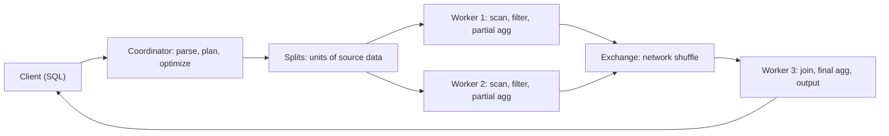

## 🎯 TL;DR

> **Trino** is a distributed SQL query engine that reads data **where it lives** (Hive, Iceberg, Delta, Postgres, Kafka and many others) through **connectors**, so one SQL statement can join across systems without copying the data first.

- It does **not store data**. It plans, schedules and executes queries; the data stays in lakes, databases or other stores.
- One **coordinator** plans the query and schedules work; many **workers** run tasks in memory and exchange data over the network.
- Tables are addressed as `catalog.schema.table`, where each catalog is a configured connector.
- It is strong for interactive, ad-hoc analytics. Its limits are memory, network shuffles and, historically, fault tolerance for long queries, which newer retry modes address.

## 🌱 Start simple (Junior)

> **💡 Analogy:** Trino is a **translator at a multilingual meeting**. The documents stay in their own rooms (databases, lakes). Trino asks each room for the pages it needs, brings them to the table, and answers the question that needs both sets of documents.

Suppose orders live in an Iceberg table on object storage and customers live in a Postgres database. Without a federated engine, you would export one side, load it, and join. With Trino, you write one query:

```sql
SELECT o.order_id, c.name, o.amount
FROM iceberg.sales.orders AS o
JOIN postgresql.crm.customers AS c
  ON o.customer_id = c.id
WHERE o.order_date = DATE '2026-01-01'
  AND o.amount > 100;
```

Each catalog (`iceberg`, `postgresql`) is a connector configured on the cluster. Each catalog file looks like this (for example `etc/catalog/postgresql.properties`):

```text
connector.name=postgresql
connection-url=jdbc:postgresql://crm-db:5432/crm
connection-user=trino_reader
connection-password=********
```

The key idea: **Trino moves the work to the data where it can, and moves only what it must.** Filters and column choices are pushed into each source, and only the matching rows travel to the workers.

## 🔧 How it really works (Mid)

A query goes through these stages:



1. **Parse and plan.** The coordinator parses SQL, asks each connector for table metadata and statistics, and runs a cost-based optimizer. Predicates and projected columns are pushed into the connector when it supports them (for example, a Postgres `WHERE` is executed by Postgres, and Iceberg uses file statistics to skip files).
2. **Splits.** A connector splits a table into **splits** (for example, Parquet files or byte ranges). Workers pull splits, so a skewed table still spreads over the cluster.
3. **Pipelined execution.** Stages run concurrently and pass **pages** of rows through in-memory buffers. Data flows as it is produced, which gives low latency for interactive queries but means a stage cannot restart on its own without help.
4. **Exchanges.** Joins and aggregations repartition data over the network (hash exchange) or broadcast a small side to every worker. The choice between partitioned and broadcast joins is made by the optimizer based on statistics; you can override it with session properties.

Memory is the central limit. Each query has a per-query memory budget across the cluster and per-node limits. A large hash join or a high-cardinality `GROUP BY` must fit in memory on each worker. If it does not, the query fails with a memory-limit error rather than slowing down silently.

**Spilling.** Some operators can spill intermediate data to local disk when memory is short. Spilling is slower but avoids failure. Its availability and configuration depend on the version and the operator, so check the docs for your release rather than assuming it applies to every join.

## 🧠 Senior depth & trade-offs

- **Fault tolerance.** The default mode (`retry-policy = NONE`) fails the whole query when a worker dies, because pipelined execution has no durable intermediate results. Trino's fault-tolerant execution adds retries. `retry-policy = QUERY` retries the whole query and works with connectors that support it. `retry-policy = TASK` retries individual tasks, but **requires an exchange manager** that spools intermediate results (for example to S3-compatible storage or HDFS), and is recommended for large batch queries on a dedicated cluster. A local-filesystem exchange manager is only for standalone test clusters. (Verified against Trino's fault-tolerant execution docs; settings change across versions.)
- **Latency vs. resilience.** Retry modes add spooling overhead, so short interactive queries can get slower. This is why teams often run two clusters: one interactive, one for long batch jobs with `TASK` retries.
- **Connector pushdown quality.** Trino is only as fast as what the connector can push down. A JDBC source that cannot push a filter means Trino pulls the whole table over the network. Check `EXPLAIN` for the `ScanFilterProject` and what is pushed into the table scan.
- **Table format matters more than the engine.** On Iceberg or Delta, file pruning from partition values and column statistics does most of the work. A bad partition layout or millions of small files (see [[small-files-problem]]) makes Trino slow no matter how good the optimizer is.
- **Consistency across sources.** Trino does not give a transaction across catalogs. A join over Postgres and Iceberg reads each side at its own point in time. Reports that need one consistent snapshot must rely on a single source or on snapshot semantics inside the table format.
- **Writes.** Trino can write to some connectors (Iceberg, Hive, Delta), but it is not a replacement for a transactional OLTP database, and bulk ETL usually belongs in Spark or dbt. Use Trino to read and serve, and to write when the connector and the volume suit it.
- **When not to use it.** Long, huge ETL jobs without fault tolerance, workloads that need a single-digit millisecond key lookup, or streaming. Monitor queued and failed queries, peak memory per node, exchange volume and how often queries hit the memory limit.

## 🧪 Try it

You have an Iceberg table `lake.events.clicks` (billions of rows, partitioned by `event_date`) and a Postgres table `crm.public.users` (5 million rows).

1. Write a query that counts clicks per user country for `event_date = DATE '2026-01-01'`, joining to `users` on `user_id`.
2. Explain which filter is pushed where, and why filtering on `event_date` in the `WHERE` clause matters.
3. A nightly report on this join fails halfway with a worker-loss error. Name two configuration options you would evaluate and the trade-off of each.

<details><summary>Show solution</summary>

**1.**
```sql
SELECT u.country, COUNT(*) AS clicks
FROM lake.events.clicks AS c
JOIN crm.public.users AS u
  ON c.user_id = u.user_id
WHERE c.event_date = DATE '2026-01-01'
GROUP BY u.country;
```

**2.** `c.event_date = DATE '2026-01-01'` is pushed into the Iceberg scan, so only the matching partition's files are read. The users table is small enough that Trino may broadcast it to the workers (a broadcast join). Ask `EXPLAIN` to confirm the join distribution and the pushed predicates.

**3.** Option one: `retry-policy = QUERY`, which retries the whole query with minimal setup but repeats all work. Option two: `retry-policy = TASK` with an exchange manager, which retries only the failed tasks and suits long batch queries, at the cost of spooling overhead and a more complex cluster. A third practical fix is to make the query smaller (pre-aggregate the daily clicks into a table).

</details>

## 💬 Interview corner

**Question: "What is Trino and when would you use it instead of loading everything into a warehouse?"**
Mid answer: "Trino queries data in place through connectors, so I can join a lake table with a database table without copying data. I use it for ad-hoc analysis."
Senior answer: "I use it when data is spread across systems, when freshness of the source matters more than the speed of a loaded copy, or when I want one SQL layer over a lakehouse. I avoid it for long batch jobs without fault tolerance, and I check connector pushdown first, because a connector that cannot push filters makes everything slow."

**Question: "What happens when a worker dies in the middle of a query?"**
Mid: "The query fails, and we rerun it."
Senior: "It depends on the retry policy. With the default, the query fails. With `QUERY` it reruns from scratch. With `TASK` and an exchange manager, only the lost tasks rerun, because intermediate results were spooled. I'd pick the policy by query length and cluster purpose."

> **🎤 Say this in the interview:** "Trino is a federated, in-memory MPP engine. Its strengths are reading data in place and joining across sources. I plan around memory, pushdown and the retry policy, and I keep long batch ETL on an engine built for it."

## ⚠️ Common mistakes

> **⚠️ Watch out:** Treating a federated join as cheap. Joining a huge table with a small one is fine if the small one is broadcast; joining two huge tables over the network is a shuffle, and it can exceed cluster memory.

> **⚠️ Watch out:** Assuming a filter reaches the source. Wrap a column in a function (`WHERE CAST(ts AS date) = ...`) or use a type mismatch, and pushdown may silently stop. Check `EXPLAIN`.

- Expecting cross-catalog transactional consistency.
- Running long ETL on the default no-retry policy and blaming the network when workers die.
- Ignoring the table layout: partition by the columns you filter on, and compact small files.
- Using Trino as an OLTP store or for point lookups by key.
- Sizing memory per query without checking concurrent queries on the same cluster.

## ✅ Check yourself (quiz)

1. What does the Trino coordinator do?
   - A) Stores the query results permanently
   - B) Parses and plans queries, and schedules work on the workers
   - C) Holds every table's data in memory
   - D) Replicates the Iceberg files

<details><summary>Answer</summary>

**B** — the coordinator parses, plans, optimizes and schedules tasks. Workers execute the splits and exchange data. Trino does not own storage.

</details>

2. Which setting lets a long batch query survive a single worker failure by retrying only the failed tasks?
   - A) `retry-policy = NONE`
   - B) `retry-policy = QUERY`
   - C) `retry-policy = TASK` with an exchange manager configured
   - D) A larger `query.max-memory`

<details><summary>Answer</summary>

**C** — `TASK` retries individual tasks, but it needs an exchange manager to spool intermediate results. `QUERY` retries everything; `NONE` (the default) fails the query.

</details>

3. A query joins `lake.db.orders` (partitioned by `order_date`) with `pg.public.stores`, and the `WHERE` clause filters on `order_date`. Why does the partition filter matter?

   - A) It is required for the join to run
   - B) It lets Trino prune partitions so the scan reads only matching files
   - C) It converts the join into a broadcast join automatically
   - D) It makes the Postgres side run faster

<details><summary>Answer</summary>

**B** — the filter is pushed into the Iceberg scan, and partition pruning skips files outside the range. Without it, the whole table is read.

</details>

4. **(Senior)** Your cluster serves short dashboard queries and long nightly jobs. Enabling `TASK` retries makes dashboards slower. What is the best structural fix?

   - A) Remove the exchange manager
   - B) Run a separate cluster for the long batch jobs with `TASK` retries, and keep the interactive cluster without spooling overhead
   - C) Disable all joins
   - D) Increase `query.max-memory` on the dashboard cluster only

<details><summary>Answer</summary>

**B** — fault tolerance adds spooling cost, which hurts short high-volume queries. Separating workloads lets each cluster use the settings that fit it.

</details>

5. **(Senior)** A federated query reads a Postgres table and an Iceberg table in one statement, and a report occasionally shows totals that do not match a source-side check. What is the most likely reason?

   - A) Trino rounds decimals differently on every run
   - B) The two sources are read at different points in time, and Trino gives no cross-catalog transaction
   - C) Iceberg does not support `SUM`
   - D) `JOIN` drops rows with null keys by design

<details><summary>Answer</summary>

**B** — each source is read at its own snapshot, so a concurrent write can make the two sides disagree. A consistent report needs one source, or a snapshot strategy in the upstream pipeline.

</details>

## 🗂️ Flashcards

| Front | Back |
|---|---|
| Trino | Distributed SQL query engine that queries data in place through connectors |
| Coordinator | Parses, plans, optimizes and schedules; does not hold the data |
| Worker | Runs tasks on splits and exchanges pages with other workers |
| Connector | Plugin that maps a source (Hive, Iceberg, Postgres) to catalogs, tables and splits |
| Pushdown | Executing filters, projections or aggregates inside the source |
| Exchange | Network repartition or broadcast of data between stages |
| `retry-policy = TASK` | Retries individual tasks; needs an exchange manager to spool results |
| Broadcast join | Small table copied to every worker; avoids shuffling the large side |

## 🔗 Go further

- [[mpp-architecture]] — the general model behind Trino, Impala and similar engines.
- [[lakehouse-table-formats]] — why table metadata and file pruning decide query speed.
- [[cloud-warehouses]] — the alternative when you want storage and compute bundled and managed.
- Trino's documentation on fault-tolerant execution and connector pushdown, checked against the version you run.
