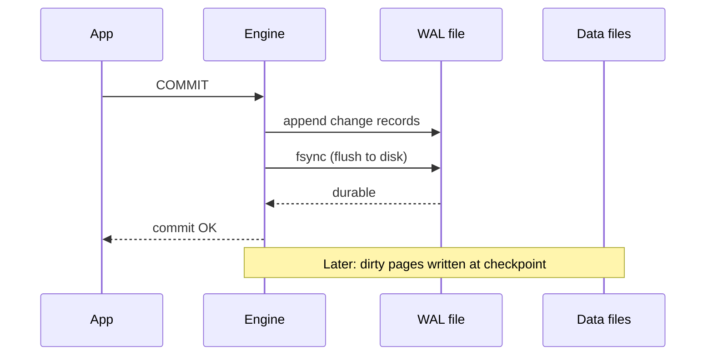

## 🎯 TL;DR

> The **write-ahead log** (WAL) makes a change durable **before** the change is acknowledged: the engine appends the change to a sequential log and forces it to disk. **MVCC** (multi-version concurrency control) lets readers and writers work at the same time by keeping several versions of each row, so readers never wait for writers.

- Durability comes from the log, not from the data files. After a crash, the engine replays the log.
- **Checkpoints** limit how much log must be replayed, by flushing data files up to a known point.
- MVCC gives each transaction a **snapshot**. Old versions are cleaned up later (VACUUM in PostgreSQL, purge in InnoDB).
- The same log is what **CDC** tools read to stream every change out of the database.

## 🌱 Start simple (Junior)

> **💡 Analogy:** A bank teller writes every deposit in a **ledger** before updating the customer's account balance. If the power goes out, the ledger tells you what happened, and you can redo the work. The ledger is only ever appended to, so writing it is fast.

Now a second idea. Suppose a report reads the balances while a transfer is running. A **lock** would make the report wait. **MVCC** instead keeps two versions of the balance: the old one, which the report reads, and the new one, which the transfer writes. Each reader sees a consistent snapshot, and nobody waits.

Two questions to keep in mind:

- **How do we survive a crash without losing committed work?** Answer: the WAL.
- **How do we let reads and writes run together?** Answer: MVCC.

## 🔧 How it really works (Mid)

### The write-ahead log

The rule is simple: **the log record must reach stable storage before the data page does, and before the commit is acknowledged.**



- Appending to a log is **sequential I/O**, which is much cheaper than random page writes. That is why engines commit through the log and write the data pages later.
- **fsync** asks the operating system to flush its cache to the device. Without it, a power loss can lose data the engine believed was written.
- Engines batch commits together (**group commit**), so one fsync can make many transactions durable.
- Recovery replays the WAL from the last checkpoint. Replay is idempotent: applying a record twice gives the same page.

**Checkpoints** write dirty data pages to the data files and record a point (the "redo point") from which recovery must start. Between checkpoints, the WAL keeps growing. Checkpoints happen on a timer or when the log reaches a size limit, and they cause I/O bursts you should monitor.

In PostgreSQL, the first change to a page after a checkpoint writes the whole page into the WAL (`full_page_writes`). This protects against a **torn page**, where a crash leaves half of an 8 KB page written.

**Commit durability settings.** PostgreSQL's `synchronous_commit` can be turned off for specific transactions. Then a crash may lose the most recent commits, but the database stays consistent, because the WAL is still written in order. Use this only where losing a few seconds of writes is acceptable.

### MVCC: versions instead of locks

Under MVCC, an update does not overwrite the row. It creates a **new version** and marks the old one as no longer current.

In PostgreSQL, each row version records the transaction that created it (`xmin`) and the one that deleted or replaced it (`xmax`). A transaction sees a version only if that version was committed before its snapshot was taken.

```sql
-- Session A: long report
BEGIN ISOLATION LEVEL REPEATABLE READ;
SELECT balance FROM accounts WHERE id = 1;   -- sees 100

-- Session B: update, commits
BEGIN;
UPDATE accounts SET balance = 150 WHERE id = 1;
COMMIT;

-- Session A: same transaction, same snapshot
SELECT balance FROM accounts WHERE id = 1;   -- still sees 100
COMMIT;
```

Session A never blocks Session B, and B never blocks A. The price is that old versions stay on disk until nothing needs them:

- **PostgreSQL** keeps old tuples in the heap until **VACUUM** removes them. If VACUUM falls behind, the table and its indexes grow with **bloat**.
- **InnoDB** (MySQL) keeps old versions in the **undo log** and purges them when no read view needs them. A long-running transaction holds back the purge.

**Isolation levels.** MVCC is the mechanism. The isolation level defines what a transaction may see. PostgreSQL's default is READ COMMITTED, where each statement takes a new snapshot. REPEATABLE READ gives one snapshot for the whole transaction (snapshot isolation). SERIALIZABLE adds checks that reject transactions which would not be equivalent to some serial order. See [[isolation-level]] and [[sql-transactions]].

### Logical decoding and CDC

The WAL records **physical** changes, such as "write these bytes to page 42". For CDC, the database can decode the WAL into **logical** changes, such as "row 7 in `orders` changed from status `NEW` to `PAID`".

- **PostgreSQL** does this with **logical decoding**. An output plugin (for example `pgoutput`, which logical replication uses, or `wal2json`) turns WAL records into row changes. A **replication slot** keeps the server from deleting WAL that the consumer has not read yet.
- **MySQL** writes a **binary log** (binlog). With `binlog_format = ROW`, which has been the default since MySQL 5.7.7, each row change is logged. Debezium reads the binlog to publish changes.

The slot is powerful and dangerous. An inactive slot makes the server keep all WAL since the slot's position, and the disk can fill up. Monitor slot lag and remove slots that nothing reads. See [[cdc]] and [[replication]].

### Flink checkpoints are a different thing

The word "checkpoint" also means something else in stream processing. A Flink checkpoint is a consistent snapshot of operator state across parallel tasks, taken with barriers that flow through the data stream. It is not a database checkpoint. Both share the goal of limiting recovery work, and both need the log or the source to replay from a known position. See [[checkpoint]] and [[exactly-once]].

## 🧠 Senior depth & trade-offs

- **fsync is the real bottleneck.** Commit latency is set by how fast the device can flush. Group commit and battery-backed or enterprise SSD caches change that number a lot. Benchmark with your hardware before you change durability settings.
- **Checkpoint tuning is a trade-off.** Frequent checkpoints shorten crash recovery but add write bursts and more full-page writes. Rare checkpoints mean a long replay after a crash.
- **Long transactions hurt MVCC.** A long-running query or an idle transaction holds an old snapshot. Vacuum (PostgreSQL) or purge (InnoDB) cannot clean the versions it might still need, so bloat and undo growth follow. Set idle-in-transaction timeouts, and watch the oldest transaction age.
- **Transaction ID wraparound (PostgreSQL).** Transaction IDs are 32-bit. Old rows must be "frozen" before the counter wraps. Autovacuum does this, and a wraparound danger means the server stops accepting writes to protect data. Monitor the age of the oldest unfrozen XID.
- **Snapshot isolation is not serializable.** Under REPEATABLE READ (snapshot isolation), **write skew** is possible: two transactions read overlapping data, write disjoint rows, and both commit, which breaks an invariant such as "at least one doctor on call". Use SERIALIZABLE or explicit locks for that kind of rule.
- **Replication slots in production.** Logical replication and CDC need slots, and each slot retains WAL. A slow sink, such as a Kafka connector that is paused, becomes a disk-full incident on the source. Alert on retained WAL size per slot.
- **Streaming CDC ordering.** Changes from the WAL arrive in commit order per transaction. Across tables and partitions, the order is only as strong as your pipeline keeps it. Check the design of [[pattern-cdc-analytics]] before you assume ordering.
- **When not to rely on it.** The WAL is an engine-internal format, and its layout changes between versions. Build integrations on the logical decoding or binlog interfaces, not on reading raw WAL files.

## 🧪 Try it

1. **Durability.** A commit writes 200 bytes of WAL and the disk needs 1 ms per fsync. Without group commit, what is the maximum commits per second on one connection? What changes with group commit if 50 transactions share one fsync?
2. **Snapshots.** A REPEATABLE READ transaction starts, then another transaction updates a row from 100 to 150 and commits. What does the first transaction read? What changes under READ COMMITTED?
3. **Bloat.** A table has 1 million live rows and updates every row once a day. Ignoring indexes and page layout, roughly how many dead row versions exist just before VACUUM runs?
4. **Replication slot.** A slot's confirmed position is stuck 40 GB behind the current WAL position. Name two possible causes and the first query you would run.

<details><summary>Show solutions</summary>

**1.** Without group commit: 1 / 0.001 s = 1,000 commits per second at most on one connection, because each commit waits for one fsync. With group commit and 50 transactions sharing one fsync, the same device can make about 50,000 transactions durable per second, if the log bandwidth allows. The bytes still matter: 50 × 200 bytes is 10 KB per flush.

**2.** The first transaction keeps reading 100, because its snapshot was taken before the update committed. Under READ COMMITTED, each new statement takes a new snapshot, so the next statement reads 150.

**3.** Each daily update creates a new version and leaves the old one dead. After one day, roughly 1 million dead versions exist before VACUUM, so the table holds about 2 million row versions for 1 million live rows. The exact count depends on timing and HOT updates.

**4.** Possible causes: the consumer is paused or failing, or the consumer confirms positions too rarely. A long-running transaction on the source can also hold back the decoder. The first check is the slot state and its lag, for example `SELECT slot_name, active, restart_lsn, confirmed_flush_lsn FROM pg_replication_slots;` together with the current WAL position. Then check the consumer's logs and its connection.

</details>

## 💬 Interview corner

**Question: "How does a database guarantee durability?"** Mid answer: "It writes a log record to the WAL and calls fsync before it acknowledges the commit. The data pages are written later, and after a crash it replays the log." Senior answer: "The WAL makes commit latency depend on fsync, so I'd use group commit and check the device's flush behaviour. I'd tune checkpoints to balance recovery time against write bursts, and I'd mention that `synchronous_commit` trades a small amount of durability for latency."

**Question: "How does MVCC let reads and writes run concurrently?"** Mid: "Updates create new row versions, and each transaction reads the version that was committed before its snapshot, so readers do not take locks that writers need." Senior: "The cost is old versions and cleanup. A long transaction blocks vacuum, so bloat grows. I'd also explain that snapshot isolation allows write skew, so invariants across rows need serializable isolation or explicit locking."

**Question: "How would you stream every change from Postgres into a warehouse?"** Senior: "Logical decoding through a replication slot, read by Debezium or a logical replication consumer. I'd monitor slot lag because an inactive slot retains WAL and can fill the disk, and I'd plan for the initial snapshot plus ordered change events."

> **🎤 Say this in the interview:** "The WAL makes commits durable with sequential writes and fsync, and recovery replays it from the last checkpoint. MVCC keeps row versions so readers do not block writers. The same log drives CDC, and the cost to watch is vacuum or purge lag and replication slot retention."

## ⚠️ Common mistakes

> **⚠️ Watch out:** Turning off `fsync` for speed. This risks corruption after a crash, not just lost commits. Turning off `synchronous_commit` for one transaction only risks its most recent commits.

> **⚠️ Watch out:** An idle transaction left open in an application. It holds a snapshot, blocks vacuum, and grows bloat, even though it does nothing.

- Assuming a checkpoint is the same as a commit. A commit is durable when the WAL is flushed. A checkpoint only limits recovery work.
- Thinking MVCC means "no locks at all". Writers still lock rows they update, and DDL takes stronger locks.
- Reading raw WAL files in a pipeline instead of using logical decoding or the binlog API.
- Creating a CDC replication slot and forgetting it. It keeps retaining WAL after the pipeline is gone.
- Assuming REPEATABLE READ prevents all anomalies. It does not stop write skew.

## ✅ Check yourself (quiz)

1. Why is a commit durable once its WAL record is flushed, even before the data page is written?
   - A) The data page is written first, and the WAL is only a backup
   - B) After a crash, recovery can rebuild the data page from the WAL records
   - C) The operating system writes the page automatically
   - D) Durability depends only on the checkpoint

<details><summary>Answer</summary>

**B** — the WAL record contains the change, so replaying it from the last checkpoint rebuilds the page. The data page itself can be written later, at checkpoint or flush time.

</details>

2. What is the main purpose of a checkpoint?
   - A) To make transactions durable
   - B) To remove old row versions
   - C) To record a point from which recovery starts, so the WAL replay is shorter
   - D) To choose the isolation level

<details><summary>Answer</summary>

**C** — a checkpoint flushes dirty pages up to a known point. Recovery starts there instead of at the beginning of the log.

</details>

3. Under MVCC, which transaction does a plain SELECT in PostgreSQL's READ COMMITTED level see?
   - A) The snapshot from the start of the transaction
   - B) The latest committed versions when the statement starts
   - C) Uncommitted changes from other transactions
   - D) Only rows that were never updated

<details><summary>Answer</summary>

**B** — under READ COMMITTED, each statement takes a new snapshot of committed data. Uncommitted changes are never visible.

</details>

4. **(Senior)** Two on-call doctors each read "how many doctors are on call" under snapshot isolation, see 2, and each removes themselves. Both commit, and nobody is on call. What anomaly is this and what fixes it?
   - A) Dirty read, fixed by READ COMMITTED
   - B) Write skew, fixed by SERIALIZABLE isolation or an explicit lock on the shared rule
   - C) Lost update, fixed by a larger WAL
   - D) Phantom read, fixed by VACUUM

<details><summary>Answer</summary>

**B** — the two transactions read overlapping data and write different rows, so snapshot isolation allows both commits. SERIALIZABLE detects the dangerous pattern, or you can lock the rows or a shared counter the rule depends on.

</details>

5. **(Senior)** A CDC replication slot on the production database has grown to hundreds of GB of retained WAL, and the consumer was stopped last week. What is the right immediate action and the lasting fix?
   - A) Delete the WAL files from the data directory
   - B) Restart the database to clear the slot
   - C) Fix or decommission the consumer, and drop the slot if nothing should read it, with alerts on retained WAL per slot
   - D) Increase `max_wal_size` so WAL stops growing

<details><summary>Answer</summary>

**C** — the slot forces the server to keep WAL until its consumer confirms it. Deleting WAL files by hand corrupts the cluster. Raising `max_wal_size` does not release retained WAL. The lasting fix is operational: alert on slot lag and retire slots that nothing uses.

</details>

## 🗂️ Flashcards

| Front | Back |
|---|---|
| Write-ahead log rule | The log record reaches stable storage before the commit is acknowledged |
| Why WAL writes are fast | They are sequential appends, and data pages can be written later |
| What fsync does | Asks the OS to flush its cache to the device, so the write survives power loss |
| Checkpoint purpose | Limit crash recovery by flushing dirty pages up to a known point |
| MVCC core idea | Updates create new row versions, so readers see a snapshot without blocking |
| What holds back VACUUM or purge | An old transaction or snapshot that may still need the old versions |
| Write skew | Two transactions read overlapping data, write different rows, and break a rule |
| Logical decoding | Turns WAL physical records into row-level changes for CDC |

## 🔗 Go further

- [[storage-engines]] explains why the WAL matters for both B-tree and LSM engines.
- [[sql-transactions]] covers ACID and the isolation levels that MVCC implements.
- [[postgresql]] shows VACUUM, bloat and logical replication in practice.
- [[cdc]] and [[pattern-cdc-analytics]] apply the logical decoding and binlog ideas to a pipeline.
- [[replication]] covers how WAL and binlog are shipped to replicas.
- Check the PostgreSQL documentation for the WAL, VACUUM and replication chapters for your major version before you rely on a specific setting.
