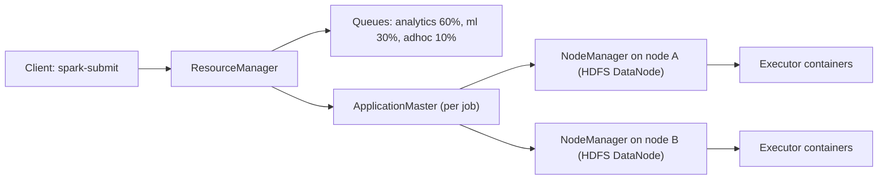
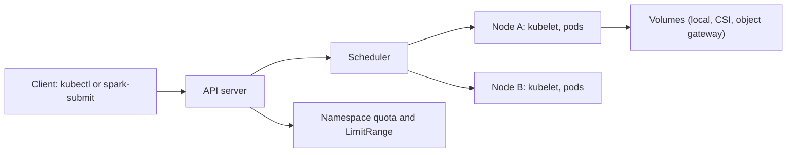

## 🎯 TL;DR

> **YARN** and **Kubernetes** both answer the same question: "which machine runs this container, with how much CPU and memory, and who is allowed to use it?" YARN was built for Hadoop: it knows about **data locality** (run the task where the HDFS blocks are) and **queues** with fixed shares per team. Kubernetes is a general container platform: it runs anything, unifies services and jobs, but does not know where your data lives unless you tell it.

- YARN: ResourceManager + NodeManagers, **queues** (Capacity or Fair scheduler), data-local scheduling with HDFS.
- Kubernetes: API server + scheduler + kubelets, **namespaces** with ResourceQuotas, pods on any node, storage through volumes.
- Neither is "better". YARN fits an existing Hadoop estate with HDFS. Kubernetes fits a platform that runs services, streaming and batch on one substrate and uses object storage.
- The real differences show in **locality, multi-tenancy, scheduling latency, operations and the ecosystem**.

## 🌱 Start simple (Junior)

> **💡 Analogy:** Two ways to run a shared office. YARN is a building manager who knows where every filing cabinet is, and assigns each team a floor so that people work next to their files. Kubernetes is a flexible coworking space: any desk, any team, the same rules for everyone, and files are kept in a shared storage room you reach through the network.

Both systems do the same basic job:

1. A **job** asks for resources: "I need 10 containers with 4 GB and 2 CPUs each."
2. The **scheduler** finds nodes with enough free capacity.
3. The **node agent** starts the containers and reports back.
4. When the job ends, resources return to the pool.

When you run Spark, you can choose which resource manager runs its executors:

```bash
# On YARN: executors are YARN containers in a named queue.
spark-submit --master yarn --queue analytics --num-executors 10 \
  --executor-memory 4g --executor-cores 2 job.py

# On Kubernetes: executors are pods in a namespace.
spark-submit --master k8s://https://k8s-api.internal:6443 \
  --deploy-mode cluster \
  --conf spark.kubernetes.namespace=analytics \
  --conf spark.executor.instances=10 \
  --conf spark.executor.memory=4g \
  --conf spark.executor.cores=2 \
  --conf spark.kubernetes.container.image=registry.internal/spark:3.5.1 \
  local:///opt/app/job.py
```

The Spark code is the same; the resource manager is a deployment choice. The flags differ, and so do the concepts behind them.

## 🔧 How it really works (Mid)

### YARN in one picture



- The **ResourceManager** owns the cluster's resource accounting and the scheduler.
- Each job gets an **ApplicationMaster** that negotiates containers for it.
- **NodeManagers** run containers on each node, usually on the same machines as HDFS DataNodes.
- **Queues** divide capacity. The Capacity Scheduler guarantees each queue a share and lets it borrow idle capacity; the Fair Scheduler balances running jobs over time. Both support preemption, with settings you must tune.

Data locality is the key feature. When a Spark task reads an HDFS block, YARN tries to run it on a node that holds a replica of that block, so the bytes do not cross the network. The scheduler tracks **node-local**, **rack-local** and **off-switch** placement, and waits briefly for a local slot before accepting a remote one (delay scheduling).

### Kubernetes in one picture



- The **scheduler** places each pod on a node that satisfies its requests, affinity rules and taints.
- **Namespaces** with **ResourceQuotas** cap what a team may request in total.
- **PriorityClasses** decide which pods are evicted first under pressure.
- Data does not follow compute automatically. You choose where data lives (object storage, a database, local volumes), and the pod reads it over the network.

### Side-by-side

| Aspect | YARN | Kubernetes |
|---|---|---|
| Original purpose | Hadoop batch jobs | General container orchestration |
| Data locality | Built in (HDFS block placement) | Not built in; use node affinity, local volumes, or accept network reads |
| Multi-tenancy | Queues with guaranteed shares | Namespaces with quotas; fair share needs add-on schedulers |
| Batch scheduling | Strong: queues, gang-like behaviour for Spark via configuration | Improved with Volcano or YuniKorn for gang scheduling |
| Long-running services | Possible (Slider, then YARN services) but not its focus | Native (Deployments, StatefulSets, Services) |
| Ecosystem | Hadoop, Hive, Spark, Flink on YARN | Operators for Spark, Flink, Kafka, ClickHouse and more |
| Operations | Hadoop admin skills, Ambari or Cloudera tooling | Kubernetes skills, GitOps, Helm, managed options in some clouds |
| Storage model | HDFS, co-located disks | Object storage, CSI volumes, databases; often separated from compute |

### The trade-off in one sentence

YARN moves **compute to data**. Kubernetes moves **data to compute**, through the network, and relies on fast object storage and caching to make that cheap.

## 🧠 Senior depth & trade-offs

- **Locality is less important than it was.** When the storage is a disaggregated object store (S3-compatible), network bandwidth inside a data centre is high enough that many scan-heavy jobs run well without locality. Measure: if the job reads 1 TB and the network gives 10 Gbit/s (about 1.25 GB/s), reading takes roughly 800 seconds of network time at full rate, which may dominate the job. Compare that with the job's compute time before deciding that locality is irrelevant.
- **Scheduling latency.** Kubernetes schedules pods one at a time with a broad set of rules. For a Spark job with 2,000 short tasks, pod start-up cost and image pulls can dominate. YARN containers on warm NodeManagers often start faster for short bursts. Solve this with image caching, pre-pulled images, and executor reuse, not by assuming one system is always faster.
- **Gang scheduling.** Without it, two Spark jobs can each get half their executors and wait forever. YARN with queue limits and preemption reduces the risk; Kubernetes needs Volcano or YuniKorn for the same guarantee. Ask how the platform prevents deadlock before accepting a design.
- **Isolation.** YARN isolates by containers with cgroups and queues. Kubernetes isolates by namespaces and quotas, but a noisy neighbour on the same node can still affect latency unless you use node pools, requests equal to limits, and priority classes.
- **Security model.** Kerberos on Hadoop integrates with Ranger; Kubernetes uses service accounts, RBAC, network policies and secrets. Migration means rebuilding the authorization model, not just the schedulers. See [[data-security]].
- **Migration path.** A common path is to run Spark on Kubernetes next to YARN, move new workloads first, and keep HDFS for the stable datasets. Move storage to object storage with an open table format such as Iceberg before moving compute, or the locality benefit disappears while the old assumptions remain in the code.
- **Operational maturity.** YARN has decades of operations knowledge in Hadoop shops. Kubernetes has broad tooling but requires skills in networking, storage and upgrades. Choose based on the team you have, not the diagram you want.
- **When to pick which.** Pick YARN for an established Hadoop platform with HDFS and mostly batch jobs and strict queue governance. Pick Kubernetes for a new platform with mixed workloads (streaming, services, batch, ML) and an object storage backbone. Do not pick Kubernetes only because it is fashionable; a team that cannot operate it will have outages.

> **⚠️ Watch out:** "Kubernetes replaces YARN" is only true for the workloads you migrate. Many organizations run both during a long transition, and the cost of running two schedulers is part of the decision.

## 🧪 Try it

1. Take a Spark job you know and write two `spark-submit` commands, one for YARN and one for Kubernetes, with the same executor count and memory. List one difference in what each command requires from the cluster (queue, namespace, image, service account).
2. Calculate the network time for reading 2 TB over a shared 10 Gbit/s link for one job, and for 20 jobs running at the same time. Explain when data locality would save you that time and when it would not.
3. Write a short queue plan for a YARN cluster with three teams: `analytics` gets 50%, `ml` 35%, `adhoc` 15%. Say what happens to `adhoc` when `ml` is idle, and what you would tune if `analytics` jobs wait too long.

<details><summary>Show solutions</summary>

**1.** The YARN command needs a queue name and a cluster that runs NodeManagers. The Kubernetes command needs an API server URL, a namespace, a container image that contains Spark and the job, and a service account with permission to create pods. The Spark code is identical; the platform requirements differ.

**2.** 2 TB = 2,000 GB; at 10 Gbit/s = 1.25 GB/s, one job needs about 1,600 seconds (about 27 minutes) of network time if it has the link to itself. Twenty jobs sharing the link each get about 1/20 of the bandwidth, so the same read takes about 32,000 seconds in total link time. Locality saves that network time by reading from local disks, which is most useful for scan-heavy jobs on HDFS. It does not help when the data is already in object storage on another network, or when the job is CPU-bound.

**3.** When `ml` is idle, the Capacity Scheduler lets `analytics` and `adhoc` borrow its unused capacity (up to configured maximums). If `analytics` waits too long, check queue maximum capacity, user limits, preemption settings and whether `adhoc` holds borrowed resources. Tuning preemption and minimum guarantees usually fixes this without buying hardware.

</details>

## 💬 Interview corner

**Question: "Would you run Spark on YARN or on Kubernetes?"**

- **Mid answer:** "On YARN if we have Hadoop and HDFS, because of queues and locality. On Kubernetes if we are building a new platform with object storage, because it runs everything on one platform."
- **Senior answer:** "It depends on the storage model and the workloads. With HDFS and mostly batch, YARN's locality and queues are a strong fit, and moving would be a large cost. For a new platform with streaming, services and ML, Kubernetes with object storage and an open table format is more flexible. I would test scheduling latency and image start-up for short tasks, and check how gang scheduling and quotas prevent a single team from starving the others."

> **🎤 Say this in the interview:** "YARN gives me locality and queues around HDFS. Kubernetes gives me one platform for everything, with namespaces and quotas, but the data has to be reached over the network, so I design the storage layer and the caching to make that cheap. I pick the one that matches the storage and the team, not the one with the most hype."

## ⚠️ Common mistakes

> **⚠️ Watch out:** Comparing the two only on features. The decision is about where the data lives, who operates the platform, and how the teams share capacity.

- Assuming Kubernetes gives data locality automatically. It does not.
- Forgetting that a Spark job on Kubernetes needs an image that contains the right Spark, Java and Python versions.
- Setting ResourceQuotas without considering gang scheduling, so jobs deadlock while holding partial capacity.
- Migrating compute to Kubernetes while keeping HDFS, then paying for both network reads and cluster management.
- Ignoring pod start-up time for short Spark tasks.
- Using YARN queues without tuning preemption, so guaranteed shares are never reclaimed.

## ✅ Check yourself (quiz)

1. What is the main advantage of YARN for an HDFS-based batch platform?
   - A) It has no scheduler
   - B) Data locality: tasks can run on nodes that hold the data blocks
   - C) It runs only streaming jobs
   - D) It removes the need for queues

<details><summary>Answer</summary>

**B** — YARN's scheduler is aware of HDFS block placement and tries to run tasks on local data. Queues handle fair sharing; locality handles data movement.

</details>

2. In Kubernetes, what gives a team a guaranteed total limit on CPU and memory within the cluster?
   - A) A Service
   - B) A ResourceQuota in the team's namespace
   - C) A ConfigMap
   - D) A PersistentVolume

<details><summary>Answer</summary>

**B** — ResourceQuotas cap what a namespace can request in total. Services route traffic, ConfigMaps hold configuration, and PersistentVolumes provide storage.

</details>

3. Why does gang scheduling matter for Spark?
   - A) Spark needs all executors to start at once, and partial allocation can deadlock jobs that each hold part of the capacity
   - B) Gang scheduling makes executors faster
   - C) It reduces the number of shuffle partitions
   - D) It is required to read Parquet files

<details><summary>Answer</summary>

**A** — a job with 50 executors that gets 25 cannot progress, and if two such jobs each take half, neither finishes. Gang scheduling allocates the whole group or none.

</details>

4. **(Senior)** A team proposes moving a 500 TB HDFS warehouse to Kubernetes compute without moving the data. What is the main risk?

   - A) Kubernetes cannot run Spark
   - B) Every scan now crosses the network, because the locality benefit is lost, and the network may become the bottleneck; the storage must be moved or cached first
   - C) HDFS files cannot be read by containers
   - D) Kubernetes requires the data to be in a single file

<details><summary>Answer</summary>

**B** — compute on Kubernetes reads HDFS over the network, so the job loses locality and may saturate the network. Plan the storage move (or a cache layer) together with the compute move.

</details>

5. **(Senior)** How would you decide between YARN and Kubernetes for a company with an existing Hadoop cluster and a new streaming and ML platform?

   - A) Always choose Kubernetes because it is newer
   - B) Keep YARN for the stable HDFS batch estate, and run new streaming and ML on Kubernetes with object storage, measuring scheduling latency, operations capacity and the cost of running two schedulers during the transition
   - C) Always choose YARN because Hadoop is open source
   - D) Choose whichever has the cheapest license

<details><summary>Answer</summary>

**B** — the decision follows the workloads, storage and the team's skills. A split approach during a transition is common, and its cost (two schedulers, two operations stacks) must be counted.

</details>

## 🗂️ Flashcards

| Front | Back |
|---|---|
| YARN's main strength | Data locality with HDFS and queue-based sharing among teams |
| Kubernetes' main strength | One platform for services, streaming and batch, using namespaces and a shared API |
| What a YARN queue does | Gives a team a guaranteed share of capacity and may let it borrow idle capacity |
| What a Kubernetes namespace does | Scopes resources and policies; ResourceQuota caps the total a team may request |
| Delay scheduling | YARN waits briefly for a node-local slot before accepting a remote one |
| Gang scheduling | Allocate all the pods or containers of a job together, or none, to avoid partial-allocation deadlock |
| Locality on Kubernetes | Not automatic; achieved with node affinity, local volumes or caching |
| Key trade-off | YARN moves compute to data; Kubernetes moves data to compute over the network |

## 🔗 Go further

- **[[spark-on-kubernetes]]** shows how Spark drivers and executors run as pods, with images, service accounts and dynamic allocation.
- **[[kubernetes-for-data]]** covers StatefulSets, storage and scheduling for data systems on Kubernetes, including batch schedulers like Volcano and YuniKorn.
- **[[hadoop-ecosystem]]** explains HDFS, YARN and the rest of the Hadoop stack that YARN serves.
- **[[spark-architecture]]** and **[[spark-shuffle]]** explain the executor model and why network movement matters in shuffles.
- **[[docker]]** covers the container images that Kubernetes runs.
- Read the Apache Hadoop YARN documentation for the exact scheduler settings of your version, and the Kubernetes and Spark documentation for resource settings; defaults differ between releases.

